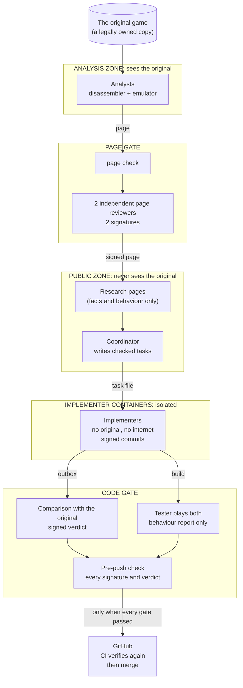
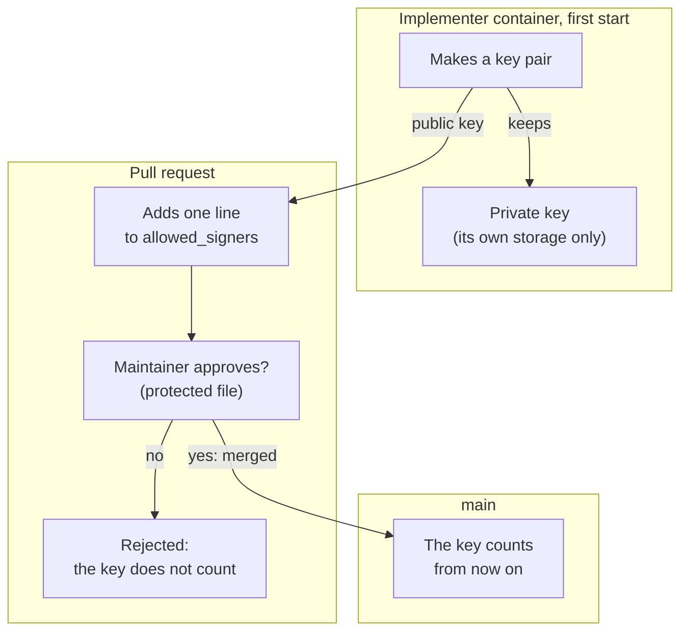
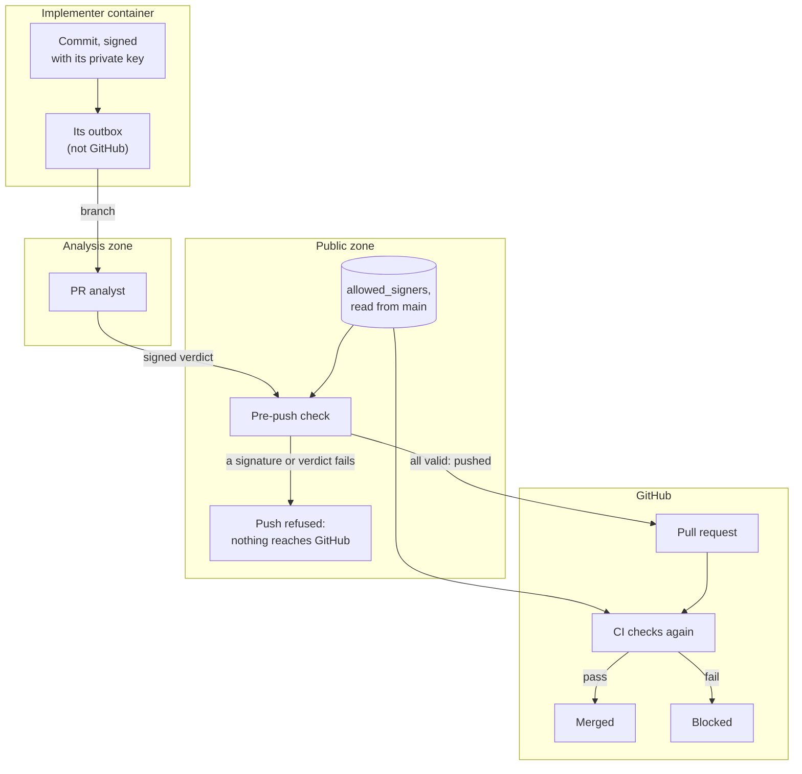

# The clean room

Coney reimplements *The Warriors* without using the original game's code. The people and agents who study the
original never write Coney's code, and the people and agents who write Coney's code never see the original. Between
them sit written research pages that describe what the game does, never how its code does it.

This page explains how that separation works and how it is enforced. Every rule below is carried out by a tool: a
folder permission, a hook, a script, a signature check or a CI job. A rule that only exists as an instruction does
not count.

## The idea

**Facts and behaviour cross; procedures do not.** A research page may say that a knocked-down character gets up
after 2.5 seconds unless hit again, give a file format, a table of values or the layout of a data structure. It may
not give code, pseudocode, the original's order of steps, its branch structure, its helper boundaries or its names.

**Any doubt, it's out.** A reviewer who is unsure rejects. Rejected research is not edited into shape: it is dropped,
and the topic is researched again from scratch by someone who has not seen the rejected text.

**Every result is checked.** Engine code is compared with the original before it is merged, whoever wrote it.



## 1. Roles and zones

Each role works in its own **zone**: a separate operating-system account with its own folders. The roles are listed
in the order work passes through them, from research to merge.

| Role | Runs in | Sees the original | Writes | Never |
| --- | --- | --- | --- | --- |
| Analyst | analysis zone | yes, to research it | research pages, through the page gate only | engine code, tests, tasks |
| Page reviewer (two per page) | its own account, analysis zone read-only | yes, read-only | a signed verdict on each page | edits to the pages, the public zone |
| Coordinator | public zone | no | issues, task files, pull requests | the analysis and tester zones, analysis tools |
| Implementer | its own container | no | code and tests on its own branch, signed | the original, the internet, other zones |
| Code reviewer | its own container | no | a signed review of the code against its page | as the implementer |
| Tester | tester zone | plays it, with no debugging tools | behaviour reports | code, disassembly, memory tools |
| PR analyst | analysis zone | yes, to compare | a signed verdict per function: independent, or rework | any detail to the implementer |

Each task goes through these roles in order:

1. The **implementer** writes the code and its tests from the approved pages.
2. The **code reviewer**, who has never seen the original either, checks the code against its page: every acceptance
   check is met and nothing is added that no page states, every reimplemented function names its address on the
   page, the structure and names follow Coney's own design, the tests use synthetic data, and the code is correct
   and readable. Fixes go back to the same implementer.
3. The **tester** plays the build beside the original. A difference goes back to the implementer as a behaviour-only
   report, for at most three rounds.
4. The **PR analyst** compares the final code with the original (section 7). It judges the exact code that will be
   pushed, so it comes last.
5. The pre-push check, then the pull request, CI and merge.

Only checked material moves between zones, through dedicated exchange folders: research pages that passed the page
gate, structured status and verdict files with no free text, and behaviour-only test reports. Agents in different
zones cannot send each other free-form messages.

## 2. Folder permissions are the wall

Each zone's folders are readable only by that zone's account; the operating system refuses everyone else. Hooks that
refuse a forbidden path are a second layer, not the wall itself, because a hook can only stop what it recognises.

- Every zone root is owned by the administrators, not by any zone account, so no zone can widen its own permissions,
  and a file's creator cannot make it readable to others.
- Inheritance from parent folders is cut, so each root carries only the permissions its configuration lists.
- A zone is started by a maintainer signing in to its account. Passwords are typed at every start and never saved.
- Maintainers open a zone's files through that zone's own account, never by granting their own account access.

## 3. Network walls

Folder permissions do not cover network ports: any program on the machine can connect to a port on the same machine.
The analysis tools that answer on local ports are therefore protected separately:

- A connection must present a secret token that only the analysis accounts can read.
- A per-account network filter blocks every other account from those ports.
- The analysis tools listen only on the machine's own internal address, never on a network address, so nothing on
  the network, a VPN included, can reach them. This is checked as well.
- If either protection is missing, the public side refuses to work.
- Every port is tested from every other account and from inside the containers.

## 4. Containers

Implementers and code reviewers run in containers that see only their task file, a clone of the public repository
and their own outbox. They have no network access except the AI service they run on, no access to the original or to
any zone, and no analysis tools installed. Work leaves a container only through its outbox, as signed commits.

## 5. Signing

Every agent that produces work signs it with its own key, so every change can be traced to the agent that made it,
and nothing can be altered after it was signed without the signature breaking.

- Implementers sign every commit; the page reviewers, the code reviewer and the PR analyst sign their verdicts.
- Only keys on the `allowed_signers` list count. Changes to that list need maintainer review, and every check reads
  it from `main`, never from the pull request being checked.
- Each key is limited to one purpose: a commit key cannot sign a verdict, and a verdict key cannot sign a commit.
  The purpose is built into every signature and every check names the purpose it expects, so an implementer's
  key can never approve its own code, and a reviewer's key can never sign code.
- Signatures are verified before a push and again in CI.

### How a key pair works

Each key is a pair made in one step: a **private key** and a **public key**. The private key is a large secret
random number; the public key is computed from it by a mathematical operation that is quick in one direction and
practically impossible to reverse. Anyone may hold the public key without learning the private one.

- **Signing** uses the private key. The signer takes a fingerprint (hash) of the exact content, a commit or a verdict
  file, and combines it with the private key into a signature attached to that content.
- **Checking** uses the public key. A calculation over the content, the signature and the public key comes out true
  only if the signature was made from this exact content with the matching private key. The private key is never
  needed to check.
- Change one byte of the content and its fingerprint changes, so the check fails. Sign with any other key and the
  check fails too. A valid signature therefore proves both who signed and that nothing changed since.

**A toy example.** Two keys can be different and still belong together because they are made as a pair that undoes
each other. This example uses tiny numbers and a clock with 15 hours. It works like an ordinary 12-hour clock, where
3 hours after 11 is 2, not 14: whenever a number reaches 15 or more, take away as many 15s as fit and keep what is
left over (for 64: four 15s make 60, leaving 4). That wrap-around is what makes the arithmetic hard to run
backwards. (A 12-hour clock would not work: the clock's size must be two different prime numbers multiplied
together, and 15 is 3 × 5.)

In this example the private key is **7**, the public key is **3**, and the content's fingerprint is **2**.

*Signing* multiplies seven 2s together (2 × 2 × 2 × 2 × 2 × 2 × 2, not 2 × 7), wrapping around the clock after each
step:

| Twos so far | Calculation | On the 15-hour clock |
| --- | --- | --- |
| 1 | 2 | 2 |
| 2 | 2 × 2 = 4 | 4 |
| 3 | 4 × 2 = 8 | 8 |
| 4 | 8 × 2 = 16 | 16 − 15 = 1 |
| 5 | 1 × 2 = 2 | 2 |
| 6 | 2 × 2 = 4 | 4 |
| 7 | 4 × 2 = 8 | **8: the signature** |

*Checking* multiplies three of the signature together, because the public key is 3:

| Eights so far | Calculation | On the 15-hour clock |
| --- | --- | --- |
| 1 | 8 | 8 |
| 2 | 8 × 8 = 64 | 64 − 60 = 4 (four 15s) |
| 3 | 4 × 8 = 32 | 32 − 30 = 2 (two 15s): **the fingerprint, so the signature is valid** |

The checker only ever used 3 and 15, never 7. Any other signature, or any changed content, would not come back to
the fingerprint. With numbers this small, 7 could be worked out from 3 and 15; real keys are so large that doing so
would take every computer on Earth longer than the age of the universe. That is why the public key can be
published and the private key must never leave its owner.

Coney uses SSH keys (Ed25519) and the signing built into SSH and Git, so no extra software is needed. Real keys use
a different kind of mathematics from this toy, but the same idea.

### Where the keys live

Containers are a fixed pool, each kept for the long run; what is fresh for every task is the work inside one: a new
branch, a new working copy and a new session. A container makes its key pair once, on its first start. The private
key stays on a storage volume that only that container uses and never leaves it. The public key goes into
`allowed_signers`, one line per key with the one purpose it may sign for: an implementer's container holds a
commit key, a code reviewer's container a verdict key, and the page reviewers and the PR analyst each a verdict
key in their own account.



When a container is rebuilt (a toolchain update) or reset (after a suspected exposure), it makes a new pair, and one
pull request replaces its old line. The old key stops counting at once.

### How a signature is checked



Because the list is always read from `main`, a pull request can never add its own key and sign with it in the same
change.

## 6. The page gate

A research page reaches the public side only through these steps, in order:

1. The analyst drafts it in the analysis zone.
2. An automated page check rejects code, instructions, step lists tied to an address, decompiler names and other
   procedure shapes (`coney-tools cleanroom page-check --rules` lists every rule).
3. A first page reviewer records a verdict for every section and image, each tied to a hash of its exact text.
4. A second, independent page reviewer reviews those verdicts. Any doubt from either one rejects.
5. Each page reviewer signs the verdict file with their own key. Neither signature can be made by the page's author
   or by the other reviewer.
6. The page leaves the analysis zone only through the publish tool, which verifies both signatures first.
7. The public side checks the page again, recomputes every hash and verifies both signatures before committing it.
8. CI verifies it all once more before merge.

Editing an approved page breaks its hashes, so an approved page cannot be changed without going through the gate
again.

A page that names addresses in the original lists them in one `## Entry points` table, the only place the code gate
takes addresses from. Each row gives an address, its job in Coney's own words and the section of the page that states
the job's outcomes:

```markdown
## Entry points

| Address | Job | Outcomes |
| --- | --- | --- |
| `0x00aa11bb` | open the store | Opening |
```

The page check holds the table to that form: exactly these columns, each address `0x` and 8 lower-case hex digits
listed once, and the outcomes naming another section of the page. The job is page text like any other, so every page
rule applies to it and it can never be a name from the original or from a decompiler.

## 7. The code gate

Engine code reaches `main` only after:

1. Every commit carries a valid signature from an allowed implementer key.
2. Every function that reimplements part of the game names the address it corresponds to, and that address must
   appear on an approved page.
3. A scripted comparison and then the PR analyst compare each function with the original: its control flow, the order
   of its checks, its helper boundaries, and any constant that is not on its page. Only a verdict of
   **independent** passes; anything else means rework. The verdict is signed.
4. The implementer only ever hears "rework from the page"; no detail of the original reaches them. A fresh session
   rewrites the function after the page is fixed.
5. A pre-push check refuses any branch that lacks its signatures and passing verdicts, so nothing unchecked reaches
   GitHub. CI then checks again before merge.

The first two points are checked on the public side by two commands, which read their settings (the engine's folder,
its source files, its game-behaviour folders) and `allowed_signers` from `main`, never from the branch being checked:

- `coney-tools cleanroom commit-sigs main..HEAD` passes only when every commit that touches the engine is signed in
  git's namespace by a key `allowed_signers` lists for commits under an implementer's name.
- `coney-tools cleanroom orig-check` reads the tag above each reimplemented function, an address, its job and a
  link to its page:

  ```cpp
  // @orig 0x00aa11bb open the store
  // @page research/pages/store/page.md
  ```

  The address must be in that page's Entry points table with that job, and the page must be merged with its verdict
  and both signatures intact. The tag therefore holds only gated text, in Coney's own words. Every function in a
  game-behaviour folder must carry a tag, so a reimplemented function cannot skip the PR analyst's comparison by
  leaving its address out.

The third point is checked on the public side too. The PR analyst's verdict is a file in
`research/code-verdicts/`, with no free text: the commit judged, every source file judged with its exact git
content, one entry per tagged function (its file, its address and `independent`, `parallel` or `transcribed`), and
the scripted pre-filter's outcome (`pass` or `flag`). It is signed in the verdict namespace by a key
`allowed_signers` lists under a PR analyst's name, and `coney-tools cleanroom code-verdict-sign` signs only a verdict
that passes.

The scripted pre-filter is `coney-tools cleanroom prefilter`, which the PR analyst runs on the analysis side before
judging. It reads every tagged function the change adds or modifies, and a facts file the analyst writes from their
own tools about each original function: its callees in call order and its number of conditional branches. That file
stays in the analysis zone. A function is flagged when its body holds a number its page does not give, when its
calls to other tagged functions follow the original's callees in the same order, or when its branch points number
the original's branches. The thresholds and the numbers too common to ask a page for are settings. The output names
rules, files and the judged addresses only. `code-verdict-sign` signs a verdict only beside the pre-filter's result
for the same commit, with the same outcome and exactly the same functions. A comparison of the code's text with the
original's for overlap is a separate step of the analyst's review, not part of this command.

- `coney-tools cleanroom code-verdict main..HEAD` passes only when every engine source file the change adds or
  modifies is listed, with its exact content, by a verdict the change adds, every `@orig` address in it is judged
  `independent`, the pre-filter passed, and the verdict carries a valid PR analyst signature. Any change to the code
  after the verdict needs a new one.

## 8. Channels that carry text

Anything that carries text between roles is checked:

- Issues and task files may contain only behaviour, acceptance checks and links to approved pages. An automatic check
  hides any issue or comment that fails, and implementers never read GitHub directly.
- Requests from the public side to the research side are plain-language questions; status coming back has no free
  text at all.
- Tester reports pass a check before they reach anyone, and describe behaviour only.
- Text and images pasted into a public-side session are scanned for code shapes.

## 9. Screens and captures

No tool that can capture the whole desktop is available to any session, since a screenshot could show another
zone's window. Game captures record a single window only: the tester's emulator window, Coney's own window, or
renders made inside the containers.

## 10. The breach watch

The zone walls are checked continuously, not assumed:

- `coney-tools zones check` compares every zone folder's owner and permissions with the configuration, confirms
  from the public account that the other zones cannot be opened, and confirms that no analysis port answers.
- Its full run, as a scheduled task, also looks for exact copies of older Coney files in the analysis zone. Older
  research enters that zone only through the research sweep's quarantine folder, so that any section the sweep turns
  down can be researched again by analysts who have not seen it; a copy anywhere else is reported by folder as a
  legacy copy and shown in every zone's status.
- It runs when a public-side session starts, before its tool calls (from a result a few minutes old at most), and
  every few minutes as a scheduled task.
- If any check fails, or cannot run at all, every public-side tool call is refused until a maintainer repairs the
  wall. Any session that ran during a breach is treated as exposed, and the work it produced is reviewed again.

The workspace was also scanned and verified clean before work began, and the scan is repeated before every major
milestone.

## 11. If something slips

Prevention comes first, because a public repository does not forget: even after a revert, old commits stay
reachable, pull requests keep their diffs, and copies may already exist. That is why every gate runs before a push.

If original material, or something shaped by it, is ever found where it must not be:

1. Work in the affected area stops, and a private record is opened.
2. Records, not memory, show what depended on it: each task file lists the page sections it was given, and each
   merge records its verdicts and signers.
3. Affected code is checked again against the original. Anything not independent is removed from history, not just
   reverted, and is rewritten later by a fresh session that never saw it.
4. An exposed container or session is reset, its key is removed, and everything it signed or wrote since the exposure
   is checked again.
5. The wall that let it through is fixed and tested before work resumes.

## Contributors

Contributors take one role. Implementers need only Docker: they work in the same container and sign with a key
created inside it. A contributor's key is added to `allowed_signers` with the declaration "I have never read The
Warriors' code, disassembly or decompiler output, nor any Coney code or research that is not in this
repository", reviewed by a maintainer. A person who has read the original's code never implements. See
[CONTRIBUTING.md](../CONTRIBUTING.md).

## Status

The clean-room tooling is being built before any engine code is written. In place: the page check, the workspace
scan, the zone accounts and their folder permissions, the breach watch, the network walls, signing, the page gate,
and the code gate's signature and `@orig` checks. Being built now: the containers, the rest of the code gate (the PR
analyst's comparison and the pre-push check), and the inboxes that let each role run on its own
([how the roles run](workflow.md)).
