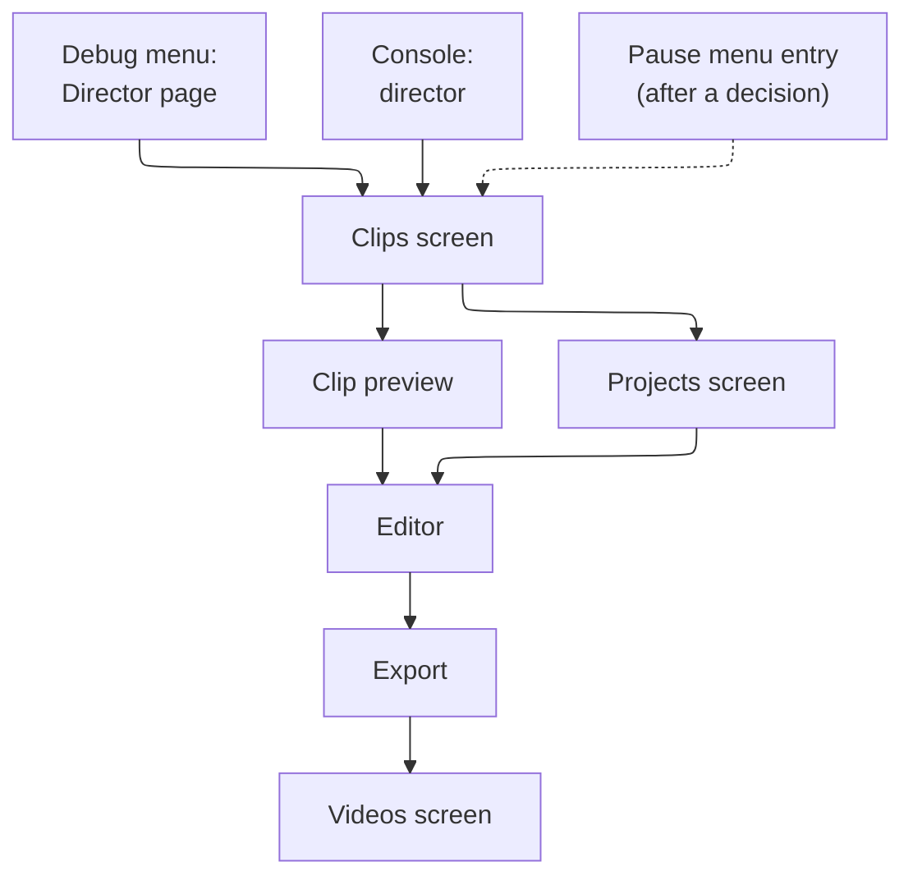

# Coney Director: the editor and export

**A design.** How Coney Director looks and is driven, how it opens, how its screens are drawn now that Coney has no
Scaleform, the clip library and projects, the timeline with its markers, cameras, blends and speed, scrubbing, cuts and
transitions, the controls for mouse, keyboard and pad, how a project is exported to MP4 by rendering every frame
offline, which encoders could write the file and what each costs in licences and patents, and how each part is tested.
Nothing on this page is built; it is a design in the sense of [Page kinds](../writing-docs.md#page-kinds), and what
gets built moves into a guide. The issue is [#1187](issue:1187), under Director's parent issue [#1184](issue:1184).

It builds on two pages and does not repeat them: [the Rockstar Editor survey](rockstar-editor.md) (the words Director
uses, the [feature list of its first version](rockstar-editor.md#first-version) with its *must*, *should* and *later*,
and [what Coney can do better](rockstar-editor.md#better)) and [Recording](recording.md) (the clips of 60 seconds in
5-second blocks, seeking, the `.crec` file, the folder, and Director's player, which draws a recording from the step
snapshot of [#1229](issue:1229)). The page ends with [the build issues in order](#build-issues) and [the questions for
the user](#questions), the encoder's licence among them.

The mock-ups are Coney's own drawings: no screenshot of the Rockstar Editor or of *The Warriors* and no game asset is
in them. Their street at night is a few shapes.

## Contents {#contents}

- [The design in short](#short)
- [Where Director opens](#entry), and [beside Coney Studio](#studio)
- [How Director's UI is drawn](#ui): the game's own GUI, Dear ImGui or RmlUi, and the choice
- [The Clips screen](#clips) and [projects](#projects)
- [The editor](#editor): [the timeline](#timeline), [markers](#markers), [cameras](#cameras), [blends](#blends),
  [speed](#speed), [scrubbing and preview](#scrubbing), [cuts and transitions](#transitions), [undo and
  saving](#undo)
- [Controls](#controls): the pad, mouse and keyboard
- [Export](#export): the choices, rendering offline, sound, progress and cancelling, the file
- [Encoders](#encoders): the options, their licences and patents
- [Tests](#tests)
- [Build issues, in order](#build-issues), [Questions for the user](#questions)

## The design in short {#short}

| Point | Proposal | Section |
| --- | --- | --- |
| The look | The Rockstar Editor's: full-screen, dark translucent panels over the replay, large type, one accent colour; the game's world fills the screen and the panels give way to it | [The look](#look) |
| Way in, first | The debug menu's *Director* page and the console's `director` command open the Clips screen; a pause-menu entry follows, as the user asked, once a maintainer decides how it may change that screen | [Where Director opens](#entry) |
| The game while Director is open | Play is suspended under Director, as under the pause menu; Director draws its recordings in a world of its own and returns to the game where it was | [Where Director opens](#entry) |
| How the UI is drawn | **Dear ImGui** for every screen inside Director, with Director's own theme and its own widgets for the timeline, the marker strip and the thumbnails; the game's own widgets only where Director's way in sits on a game screen. RmlUi is the fallback if the first build issue's proof falls short | [How Director's UI is drawn](#ui) |
| Clips and projects | The Clips screen lists recordings as thumbnails, grouped by recording; a project is a text file in `<install>/director/projects/` that names clips, never copies them | [Clips](#clips), [Projects](#projects) |
| The timeline | One timeline in **video time**: the clips row, the markers row and the speed row; a run of clips of one recording plays as one stretch with no seam | [The timeline](#timeline) |
| Cameras | Five kinds per marker: the game's camera, free, look at a target, ride with a target, orbit a target; flown with the pad's sticks or with the mouse and W A S D | [Cameras](#cameras) |
| Blends | Cut, or smooth: a centripetal Catmull-Rom curve through every marker, with an ease per marker; no undershoot | [Blends](#blends) |
| Speed | Per marker from 0.05× to 4×, eased between markers when *Ramp* is on, so a ramp has no steps | [Speed](#speed) |
| Export | MP4, rendered offline frame by frame from the replay at 720p to 2160p and 30 or 60 frames a second, with the game's sound; progress, estimate and cancel | [Export](#export) |
| The encoder | **A maintainer decision**: the options are the operating system's encoders, FFmpeg, OpenH264 and AV1 with SVT-AV1; the page lists their licences and costs and proposes, and Coney's own MP4 writer serves any of them | [Encoders](#encoders) |
| Tests | Director's model tested alone; the UI by scripted pad, keys and mouse in the test mode; pictures by hashes of rendered frames; the export by frame hashes before encoding and a check of the MP4's boxes | [Tests](#tests) |

## Where Director opens {#entry}



*Figure: the ways in, first the debug menu and the console; the dotted one waits on a maintainer.*

- **The debug menu first.** A *Director* page in the [debug menus](../debug-menu.md#pages) (every build with the debug
  tools): *Open Director* (the Clips screen), the five newest clips (each opens in the preview), *New project*, and the
  recorder's start and stop ([Recording](recording.md#build-issues), issue 7). It is a page of the one model, so the pad
  menu and the developer overlay both show it ([One model](../debug-menu.md#one-model)).
- **The console.** `director` opens the Clips screen; `director clip <recording> <n>` opens one clip in the preview;
  `director project <name>` opens a project in the editor. They join the
  [developer set](../studio/console.md#developer-set) first, because the console's
  [release set](../studio/console.md#release-set) is a maintainer's, and move to it when Director ships to players
  ([a question](#questions)). The console is itself a design ([#1064](issue:1064)), so the
  debug menu's page is the first way in to be built.
- **The command line**, for tests and scripts: `--director` starts in the Clips screen, `--director-project FILE` in
  the editor, and `--director-export FILE --out VIDEO` exports a project and exits ([Export](#export)); debug tools'
  options, as `--record` is ([Recording a clip](../running-options.md#record)).
- **The pause menu**, the user's player-facing entry, follows. The pause grid is fixed and full, and a maintainer
  decided that MOD OPTIONS is the one place Coney adds to the game's screens
  ([UI and menus: Maintainer decisions](../studio/ui.md#decisions)), so an entry there is a [question](#questions):
  a DIRECTOR item after the grid, in the game's own widgets and cues, only while an option is on; or a chord on the
  pause screen (R3) with no item, shown on the usage line. The main menu's EXTRAS stays alone by the same decisions.
- **Opening from play suspends play.** Director is a game mode of Coney's (an id from 0x100) pushed over the paused
  gameplay mode, as the pause menu is ([UI and menus: modes](../studio/ui.md#original-structure)); no step of the game
  runs while it is open, and a recording in progress ends at the step it opened on ([Clips of 60
  seconds](recording.md#clips)). Director loads the level of the clip it shows into **a world of its own** (Director's
  player is a client world fed from a file, [What it shares with networking](recording.md#networking)), so closing
  Director returns to the paused game as it was. If two levels do not fit in memory together on the machines Coney
  supports, the fallback ends play on opening and reloads the last checkpoint on closing; the build issue of the
  editor's preview measures it ([build issue 5](#build-issues)).

### Beside Coney Studio {#studio}

Director is part of the game, not of [Coney Studio](../studio/index.md): it ships in `coney`, works without Studio
and edits recordings, never levels or scripts. The two meet in three places:

- **Code.** Director's model is `src/director/` in the game's libraries and its screens a front end of their own
  ([The UI](#ui)), so Studio can link both: a *Recordings* panel in Studio, later, opens Director's screens for what was
  recorded during Play, in the same window.
- **Recording in Studio's Play.** Play runs the game's own play session, so the recorder records there as in the game;
  a scene a modder stages with Studio and its scripts is recorded in game and edited in Director
  ([What Director is](index.md#principles)).
- **Words.** Studio's *project* is a folder of a mod; Director's *project* is one file of edits. The survey asks whether
  one word may serve both ([its question 1](rockstar-editor.md#questions)); this page uses *project* until it is
  answered.

## How Director's UI is drawn {#ui}

The Rockstar Editor's screens are Scaleform (Flash movies drawn by the game). Coney has no Scaleform and adds none: its
licence was commercial and it is no longer sold. Three ways were weighed:

### The three ways {#ui-options}

| | (a) Coney's port of the game's GUI, with new widgets | (b) Dear ImGui, themed | (c) RmlUi, HTML and CSS |
| --- | --- | --- | --- |
| What it is | The original's widget classes in `src/gui/` (`OptionGrid`, `ScrollingMenu`, `TextWidget` with markup, `Bar`, `CircledText`, the message box), the [screen flow](../studio/ui.md#coney) and fonts, drawn through the 2D layer (`RenderDevice`), plus Director's own widgets written to match | The immediate-mode toolkit Coney pins (docking release), with a Director theme and Director's widgets drawn on its draw lists | A retained element tree laid out from RML (HTML-like) and RCSS (CSS-like) documents, with data bindings, animations and transitions |
| In a player's download | Yes: it is the game's front end | Decided for the console in its own target `coney_console_ui` ([Maintainer decisions](../studio/console.md#decisions)) and for the launcher's screens ([The launcher](../launcher.md#decided)); Director would be its second user in the game, which a maintainer decides ([questions](#questions)) | A new dependency in the release, with FreeType |
| Licence | Coney's own code | MIT | MIT; FreeType under its FTL or GPL-2.0-or-later |
| Size | Nothing added | A few hundred KB, already built | A library and FreeType, larger than Dear ImGui and, by its README, a fraction of a browser's |
| The widgets an editor needs | None of a form's: no text field, slider, toggle, table, scroll view, tooltip or pop-up, and no layout beyond the game's fixed places; every one written | All of a form's; the timeline, marker strip, speed curve and thumbnails drawn by Director (rectangles, lines and textures on its draw list) | A form's, flexbox layout, scrolling and text input; the timeline and thumbnails as custom elements in C++ |
| Mouse | None: the game has no pointer, and the menus are pad and keyboard by a maintainer's decision ([UI and menus](../studio/ui.md#focus)); a pointer layer to add | Yes | Yes |
| Pad | The game's six menu commands, cues and timings: the most console-like | Built-in navigation (`ImGuiConfigFlags_NavEnableGamepad`) moves focus between items, as the console's bar does ([Input and the gamepad](../studio/console.md#input)) | Spatial navigation between elements, "suitable for controllers" by its README |
| Text | The disc's sprite-sheet fonts (`part_page0`, `big_font`), byte-indexed and drawn for 640 × 448, so 3 to 5 times enlarged and soft at 1440p and 4K | Inter at any size, sharp, at the [UI scale](../debug-menu.md#ui-scale) the overlay computes; Studio already ships it (OFL-1.1) | Any font at any size through FreeType |
| The Rockstar Editor's look | The game's own look instead (circled red text), which is not the brief's | Flat by default; close to the mock-ups with a theme, big type and Director's own drawing; animation by hand | The closest: styled, animated screens are what it is for |
| The GPU renderer | Free: the 2D lists move with [#1203](issue:1203) | Dear ImGui's own `sdlgpu3` backend, the move Studio, the launcher and the console make | An SDL GPU backend among its samples, copied and adapted |
| Tests | Input scripts and the 2D draw-stream hashes, as the front end's | The Dear ImGui Test Engine, Studio's harness (in test builds only, [The harness](../studio/technology.md#test-engine)), and input scripts for the pad | No harness: Coney writes one (input into the context, elements found by id) |
| Shared with | The front end, the HUD | The debug overlay, the console's bar, the launcher, Studio: one theme file, one set of widgets | Nothing else in Coney: a second toolkit, theme and harness |
| Size of the work | **L**: a toolkit (layout, scrolling, pointer, text entry, every editor widget) under a faithful port that must stay faithful | **M**: the theme, Director's custom widgets and its pad layer | **M** to **L**: the dependency's build, the bridge, the custom elements, a test harness |

### The choice {#ui-choice}

**Dear ImGui, for every screen inside Director**, themed as the mock-ups show, with Director's own widgets for the
timeline, the marker strip, the speed curve and the thumbnails, and Director's own pad layer for what a menu cannot do
(triggers that scrub by how far they are pressed, sticks that fly the camera). Where a way into Director sits on one
of the game's own screens (a pause-menu item, the recorder's REC mark and time on the HUD), it is the game's own
widgets, drawn as the game draws that screen. Why:

- **It is the toolkit Coney already ships to players' screens.** The console's bar and the launcher are Dear ImGui by
  maintainer decisions, and their reasoning (a text line, scrolling lists, tables, mouse, keyboard and pad, which the
  game's widgets lack) is Director's too ([Why Dear ImGui in release](../studio/console.md#boundary)).
- **One stack with Studio.** Director's panels run inside Studio's window unchanged, and the Test Engine drives them
  as it drives Studio's.
- **The game's GUI is the wrong base.** Its widgets are faithful ports of a PS2 front end, with no pointer, no text
  field and fonts drawn for 640 × 448; turning them into an editor's toolkit means writing one under code that must
  stay as the original wrote it.
- **RmlUi would look most like Scaleform**, and its pad navigation is real, but it adds a second toolkit beside the
  one the console, the launcher and Studio share, with a harness of its own. It is the fallback: the first build issue
  is a proof of the themed screens with the pad, at 1080p and 4K, and if its pad feel or its look falls short of the
  mock-ups, RmlUi takes its place behind the same model.

The split by kind of screen (the game's widgets for the Clips list, Dear ImGui for the editor) was weighed and left
out: one tool with two looks reads as two tools, and the Clips screen needs a pointer and text entry (renaming) as much
as the editor does. Mouse support in Director does not change the game's menus, which stay pad and keyboard
([a question](#questions)).

**The code.** Director's model (projects, markers, cameras, the time map, undo) is `src/director/`, with no UI and no
platform code, in the game's libraries; its screens are `src/platform/director_*` in a target of their own,
`coney_director_ui`, which links Dear ImGui and nothing of the debug tools, as `coney_console_ui` does
([The code boundary](../studio/console.md#boundary)).

### The look {#look}

The Rockstar Editor's: the replay fills the window, and Director's panels sit over it in translucent near-black, with
white type, grey labels and one amber accent for focus, markers and the playhead; clips are blue, speed purple. Type is
Inter at 13 to 20 points at 1080p, scaled with the window by the [UI scale](../debug-menu.md#ui-scale). Focus moves
with a short fade and every control shows its pad glyph on the usage line at the bottom, as the game's own screens do
([UsageInfo](../studio/ui.md#coney)). Hidden panels (Select, or F in the preview) leave the picture alone.

## The Clips screen {#clips}


*Figure: the Clips screen, one of Director's three lists (Clips, Projects, Videos) under the tabs at the top.*

- **Grouped by recording**, newest first: a recording's date, level, clip count and length over its clips, each a
  thumbnail with its number and length. Marks on a thumbnail: a favourite (star), *in N projects*, *modded*, *older
  format* (opens after conversion, [Versions](recording.md#versions)), *newer format* (refused, and says why).
- **Thumbnails** are the frame the game drew at the clip's thumbnail step ([The file](recording.md#file): the index
  names it), read back before the 2D layers when the recorder reaches that step, scaled to 320 × 180 and written to
  `cache/` by the recorder's worker, so the list needs no level loaded. A missing one is rebuilt by Director's player,
  in the background, the next time the list opens.
- **Preview.** When the focus rests on a clip for half a second, its thumbnail plays the clip muted, from Director's
  player at thumbnail size; *Preview* opens it full screen with sound.
- **Actions:** add to a project (the open one, or a new one), favourite, rename the recording (the name goes in a file
  beside its clips, [Where it lives](recording.md#where)), delete. Delete asks first and names the projects that use a
  clip; a project whose clip is gone shows the gap.
- **Filters:** by level, favourites, modded; sorted by date, length or size. The storage line shows the folder against
  its cap ([Where it lives](recording.md#where)).

## Projects {#projects}

The Projects screen lists the projects with a thumbnail, name, length and when each was last saved; *New*, *Open*,
*Duplicate* (save as), *Rename*, *Delete*. A project is one text file, `<install>/director/projects/<name>.cdir`, in
the [statement format](../studio/project-formats.md#statement-format) Coney's other text files use, so it diffs, and a
test can read it:

```text
format director-project 1
project name="Rumble at the Yard" fps=60 size=1920x1080 hud=off
item recording=2026-10-29_21-04-17 from=clip1:0 to=clip2:900
marker at=clip1:0 camera=game blend=cut speed=1
marker at=clip1:180 camera=free pos=10.2,-4.0,1.7 yaw=35 pitch=-8 fov=50 blend=smooth ease=both speed=1
marker at=clip1:300 camera=look target=human:12 pos=12.4,-3.1,1.8 fov=42 blend=smooth ease=both speed=0.25 ramp=on
item recording=2026-10-28_18-30-02 from=clip1:0 to=clip1:1080
marker at=clip1:0 camera=game blend=cut speed=1
```

- **It names, never copies.** An item names a recording, a first and a last step (`clip1:180` is clip 1, step 180), so
  a project is a few kilobytes. A run of clips of one recording is one item ([Cuts](#transitions)).
- **Markers are anchored to steps of their clip**, with a fraction where a marker sits between two steps in slow
  motion, so trimming an item never moves a marker within its clip; a marker trimmed away is kept, hidden, until the
  trim gives it back.
- **Targets are the recording's ids** (`human:12` is the human with net id 12 in that recording,
  [What it shares with networking](recording.md#networking)), never a name.
- **Versions** follow the recording's rule: a newer `format` is refused, an older one converted on open
  ([Versions and mods](recording.md#versions)).

## The editor {#editor}


*Figure: the editor on a project of three clips, the playhead on marker 3, a look-at camera at a quarter speed.*

The editor is three parts: **the preview** (Director's player, drawing the recording from the evaluated camera at the
export's shape, with the safe frame marked), **the marker panel** (the marker at or before the playhead) and **the
timeline** under the transport. The top bar holds the project's name (a dot while it has unsaved changes), undo and
redo, and *Export*.

### The timeline {#timeline}

- **Video time.** The timeline's ruler and the clock show the video's time, what the export will last: a stretch in
  slow motion is wider, a fast one narrower. The transport also shows the clip and step under the playhead
  (`clip 1 at 0:10.00, step 300 of 1,800`). Video time is what an editor cuts to; clip time is where a marker is
  anchored, and the [speed map](#speed) converts between them exactly.
- **Rows.** *Clips* (each item a blue block with its filmstrip of thumbnails, a dotted line where it crosses from one
  clip of its recording to the next), *Markers* (amber: a diamond blends in smoothly, a bar cuts; the line between them
  is the blend), *Speed* (the speed curve, on a log scale). Text, music and effects rows are the survey's *should* and
  *later* ([Director's first version](rockstar-editor.md#first-version)).
- **Editing items:** drag an edge to trim, drag a block to reorder, split at the playhead, delete; *Add clips* from the
  Clips screen appends. Snapping to markers, item edges and the playhead is on by default.
- **Zoom** from the whole project to a few frames; the view follows the playhead while playing.

### Markers {#markers}

A marker is Director's keyframe ([The words Director uses](rockstar-editor.md#terms)): from it on it holds the camera,
the blend into it, the speed and, later, the looks.

- **Every item starts and ends with one**, as the Rockstar Editor's clips do; the first is the game's camera at 1×.
- **Adding** a marker at the playhead copies **what is seen there**, not the last marker's settings: the evaluated
  camera (with its blend in progress), the speed and the kind. So adding a marker never changes the shot, and a blend
  can be split anywhere.
- **Moving** a marker drags it along its clip (snapping to frames); it cannot pass its neighbours. **Copy** and
  **paste** carry the settings, never the time. **Jump** goes to the previous or next marker.
- **The panel** shows the marker's camera kind and its values, the blend in and its ease, the speed and the ramp
  (the mock-up's right side). Every value changes by mouse (drag, type), keyboard (Tab between fields, arrows) and pad
  (up and down between rows, left and right to change, L2 and R2 held for finer and coarser steps, as the debug menu's
  numbers, [Opening it and the controls](../debug-menu.md#controls)).

### Cameras {#cameras}

| Kind | The view at a moment | Set by |
| --- | --- | --- |
| **Game** | The recorded game camera of player 1 (or 2), cuts and letterbox as played ([What a recording holds](recording.md#holds)) | Choosing it |
| **Free** | A position, yaw, pitch, roll and field of view, fixed in the level | Flying it |
| **Look at** | A free position whose orientation keeps a target at a framing point of the picture (the centre by default) | Flying the position; picking the target |
| **Ride** | A position and orientation in the target's own frame, so the camera moves and turns with it | Flying it relative to the target |
| **Orbit** | A target, a distance, an angle round it and a height angle, and a turning speed in degrees a second | Sticks or mouse turn round the target |

- **Targets** are any human, car or object the recording holds. Pick in the preview (click, or ◎ *Pick* then a
  click), or cycle with the pad (□ moves to the next human on screen, nearest the centre first); the target is ringed.
  The target's position is its recorded root, its height the head for humans. A target that leaves the recording (a
  death, a removal) keeps the camera where it last was.
- **No range circle** and no locked places: the camera goes anywhere in the level, and the scenery streams round it,
  not round the recorded player ([The world round the camera](recording.md#seek-world)). Nothing stops the camera at
  walls: it is a film camera.
- **Field of view** 10° to 110° (horizontal at the export's shape); **roll** ±45°. Shake and depth of field are the
  survey's *should* list.

**Camera mode** flies the marker's camera full screen, the panels hidden, the playback paused at the marker (Start plays
it to see the blend into it). *Keep* writes the camera into the marker; *Cancel* leaves it as it was; both are one undo
step.


*Figure: camera mode on a look-at camera; □ would move the target to the dashed human.*

The free camera flies at a fixed step, never by a clock, as Studio's fly camera does
([`src/studio/level_camera.h`](repo:src/studio/level_camera.h)), so a scripted pad or mouse flies the same path every
run; Director reuses its movement rule, with the pad's sticks added.

### Blends between markers {#blends}

Each marker says how the camera reaches it from the marker before: **cut** (the new camera at the marker's moment) or
**smooth**. A smooth run (markers joined by smooth blends) moves the camera along one curve **through every marker**, so
there is none of the Rockstar Editor's undershoot ([Blends](rockstar-editor.md#blends)):

- **Each marker's view is evaluated at the playback moment**, then blended. For free cameras the points stand still; for
  look-at, ride and orbit cameras they move with their targets, and the curve is made each frame through where each
  marker's camera is *now*. So a blend from a free shot into a ride shot lands on the moving target exactly.
- **Position:** a centripetal Catmull-Rom spline through the run's positions (centripetal, so it neither loops nor
  overshoots between close markers), the segment's parameter from the time between the two markers.
- **Orientation:** a spherical spline through the run's orientations (quaternions), shortest way round; **field of
  view** and **roll** by monotone cubic interpolation, so they never pass beyond either end.
- **Ease** per marker: *none* (constant pace through the segment), *in*, *out* or *in and out*, reshaping the segment's
  parameter only, so the path is the same and only the pace along it changes.
- **Game camera to another kind**: the game camera's view at that moment is the run's point, so a blend leaves or
  reaches the play's own framing smoothly; its own cuts stay cuts.

The blend is Director's own maths, written for it; the game's blend camera (`CameraBlend`, a straight line) is the
original's behaviour for play and stays as it is.

### Speed {#speed}

- **Per marker**, from 0.05× to 4×, typed or slid on a log scale, with presets 0.05, 0.1, 0.25, 0.5, 1, 2 and 4.
- **Ramp** (on by default): the speed eases from the marker before to this one over the segment (a smooth step in log
  speed), so a slow-motion ramp has no steps; off, it changes at the marker in one step.
- **The speed map.** Video time *t* and clip time *c* are tied by *dc/dt = speed(t)*; Director integrates it per
  segment in closed form for a step and numerically, to a fixed table, for a ramp, and inverts it by search, so a
  marker's place on the timeline, a scrub and an export frame all come from one function of the project. Its test
  checks that every marker lands where the map says, within a microsecond.
- **Drawing between steps.** At a quarter speed and 60 frames a second, each step of 1/30 s is drawn over eight frames,
  blended as Director's player blends any two steps ([Seeking and scrubbing](recording.md#seeking)). Reverse play is
  *later*.
- **Sound follows the speed** (pitched with it, by the proposal; the survey's [question 5](rockstar-editor.md#questions)
  stays open, [here too](#questions)).

### Scrubbing and preview {#scrubbing}

- **The picture at once.** Dragging the playhead, or a trigger held, draws the frame at the playhead every frame, from
  the decoded blocks the player keeps ([Seeking and scrubbing](recording.md#seeking): at most 16 ms for a seek into a
  new block with 64 humans). While a seek is decoding, the last frame stays up, never a black one.
- **Stepping** moves one video frame at the export's rate (◁| and |▷), or one recording step with Shift.
- **Scrub sound** is off by default and a toggle on the transport plays short grains at the playhead.
- **Full-screen preview** (F, or Select) plays the project as the export will, with the panels hidden, at the window's
  size; the export renders at its own size ([Export](#export)).
- **The HUD** the recording holds is drawn or not, a project setting (off by default; [a question](#questions)).

### Cuts and transitions {#transitions}

- **Between items, a cut.** Two items are different times or places, so no camera blends across them.
- **No seam within a recording.** A recording's clips follow each other step by step ([Clips of 60
  seconds](recording.md#clips)), so one item spans them and its markers and blends run on across the boundary: a shot
  can last as long as the recording. This is Coney's answer to the Rockstar Editor's gaps.
- **Fades** to and from black at an item's start and end, with a length, are the survey's *should* list; a cross-fade
  between items (two worlds drawn at once) is *later*, and is cheapest in the export, where frames need not keep up.

### Undo and saving {#undo}

Every edit is a command with its inverse, so undo and redo cover markers, items, values and camera mode, as many steps
as the session made. The project saves itself 30 seconds after the last edit and on leaving the editor, to
`<name>.cdir.autosave` until *Save* writes the file; opening a project whose autosave is newer offers it. A test-mode
run saves only where its script says.

## Controls {#controls}

Every action has a pad control and a mouse or keyboard one; the usage line shows the pad's for the focused part. The
pad is named by the PS2's buttons, as Coney's [controls](../running-input.md#controls) are. Keys and buttons can be
rebound later, in Director's settings.

### The pad {#pad}

| Where | Control | Does |
| --- | --- | --- |
| Everywhere | d-pad, left stick | Move the focus between controls; on a value, left and right change it |
| Everywhere | ✕ / ○ | Choose / back (close a panel, leave camera mode, leave Director from its tabs) |
| Lists | L1 / R1 | The previous / next tab (Clips, Projects, Videos) |
| Clips | □ / △ | Add to a project / favourite |
| Editor | Start | Play and pause |
| Editor | L2 / R2, held | Scrub back / forward, faster the further pressed (to 8×) |
| Editor | d-pad left / right, on the timeline | One frame back / forward; held, it repeats and speeds up |
| Editor | L1 / R1 | The previous / next marker |
| Editor | ✕ on the timeline | Add a marker at the playhead, or open the one under it in the panel |
| Editor | □ | Delete the marker under the playhead (undo brings it back) |
| Editor | △ | Camera mode for the marker under the playhead |
| Editor | L3 / R3 | Undo / redo |
| Editor | Select | Hide or show the panels |
| Camera mode | left stick / right stick | Move / look; in orbit, turn round the target / change the distance |
| Camera mode | L2 / R2 | Down / up |
| Camera mode | L1 / R1 | Zoom out / in (field of view) |
| Camera mode | d-pad left / right, up / down | Roll / the flying speed |
| Camera mode | □ / △ | The next target / the next camera kind |
| Camera mode | ✕ / ○ | Keep / cancel |

The sticks use the pad's dead zone and a response curve, so a light push creeps and a full push moves at the chosen
speed; the triggers' scrub uses their travel. While Director is open, port 1 and port 2 both drive it and the game,
suspended, sees nothing.

### Mouse and keyboard {#keys}

| Control | Does |
| --- | --- |
| Click, double-click | Select; open (a clip in the preview, a project in the editor, a marker in the panel) |
| Arrows, Enter, Escape, Tab | Move the focus, choose, back, the next field |
| Space | Play and pause |
| Left / Right, Shift+Left / Shift+Right | One frame / one recording step back or forward |
| Home / End | The project's start / end |
| , / . (or Ctrl+Left / Ctrl+Right) | The previous / next marker |
| M | Add a marker at the playhead |
| Delete | Delete the selection |
| C | Camera mode for the marker under the playhead (in it: the next camera kind) |
| Ctrl+Z, Ctrl+Y (Ctrl+Shift+Z) | Undo, redo |
| Ctrl+C, Ctrl+V | Copy, paste a marker's settings |
| Ctrl+S, Ctrl+Shift+S | Save, save as |
| Ctrl+E | Export |
| F | Full-screen preview |
| Timeline: click, drag | Seek; scrub (the playhead), move (a marker), trim (an item's edge), reorder (an item) |
| Timeline: wheel, Ctrl+wheel | Scroll; zoom round the pointer |
| Preview, right button held | Fly the marker's camera: move the mouse to look, W A S D to move, Q and E down and up, Shift faster, Alt slower, the wheel for the flying speed (Studio's fly camera keys, [The keymap](../studio/level-view.md#keymap)) |
| Preview, wheel | Zoom (field of view) |
| Preview, Alt and the left button dragged | Orbit round the target |
| Camera mode: Tab, Enter, Escape | The next target, keep, cancel |

While Director is open the keyboard is Director's, not the game's (the game, suspended, sees no key), and Escape never
quits Coney from Director; it goes back.

## Export {#export}


*Figure: the export's settings and the same export at 62 %.*

### The choices {#export-choices}

The survey's [question 10](rockstar-editor.md#questions) made concrete, as a proposal:

| Choice | Offered | Default |
| --- | --- | --- |
| Container | MP4 only, as the brief sets | MP4 |
| Resolution | 720p, 1080p, 1440p, 2160p (4K) | 1080p |
| Shape | 16:9; 4:3, the game's own | 16:9 |
| Frame rate | 30 (one frame a step at 1×) and 60 | 60 |
| Quality | *Standard*, *High*, *Best*: *High* is YouTube's recommended upload bit rate for the size and rate (12 Mbit/s for 1080p at 60), *Standard* half of it, *Best* twice | High |
| Codec | Set by the [encoder decision](#encoders) | H.264 or AV1 |
| Sound | The game's sound, 48 kHz stereo, on or off | On |
| The game's HUD | Drawn or hidden | Hidden |

The screen shows the estimated size (bit rate times length) before starting.

### Rendering offline {#offline}

The export draws **every frame from the replay**, independent of the window and of how fast the machine is:

1. **Frame *n* is at video time *n / rate*** exactly; the [speed map](#speed) gives its clip and fractional step, the
   [camera](#cameras) its view.
2. **Director's player sets the world** to that step (decoding blocks in order, so an export never seeks backwards) and
   **renders it at the export's size into an offscreen target**, not the window, with the preset the project names
   (the [renderer's presets](../../engine/renderer.md#presets)). The 2D layers come in only when the HUD is on;
   Director's own panels never do.
3. **The frame is read back** without stalling (a few frames in flight: librw's copy today, an SDL GPU download after
   the renderer's move), converted to the encoder's YUV 4:2:0 (BT.709) on the GPU, and handed to the encoder's thread.
4. **A hash of every frame** is kept before encoding, as `--record` prints one
   ([Recording a clip](../running-options.md#record)): the same project, Coney and preset give the same frames on any
   machine; the encoded bytes are the same only with the same encoder.

It runs faster or slower than real time as the machine allows: the window stays responsive, drawing the progress
screen between batches of export frames. Rendering at twice the size and scaling down, and motion blur from several
sub-frames a frame, are cheap additions here because no frame has to keep up: both are *later*.

### Sound {#export-sound}

The mixer runs offline, as test mode already mixes step by step for `--record`: for each block of output samples it
plays the sounds the recording's event track starts at the clip's position
([What a recording holds](recording.md#holds)), at the speed and pitch the [speed map](#speed) gives, through the
game's own mixer and volumes. The game's music in the video is the survey's
[question 6](rockstar-editor.md#questions) (whose answer may be the legal side's). Sound is encoded in the same pass as
the frames and interleaved in the file.

### Progress, cancelling and errors {#progress}

- **Progress** shows the latest frame (one in ten), a bar, frames and video time done, the rendering rate against real
  time, megabytes written and an estimate of the time left (from the real clock, read in the platform layer only; a
  test-mode export shows no estimate).
- **Cancel** (○, Escape, the button) asks once, stops at the next frame and deletes the part-written file. Nothing of
  the project changes during an export: the editor waits under the progress screen.
- **Errors** (a full disk, an encoder that fails or refuses the size) stop the export, delete the part file and say
  what happened and what to change ("1440p at 60 is beyond this machine's hardware encoder; choose 1080p or the
  software encoder").
- **Done:** the file is in `<install>/director/videos/`, named after the project (`-2`, `-3` when taken), and the Videos
  screen lists it with its first frame, length and size; *Show in folder* opens the system's file manager. Playing a
  video inside Director needs an H.264 or AV1 decoder, part of the [encoder question](#questions); until then the
  system's player plays it.

### The file {#mp4}

**Coney writes the MP4 itself**, whatever encoder makes the streams: a small ISO base media file writer (one video
track, one sound track, the index at the front so it plays as it downloads) that takes the encoder's packets. One
writer means one set of tests and the same file layout from every encoder, and none of the encoders' own writers
(Media Foundation's sink writer, AVFoundation's) is needed. The file carries no metadata beyond the boxes every MP4
has: no title, path, user name or encoder string, the rule Coney's clips follow ([Clips](../testing.md#clips)).

## Encoders {#encoders}

H.264 and AAC are covered by patent pools; who pays depends on who ships the encoder. **Which of these Coney may ship
is a maintainer decision** (licences are, [AGENTS.md](repo:AGENTS.md)); the page lists them and gives the engineering
view, and the build issue that writes the encoder waits for the answer. Coney's code is GPL-3.0-or-later
([LEGAL.md](repo:LEGAL.md#licences)), so any GPL-compatible library may be linked.

| Option | Codec in the MP4 | What Coney ships | Code licence | Patents and cost | Platforms | Quality and speed |
| --- | --- | --- | --- | --- | --- | --- |
| **1. The operating system's encoders**: Media Foundation (Windows), VideoToolbox (macOS), VA-API (Linux) | H.264 and AAC (HEVC also on Windows and macOS) | Calls to system libraries; no codec | The system's | Paid by the system's maker under its own licence, as for any program that calls them (inferred: Via LA's terms list a PC operating system's codecs apart from other products); a Windows *N* edition lacks the media parts until the Media Feature Pack is installed | Windows and macOS, always; Linux only where the GPU's driver offers H.264 encoding: Intel's media driver does, while Fedora's and openSUSE's Mesa builds leave H.264 out for patent reasons | Hardware encoders where present (fast), Microsoft's and Apple's software encoders otherwise |
| **2. FFmpeg, an LGPL build** | H.264 only through wrappers of option 1 or 4 (FFmpeg has no H.264 encoder of its own under the LGPL); AAC through its native encoder | Coney's FFmpeg widened from Bink only (`cmake/ffmpeg/`) by the wrappers, the AAC encoder and the scaler | LGPL-2.1-or-later | As option 1 or 4 for the video; **Coney would ship an AAC encoder**, in the Via LA AAC pool's scope | All three, with the gaps of the options it wraps | As the options it wraps |
| **3. FFmpeg with x264, a GPL build** | H.264 (x264) and AAC | x264 and FFmpeg's encoder, muxer and scaler | GPL-2.0-or-later, compatible with Coney's GPL-3.0-or-later | **Coney would ship an H.264 encoder**: Via LA's AVC fees are none for the first 100,000 units a year, then $0.20 a unit; whether free downloads count as units is for a maintainer to establish | All three, the same everywhere | The best software H.264 encoder; CPU only |
| **4. OpenH264, Cisco's binary** | H.264 (Constrained Baseline only); sound from another option | Nothing bundled: Cisco's prebuilt library, downloaded when Coney is installed (the launcher, [The launcher](../launcher.md)) | BSD-2-Clause | **Paid by Cisco** for its own binary, which must be downloaded at install, not bundled; built from source, the fees are the builder's | Windows, macOS, Linux (x86-64 and ARM) | Lower than the others at a given bit rate (Baseline profile), so files are larger; CPU only |
| **5. AV1 with SVT-AV1, and Opus** | AV1 and Opus (both standard in MP4) | SVT-AV1 and libopus, linked | BSD-3-Clause-Clear with the Alliance for Open Media Patent License 1.0; libopus BSD-3-Clause | **Royalty-free** by the AOM members' grant; Sisvel runs a pool that claims AV1 patents and licenses hardware devices, and has not ruled out software | All three, the same everywhere | Smaller files than H.264 at the same quality; slower to encode on a CPU (presets trade speed for size); some older systems play AV1 only after installing a decoder |
| **6. The player's own FFmpeg** | Whatever that FFmpeg offers | Nothing: Coney pipes frames to an FFmpeg the player installs and names, as `--record` does today ([Recording a clip](../running-options.md#record)) | The player's | The player's | All three | The player's choice; an extra step to set up |

**Sound.** AAC (in the Via LA AAC pool) plays everywhere and comes with options 1 to 3; Opus (royalty-free, libopus
BSD-3-Clause) comes with option 5 and plays in browsers and most players, though not in every system player.

**The engineering view, for a maintainer to decide.** Option 1 as the default on Windows and macOS (every player plays
H.264 and AAC, the GPU encodes fast, and Coney ships no codec), option 5 offered everywhere as the royalty-free choice
and as Linux's built-in one, and option 6 for players who want their own encoder. The writer, the offline renderer
and the sound mix are the same for all of them, so the [build issues](#build-issues) before the encoder go ahead
whatever the answer. Options 2 and 3 make Coney a distributor of an AAC or H.264 encoder; option 4 depends on Cisco's
download and gives the weakest files. A Videos screen that plays exports needs a decoder, under the same question.

### Sources {#sources}

- Via LA, [AVC/H.264 licence fees](https://www.via-la.com/licensing-2/avc-h-264/avc-h-264-license-fees) (the unit
  royalties; the PC operating system entry).
- OpenH264, [FAQ](https://www.openh264.org/faq.html) (who pays, the download at install, the Baseline profile).
- Phoronix, [Fedora disabling Mesa's H.264 and H.265 VA-API
  support](https://www.phoronix.com/news/Fedora-Disable-Bad-VA-API).
- Microsoft, [the Media Feature Pack for N editions](https://support.microsoft.com/kb/3133719) and [the H.264 video
  encoder](https://learn.microsoft.com/windows/win32/medfound/h-264-video-encoder) (profiles; a certified hardware
  encoder is preferred).
- SVT-AV1, [its repository](https://github.com/AOMediaCodec/SVT-AV1) (the licence and the AOM patent licence).
- Streaming Media, [Sisvel's VP9 and AV1
  pools](https://www.streamingmedia.com/Articles/News/Online-Video-News/No-Content-Royalties-in-Sisvel-VP9-AV1-Patent-Pools-130849.aspx).
- RmlUi, [its repository](https://github.com/mikke89/RmlUi) (licence, FreeType, the SDL GPU backend, spatial
  navigation).
- YouTube, [recommended upload encoding settings](https://support.google.com/youtube/answer/1722171) (bit rates).

## Tests {#tests}

Nobody plays Director to check it ([Testing](../testing.md)); each build issue writes its tests first. Recordings for
tests are made by the tests themselves: a disc test records `level99` through [the player's
path](../testing.md#test-through-the-players-path), and a disc-free test records a [sandbox](../sandbox.md) scene of
Coney's own, so CI has recordings with no game data.

| Test | What it proves | Kind |
| --- | --- | --- |
| **The model alone** | A project with markers of every kind evaluates the same views from the same inputs: smooth runs pass through every marker's view exactly, eases keep the path, cuts land at the marker's step; the speed map puts every marker where it is anchored and inverts to within a microsecond; undo then redo of every command gives the same project bytes | unit |
| The project file | Write, read and write again give the same bytes; an older format converts, a newer one is refused | unit |
| **The pad walk** | An input script, from boot: the debug menu's Director page, a clip, add to a new project, a marker, camera mode flown with the sticks at partial pushes, *Keep*, a speed of 0.25 with a ramp, save. The saved project equals an expected file | disc (and sandbox) |
| **The mouse and keys walk** | The same project made with clicks, drags, keys and the right-button fly, through input scripts' new `key`, `mouse` and `wheel` actions; the file equals the pad walk's | disc (and sandbox) |
| The panels | The Test Engine finds every control by its path and drives it by mouse and by gamepad navigation; every control is reachable by the pad from the tab bar | unit (test builds) |
| **Pictures** | Frames of a fixture project at fixed video times, rendered offscreen at 1280 × 720, compared with stored hashes, and within the renderer's tolerance across renderers ([How pictures are compared](../../engine/renderer.md#comparing)); captures of each screen at 1080p and 4K for the pull request | sandbox, disc |
| Scrubbing | A seek to every 10th frame of a project and a play through it draw the same frames; a seek's counted work stays under its budget | disc |
| **The export** | A 5-second export of the fixture project at 720p and 30: the frame count, every frame's hash the same over two runs and equal to the preview's frames at those times; the MP4's boxes read back by a Python reader (two tracks, lengths, sample counts, no metadata) | sandbox, disc |
| Sound | The offline mix of the fixture's sound track at 1× equals the game's own mix of those steps; at 0.5× it is the same samples resampled | disc |
| Cancel and errors | A fake encoder fails, a fake disk fills: the part file is deleted, the message raised, the project unchanged | unit |
| Determinism | Two exports of one project give the same frame hashes; with the software encoder, the same bytes | disc |

Input scripts gain what Director's tests need: `key NAME` (shared with the UI design's [first build
issue](../studio/ui.md#build-issues)), `mouse X Y` (the pointer, in pixels of a fixed 1920 × 1080 logical window),
`click`, `press` and `release` of a mouse button, `wheel N`, and a pressure on `press l2 50` for the triggers' scrub.

## Build issues, in order {#build-issues}

Each is one pull request, a sub-issue of [#1184](issue:1184). "R" numbers are [the recording's build
issues](recording.md#build-issues). Issues 1 to 3 need no recording code, so they can start now.

| # | Issue | Needs | Done when |
| --- | --- | --- | --- |
| 1 | **Director's model**: projects, items, markers, the five camera kinds, smooth blends and eases, the speed map, undo and redo, the `.cdir` reader and writer, in `src/director/` with no UI | none | The model and project file tests, on synthetic target paths |
| 2 | **Input scripts for Director**: `key`, `mouse`, `click`, `wheel`, trigger pressure; the keyboard and mouse reach Director through the same tables the window uses | none | A script's keys and clicks give the same events as the window's |
| 3 | **Director's screens, a proof**: `coney_director_ui` in Dear ImGui with Director's theme; the Clips, Projects, editor, camera mode and export screens on fixture data, at the UI scale; the debug menu's Director page and `--director` | 1, 2 | The pad walk and the mouse walk over the fixture screens; captures at 1080p and 4K judged against the mock-ups (RmlUi if they fall short) |
| 4 | **The Clips screen**: the folder's recordings, thumbnails taken while recording and rebuilt when missing, preview, favourites, rename, delete, filters | 3, R4, R5 | The Clips part of the pad and mouse walks on recorded clips |
| 5 | **The editor's preview and timeline**: Director's player drawing the evaluated camera offscreen at the export's shape, the transport, scrubbing and stepping, items added, trimmed, ordered and split, one item across a recording's clips; opening over paused play in a world of its own, measured, or the checkpoint fallback | 3, R5 | The scrubbing tests; the picture hashes of the fixture project |
| 6 | **Markers and cameras**: the marker panel, adding, moving, copying, deleting, camera mode by pad and mouse, target picking, the five kinds | 5 | The pad and mouse walks complete; the preview's frames at markers match the model's views |
| 7 | **Speed and sound in the editor**: speed and ramps, sound pitched with the speed, scrub sound | 6, R3 | The sound tests at 1× and 0.5× |
| 8 | **The offline renderer**: export frames at a size and rate into an offscreen target, read back without stalls, converted to YUV, hashed; `--director-export` writing raw frames | 5 | The export's frame tests, without an encoder |
| 9 | **The MP4 writer and the sound mix**: Coney's ISO base media writer for the codecs decided, the offline mix, interleaving | 8, the encoder decision | Synthetic streams round-trip through the Python box reader |
| 10 | **The encoders decided**: the backends the maintainer chose ([Encoders](#encoders)), behind one interface, with their errors | 9, the encoder decision | The 5-second export on each backend the machine has; the determinism test |
| 11 | **The export screen and the Videos list**: settings, estimate, progress, cancel, errors, the Videos screen, *Show in folder* | 10 | The cancel and error tests; an export through the pad walk |
| 12 | **The ways in for players**: `director` in the console (developer set, then the release set when decided), and the pause-menu entry in the form decided | 11, #1064's console, the answers | A release-build smoke test opens Director by the decided route |

The survey's *should* list (fades, text, depth of field, looks, shake, audio volumes, stills) follows as issues of its
own after 12, each with its row on the timeline or the marker panel.

## Questions for the user {#questions}

1. **The UI toolkit** (a maintainer's): may Director link Dear ImGui into the release build, as its second user in the
   game after the console ([The choice](#ui-choice))? And once the proof (issue 3) has its captures, is the look right,
   or should RmlUi be tried?
2. **The encoder and its licence** (a maintainer's): which of [the options](#encoders) may Coney ship: the operating
   system's encoders (H.264 and AAC, no codec shipped), SVT-AV1 and Opus (royalty-free), FFmpeg with x264 or an AAC
   encoder (Coney then ships a patented encoder), OpenH264 through Cisco's download, or only the player's own FFmpeg?
   The same answer covers a decoder to play videos inside Director.
3. **The pause-menu entry**: a DIRECTOR item after the pause grid, shown only while an option is on, or a chord on the
   pause screen with no item? Either changes a faithful screen, which the maintainer decisions on the game's screens
   cover ([UI and menus](../studio/ui.md#decisions)); and is the main menu left alone?
4. **Release**: does `director` join the console's release set, and from when?
5. **Mouse in Director**: Director takes the mouse throughout while the game's menus stay pad and keyboard. Is that
   right?
6. **Export defaults**: 1080p, 60 frames a second, *High*, 16:9, with 720p to 4K and 4:3 offered. Right, or other
   sizes and rates (24, 120)?
7. **Sound in slow motion**: pitched with the speed (the proposal), kept at pitch, or muted below some speed (the
   survey's [question 5](rockstar-editor.md#questions))?
8. **The game's HUD in videos**: hidden by default, as proposed?
9. **Opening from play**: is returning to the paused game worth holding two levels in memory, or may opening Director
   end play and closing it reload the last checkpoint?
