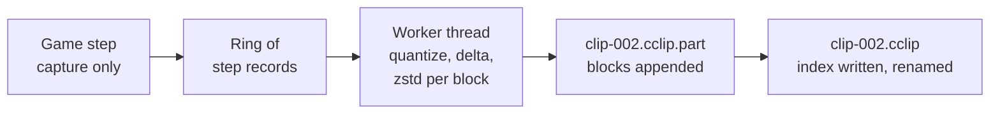

# Coney Director: recording

**A design.** How Coney records play for Coney Director: what a recording stores and holds, how it is cut into clips of
60 seconds with no gap, how Director seeks and scrubs through it, how a recording made by an older Coney or with mods
is opened, where the files live, what recording shares with networking, and how it is tested. Nothing on this page is
built; it is a design in the sense of [Page kinds](../writing-docs.md#page-kinds), and what gets built moves into a
guide. The issue is [#1186](issue:1186), under Director's parent issue [#1184](issue:1184). What the Rockstar Editor
records, the words Director uses (recording, clip, project, marker) and Director's feature list are the Rockstar
Editor survey's ([#1185](issue:1185)); the editor and the video export are [#1187](issue:1187)'s. The page ends with
[the build issues in order](#build-issues) and [the questions for the user](#questions).

A recording is **a replay the engine draws again, not video**: Director loads the level, takes the recorded state of
every human, object and camera step by step, and draws it with its own cameras. Recording only reads the game and
never changes it, and the [test mode](../testing.md) holds: a recording made with a fixed step and seeded randomness
is the same, byte for byte, every run.

## Contents {#contents}

- [The design in short](#short)
- [What is stored](#stored): inputs, states, or both, measured on the hub and on a crowd of 50
- [What a recording holds](#holds): humans, poses, objects, cars, effects, lights, the HUD, sound, the level and mods
- [Clips of 60 seconds with no gap](#clips)
- [Seeking and scrubbing](#seeking)
- [The file](#file): blocks, the index and the header
- [Versions and mods](#versions): what is refused and what is warned
- [Where it lives](#where): the folder, the names, the limits and a full disk
- [What it shares with networking](#networking)
- [Tests](#tests)
- [Measurements](#measurements): how they were taken
- [Build issues, in order](#build-issues), [Questions for the user](#questions)

## The design in short {#short}

| Point | Decision | Why, in one line |
| --- | --- | --- |
| What is stored | **The drawn state**: every human's position, heading and pose, every object's pose, the cameras, the HUD and lights, and an event track (sounds, particles, messages), each step; a full state (a **key frame**) at the start of every **block** of 5 seconds, then each step as a delta, quantized, laid out by column and compressed with zstd. The pads are kept beside it, for the tests | Measured at 0.30 MB a minute on the hub and 3.8 MB a minute with 50 fighters; it plays back without the game's rules, seeks in a block, and survives changes to the simulation |
| Not stored | No video, no input-only replay | An input replay needs a copy of the whole simulation at the start of every clip, which Coney cannot make (the Lua state), and a seek re-simulates (3 to 6 s a minute of play) |
| Cost to the game | Capture only on the game's step: 0.009 ms (hub) to 0.017 ms (crowd) a step; quantizing, compressing and writing on a worker thread | A file write on the game's step stalled one step by 60 ms in the measurements |
| Clips | 60 seconds = 1,800 steps = 12 blocks; every block starts with a key frame, so a clip boundary is an ordinary block boundary and the next clip's first step is the next step | No step is dropped, nothing is waited for |
| Seeking | Any step: decompress its block and decode from the key frame; at most 150 steps, about 13 ms for the crowd; blocks kept decoded while scrubbing | Forward and back at any speed, the picture at once |
| Versions | A header with the format version, Coney's version, the level, the disc and the mods. A newer format is refused; an older one is converted on open; another Coney version or a missing mod is warned, never refused | State playback runs no script, so a missing mod draws less, it does not break |
| Where | `<install>/director/clips/`, one folder per recording, `clip-001.cclip` and on; a cap on the folder; a full disk ends the recording at its last whole block | The fixed folder of [#1184](issue:1184); [a question](#questions) for an install that cannot be written |
| Networking | One id scheme (`NetId`, [#553](issue:553)), one set of field tables, one delta encoder with a baseline ([#554](issue:554)), one event set ([#556](issue:556)), one state digest ([#558](issue:558)), and Director's player is the client's world ([#555](issue:555)) fed from a file | The recording is a snapshot stream with no budget and no interest filter |

## What is stored {#stored}

### Three ways {#ways}

The brief names three ways, and the measurements below compare them on two real scenes, the hub (`level95`) with its
own 14 humans and the hub with 50 AI fighters spawned in front of the player (64 humans), for one minute each
([Measurements](#measurements) has the method):

1. **Inputs and events from a start state.** The pads of each step and the session's events, played again through
   the game from a start. Tiny, but every playback must come out bit for bit the same, and a seek means simulating
   again from the start.
2. **A full state every step**, or every few steps, with deltas. Bigger; a seek reads the nearest full state; the
   playback needs none of the game's rules.
3. **Both: key frames and deltas**, as a video codec does: a full state at regular steps, and each step between as a
   delta against the step before.

| Way, one minute | Hub (14 humans, 72 objects) | Crowd (64 humans, 71 objects) | Game-thread cost a step | Seek to any step |
| --- | --- | --- | --- | --- |
| Inputs only (one pad, before compression) | 0.014 MB | 0.014 MB | none | simulate from the start: 1.78 ms (hub) and 3.38 ms (crowd) a step, so 3.2 s and 6.1 s a minute of play, after a level load of about 1 s |
| Raw floats, every step (what the probe captured) | 19.1 MB | 72.4 MB | 0.009 / 0.017 ms (copy) | read one step |
| Quantized full state every step | 5.5 MB | 19.6 MB | | decode one step |
| Key frame every 1 s, bit-packed deltas | 1.01 MB | 6.0 MB | + 0.035 / 0.13 ms (encode) | at most 30 steps: 0.5 / 1.9 ms |
| The same, 1 s blocks with zstd | 0.68 MB | 4.9 MB | worker | |
| The same deltas by column, 1 s blocks, zstd | 0.53 MB | 5.0 MB | worker | |
| Key frame every 5 s, bit-packed deltas | 0.88 MB | 5.64 MB | | |
| **Key frame every 5 s, deltas by column, zstd** | **0.30 MB** | **3.8 MB** | worker: 0.009 / 0.04 ms a step to compress | **at most 150 steps: 4 / 13 ms** |
| Key frame every 60 s, bit-packed deltas | 0.86 MB | 5.56 MB | | up to 1,800 steps |
| Animation layers in place of poses, key frame every 5 s, bit-packed | 0.26 MB | 0.68 MB | | as the row above it |

The sizes come from the real states of the two runs, quantized as [below](#quantization); the costs are the probe's
zones ([Measurements](#measurements)). What the numbers say:

- **Poses are most of a recording.** A pose is 34 bone rotations. In a fight about 14 of a human's 34 bones change in
  a step, and only 64 % by a small amount, against 93 % in the hub's calm. Everything else (positions, headings,
  objects, cameras) is a few hundred bytes a step.
- **Key frames are cheap.** Going from one every 60 s to one every 5 s costs 2 to 3 % (the bit-packed rows), and a
  key frame at every block is what makes each block, and each clip, readable on its own.
- **Longer blocks laid out by column compress best.** With 1-second blocks, zstd makes about as much of the deltas by
  column as of the bit-packed stream (5.0 and 4.9 MB a minute for the crowd; 0.53 and 0.68 on the hub). With
  5-second blocks the columns come to 3.8 MB: a column holds one bone's differences for 150 steps, and zstd finds the
  repeats in it that a bit-packed stream hides.
- **Predicting the next pose from the last two steps does not help** (second differences came out 5 to 17 % larger):
  the smallest-three encoding of a rotation changes which component it drops as the bone turns.

### The choice {#choice}

**Way 3: a key frame at the start of every 5-second block, then deltas, by column, with zstd; the drawn state, not
the inputs.** At 3.8 MB a minute for 64 humans in a brawl and 0.3 MB in the hub, an hour of the crowd is about 230 MB.
Why not the others:

- **Inputs only cannot start a clip.** Every clip must open by itself ([Clips](#clips)), so an input replay needs the
  whole simulation's state at each clip's first step: every human, brain, gang, goal and timer, and the level's Lua
  4.0 state, which no snapshot can copy ([Network architecture: scripts](../network-architecture.md#sub-scripts),
  [the subsystems' readiness](../network-architecture.md#subsystems): "No copy or restore of simulation state"). And
  every seek backwards re-simulates from that start: 3 to 6 s for one minute of play, measured.
- **Inputs only break with every change to the game.** A replay of inputs is right only while every rule, constant and
  random draw of the build that plays it is the build that recorded it; Coney changes such things often while it is
  made faithful (the survey's other games show the same: Halo, StarCraft II, Overwatch). A recording of state
  plays in any later Coney that can read its format.
- **A full state every step** is 5 (crowd) to 18 (hub) times the size for no gain: the deltas decode at 0.02 to
  0.06 ms a step.

**Poses, not animation layers.** Storing each human's animation layers (clip ids, times, fades) instead of its pose is
five times smaller in the crowd even before compression (0.68 against 3.8 MB a minute), and is what networking sends
([Animation sync](../network-architecture.md#sub-animation)). A recording stores the pose because it is what was
drawn: playing layers back means sampling the clips with Coney's animation code of the day, so a fix to a blend, a
gait or a clip's timing (the faithful work changes these often) would change every old recording, and a mod's
animation would have to be present. **Coney's choice**, open to [a question](#questions): the layers can be added
later as a second, smaller encoding for a recording whose Coney and mods are those that play it.

**The pads too.** The pad of each step is kept in the recording (0.014 MB a minute at most): not to play it back, but
for the tests ([Tests](#tests)) and for the networking replays, which are input replays within one build
([#558](issue:558)).

### Quantization {#quantization}

The probe's precisions, which the sizes above use; the field tables of [#553](issue:553) give positions, headings and
health the same bits:

| Field | Encoding | Precision |
| --- | --- | --- |
| Position (feet, objects, cameras) | 18 bits an axis over -1,024 to 1,024 m | under 8 mm |
| Heading | 10 bits over a turn | 0.35° |
| Lean | 8 bits over ±0.6 rad | 0.3° |
| Pelvis offset (the pose's root) | 12 bits an axis over ±2 m | 1 mm |
| Bone and object rotations | smallest three: 2 bits for the component dropped, 3 × 10 bits | about 0.1° |
| Camera direction | yaw 14 bits, pitch 12 bits | 0.02°, 0.05° |
| Health, its maximum, the clip id | 15, 15 and 16 bits | exact |

A delta stores a field's quantized value against the step before's quantized value, so decoding is exact against
the key frame's quantization and errors never add up along a block. The probe decoded every step it encoded and
compared it with what it encoded: 0 differences in 1,861 steps of each scene.

## What a recording holds {#holds}

What Director needs to draw a step from any camera, and how each part is kept. **State** is kept in the key frame
and the deltas; an **event** happens on one step (as in [Three kinds of data](../network-architecture.md#data-kinds)),
and what an event leaves running (a sound still playing, a scene in progress) is also in each key frame, so a block
read alone plays it from the middle.

| Part | What is kept | How |
| --- | --- | --- |
| Humans | id, character type and model, hat, held object, position, heading, lean, pose (34 bones and the pelvis offset), health and its maximum (the blood layer and the health ring follow from them), shown or hidden, the player slot | state |
| Objects | every world object, door, pane of glass, prop, pickup and loose object **the level has changed** since it loaded: model, position, rotation, tint, broken, hidden; untouched ones come from the level's data | state |
| Cars | position, rotation, paint, parts removed, open and damaged, lights, exploded ([Cars](../../research/cars.md)) | state |
| Cameras | the game camera of each player (position, direction, up, field of view, near and far clip, cuts), the letterbox | state; Director's *game camera* option replays it |
| Effects | particles started (system, position, direction, seed), glints and decals; the litter round the camera and the ground fog follow the level's settings | events, played again by the effects' own code from their own seeds: presentation, so a later Coney may draw them a little differently |
| Lights | each light task's value this step (flicker, the player's shadow dimming) | state: a few bytes a step |
| HUD | the HUD's draw list of the step (panels, meters, messages, radar, counters, prompts) as ids and numbers, never text | state, deltas only when it changes; shown or not is Director's choice |
| Sound | each sound started (its hash, emitter id or position, volume), stopped; music and ambient cues; what plays at a key frame and since when | events (2,639 sounds in the crowd's minute, 75 in the hub's) |
| Movies and scenes | a scene's start and end; a pre-rendered movie as a marker (its name, start, end, skipped), not its pictures | events; how Director shows a movie is the survey's open question 7 |
| The level | level and checkpoint, the game time at each step, the step number | header and state |
| The session | Coney's version, the format version, the disc (the install's disc hash), the presentation source (PS2 or Xbox textures), every mod running (name, version, package hash, order), modded or faithful, the pads | header |

A recording holds ids and numbers and the game's own name hashes, never an asset, text or a script: drawing it needs
the player's own install, as playing does ([The install folder](../asset-and-script-architecture.md#install-folder)).

**Objects the free camera may see.** The probe recorded what the game drew round its own camera (72 objects). A free
camera that flies away from the player would find those the game never streamed in missing, as the Rockstar Editor's
does (the survey's *Limits*). So the recorder keeps every object of the level that has changed since the load, not only
the drawn ones; the rest come from the level's data, which Director streams round its own camera. The cost is small:
an object at rest is one bit a step in a delta.

## Clips of 60 seconds with no gap {#clips}

A **recording** runs from the player's start to stop (or a script's); it is saved as a chain of **clips** of 60
seconds, the last one shorter. A clip is 1,800 steps: steps are the clock ([Update and
render](../conventions.md#update-and-render)), so a clip is 60 seconds of game time whatever the frame rate, and a
pause, a menu or a loading screen, where no step runs, takes no time from it.



*Figure: the game's step only copies; the worker builds the blocks and the files.*

1. **The step copies.** At the end of each step the recorder copies what the [table](#holds) lists into the next
   record of a ring held in memory: 0.009 ms on the hub, 0.017 ms with 64 humans (about 40 KB a step, 6 MB a
   block). It does not quantize, compress, allocate or touch a file.
2. **A worker builds the blocks.** It takes the records, quantizes them, writes each block (150 steps: a key frame
   and 149 deltas) by column, compresses it with zstd and appends it to the clip's file. Its work is 0.05 to 0.2 ms a
   step on one core.
3. **A clip is 12 blocks.** When a clip's 1,800th step is in, the worker ends it: it appends the index ([The
   file](#file)), writes the file out and renames `clip-001.cclip.part` to `clip-001.cclip`. The next step is the
   first of a block, as every 150th step is, so it is the first of the next clip, with its own key frame. The game's
   step does nothing different on that step, which is the boundary's whole cost.
4. **Nothing is dropped, nothing waits.** Steps are numbered from the recording's start; each clip holds the steps
   that follow the last one of the clip before, and its header carries that step's number and [digest](#tests), so a
   gap or an overlap shows. If the worker falls so far behind that the ring is full (a stalled disk),
   the recording ends at the last whole block and says so; it never makes the game's step wait for a file.
5. **A level change ends the clip.** A clip shows one level: a level load (a mission's next level, a checkpoint that
   loads another) closes the clip there and the recording goes on in a new clip in the new level, shorter than 60
   seconds.

The worker is outside the simulation: it reads only the records the step copied. A test-mode recording, which does
the worker's work on the game's thread after each step, gives the same bytes as a threaded one.

## Seeking and scrubbing {#seeking}

Director draws a recording as a network client draws the server's game ([Interpolation](../network-architecture.md#interpolation)):
the world is the decoded state of two neighbouring steps, blended by the frame's place between them through
`Interpolated<T>` and `DrawnPoses`, with a jump (a teleport, a cut, a new human) drawn unblended.

- **A seek** to step *s* opens the block that holds it (the index gives its offset), decompresses it and decodes from
  its key frame to *s*: at most 150 steps, 0.02 ms (hub) to 0.06 ms (crowd) each to decode (the probe's bit-packed
  decoder, standing in for the columns') and 0.006 to 0.03 ms each to decompress, so about 4 ms and 13 ms at worst.
  Then it takes the world near Director's camera from the level's streaming, which is already loaded for the clip
  ([below](#seek-world)).
- **Scrubbing** (dragging the playhead, forward or back) keeps the last few decoded blocks in memory, about 6 MB each
  for the crowd at full precision, so moving within them costs nothing, and only crossing into another block decodes.
  A cache of eight blocks covers 40 seconds round the playhead.
- **Any speed.** Slow motion draws the same steps with smaller steps of the blend between them (a quarter speed is
  four frames a step at 30 frames a second); fast motion and reverse decode the steps in order and draw every *k*-th.
  The format needs only that each step can be reached from its block's key frame, which it is.
- **Sound follows the playhead.** On a seek, the key frame's list of what is playing restarts each sound at its
  offset; while playing, the event track starts and stops them at their steps. Its pitch at other speeds is the
  survey's open question 5.
- **A clip with a damaged block** (a crash, a bad disk) plays up to the last whole block.

### The world round the camera {#seek-world}

The Rockstar Editor loads the world round the recorded player, so a distant free camera shows low detail or holes
(the survey's *Scrubbing and preview*). Director streams the level's scenery round **its own camera**: the scenery
is the level's data, not the recording's, and the level's streaming already chooses parts by a view
([The streamed world](../../research/world.md)). The objects come from the recording (those the level changed) or the
level's data (the rest). A seek therefore waits for no simulation and only for the scenery parts near the new camera
position, as a teleport in play does.

## The file {#file}

One clip is one file, `.cclip`, little-endian:

| Part | What it holds |
| --- | --- |
| Header | magic `CCLP`, format version (major, minor), the [session](#holds) (Coney's version, disc hash, presentation source, mods), the recording's id, the clip's number, its first step, the step rate (30), the number and digest of the last step of the clip before (none for the first), a checksum |
| Blocks | each: magic, length, first step, step count, the zstd frame of the columns (a key frame, then the deltas of each field by column), the event track of its steps, the pads, a digest per step, a checksum |
| Index | the offset, first step and game time of each block, the clip's length in steps, a thumbnail's step |
| Footer | the index's offset and checksum, the magic again |

- **Appended, never rewritten.** Blocks go one after another into `.part`; the index and footer are written once, at
  the end. A `.part` file found when Coney starts (a crash, a power cut) is closed by reading its blocks from the
  start, keeping those whose checksum holds, and writing the index: at most the block in memory, 5 seconds, is lost.
- **Chunks by tag.** Header fields and block sections are tagged and sized, so a reader skips what a newer minor
  version added ([Versions](#versions)).
- **zstd.** A new dependency (BSD licence), pinned in `cmake/deps.cmake` like the others; it compresses at hundreds
  of megabytes a second, which is why a block costs 0.04 ms a step. The measurements used zstd at level 3.

## Versions and mods {#versions}

A recording plays in a Coney other than the one that made it, so the header says what made it and Director compares:

| What differs | Director |
| --- | --- |
| The format's **major** version is newer than this Coney reads | **refuses**: "made by a newer Coney (format 3); update Coney to open it" |
| The major version is older | **converts on open**, in memory, through each major's converter in turn (2 to 3, then 3 to 4); every major change ships its converter, and the clip file is left as it is unless the player saves the converted copy |
| The minor version is newer | opens it, skipping the tagged sections it does not know, and warns once |
| Coney's version differs, same format | opens it; no warning (the recording is the drawn state, so a newer Coney draws what was recorded) |
| Another disc (another region, or an Xbox install for the textures) | opens it when its levels and name hashes are the same; else refuses, naming the disc |
| A mod in the recording is missing, stopped or of another package hash | **warns** and names each one, then plays: a missing model draws as its character's stand-in, a missing sound is silent |
| The recording was modded, the viewer's game is faithful (or the other way round) | plays; the Clips list marks a modded recording |
| A block's checksum fails | plays up to the last whole block, and says where it stops |

A recording never runs a script, so unlike an input replay ([Modded saves and replays](../studio/mods.md#saves-replays),
which refuses any difference in mods) a missing mod costs only what it drew. The tests' input track is the
exception: re-simulating it needs the same Coney and mods, and the test that does it checks both first.

## Where it lives {#where}

The folder is fixed, inside the install folder ([#1184](issue:1184); [The install folder](../asset-and-script-architecture.md#install-folder)):

```text
<install>/director/
  clips/
    2026-10-29_21-04-17/          one recording, named by when it started (local time)
      clip-001.cclip              60 seconds
      clip-002.cclip
      clip-003.cclip.part         being written
  projects/                       Director's projects (#1187)
  videos/                         exported MP4 files (#1187)
  cache/                          thumbnails, rebuilt when missing
```

- **Names.** The recording's folder is its start's local date and time; the clips are numbered from 001. The Clips
  list shows them as the survey proposes ("Oct 29 2026, clip 1"), and a recording can be renamed there (the folder
  keeps its name; the new name goes in a small file beside the clips). Reading the date is a real-clock read outside
  the frame pacer, so it goes in the platform layer with the clip recorder's allowance in the clock check
  ([Update and render](../conventions.md#update-and-render)); a test-mode run names its recording from
  `--record-name` instead, so its files are the same every run.
- **Size.** About 0.3 MB (hub) to 3.8 MB (64 humans in a fight) a clip. A clip grows with the humans in play, and the
  crowd measured is already past the original's pool of about 60
  ([Network architecture](../network-architecture.md#authority)), so an hour of a level's busiest scene is about
  230 MB.
  The folder has a **cap**, a setting (a proposal: 20 GB, about 90 hours of crowd), checked before each block.
- **A full disk or the cap.** Before each block the worker checks the free space (at least the block and 256 MB
  left) and the cap. When either fails, or a write fails, the recording ends at its last whole block: the clip is
  closed and valid, the HUD says "Recording stopped: the disk is full" (or "the recordings folder is full"), and the
  game goes on. Nothing is deleted by itself ([a question](#questions)).
- **An install that cannot be written.** A portable install in a folder the player can write (their own) is what
  the install-folder decision assumes, and the launcher's updates need it too ([The launcher](../launcher.md)). An
  install under `C:\Program Files` cannot be written without administrator rights. The proposal, for the user to
  decide ([questions](#questions)): the installer offers a folder of the player's own by default and warns before
  a protected one; and Coney, finding `<install>/director/` not writable, uses `director/` in the per-user save location
  instead and says so on the Clips screen, rather than failing to record.

## What it shares with networking {#networking}

A recording is a stream of snapshots of the whole world with no budget and no interest filter, saved to a file;
networking sends snapshots of part of it to each client under a budget. One format where it fits:

| Networking piece | What recording takes | What differs |
| --- | --- | --- |
| Network ids, `NetIdAllocator` and `NetIdTable` ([#553](issue:553), [Network ids](../network-architecture.md#net-ids)) | The recorder gives each human, object and car an id from the same allocator and table code, so a recording names things as a snapshot does, and an id reused after a death has a new generation | In single player the recorder owns the allocator; in a session it reads the server's |
| Field tables ([#553](issue:553)) | The human, world object and car tables, with their bits and ranges, for the fields they share; recording adds its own tables for the pose (34 rotations, a new *rotation* encoding for smallest three), the lean, the pelvis, the cameras, the lights and the HUD | Networking sends layers, not poses ([Poses](#choice)) |
| Snapshots and deltas ([#554](issue:554), [Snapshots](../network-architecture.md#snapshots)) | The same delta: per thing a changed bit, then a changed bit per field group, against a baseline; one encoder taking the baseline as a parameter | The baseline is the step before (the client's acknowledged snapshot in networking); a key frame every block; no 1,200-byte budget or priority; the block is laid out by column and compressed, where a datagram is bit-packed |
| Events ([#556](issue:556)) | The same event types and their encoding: sounds, particles, HUD messages, scenes, movies, through the one call the [checklist](../network-architecture.md#checklist) (item 8) asks every subsystem for | The recording keeps every event, cosmetic ones too |
| The client's world ([#555](issue:555)) | Director's player **is** a client world: a game mode with no simulation that draws from snapshots through `Interpolated<T>` and `DrawnPoses`; its jitter buffer is replaced by the block reader | Seeks; any speed |
| The state digest ([#558](issue:558), [Testing](../network-architecture.md#testing)) | One digest function over the field tables' quantized values, per step; the recording stores it per step | Over the recorded fields (poses included) |
| Replays ([#558](issue:558)) | The pads in the recording are the input commands' pad encoding ([Input commands](../multiplayer.md#input-commands)), so a test recording is also a networking replay | Played only by the tests |

So the order of work puts networking's ids, tables and delta encoder first, and the recorder builds on them; Director's
player waits for the client's world, or is that game mode's first user if it comes first.

## Tests {#tests}

Every test runs with no window and no clock, as the rest ([Testing](../testing.md)); disc tests print counts and
digests only.

| Test | What it proves | Kind |
| --- | --- | --- |
| **A recording replays to the same state digest** | A disc test plays `level99` through [the player's path](../testing.md#test-through-the-players-path) (`DiscSession`) with an input script while recording; Director's player then plays the recording headless, and its per-step digest of the drawn state equals the digest the recorder wrote, for every step of every clip | disc |
| The recording re-simulates | The same recording's pad track, played from the level's start in test mode, gives a game whose recorded state has the same digests (the bit-exact path; the same Coney and mods) | disc |
| **A clip boundary drops no step** | With a test clip length of 60 steps over 600 steps: the clips hold steps 0-59, 60-119 and on, each exactly once; each clip opens alone; its first step follows the previous clip's last (the digest chain) | unit and disc |
| Recording changes nothing | The game's own state digest ([#558](issue:558)) is the same per step with the recorder on and off | disc |
| The step does no I/O | A fake writer records which thread wrote; the game's step only copies, on the boundary step as on any other (counted work, not time) | unit |
| The codec round-trips | Synthetic scenes: humans appearing and leaving, ids reused with a new generation, objects breaking, a seek to every step equal to reading in order | unit |
| Same input, same bytes | Two test-mode recordings of one input script are byte-identical, threaded or not | disc |
| A full disk, a failed write, a full ring | A fake file system: the recording ends at its last whole block, the clip opens, the notice is raised, the step never waits | unit |
| A crash | A `.part` file cut at every byte of a short recording opens to its last whole block | unit |
| Versions | A synthetic file of an older major converts; a newer major is refused with its message; an unknown minor section is skipped; a missing mod is warned | unit |
| Size and cost budgets | The hub and the 50-fighter crowd recorded for a minute stay under 1 MB and 6 MB a clip, and the capture's work stays within its counted budget | disc, prints sizes |

## Measurements {#measurements}

Taken on 2026-10-29 on the agents' machine of [Performance: findings](../performance.md#findings) (a Ryzen 7 9800X3D,
an RTX 5080), from a `playtest` build of `main` at `b6559b4cc` with a probe added for the study and not kept, windowed,
vsync off, lockstep, with no build holding a slot (other agents' processes were running). Each run is the hub
(`level95` checkpoint 1) from its first frame of play for 1,860 steps, the bench's 60 steps of warm-up unmeasured,
with no fighters or with `--bench-fighters 50 --bench-god` ([Measuring a run](../performance.md#bench)):

```sh
coney --disc DISC --play-level level95 --skip-movies --frames 1860 --bench out.json --bench-fighters 50 \
    --bench-god --bench-warmup 60 --vsync off --no-activate
```

**The probe.** After each step's last update it copied, for the player and every AI human, the feet, heading,
lean, pose (the drawn snapshot's 34 rotations and the pelvis), the layer count, top clip and its time, and health;
for every world object and door the game drew, its pose; and the step's camera. It then quantized them as
[above](#quantization), encoded a key frame every 30 steps and a bit-packed delta otherwise, decoded what it had
encoded and compared, and wrote the raw records and the encoded bytes to files in the scratch folder, under perf
zones. A script read the raw records and computed every other row of [the table](#ways) from them (its count of the
probe's own format agreed with the probe's bytes: 1,041,858 of 1,041,858 on the hub, 6,219,578 of 6,219,581 for the
crowd), compressing with Python's zstd (level 3) and zlib to time them. The pads were not recorded: the input row is
the encoding's upper bound (61 bits a step, `writePad` in `src/net/protocol.cpp`).

| Per step (mean, ms) | Hub | Crowd (two runs) |
| --- | --- | --- |
| The game's step (`step`), without the probe | 1.63 | 2.63 |
| The copy (`rec.capture`) | 0.009 | 0.016, 0.017 |
| Quantize and bit-pack (`rec.encode`) | 0.035 | 0.131, 0.127 |
| Decode and compare (`rec.decode`) | 0.018 | 0.062, 0.060 |
| Write the raw records to a file (`rec.rawwrite`), median and largest | 0.028, 0.38 | 0.053, 60.6 |
| Frame, without and with the probe | 2.72, 2.66 | 5.00, 5.87 and 6.39 |
| Headless step, for re-simulation (no probe) | 1.78 | 3.38 |

- The crowd runs had 64 humans (the hub's 14 and the 50 fighters) and 70 to 72 objects a step; the hub 14 and 72.
- A headless start of the hub to its first step took about 1 s of real time.
- The frames are noisy on a shared machine; the probe's own zones are the cost. One crowd run's file write took 60 ms
  on the game's step once, which is why the design writes on a worker.
- Over a minute of the hub the game's event log counted 75 sounds; with the 50 fighters, 2,639.

## Build issues, in order {#build-issues}

Each is about one pull request, a sub-issue of [#1184](issue:1184). The first waits for [#553](issue:553).

| # | Issue | Needs | Done when |
| --- | --- | --- | --- |
| 1 | **The recording codec**: the block format (key frame, deltas by column, zstd, checksums, the index and footer), the recording's field tables beside #553's (rotation encoding, pose, lean, pelvis, cameras), the per-step digest; zstd added to the dependencies | #553 | The codec, the crash and the version tests, on synthetic scenes |
| 2 | **The recorder's capture**: the copy at the end of the step for humans, poses, objects the level changed, doors, cars, cameras, lights and the HUD's draw list into a ring; the worker that quantizes, compresses and writes; `--record-replay DIR`, `--record-name` and `--record-clip-steps` for the tests | 1 | The step-does-no-I/O, same-bytes and recording-changes-nothing tests |
| 3 | **The event track**: sounds, particles, HUD messages, scenes and movies through one call each, recorded with what a key frame needs of them; shared with #556 | 2 | Event counts of a disc run match the event log's |
| 4 | **Clips and the folder**: 60-second clips, `.part` and the rename, recovery at start, the folder layout and names, the cap and the free-space check, the fallback folder | 2 | The clip-boundary, full-disk and crash tests |
| 5 | **Director's player**: the game mode that draws a recording, seeks and scrubs at any speed, with the block cache and the sound restarted at a seek; built on #555's client world, or its first user | 4, #555 | The replays-to-the-same-digest test |
| 6 | **Versions and mods in Director**: the header's checks, the warnings and refusals of [Versions](#versions), the first converter's frame | 5 | The version tests |
| 7 | **The recorder for the player**: start and stop from the keyboard, the pad and scripts, the indicator and time on the HUD, the stop notices | 4 | A disc test drives it through the pad |
| 8 | **Budgets**: a disc test that records the hub and the 50-fighter crowd for a minute and pins the bytes a clip and the capture's counted work | 4 | Sizes printed and held under the budgets |

## Questions for the user {#questions}

1. **An install that cannot be written.** A portable install under `C:\Program Files` cannot hold recordings. Is the
   proposal right: the installer offers a folder of the player's own by default and warns before a protected one, and
   Coney falls back to the per-user save location's `director/` and says so ([Where it lives](#where))? Changing the
   installer is a maintainer decision.
2. **The cap and a full disk.** Is 20 GB the right default cap? When the folder or the disk is full, should the
   recording stop and keep everything (the proposal), or delete the oldest clips no project uses (the survey's
   question 4)?
3. **Poses or layers.** The proposal stores poses (3.8 MB a minute in a crowd, plays in any later Coney) over
   animation layers (0.68 MB, but replayed through the animation code of the day and the mods' clips). Is the larger,
   robust form right for the first version?
4. **Old recordings.** Must every old clip open forever, each format change shipping its converter (the proposal), or
   may a clip older than some versions say it is too old? This is the survey's question 8, made concrete.
5. **Sharing recordings.** A clip holds ids and numbers, no asset or text, and plays only on an install made from the
   player's own disc. May players share clip files with each other? This may be for the legal side
   ([LEGAL.md](repo:LEGAL.md)).
6. **The listener.** When Director plays a clip from a free camera, is the sound heard from the camera (the proposal)
   or from the recorded player, as the game heard it?
