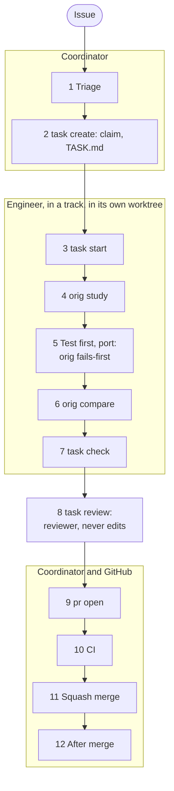
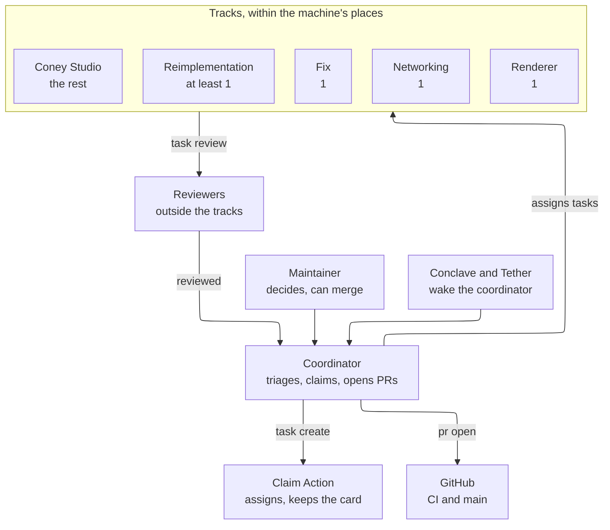
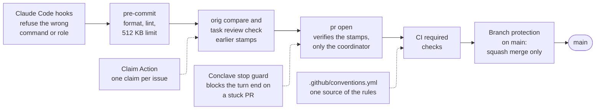

# How we work

This page is the map of Coney's workflow: the road from an issue to a commit on `main`, who walks each stage, which
command ends it and what it must prove, and how many engineers work at once without stepping on each other. It is the
same for the project's agents and maintainers; a person contributing from a fork follows
[CONTRIBUTING.md](repo:CONTRIBUTING.md) and needs no stamps. It stays high level and links to the guide that holds the
detail. Start with [Who is who](#who-is-who), the roles in one table, then [The pipeline](#the-pipeline), the stages in
order. [How the work is run](#how-it-runs) shows how the roles fit together and how many work at once, and [How the
rules are enforced](#enforcement) shows which check stops what. The diagrams on this page illustrate; the text beside
each is the rule.

Four principles hold the workflow together. **Results, not rituals:** each stage has a required result, and how an
engineer reaches it is its own choice. **Tools prove, people judge:** each stage from Start to Open ends with a command
that checks its result and writes a [stamp](stamps.md#log), and the judgement left to a person or a reviewer is a small,
closed question. **Enforced, not remembered:** a rule lives in a hook, a tool or a CI check, defined once in
[.github/conventions.yml](repo:.github/conventions.yml), and the guides explain it. **Ask, don't guess:** at a [decision
point](#decision-points) an engineer asks the coordinator.

## Who is who {#who-is-who}

Every role in the work: person, agent, plugin or service. The agent roles are the files in `.claude/agents/`, and a
hook holds each to its own commands and files ([Which role to start](agents.md#roles)); a person can take any of them.

| Role | What it is | What it reads | What it writes | When it runs |
| --- | --- | --- | --- | --- |
| **Maintainer** | A person | What the coordinator escalates | The [maintainer decisions](repo:AGENTS.md) only; may merge | When one is due |
| **`coordinator`** | The main session, started with `coney-agent` ([The coordinator](#coordinator)) | Issues, task files, unit records and stamps, GitHub | Triage, claims and task files (`task create`), briefs, answers, pull requests (`pr open`) and merges; the only role that writes to GitHub. No code, tests or research, no review, and none of the stage commands from Start to Review | Always; Conclave and Tether start its turns |
| **`engineer`** | Agent, Opus (Sonnet without reverse engineering: [Which model](agents.md#models)), in one of the tracks: reimplementation, fix, Coney Studio, networking or renderer ([Tracks](#slots)) | Its task file and issue, the guides, the original, research pages | Code, tests, pages and docs on its task's branch, its stamps, `PR.md`. Never pushes or runs `pr open` | One task, from Start to a passing Review |
| **`tooling`** | Agent, Sonnet; the engineer's rules for the project's own tools | The guides and the tool's code; no Ghidra or PCSX2 | Tools, workflows, hooks and their guides, on its task's branch. Never pushes | One task about the tools or the process |
| **`reviewer`** | Agent, Opus for research and `@orig`, smaller for docs and tooling ([The reviewer](agents.md#reviewer)); outside the tracks | The diff, the packet, the [checklists](review/index.md), the original (read only) | Its verdict and report, nothing else; it never edits | Once per task tip, by someone other than its author ([Task review](review/task.md)) |
| **Claim Action** | The `claim` workflow on GitHub ([Claiming an issue](issues.md#claiming)) | `/claim`, `/unclaim` and `/progress` comments, issue and pull request events | Assignees, `S-` labels and the claim card; it deletes the command comments | On each command, and an hourly sweep |
| **Conclave** | Coney's own Claude Code mod ([Conclave](conclave.md)) | `coney-tools conclave snapshot` | Nothing; it draws, and starts a coordinator turn for Coney's own events | In a session loaded with it, between the coordinator's turns |
| **Tether** | A Claude Code plugin ([Waking the coordinator](coney-tools-setup.md#coord-wakes)) | The session and the machine | Nothing; it keeps the session healthy (context, cache, clearing) and starts a coordinator turn | Between the coordinator's turns |
| **GitHub CI** | The required checks and the ruleset on `main` ([What CI runs](building.md#what-ci-runs)) | Each pushed pull request | Check results; the squash merge, once every check passes and auto-merge is on | After `pr open` pushes |

## The pipeline {#the-pipeline}

A piece of work travels from an issue to `main` through the stages below. The coordinator triages and claims it,
the engineer takes it from Start to Check in its own worktree, a reviewer judges it, and the coordinator opens the pull
request and tidies after the merge. Each stage from Start to Open ends with a command that writes a
[stamp](stamps.md#log) into the task's log (Triage, CI, the merge and After merge write none). Three commands refuse
while an earlier result is missing or stale: `orig compare` (the study), `task review` (every changed `@orig`
function compared, every added test failed first, `docs check`) and `pr open` (the whole chain, `checked` and
`reviewed` included). `task check` reads no earlier stamp, so a skipped stage meets the next of these three, never
earlier.

*Figure: the road from an issue to `main`, top to bottom.*

| # | Stage | Who | Run | Required result | Stamp | Detail |
| --- | --- | --- | --- | --- | --- | --- |
| 1 | Triage | Coordinator | (labels) | The issue has its type, area and priority, `S-ready-to-start`, and fits one reviewable pull request; `P-critical` issues first | none | [Triage](issues.md#triage) |
| 2 | Claim | Coordinator | `coney-tools task create <issue>... --terms ... --scope ...` | The claim Action assigned the issue and it settled; `TASK.md` holds the goal, Done, scope, leads and decision points | `assigned` (written by Start) | [Task files](issues.md#task-files) |
| 3 | Start | Engineer | `coney-tools task start <task>` | Branch and worktree from `main`, the unit record; reports its track's places, and refuses a start over the limit | `claimed` | [Starting a task](issues.md#starting) |
| 4 | Study | Engineer (and its helpers) | `coney-tools orig study <addr>`; PCSX2 for what a player sees | Per function: the decompile, callers, callees and data reads saved and hashed, the lines numbered and cut into pieces; the expected values found (code or runtime); research claims written and graded | `studied` per address | [Study](stamps.md#study), [The engineer's steps](#engineer-steps) |
| 5 | Port | Engineer | `coney-tools build --agent <id> --preset dev --test -R ...`; `coney-tools orig fails-first` | The test is written first from the study's result, cites its expected values and fails; the port makes it pass; the copy check is clean | `fails-first` per test | [Fails first](stamps.md#fails-first), [Testing](testing.md) |
| 6 | Compare | Engineer | `coney-tools orig compare <addr>` | Every numbered line of each ported function is in a pair (`same`, `stand-in` with a reason, `not-ported` with an issue) | `compared` per function | [Pairs](stamps.md#pairs), [Compare](stamps.md#compare) |
| 7 | Check | Engineer | Commit, then `coney-tools task check` | The whole gate for the change's kind on the committed tip: for engine changes the MSVC `ci` build and the C++ tests the change reaches, with the disc (those near it when it reaches too many; the whole suite only when it cannot be traced) | `checked` | [task check](coney-tools-repo.md#task-check), [The local gate](testing.md#local-gate) |
| 8 | Review | Reviewer | `coney-tools task review <task>`, then `--record` | The tool part passes; every checklist, `@orig` function, research page and picture is judged, the description included | `reviewed` | [Task review](review/task.md) |
| 9 | Open the pull request | Coordinator | `coney-tools pr open <task>` | The stamps hold for this change; the generated text passes CI's checks; pushed, opened, auto-merge on | `pr-opened` | [pr open](pr.md#open), [Opening the pull request](#release-queue) |
| 10 | CI | GitHub | (automatic) | Every required check passes | none | [What CI runs](building.md#what-ci-runs) |
| 11 | Squash merge | GitHub, or a maintainer for `merge.manual_paths` when `pull_requests.auto_merge_manual_paths` is off | (auto-merge) | One commit on `main` with the pull request's title | none | [Merging safely](#merging) |
| 12 | After merge | Coordinator | `/repo-hygiene`, `coney-tools workspace clean --apply`, `coney-tools ci disc-suite --apply` | The issues it lists under Issues affected edited, its issues closed, the merged worktree and old build folders removed; after engine merges the whole suite with the disc run on `main` (a failure files a `P-high` issue) | none | [After a merge](issues.md#after-a-merge), [ci disc-suite](coney-tools-ci.md#disc-suite) |

- **Study, Port and Compare repeat per function**; Check, Review and Open once per tip. Review may run while Check
  runs, on the same tip; the task moves on when both pass. A commit after either makes it stale.
- **A docs or tooling task** (kinds `docs`, `tooling`) has no Study and no pairs, and records `fails-first` as none with
  `orig fails-first --none <reason>`; a task that changes a research page still grades its claims. A tooling task's
  Python tests come first all the same, and the reviewer checks that they did.
- **A finding sends the work back.** A finding in Review goes to the engineer, who fixes it in a new commit and runs
  Check and Review again; a red CI check becomes a fix task ([Tracks](#slots)).
- **A refusal names the stage to redo.** `pr open`, `task review` and `orig compare` list every missing or stale
  result with the command that makes it, and the work goes back to the engineer, never to the coordinator's hands.

### Decision points {#decision-points}

An engineer stops and asks the coordinator, through `QUESTION.md` in its scratch folder
([Questions](conclave.md#questions)), when no lead finds the original function; when a fidelity choice or a stand-in
has to be made; when a test would have to change to pass; when the scope would have to be cut; and when anything might
be a [maintainer decision](repo:AGENTS.md). Everything else it decides itself and keeps going. The task file lists the
decision points the coordinator already sees ([Task files](issues.md#task-files)).

### The engineer's steps {#engineer-steps}

Study, Port and Compare in detail, for every feature:

1. **Read the code.** Before starting, an engineer reads the task file's leads, `docs/research/` and the open pull
   requests for existing or in-flight coverage and extends it ([Before you research](research-workflow.md#upstream)),
   and the task file's list of [pending work that overlaps](pending-work.md).
   Then the engineer studies the original executable `SLUS_212.15` in Ghidra with `orig study`: names the
   functions, writes plate comments and works out what each one does.
2. **Watch it run.** For behaviour a player sees, always, not only when the code is unclear: the engineer makes the
   behaviour happen in the original running in PCSX2 and records it (a per-update trace, memory reads, reference
   frames). Play to it with input (a PCSX2 input recording, or scripted input); when that is slow or unreliable,
   trigger it directly, using a [recipe](#recipes) or, where none exists, finding in Ghidra and the debugger which
   state, call or event starts it and setting that over PINE. A new way of triggering something becomes a recipe for
   the next engineer. What the recording shows is read against the code in Ghidra, and the debugger's breakpoints and
   memory reads fill in what neither shows alone.
3. **Write it down.** The finding goes on a research page in `docs/research/`, in prose, with the address it comes
   from and an [evidence level](research-evidence.md#evidence-levels) on every claim.
4. **Test first, then implement it.** The engineer writes the test from what the study found, citing where each
   expected value comes from ([Cite the expected values](testing.md#citations)), commits it and sees it fail. Then it
   ports the behaviour from the original function at its address in Ghidra. The research page is the map to that
   function (which one, where, what it touches), not the source of its logic: the logic is read from the function
   itself, and any disagreement with the page's cited addresses is recorded on the page
   ([the runtime comparison](testing.md#runtime-comparison)). The engineer writes Coney's own code for it and tags it
   with `@orig` and the page link ([Conventions](conventions.md#comments-and-orig)); the test now passes, and
   `orig fails-first` records both runs. Where Coney already has the behaviour, the engineer adjusts it until it
   matches the original and the recording; where it does not, adds it. Presentation taken from the Xbox port is
   ported the same way from the Xbox executable (`@orig xbox`). Code with no original counterpart (networking, the
   launcher, debug tooling, enhancements) is the exception: it carries no `@orig` tag and is checked by its own
   tests.
5. **Compare.** `orig compare` shows the saved decompile beside the Coney function and refuses to stamp while a
   numbered line is in no pair. Work a player sees is also checked against the original running, not only against
   our reading of its code: the same scenario runs on both games, or the same moment is taken from a PCSX2 save state
   and from Coney, and traces, values or frames are compared
   ([Comparing with Coney](research-traces.md#comparing-with-coney),
   [the runtime comparison](testing.md#runtime-comparison)). A difference goes back to item 1 or 4 as a question or a
   fix. The pull request states the result in its `Runtime:` line.

### Recipes {#recipes}

Recipes are the shared ways of making things happen in the running original: finding, moving and spawning humans,
editing their attributes and the player's stats, giving the crew orders, raising events, going to a level, mission or
checkpoint, and driving the pad. Each is confirmed at runtime and run with `coney-tools pcsx2 recipes` on a PCSX2 copy
you hold a claim on; the list, with the address and evidence behind each recipe, is [PCSX2 recipes](pcsx2-recipes.md).
A new way of triggering something becomes a recipe there ([Driving PCSX2](research-tools.md#driving-pcsx2) explains
the techniques underneath).

The places to start from are shared too: the [PCSX2 state library](pcsx2-states.md) keeps save states of the original
(a pedestrian to grab, a fence to jump, a store door) with a catalog saying what each shows. Check it before driving
the game anywhere, and add a state you made that others could use.

## How the work is run {#how-it-runs}

Coney is written by agents (AI models) under a maintainer, and a person can take any of the same roles. The parts:

*Figure: who does what; only the coordinator writes to GitHub, through the claim Action and `pr open`.*

What each role is, reads and writes is in [Who is who](#who-is-who); what is left here is how they fit together:

- **The maintainer decides** only what a short list in [AGENTS.md](repo:AGENTS.md) names; the coordinator or the
  engineer decides everything else on the spot, and asks at a [decision point](#decision-points).
- **Engineers each own one task.** An engineer works in its task's worktree and branch, briefed as
  [Briefing](agents.md#briefs) describes (a brief may be just the task id), follows the [pipeline](#the-pipeline),
  commits locally and is done when its task passes Review. It may start its own helpers for research, tracing or
  grading; only the engineer commits and stamps in its worktree. The model is chosen per task
  ([Which model](agents.md#models)).
- **The reviewer reads what someone else wrote** and reports; it never edits. One `reviewer` takes every kind of change
  and the description ([Task review](review/task.md)).
- **Pull requests open through `pr open`**, run by the coordinator once Check and Review hold, and from the cutover
  by no other route ([Opening the pull request](#release-queue)).

### Tracks {#slots}

Engineer work runs in five tracks (maintainer decisions of 2026-10-28, which put Coney Studio first, and of
2026-10-29, which gave networking and the SDL3 GPU renderer an engineer of their own):

- **Reimplementation:** game issues and pull requests outside Coney Studio, networking and the renderer. At least one
  engineer always works on game work (a `feature` task; a tooling or docs unit shares the track but does not count as
  that one).
- **Fix:** one engineer resolves pull request problems (a failed check, a conflict, a rebase) after a unit's pull
  request is opened.
- **Coney Studio:** an issue labelled `studio`. As many engineers as the machine holds work on Studio research and
  development, on the models [Which model](agents.md#models) names for them.
- **Networking:** an issue labelled `networking` (the co-op plan in [multiplayer](multiplayer.md#plan): network ids,
  snapshots, interpolation, the level-load barrier). One engineer always works on it, and no more than one; its
  claim is outside the open-claims limit, so game work cannot crowd it out.
- **Renderer:** an issue labelled `renderer` (the SDL3 GPU migration, design #883: Coney's own renderer on SDL3's GPU
  API, librw kept only for reading data). Networking's rule: one engineer always works on it, and no more than one,
  outside the open-claims limit. An issue with both labels is a networking unit.

A machine holds a fixed number of units of all tracks together for each of its build slots, the ones `coney-tools build`
keeps ([Engineer tracks](agents.md#slots) has the number and the evidence for it). One place is kept for game work while
no `feature` unit runs, one for a fix, one for networking and one for the renderer while none runs, so Studio never
takes any of them (a machine with one build slot cannot keep all four), except that the fix, networking and renderer
places lapse while their track has nothing to start ([A kept place lapses](slot-fill.md#lapse)) (`tasks.start.slots` in
[.github/conventions.yml](repo:.github/conventions.yml)); `task start` refuses a start over the limit and the
coordinator's Agent guard refuses the engineer before it starts ([Engineer tracks](agents.md#slots) has the rule in
full). There are no standing teams: the coordinator assigns the next task from the triaged issues, `P-critical` first
and then by priority, whenever a place frees.

- **A place frees when its task passes Review.** The engineer's job ends there; its place takes the next task while
  the pull request runs CI.
- **The places stay full.** A free place with startable work and no reason is a failure the coordinator cannot end
  a turn on; the reasons, the waivers and the `Stop` hook are in [Keeping the places full](slot-fill.md).
- **A CI failure on a pull request is a fix task** (`task create --fix-of <issue>`) in the fix track: one at a time,
  oldest failure first. If the engineer that wrote the task is still running, the fix goes to it; otherwise a fresh
  engineer takes it, and may take the next queued fix while its context is warm. A fix redoes only the stamps it made
  stale and goes out with `pr open` on the same pull request ([Starting a task](issues.md#starting)).
- **A conflict is a fix task too, and the work starts at once.** [Conclave](conclave.md#conflicts) tries the rebase of
  every pull request in conflict (and of a ready unit `main` has moved past) in a throwaway worktree. A clean rebase
  whose stamps still hold needs no engineer: the wake is `unit-ready` and the coordinator runs `pr open`. A real
  conflict, or a rebase that leaves a stamp stale, is one `conflict-fix` wake carrying the command (`task create
  --fix-of <issue>`, the unit's own task, or `task create <issue> --name <branch>` then `task start <branch> --adopt`
  for a branch made before units) and a brief, so the coordinator starts the engineer in the fix track straight away,
  oldest conflict first; while the fix place is taken the wake says which conflict waits behind which fix. Nothing
  parks a conflict: a hold needs `--who` (a live agent), and a waiver only with a maintainer decision named in its note.
- **Reviewers and helpers are outside the tracks**, and so is work in other repositories. Until the cutover so are
  units that build the workflow itself (their issue carries the `workflow` label, read from the claim card); from it
  they count like any other task ([Engineer tracks](agents.md#slots) holds the rule). Their claims are outside the
  open-claims limit too, by the same label, and so are the claims of Studio, networking and renderer issues, for good.
- **Two engineers never work in the same functions.** A claim carries its scope, and `task create` warns when another
  held claim's scope overlaps.

## Legacy fidelity {#fidelity-audit}

Code that predates porting from the original function, or was ported from a quick reading, can differ from the
original in ways nobody has noticed, while gameplay must match the original exactly until the game is complete
([AGENTS.md](repo:AGENTS.md)). Such code is marked **legacy**: every `@orig` function that was never compared, and
every file below its standard, is listed ([The standards](coney-tools-standards.md#standards)), and nothing new is
marked legacy. There is no separate audit team; legacy code is brought up to standard in two ways:

- **By touching it.** A task that changes a legacy function brings it up to its standard in the same pull request: a
  changed `@orig` function is studied, compared and reviewed like a new one, so it leaves the list; the rest of a file
  it touches is not owed, and is listed for cleanup issues ([Touch a page, fix the page](writing-docs.md#touch-it)).
- **By its own issues.** The findings of the earlier orig sweep, and any difference found since, are filed as issues
  and prioritised by what a player would notice. Each is an ordinary task: claimed, studied, fixed with a test that
  fails before and passes after, compared and reviewed. A difference that is deliberate (a PC platform call in place
  of a PS2 one) stays as a `stand-in` pair, and its comment says why. Coney-only code (networking, the launcher, debug
  tooling, enhancements) has no original function to compare with.

The rubric a reviewer applies to an `@orig` function, fidelity and own expression, is [Orig review](review/orig.md);
`coney-tools orig index` lists every tagged function with its research page ([orig](coney-tools-fidelity.md#orig)).

## One role: the engineer {#engineer}

An engineer studies the original (Ghidra through ghidra-mcp, the running game through the pcsx2 MCP server), writes
research pages where they help and implements the result in engine code and tests
([Studying the original](research-workflow.md#studying-the-original)). An answer worth keeping lands on the page, not
in a private message, and no game data ever goes in the repository ([LEGAL.md](repo:LEGAL.md#no-game-data)).
The page points the next engineer at the original function and records what was learned from it; the logic itself is
ported from the function at its address. How a page and the function work together, with three real features traced
to the merged result, is in [From research to code](research-to-code.md).

## The tools

- **Ghidra, shared.** One Ghidra project of the PS2 executable (with the Emotion Engine extension), kept open by a
  headless ghidra-mcp server on port 8090. Every engineer works in that one project at once, so a name given by one
  is seen by all; never undo another engineer's names. Setup: [Ghidra + ghidra-mcp](ghidra.md).
- **The Xbox build: a reading aid, and a source for presentation.** The same function in the Xbox executable can
  read faster (inline strings, named library calls), and behaviour is still cited at PS2 addresses. Where the Xbox
  port draws the game differently (anything either build does natively is faithful, e.g. lighting, shadows,
  textures, movies), Coney may follow it as an option ([Faithful first](repo:AGENTS.md)); that work cites
  `Xbox 0x...` addresses on its research page and `@orig xbox` in code
  ([Xbox addresses](research-evidence.md#xbox-addresses), [Xbox tags](conventions.md#xbox-tags),
  [Xbox executable](../research/xbox-executable.md)).
- **PCSX2, several copies with claims.** Portable PCSX2 copies (`pcsx2`, `pcsx2-b`, ...) run the maintainer's
  PCSX2-MCP fork build (`coney-tools pcsx2 setup-copies`) and each have their own settings, states, PINE port and
  debug server port, so several engineers can run the game at once. A copy is used only inside a claim:
  `coney-tools pcsx2 claim --agent <id>` hands out a free copy and its two ports, `pcsx2 unclaim` frees it, `pcsx2
  status` shows who holds what, and a claim whose process died is taken over; an agent connects the `pcsx2` MCP server
  to its own copy's ports only, which a hook checks at the connect ([Driving PCSX2](research-tools.md#driving-pcsx2),
  [Agents](agents.md#setup), [the PCSX2 MCP guard](agents.md#pcsx2-guard)).
- **Input without the keyboard.** The game is driven by writing pad state into its memory over PINE (the
  `scripted-pad`, `right-stick` and `puppet` patches), with analog sticks at realistic partial deflections, or by the
  debug server's pad and PCSX2's own input recordings, which replay a run exactly. No tool brings PCSX2 to
  the front or types into it, so the machine stays usable; a maintainer's quick-save slots are read-only,
  and engineers save states to files.
- **Traces and frames.** `coney-tools trace original` and `coney-tools trace` record the same scripted scenario on the
  original and on Coney and diff them; Coney's `--camera`, `--freeze-world` and `--screenshot` flags reproduce a
  reference frame ([coney-tools](coney-tools-trace.md#trace)).
- **Extraction.** `coney-tools extract` turns the player's disc into open formats (PNG, glTF, WAV) in a folder
  outside the repository ([extract](coney-tools-disc.md#extract)).

## The local layout

Everything that is not source code sits next to the repository, never inside it: the disc and extracted files,
PCSX2 copies, Ghidra and its project, worktrees and a scratch folder. The repository cannot leak game data through
a stray `git add`, and every worktree shares the same tools. Details: [Local workspace](workspace.md).

## Working in parallel {#working-in-parallel}

Several tasks run at once, each owning the scope its claim names:

- **One branch and one worktree per task**, under `worktrees/coney/<task>/`, made by `task start`. Nobody edits the
  main checkout.
- **No stacked work.** A claim is refused while an issue in its "Blocked by" section is not done, so every task starts
  from `main` and `pr open` refuses a unit cut from any other base ([Claiming an issue](issues.md#claiming)).
- **Pending work is read, not built on.** Work that is finished but not merged (an open pull request,
  another unit in progress) is invisible to a unit that starts from `main`. `task start` lists the pending work that
  touches the same files, `@orig` addresses or research pages in the task file's "Pending work that overlaps" section,
  and `task check` and `task review` print it again when it changed
  ([Pending work that overlaps](pending-work.md)). The engineer reads those changes before researching or
  changing the area, so it does not repeat research or contradict a page about to change; it never builds on them
  unless the unit is stacked on the other branch with a `Depends on #N` line, because `main` is the truth. When an
  overlap matters it notes it in `STATUS.md` and tells the coordinator, who orders the two units.
- **Small shared files are regenerated, not hand-merged**: binding pages and similar files come from generators
  that the merge reruns. Files every pull request would change are not committed at all: the progress tables and the
  README's badges and picture are produced by the docs build ([Measuring progress](#measuring-progress)), so a merge
  to `main` never makes another pull request conflict on them.
- **Pull requests merge one at a time**, by GitHub's auto-merge once every required check passes, or by a maintainer
  for the paths kept for one while `pull_requests.auto_merge_manual_paths` is off ([Merging safely](#merging)), never
  by the agent that wrote them. Each is squash-merged, so it lands on `main` as one commit; work-in-progress commits
  on the branch are dropped by the squash and need no tidying first.
- **Each task's state is on disk**: its task file, unit record and stamp log, and `STATUS.md` in its scratch folder
  ([Unit status](#status)), not in anyone's head.

<!-- The anchor keeps its old name, release-queue: .claude/hooks/pr_guard.py and push_guard.py link it and their tests
     check for it. Rename it together with them in the cutover cleanup. -->
## Opening the pull request {#release-queue}

Agents work locally and never wait on CI. An engineer commits on its task's branch, runs Check, writes the one paragraph
of `PR.md` that the tools do not generate ([The engineer's file](pr.md#file)) and ends at a passing Review; the
coordinator then opens the pull request.

- **An agent never pushes and never opens a pull request.** A hook (`.claude/hooks/push_guard.py`) refuses `git push`
  and every `gh` command that writes (a pull request, a comment, a label, a review, a merge, a rerun, `gh api` with a
  method other than GET) when a subagent runs it, and the role rules refuse `pr open` to an engineer or reviewer
  ([Which role to start](agents.md#roles)).
- **`coney-tools pr open <task>` opens the pull request** ([pr open](pr.md#open)): it proves the unit, writes the
  text, pushes and turns on auto-merge, and does not wait for CI room. A refusal lists every stage to redo and goes back
  to the engineer; a change to a path in `merge.manual_paths` gets auto-merge too while
  `pull_requests.auto_merge_manual_paths` is on, and is left for a maintainer when it is off.
- **The PR guard keeps the release to `pr open`.** A Claude Code hook (`.claude/hooks/pr_guard.py`) refuses, in every
  session, the coordinator's too, the hand-typed routes it recognises: opening a pull request, rewriting its text,
  turning on auto-merge, moving its branch and pushing this repository. Its switch is `pull_requests.open_only` in
  [.github/conventions.yml](repo:.github/conventions.yml), on since 2026-10-27 (the maintainer's decision);
  `coney-tools pr open` runs its own `git` and `gh` as subprocesses, which no hook sees. What it refuses, allows and
  does not cover: [The PR guard](enforcement.md#pr-guard); the command for each release need:
  [After the switch](pr.md#after-the-switch).
- **A failure CI finds** (another platform, a check that cannot run locally) becomes a fix task in the fix track
  ([Tracks](#slots), [When a pull request fails checks](agents.md#ci-failures)). Stale failures restart themselves:
  `coney-tools pr list-stuck --rerun --apply` reruns a required check that failed because the runner or GitHub did,
  at most twice per workflow and commit, and never a real lint, build or test failure
  ([pr list-stuck](coney-tools-pr.md#pr-list-stuck)).
- **A description is public:** the rules of a research page apply (addresses and short findings, no game data and
  no pasted function listings).

People contributing from their own fork push and open pull requests themselves
([CONTRIBUTING.md](repo:CONTRIBUTING.md)); they need no stamps, CI runs the same checks on their pull request, and a
maintainer reviews it.

## Legacy release checks {#pr-review}

A branch started before [the cutover](#cutover), outside a task, is released with the checks that predate `task review`
and `pr open`, and they are retired at the cutover: the description review `coney-tools legacy pr-review <PR.md>
--worktree <worktree>` with its gate `legacy check-pr-review` ([legacy pr-review](coney-tools-repo.md#legacy-pr-review),
the [Description](review/text.md) checklist), and for a branch that changes `@orig` functions the `reviewer` in pr mode
with its gate `orig check-review` ([Orig review](review/orig.md)). Any later commit, or an edit to the description or
its pictures, makes such a verdict stale. Every new task is reviewed by `task review` instead, which covers the
description and the `@orig` functions in one verdict. The legacy gate's rules, generated from `pull_requests.review` in
[.github/conventions.yml](repo:.github/conventions.yml):

<!-- conventions:begin pr-review -->
- The `reviewer` agent (`.claude/agents/reviewer.md`) writes `REVIEW.json` and `REVIEW.md` next to the description file:
  `REVIEW.json` holds `tip`, `body_sha256`, `verdict` (`pass` or `fail`), `images` (each local image's `path` and
  `sha256`) and `findings` (each with `severity` `blocker` or `note`, `where` and `text`).
- `legacy check-pr-review` passes only when the description's title (line 1) and body (the rest) pass `pr check-title`
  and `pr check-body` (a local image is allowed, as `gh --attach` uploads it), the verdict is `pass` with no `blocker`
  finding, `tip` is the worktree's HEAD, `body_sha256` is the description file's hash now and every local image the
  description shows is listed with its hash now; any new commit, edit or replaced picture makes the verdict stale.
- The description's hash is the SHA-256 of the whole file (title line included) as UTF-8, with a leading BOM dropped and
  CRLF or CR turned into LF.
- Two byte-identical images in one description are refused, whatever the verdict.
<!-- conventions:end -->

## Unit status {#status}

A task's state is on disk, so a stopped engineer is resumed from disk, not from a dead agent's context: the task file
(`TASK.md`), the unit record (`unit.json`) and the stamp log in its scratch folder say what is claimed and which stages
hold (`coney-tools stamp list`), and `STATUS.md` beside them says what is done (with commits), what is left and the log
paths that matter. The engineer updates `STATUS.md` as it goes; a fresh engineer continues from it and the branch
([Running agents](agents.md#cache)).

## Sharing one machine {#shared-machine}

Many agents and a maintainer use one computer at the same time. These rules each exist because a past session broke
something:

- **Never edit the main checkout.** Work in your own worktree and address it with `git -C "<absolute path>"`: a
  relative `cd` that failed once ran a build in the wrong checkout.
- **Never use `git stash`.** The stash list lives in the shared repository, so every worktree sees one list, and a
  `stash` followed by a `pop` can take another task's work. To set work aside, commit it as a WIP commit on your own
  branch (or a local `wip/<branch>` branch) and reset or cherry-pick it back later. Never pop, apply or drop a stash
  you did not make.
- **Stop only what you started.** Never kill processes by image name (`taskkill /IM`, `Stop-Process -Name`,
  `pkill`): other tasks run the same programs (the game, test runners, the emulator). Stop your own background
  task, or its process tree by id (`taskkill /T /PID <pid>`). Stopping a background task does not always stop the
  children its shell started, so check that nothing of yours is still running.
- **Keep the machine usable.** Nothing you start may take the keyboard focus or send keystrokes to another
  window; drive programs through their own interfaces (for the emulator, see
  [Driving PCSX2](research-tools.md#driving-pcsx2)). Keep build parallelism moderate, and do not run
  virtual-machine builds locally when the project's CI covers them. On Windows that means no WSL builds and no
  clang-tidy runs: GitHub CI is the Linux and macOS gate, and a failure there is a fix task
  ([CI](building.md#what-ci-runs)).
- **Keep the drive from filling up.** A build is about 6 GB and every task has its own worktree, so forgotten
  worktrees fill a drive (once down to 3 GB free, which broke builds). An agent creates a `.coney-busy` file in its
  worktree for a stretch where files must not change and deletes it when it finishes, and deletes its own `build/`
  folder when its task passes Review. The coordinator runs `coney-tools workspace clean --apply` after every merge (it
  removes merged worktrees and old build folders, and never touches busy or unmerged work) and
  `coney-tools workspace check-space` before starting builds: below 30 GB free on any [watched
  drive](workspace.md#watched-drives) (the workspace's, the build root's and the `watch_paths` of `coney.local.toml`)
  it cleans first ([Cleanup](workspace.md#cleanup)).
- **Heavy builds take a slot, from a tool.** A full engine build uses every core, so only two run at once and the
  rest queue: every build and test run goes through `coney-tools build`, which claims a build slot like a PCSX2 copy (a
  fast lane for small jobs, a fair queue, priority for builds someone waits on; [`build`](coney-tools-build.md#build)),
  and a hook refuses raw `cmake --build`, `ctest` and `ninja`. The machine's number of build slots is `build_slots` in
  `coney.local.toml` ([Local workspace](workspace.md#local-config)). Tasks that only read, write docs or drive the
  emulator need no build slot. Beyond the build slots, at most `build_worktree_cap` worktrees (7) hold a build folder at
  once: `coney-tools build` refuses a new one past that, and `coney-tools workspace clean --apply` makes room ([The
  cap](agents.md#build-cap)); research, tools and docs work is not counted.
- **Share the long-lived tools, one user per copy.** One Ghidra server serves every engineer: use it as it is, never
  restart or stop it, and start it only if it is down ([Ghidra + ghidra-mcp](ghidra.md)). An emulator copy has one
  user at a time, through a claim that is released when done ([Driving PCSX2](research-tools.md#driving-pcsx2)).
- **Keep Python out of the tree.** Use a private virtual environment in your scratch folder
  (`UV_PROJECT_ENVIRONMENT`) rather than a `.venv` inside a worktree, which every tool and linter would then scan.
- **Scratch is yours per task.** Put output in `scratch/<task>/`; game-derived files (captures, states, dumps,
  screenshots) stay there and are deleted after the merge.
- **Your own tooling and records stay yours.** State files (`HANDOFF.md`, `STATUS.md`), personal scripts, launchers,
  editor or agent settings and notes live beside the repository, never in it: the repository holds only the project.
- **Generated images, video and audio may be deleted without asking.** Screenshots, frame captures and recordings
  pile up during reviews; anyone may remove the ones the project produced. Write the path literally or guard a
  variable (`rm -f "${DIR:?}"/*.png`): a path built from a possibly empty variable can delete far more than meant.

## Issues {#issues}

Bugs and tasks are tracked as issues, opened from a form and labelled by type, area, priority and status. The
coordinator triages them and is the only one who writes to GitHub; an agent reads an issue (`gh issue view N
--comments`) and its task file. A pull request that finishes one says `Fixes #N`, so merging closes it. The whole
process: [Issues](issues.md).

**Issue rules are enforced, not remembered.** An issue is drafted, checked and filed only with `coney-tools issue
template`, `check` and `create` (or `edit` and `set-parent`); the repository's Claude Code hook
(`.claude/hooks/issue_guard.py`) refuses a raw `gh issue create`, a `gh issue edit` that sets the body and a `gh api`
call that writes an issue; and the `issue-check` workflow checks every issue opened or edited on the website or through
the API and keeps one comment listing the problems. The audit flags what slips past all three ([Filing an
issue](issues.md#filing)).

**Claiming is one comment.** Whoever takes an issue (a person, an agent, the coordinator) claims it with `/claim`, and a
GitHub Action assigns it, sets the status label and keeps a claim card with the deadline; from the cutover
(`claims.release`) a claim idle for 72 hours is released, after a warning at 48. The coordinator's `coney-tools task
create` makes the claim and writes the task file ([Claiming an issue](issues.md#claiming), [Task
files](issues.md#task-files)); the engineer then runs `coney-tools task start`, which makes the branch, worktree and
unit record ([Starting a task](issues.md#starting)). Nobody works on an issue without a claim. The coordinator gives a
claim back or renews it with `coney-tools claim unclaim` and `claim renew`, never by hand, and the claim of an issue
labelled `workflow` (a unit that builds the workflow itself) is outside the open-claims limit
([Claiming an issue](issues.md#claiming)).

**A pull request merges only when every task in it is finished.** Its Checklist lists what it finishes, all ticked, and
CI refuses an unticked item; there is no "Remaining" list. Work an agent finds that is not part of its task goes in its
report to the coordinator (title, area, research page, what "done" means) and the coordinator files it as an issue of
its own; a pull request that finishes an issue says `Fixes #N`
([Work found along the way](issues.md#follow-up-work)). The issue states its problem first, links pages by relative links
and names the source pull request's status truthfully ([Writing an issue a newcomer can read](issues.md#writing)).
The `hygiene` workflow comments on an issue or pull request that breaks the repository's rules and keeps that one
comment current; fix what it lists, and the comment says so when it is done
([Workflows](repo-conventions.md#workflows)).
The state file (`HANDOFF.md`) keeps only the live state and issue numbers, never a list of work to do: the work list
is the open issues.

## Testing {#testing}

Nobody waits for a person to play their work, so the automated tests stand in for one. Every task proves its work the
same way: tests written first that start through the player's path, input driven like a gamepad, an adaptive
playthrough for every mission checkpoint, and diffs against the original. People play play-test builds at milestones
and their findings come back as fixes. The standard, including what "done" means for each kind of work and where each
expected value comes from: [Testing](testing.md). A pull request shows the result: what was run with its numbers, and
before and after screenshots of anything visible ([What a pull request shows](testing.md#pr-evidence)).

## The coordinator {#coordinator}

One agent (or person) runs the work day to day: it triages, claims and assigns tasks, answers questions, opens pull
requests and tidies after merges. It works under these rules:

- **Decide and keep going.** The coordinator approves its own designs and plans, and when one item ends it takes the
  next instead of asking whether to start. It stops only when a maintainer says so.
- **Escalate only maintainer decisions**, the list in [AGENTS.md](repo:AGENTS.md) (`repo.maintainer_decisions` in
  [.github/conventions.yml](repo:.github/conventions.yml)); everything else the coordinator decides itself.
- **Keep the places full, and never over them.** When a task passes Review its place takes the next triaged issue at
  once, `P-critical` first, then by priority ([Tracks](#slots)); one reimplementation, one networking and one renderer
  unit always run, Coney Studio takes the rest of the machine, and a failed check on a pull request goes to the fix track.
  The priorities are on the [roadmap](../roadmap.md#priorities). **No engineer or tooling agent starts without a held
  claim:** its brief carries a line `Task id: <id>` from `task create`, and a hook refuses the start when the task file
  is missing, the claim is no longer held, its track or the machine is full, or a Studio unit names a model it may not
  use ([Engineer tracks](agents.md#slots)). **The places are also a floor:** a `Stop` hook refuses to end a coordinator
  turn while a place is free, work can be started and nothing excuses it (no eligible issue, the claim limit, low
  disk, or a logged, expiring `task slots --waive`): [Keeping the places full](slot-fill.md).
- **Name the overlaps in the brief.** Before it briefs an engineer the coordinator runs `coney-tools task overlap
  <task>` and names the pending work that meets the unit, and when an engineer reports an overlap it orders the two
  units (the one that lands first, or a `Depends on #N` stack)
  ([Pending work that overlaps](pending-work.md)).
- **Never do a stage of the engineer's or the reviewer's.** It writes no engine code, tests or research, runs none of
  the stage commands from Start to Review, judges no fidelity and fixes no CI failure in a branch's files; the role
  rules refuse them ([Which role to start](agents.md#roles)).
- **Tidy after every merge** (the After merge stage). Each pull request lists the open issues it affects in its Issues
  affected section; once it merges the coordinator edits each of them, and `pr.affected-unedited` reports the ones left
  ([After a merge](issues.md#after-a-merge)). The `/repo-hygiene` skill runs the audit and fixes each finding by its
  class ([Merging safely](#merging)).
- **The local gate runs the tests a change needs; CI and the after-merge disc run are the full-suite gate**
  ([The local gate](testing.md#local-gate)).
- **Merge on the automated gate, not on play-tests.** A pull request merges by squash once every required check
  passes; the coordinator runs no full suite of its own first, because the engineer's `task check` already ran it on
  the branch. Since the maintainer's grant of 2026-11-01 that holds for a change to the convention files, `AGENTS.md`
  and the agent rules too: `pr open` turns auto-merge on for it (`pull_requests.auto_merge_manual_paths`) and the
  coordinator approves and merges it on the maintainer's behalf. If that setting is switched off, such a pull request
  is held for the maintainer and Conclave does not raise an auto-merge-off alert for it.
- **Ship after every merged feature.** Build the release locally and hand the play-testers one list of what changed
  and how to reach it ([Play-testing](testing.md#play-testing)). Research-only merges need no build.
- **Resume what was interrupted.** A usage limit, an account switch or a cleared session can stop agents mid-task;
  the coordinator restarts each stopped task as a fresh engineer from its [unit status](#status) and branch before
  taking new work.
- **Let the plugins wake it.** Between turns the session sees nothing. [Conclave](conclave.md#watchers) starts a turn
  once for each new event of Coney's own (a failed check or another pull request problem, a merge, a unit whose proof
  `pr open` would pass, a question: a `QUESTION.md` in a unit's scratch folder, answered in `ANSWER.md` beside it,
  [Questions](conclave.md#questions)) and keeps the coordinator from ending a turn on a pull request problem nobody holds
  ([`pr hold`](pr.md#hold) says who does); [Tether](coney-tools-setup.md#coord-wakes) keeps the session healthy and
  wakes it for issues to triage and detached builds that ended. The settings that do this are documented there, not
  kept only on one machine.
- **Keep its own context small.** The coordinator re-reads its whole conversation on every turn: it saves the state,
  clears and continues from it at a natural boundary ([Running agents](agents.md#cache)).
- **A lesson becomes a rule in the same commit.** A mistake that cost time (a tool pitfall, a process race) is
  written into the guide where it applies, generally (why and the method), alongside its fix, and where a program can
  check it, into a hook, a tool or `.github/conventions.yml`; briefs only point to it. Which rules a program checks,
  and at which point, is the [Enforcement map](enforcement.md).

## How the rules are enforced {#enforcement}

A rule that only people remember gets broken, so each rule is checked by a program, and each check sits at the first
place the mistake can be caught. The same checks run again further along, so a mistake that slips past one stage meets
the next. Most of the rules are read from one file, [.github/conventions.yml](repo:.github/conventions.yml), so the local
check and the CI check never disagree ([Repository conventions](repo-conventions.md)).

*Figure: the guards between a line of code and `main`, in the order a change meets them.*

The guards, with the rule each one holds (the diagram only orders them; its dotted arrows show what else holds a stage
and where the rules are read from):

| Guard | What it refuses | Where it is documented |
| --- | --- | --- |
| Claude Code hooks (`.claude/hooks/`) | A raw `cmake --build`, `ctest` or `ninja`; a raw `gh` command that writes an issue; a push or GitHub write from a subagent; a wait loop with no bound; an agent started with `isolation: "worktree"` or with no Coney role; a tool call the session's role does not allow; a write to a stamp log; a `Co-Authored-By` trailer that names the wrong model; the end of a coordinator turn with an engineer place free, work to start and no reason | [The hooks](agents.md#hooks), [Enforcement map](enforcement.md#hooks) |
| pre-commit (`.pre-commit-config.yaml`) | Unformatted C++ (clang-format) and Python (ruff); a Markdown line over 120 characters; trailing whitespace, broken YAML or TOML; any file over 512 KB, which is usually game data; a read of the real clock outside the frame pacer; a commit message with the wrong trailers | [Formatting and pre-commit](building.md#formatting-and-pre-commit) |
| Claim Action and `task create` | A second claim on an issue; a claim on an issue that is not ready, is blocked by unfinished work, or over the claimant's limit (a `workflow` unit's claim is not counted); any other claim while a `P-critical` issue has none | [Claiming an issue](issues.md#claiming) |
| Stage commands (`task start`, `orig compare`, `task check`, `task review`) | A start without a held claim (and over its track's or the machine's limit); a compare with no current study, a line in no pair or a copied line; a Check whose gate fails; a Review whose compared or fails-first stamps are missing or stale, or one recorded by the change's author | [Stamps](stamps.md), [task check](coney-tools-repo.md#task-check), [Task review](review/task.md) |
| `pr open` | A unit whose stamps do not hold for the change, a generated title or description CI would refuse, a caller who is an engineer or reviewer. The stages are enforced here, locally, not in CI | [Opening the pull request](#release-queue), [pr open](pr.md#open) |
| Conclave stop guard | A coordinator turn that ends while a pull request has a failed required check, a conflict, a stuck check or auto-merge off and nobody holds it | [Conclave](conclave.md#watchers) |
| CI required checks | `title`, `docs`, `body`, `build-ok`, `python-ok`, `format`, `mkdocs`, `markdownlint`, `actionlint`, `clang-tidy`, `dependencies` | [What CI runs](building.md#what-ci-runs) |
| Branch protection (GitHub ruleset on `main`) | A direct push; a merge before every required check passes; a merge that is not a squash | [Merging safely](#merging) |

`coney-tools ci run` runs what CI would fail on for the files a change touched; it is an aid while working, and
`task check` is the gate ([The local gate](testing.md#local-gate)). Issues are guarded the same way: the `issue_guard`
hook, `coney-tools issue check` and the `issue-check` workflow ([Issues](#issues)).

## Merging safely {#merging}

- **After a merge, tidy.** The `/repo-hygiene` skill runs the audit and fixes what it finds by the finding's fix
  class, including the issues each merged pull request lists under Issues affected
  ([After a merge](issues.md#after-a-merge)) and the issues that cite it (change "open" to "merged", tick what it
  finished, close or relabel an issue it fixed: [Writing an issue a newcomer can read](issues.md#writing)). It stops
  at the maintainer decisions ([The /repo-hygiene skill](repo-conventions.md#hygiene-skill)).
- **Merge only finished work.** A pull request is merged as it stands at its tip, and the squash drops the commits
  inside the branch, so a "WIP" commit in the middle does no harm. A branch whose tip is a paused, half-finished
  state is never merged: finish it, or cut the finished part into a task of its own.
- **Check a branch's diff before merging it.** A branch can be contaminated with unrelated reverted files (a bad
  rebase or a stray copy); a diff against the merge base that touches files outside the task's scope means the
  branch is rebuilt, not merged.
- **GitHub merges, one pull request at a time.** Auto-merge is on: `pr open` enables it (when the viewer may; the
  maintainer or the coordinator does it by hand otherwise) on a pull request that follows the rules, and GitHub
  squash-merges it as soon as every required check passes, then deletes its branch. The settings are the `merge` section
  of the conventions file, shown in [What CI runs](building.md#what-ci-runs). No local script merges anything, so there
  is no lock to take; the only merges done by hand are of `main` into a branch.
- **Do not hide a failed command in a pipe.** `git merge origin/main | tail -1 && next` reports the status of `tail`,
  not of the merge. Run the command on its own and test its exit code.
- **Regenerate, then resolve by hand only what a generator cannot.** On a conflict in a generated file, take either
  side and rerun the generator; resolve prose pages by hand, keeping both sides' claims.
- **Run Check again after merging `main` into a branch or rebasing it**: the hashes say which stamps the change made
  stale ([The change hash](stamps.md#change)). Fix a red `main` forward rather than leaving it red: a failed run on
  `main` opens a `P-critical` issue, which is claimed before anything else. Before editing a page many tasks share,
  rebase on `main` first.
- **Rebuild the play-test build after an engine merge.** When a merged change touches the engine, the coordinator
  builds the `playtest` preset ([Build and test](building.md#build-and-test)) from the updated `main`, so the
  maintainer can play the latest `main`. A merge that changes only docs or research needs no build.
- **Make a new pull-request check required only once every open branch has it.** Most workflows run from the pull
  request's own merge commit, so a branch made before a new job was added to one of them never runs it, and a required
  check that never reports blocks the pull request for good. Add the job, wait until every open pull request's branch
  includes it (rebase or merge `main` into the old ones), then add it to the required checks of the ruleset on `main`.
  The `pr` workflow is the exception: it runs on `pull_request_target`, from `main`, so a job added to it runs on every
  open pull request at its next push or edit ([the pr workflow](repo-conventions.md#pr-workflow)).
- **Later: a merge queue.** The ruleset on `main` has "require branches to be up to date" off to save CI time, so two
  pull requests that each pass can still break `main` together (a semantic conflict). Once there are regular outside
  contributors, turn on GitHub's merge queue for `main`: it tests each pull request on top of the ones queued ahead
  of it before merging.
- **Do not wait.** When a commit is finished and you are sure of it, report its sha in one line and go on. Never block
  on a merge, a rebase, a manual test or an answer that can wait: use a clearly marked stand-in, or ask at a
  [decision point](#decision-points) when it cannot.

## Agents {#agent-conduct}

- **Choose how to run each agent deliberately.** Whether the coordinator does a task itself, forks or starts a
  fresh agent, which model it gets, how it is briefed and how it runs long commands decide most of what the work
  costs: [Running agents](agents.md).
- **An agent knows only what its brief, its task file and the repository tell it.** The brief names the role, the
  model, the task and what "done" means, and points at the rules rather than pasting them ([Briefing](agents.md#briefs)).
- **No agent waits on CI, or pushes.** An engineer works local-first and ends when its task passes Review; the
  coordinator opens the pull request with `pr open`, which refuses an agent's identity, and a failure goes to the fix
  track ([When a pull request fails checks](agents.md#ci-failures)). An agent idle past its cache lifetime re-writes its
  whole context, often hundreds of thousands of tokens, when it resumes.
- **Report what a reader needs:** commits, what works now and the command that shows it, stand-ins, open items and
  the results of the checks. Short. A pull request's description carries the same as a Testing section (what ran,
  the numbers) and a Screenshots section (before and after for anything visible, uploaded with `gh --attach` and never
  committed): [What a pull request shows](testing.md#pr-evidence).
- **Commits carry the agent's own model name** in a `Co-Authored-By` trailer (the format is
  `commits.trailers` in [.github/conventions.yml](repo:.github/conventions.yml), explained in
  [CONTRIBUTING.md](repo:CONTRIBUTING.md#agents-commits)); an agent never pushes, opens or merges a pull request.

## The cutover {#cutover}

This page describes the workflow every new piece of work follows. The tools of every stage are on `main`; the cutover
is the day the last switches that enforce it go on and the old ways are removed.

<!-- CUTOVER-DATE: a maintainer writes the date on the next line; until then it reads "to be set by a maintainer". -->
**Cutover date:** to be set by a maintainer.

At the cutover, in one change of [.github/conventions.yml](repo:.github/conventions.yml) and the commits beside it
(item 1 went on early, on 2026-10-27, by the maintainer's decision):

1. `pull_requests.open_only` is on: a pull request opens only through `pr open`
   ([The PR guard](enforcement.md#pr-guard)).
2. `claims.adopt` and `claims.release` turn on: an issue assigned by hand gets a claim card, and an idle claim is warned
   at 48 hours and released at 72 ([Claiming an issue](issues.md#claiming)).
3. `tasks.start.slots.exempt_workflow` turns off, in the same change as item 2: units of `workflow` issues then hold a
   place and count against the claim limit like the rest ([Engineer tracks](agents.md#slots)).
4. The [legacy release checks](#pr-review) and their commands (`legacy pr-review`, `legacy check-pr-review`, `repo
   review-stamp`, `orig review-stamp`, `orig check-review`, `orig record-findings`) are removed, and the old names of
   renamed `coney-tools` commands stop working. The sweep of [legacy fidelity](#fidelity-audit) uses `orig review-stamp
   --folder` and `orig record-findings`, so it must be filed before this step.
5. The heads-up in the README that asks contributors to wait is removed.
6. Tether keeps only the session's health; its Coney pollers and pull request guard are removed, as Conclave holds them.
7. Branches started before the cutover become tasks when they are picked up, their work and review findings the
   starting point.

## Starting on another game {#another-game}

The process, not the game, is what carries over. Reuse unchanged: the evidence levels, the
research database and page layout, the trace-and-diff method, the workspace layout, and every rule on this page and
in [Lessons learned](research-workflow.md#lessons-learned). Replace: the executable and its address base, the
emulator and its remote-memory interface, the patches and hook caves (they are found per game from unused memory),
the pad-input patch, the tick counter that numbers updates, and the format tools. Start by finding, in the new game,
four anchors: where input is read, what counts one update, where free memory for hook code is, and a string table
that names the subsystems.

## Measuring progress

A function counts as understood when it has a meaningful name and plate comment in the shared Ghidra project and a
research page cites its address with an evidence level ([The Understood measure](research-workflow.md#understood)).
`coney-tools progress` turns that into the [progress page](../progress/index.md) and a per-subsystem backlog. The
page's tables, the README's badge data and its progress picture are generated by the docs build and published from
`main`; a pull request changes only their inputs (the function database `research/functions/`, the research pages,
the roadmap), never a table, and CI runs `coney-tools progress check` on those. If a branch from before this change
conflicts on `README.md` or `docs/progress/index.md`, take `main`'s version of both.

## Where next

- The stages in detail: [Issues](issues.md) (triage, claims, task files, starting), [Stamps, studies and
  pairs](stamps.md) (study, port, compare), [Testing](testing.md), [Task review](review/task.md),
  [Releasing a pull request](pr.md).
- Doing research: [Research workflow](research-workflow.md), then [Ghidra + ghidra-mcp](ghidra.md).
- Writing code: [Conventions](conventions.md), then [Building and testing](building.md).
- Running agents: [Running agents](agents.md).
- Writing pages: [Writing these docs](writing-docs.md).
