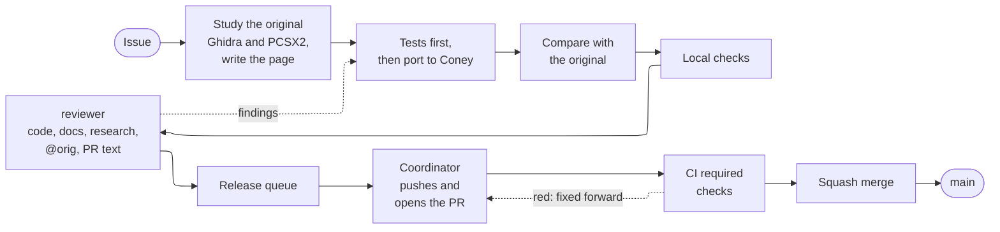
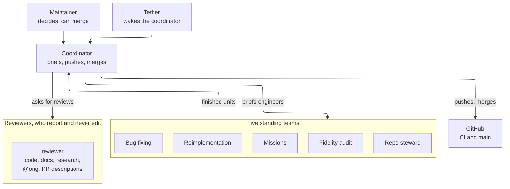
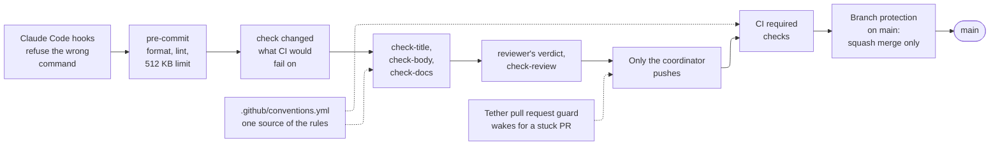

# How we work

This page is the map of Coney's reverse-engineering process: what happens between the original game and a line of
Coney code, which tools sit at each step, and how many people (or agents) work at once without stepping on each
other. It stays high level and links to the guide that holds the detail. Read it first; read the linked guide when
you are about to do that step. [How the work is run](#how-it-runs) explains who does what, for a newcomer, and
[How the rules are enforced](#enforcement) shows which check stops what, from the first line of code to `main`. The
diagrams on this page illustrate; the text beside each is the rule.

## The pipeline

A piece of work travels from an issue to `main` like this:



*Figure: the road from an issue to `main`. Solid arrows are the usual way; dotted arrows are where a failure sends the
work back.*

The numbered steps below are the engineer's part (from the issue to the local checks). Everything after it is the
[release queue](#release-queue) and [merging](#merging).

Every feature goes through the same steps:

1. **Read the code.** Before starting, an engineer checks `docs/research/` and the open pull requests for existing or
   in-flight coverage and extends it ([Before you research](research-workflow.md#upstream)). Then the engineer studies
   the original executable `SLUS_212.15` in Ghidra: names the functions, writes plate comments and works out what
   each one does.
2. **Watch it run.** For behaviour a player sees, always, not only when the code is unclear: the engineer makes the
   behaviour happen in the original running in PCSX2 and records it (a per-update trace, memory reads, reference
   frames). Play to it with input (a PCSX2 input recording, or scripted input); when that is slow or unreliable,
   trigger it directly, using a [recipe](#recipes) or, where none exists, finding in Ghidra and the debugger which
   state, call or event starts it and setting that over PINE. A new way of triggering something becomes a recipe for
   the next engineer. What the recording shows is read against the code in Ghidra, and the debugger's breakpoints and
   memory reads fill in what neither shows alone.
3. **Write it down.** The finding goes on a research page in `docs/research/`, in prose, with the address it comes
   from and an [evidence level](research-evidence.md#evidence-levels) on every claim.
4. **Implement it.** The engineer ports the behaviour from the original function at its address in Ghidra. The
   research page is the map to that function (which one, where, what it touches), not the source of its logic: the
   logic is read from the function itself, and any disagreement with the page's cited addresses is recorded on the
   page ([the runtime comparison](testing.md#runtime-comparison)). The engineer then writes Coney's own code for it,
   tests first, and tags it with `@orig` and the page link ([Conventions](conventions.md#comments-and-orig)). Where
   Coney already has the behaviour, the engineer adjusts it until it matches the original and the recording; where it
   does not, adds it. Code with no original counterpart (networking, the launcher, debug tooling, enhancements) is
   the exception: it carries no `@orig` tag and is checked by its own tests.
5. **Compare.** Work a player sees is checked against the original running, not only against our reading of its code:
   the same scenario runs on both games, or the same moment is taken from a PCSX2 save state and from Coney, and
   traces, values or frames are compared ([Comparing with Coney](research-traces.md#comparing-with-coney),
   [the runtime comparison](testing.md#runtime-comparison)). A difference goes back to step 1 or 4 as a question or a
   fix. The pull request states the result in its `Runtime:` line.
6. **Merge.** Finished work goes to `main` after the full set of checks.

### Recipes {#recipes}

Recipes are the shared ways of making things happen in the running original: finding, moving and spawning humans,
editing their attributes and the player's stats, giving the crew orders, raising events, going to a level, mission or
checkpoint, and driving the pad. Each is confirmed at runtime and run with `coney-tools pcsx2 recipe` on a PCSX2 copy
you hold a claim on; the list, with the address and evidence behind each recipe, is [PCSX2 recipes](pcsx2-recipes.md).
A new way of triggering something becomes a recipe there ([Driving PCSX2](research-tools.md#driving-pcsx2) explains
the techniques underneath).

The places to start from are shared too: the [PCSX2 state library](pcsx2-states.md) keeps save states of the original
(a pedestrian to grab, a fence to jump, a store door) with a catalog saying what each shows. Check it before driving
the game anywhere, and add a state you made that others could use.

## How the work is run {#how-it-runs}

Coney is written by agents (AI models) under a maintainer, and a person can take any of the same roles. The parts:



*Figure: who does what. The maintainer decides, the coordinator runs the work, engineers in five standing teams do it,
and reviewers check it; only the coordinator writes to GitHub.*

- **The maintainer decides.** What only a maintainer may decide is a short list in [AGENTS.md](repo:AGENTS.md);
  everything else is decided by the coordinator or the engineer on the spot.
- **The coordinator runs the work** day to day: it starts and briefs engineers, keeps the state, pushes finished
  units and merges ([The coordinator](#coordinator)).
- **Engineers each own one issue or unit.** An engineer works in its own worktree and branch, briefed as
  [Briefing](agents.md#briefs) describes (a brief may be just "issue #N"), follows the [pipeline](#the-pipeline)
  above, commits locally and hands the finished unit over. The model is chosen per task
  ([Which model](agents.md#models)).
- **The reviewer reads what someone else wrote** and reports; it never edits. One `reviewer` takes code, tests, tools,
  docs and commits, research pages and the research database, `@orig` functions against the original and every pull
  request description before it is pushed ([Task review](review/task.md), [The description review](#pr-review); the
  roles are in [Setting up an agent tool](agents.md#setup)).
- **The release queue** is how work reaches GitHub: engineers never push; the coordinator does, when CI has room
  ([below](#release-queue)).
- **Tether wakes the coordinator.** Between turns the coordinator sees nothing, so the Tether plugin starts a turn
  when there is new work ([Let Tether wake it](#coordinator)).

### Standing teams {#teams}

Five teams are kept staffed at all times. When an engineer finishes or stops, the coordinator starts the next one
from that team's list at once instead of waiting; many issues are in work together, one engineer each, and two
engineers never work in the same functions.

1. **Reimplementation:** functions of the original that Coney has not ported yet, and the open feature issues.
2. **Missions:** building the missions and fixing their checkpoints (`research/missions.yaml`).
3. **Bug fixing:** the open bug issues, highest priority first.
4. **Repo steward:** reads GitHub (issues, pull requests, CI, labels) and the workspace and proposes: triage, red or
   stuck pull requests, audit findings. It writes nothing to GitHub; the coordinator applies what it proposes
   ([Issues](#issues)).
5. **Fidelity audit:** compares existing code with the original ([below](#fidelity-audit)).

## The fidelity audit {#fidelity-audit}

Code that predates porting from the original function, or was ported from a quick reading, can differ from the
original in ways nobody has noticed. The audit is the standing team that looks for exactly that, since gameplay
matches the original exactly until the game is complete ([AGENTS.md](repo:AGENTS.md)). It works through the code one
subsystem at a time, in the order of the `@orig` index, and avoids files that other open branches change.

- **Compare function by function.** For each function that carries an `@orig` tag, the engineer opens the original
  function at that address in Ghidra and reads it next to Coney's. Where the code leaves a point unclear, the engineer
  runs the original in PCSX2, inside a claim, and reads the values
  ([Driving PCSX2](research-tools.md#driving-pcsx2)).
- **Fix what differs, with a test.** Each fix comes with a test that fails before it and passes after
  ([Testing](testing.md)). A difference that is deliberate (a PC platform call in place of a PS2 one) stays, and its
  comment says why. A fix a player sees is a gameplay pull request like any other and carries a `Runtime:` line
  ([the Runtime line](testing.md#runtime-line)).
- **Research pages keep their structure and gain references.** Next to each behaviour a page describes, the audit adds
  the address and name of the original function where its logic lives, so the next engineer is sent to the function.
  A claim is rewritten only when the original contradicts it, with the address and evidence level
  ([Evidence levels](research-evidence.md#evidence-levels)).
- **Coney-only code is out of scope:** networking, the launcher, debug tooling and enhancements have no original
  function to compare with.
- **Check the expression too.** Each function is judged on two counts: fidelity, and own expression (ported, not
  transcribed: [Porting, not transcribing](conventions.md#porting)). The classes, the snippet limit and the file
  formats are in one rubric, [Orig review](review/orig.md). A sweep over existing code runs the `reviewer`
  agent in sweep mode, one folder or address list at a time ([Running agents](agents.md#reviewer)). Every
  class but `clean` and `diff-deliberate-ok` becomes a fix unit.
- **Progress is kept by the tool.** `coney-tools orig index` lists every tagged function with its research page. The
  review ledger records each function reviewed, at which body and with what class, and `orig queue` orders what is
  unreviewed or changed since its review ([orig](coney-tools-fidelity.md#orig)). So every `@orig` function is reviewed once,
  and again after each change to it.

The audit's output is ordinary units: a branch of fixes, tests and page references per pull request, handed to the
[release queue](#release-queue).

## One role: the engineer {#engineer}

An engineer studies the original (Ghidra through ghidra-mcp, the running game through the pcsx2 MCP server), writes
research pages where they help and implements the result in engine code and tests
([Studying the original](research-workflow.md#studying-the-original)). An answer worth keeping lands on the page, not
in a private message, and no game data ever goes in the repository ([LEGAL.md](repo:LEGAL.md#no-game-data)).
The page points the next engineer at the original function and records what was learned from it; the logic itself is
ported from the function at its address. How a page and the function work together, with three real features traced
to the merged result, is in [From research to code](research-to-code.md).

## The tools

- **Ghidra, shared.** One Ghidra project of the PS2 executable (with the Emotion Engine extension), kept open by a
  headless ghidra-mcp server on port 8090. Every engineer works in that one project at once, so a name given by one
  is seen by all; never undo another engineer's names. Setup: [Ghidra + ghidra-mcp](ghidra.md).
- **The Xbox build as a reading aid.** The same function in the Xbox executable can read faster (inline strings,
  named library calls). It is only read; evidence is always cited at PS2 addresses
  ([Xbox executable](../research/xbox-executable.md)).
- **PCSX2, several copies with claims.** Portable PCSX2 copies (`pcsx2`, `pcsx2-b`, ...) run the maintainer's
  PCSX2-MCP fork build (`coney-tools pcsx2 setup-copies`) and each have their own settings, states, PINE port and
  debug server port, so several engineers can run the game at once. A copy is used only inside a claim:
  `coney-tools pcsx2 claim --agent <id>` hands out a free copy and its two ports, `pcsx2 release` frees it, `pcsx2
  status` shows who holds what, and a claim whose process died is taken over; an agent connects the `pcsx2` MCP server
  to its own copy's ports only, which a hook checks at the connect ([Driving PCSX2](research-tools.md#driving-pcsx2),
  [Agents](agents.md#setup), [the PCSX2 MCP guard](agents.md#pcsx2-guard)).
- **Input without the keyboard.** The game is driven by writing pad state into its memory over PINE (the
  `scripted-pad`, `right-stick` and `puppet` patches), with analog sticks at realistic partial deflections, or by the
  debug server's pad and PCSX2's own input recordings, which replay a run exactly. No tool brings PCSX2 to
  the front or types into it, so the machine stays usable; a maintainer's quick-save slots are read-only,
  and engineers save states to files.
- **Traces and frames.** `coney-tools pcsx2 record` and `coney-tools trace` record the same scripted scenario on the
  original and on Coney and diff them; Coney's `--camera`, `--freeze-world` and `--screenshot` flags reproduce a
  reference frame ([coney-tools](coney-tools-trace.md#trace)).
- **Extraction.** `coney-tools extract` turns the player's disc into open formats (PNG, glTF, WAV) in a folder
  outside the repository ([extract](coney-tools-disc.md#extract)).

## The local layout

Everything that is not source code sits next to the repository, never inside it: the disc and extracted files,
PCSX2 copies, Ghidra and its project, worktrees and a scratch folder. The repository cannot leak game data through
a stray `git add`, and every worktree shares the same tools. Details: [Local workspace](workspace.md).

## Working in parallel

Many tracks run at once, each owning one subsystem, mission or question:

- **One branch and one worktree per track**, under `worktrees/coney/<branch>/`. Nobody edits the main checkout.
- **Small shared files are regenerated, not hand-merged**: binding pages and similar files come from generators
  that the merge reruns. Files every pull request would change are not committed at all: the progress tables and the
  README's badges are produced by the docs build ([Measuring progress](#measuring-progress)), so a merge to `main`
  never makes another pull request conflict on them.
- **Pull requests merge one at a time**, by the maintainer or a coordinator the maintainer has allowed to, never by
  the agent that wrote them. Before merging, the coordinator checks more than CI: the title, one feature per pull
  request, the description, docs and tests that go with the change, and a diff that holds only that change. Each
  pull request is squash-merged once every required check passes (tests, generators, docs build), so it
  lands on `main` as one commit; work-in-progress commits on the branch are dropped by the squash and need no
  tidying first.
- **Agents work locally; the coordinator releases to CI** from a queue ([below](#release-queue)).
- **Each track's status is a file on disk**, `STATUS.md` in its scratch folder ([Track status](#status)), not in
  anyone's head.

## Local first: the release queue {#release-queue}

CI is shared and limited (about 20 jobs at once, 5 of them on macOS; a full code pull request takes about 20
minutes), so it must never hold an agent back. Agents do all their work locally and hand finished units to the
coordinator, who pushes them when CI has room.

- **An agent never pushes and never opens a pull request.** It commits on its branch and runs every local check that
  applies before calling a unit finished: `coney-tools build --test` for code, `uvx pre-commit run --all-files`, pytest,
  `mkdocs build --strict` ([The local gate](testing.md#local-gate)). CI should only ever find what the local
  platform cannot see. A hook (`.claude/hooks/push_guard.py`) refuses `git push` and every `gh` command that writes
  (a pull request, a comment, a label, a review, a merge, a rerun, `gh api` with a method other than GET) when a
  subagent runs it; Claude Code marks a subagent's calls with an `agent_id`, so the coordinator's own session is never
  refused. An agent started as a session of its own (`claude -p`) has no `agent_id` and is not covered: its brief
  says it never pushes. Nor is a command run from a script file or through `xargs`.
- **The unit is one pull request's worth,** not a whole task: one fix or feature with its tests and docs. For each,
  the agent writes the pull request's title and description (from `.github/pull_request_template.md`) to a file in
  its scratch folder (`PR.md`, or `PR-<n>.md` for several), messages the coordinator the branch, the commit range and
  the file, and goes on with the next unit.
- **Dependent units are stacked.** The next unit branches from the previous one and its description names the
  pull request it depends on. After the earlier one is squash-merged, the later branch is moved onto `main` with
  `git rebase --onto origin/main <old base> <branch>` (the old base is the earlier branch's tip), so the squashed
  commits are not replayed.
- **The coordinator keeps the release queue** in its state file and releases units while the agents keep working:
  it checks the queue (`gh run list --status queued` and `--status in_progress`), pushes the branch and opens the
  pull request with `gh pr create --title "<title>" --body-file <PR.md>` when there is room, run from the author's
  scratch folder with one `--attach ./shots/<file>.png` per capture the text refers to (gh 2.99+;
  [Capturing and attaching](testing.md#pr-media)). Priority: engine fixes first, then what
  unblocks other work. A pull request runs only the jobs its change can break, so a documentation-only one is cheap
  ([What CI runs](building.md#what-ci-runs)).
- **A task is reviewed with `coney-tools task review`** ([Task review](review/task.md)): the tool checks what a
  program can (the stamp log, a current `compared` stamp for each `@orig` function, the copy check, `fails-first`
  stamps, `docs check`, the description), a `reviewer` judges the rest, and the verdict is recorded as a `reviewed`
  stamp bound to the change. The two release checks below predate it and run until `pr open` replaces them.
- **Every `@orig` function a branch adds or changes is checked against the original before release.** The
  `reviewer` agent runs in pr mode on the branch ([Running agents](agents.md#reviewer)). It decompiles
  each address and compares on fidelity and own expression ([Orig review](review/orig.md)), and writes
  `ORIG-REVIEW.json` and `ORIG-REVIEW.md` next to the description. The release step runs
  `coney-tools orig check-review`. That check passes a branch with no changed `@orig` function, and otherwise needs
  a passing verdict that covers each changed function at its current body. A transcription, a behaviour difference
  with no reason, a deliberate difference with no comment, or a wrong address fails. Run it before the description
  review, so a fix to the code does not make the description's review stale.
- **Every description is reviewed before it is pushed** ([below](#pr-review)). The coordinator runs
  `coney-tools repo review <PR.md> --worktree <worktree>` and pushes only when `repo check-review` passes. Any edit to
  the description or its pictures, and any new commit on the branch, makes the verdict stale: review again.
- **The PR guard holds the push to CI's checks.** A Claude Code hook (`.claude/hooks/pr_guard.py`) runs before
  `gh pr create` and `gh pr edit`. `create` needs `--title` and `--body-file` (never `--body`, `--fill`, `--web` or a
  body on stdin), and the title and the file must pass `repo check-title` and `repo check-body --title` (with
  `--local-images` when the command has `--attach`), the checks CI's required `title` and `body` jobs run; `edit` checks
  the title or file it changes. On 2026-10-20 and 21 CI's `body` job refused six pull requests for a missing section or
  a local image not attached, mistakes this finds before the push. A relative `--body-file` is found from the folder a
  leading `cd` moved to. A command that names only another repository passes, a title or file the shell fills in
  (`"$TITLE"`) is not checked, and the hook lets a command through when it cannot run the checks. When
  `coney-tools pr open` replaces `gh pr create`, one switch (`[pr_guard] refuse_pr_create` in
  `.claude/hooks/hooks.toml`, off until then) makes the hook refuse every `gh pr create` and every `gh api` call that
  opens a pull request ([The hooks](agents.md#hooks)).
- **Stale failures restart themselves.** `coney-tools repo pr-health --rerun --apply` (run from the coordinator's
  watch loop) reruns a required check that failed because the runner or GitHub did (cancelled, never started, timed
  out, or a log that shows the runner was lost), at most twice per workflow and commit, and never a real lint, build or
  test failure. For a `title` or `body` check that failed on text fixed since, it reports that the pull request needs a
  new event (edit the title or description) because a rerun would reuse the old text
  ([pr-health](coney-tools-repo.md#repo-pr-health)).
- **A failure CI finds later** (another platform, a check that cannot run locally) goes to the coordinator when it is
  trivial, otherwise to a small fresh agent ([When a pull request fails checks](agents.md#ci-failures)); never back
  to the agent that wrote the unit.
- **A description is public:** the rules of a research page apply (addresses and short findings, no game data and
  no pasted function listings).

### The description review {#pr-review}

`coney-tools repo check-body` (and CI) only checks a description's structure, and the review itself starts only on a
description that passes it (below). On 2026-10-12 a pull request was released whose screenshots did not match it:
three of its four pictures showed a letterboxed scene instead of gameplay, and its before and after pair were the same
file. So a second reader goes over every description before it is pushed: the `reviewer` agent
([Running agents](agents.md#reviewer); its checklist is [Description](review/text.md)). It reads the description, the
branch's diff and the logs the description cites,
opens every picture, and writes a verdict: whether each picture shows what the text says (gameplay, not a scene,
loading screen or menu; the right level; before and after that differ), whether each claim in Summary and Testing is
backed by the diff or a log, whether `Fixes #N` fits, whether Issues affected lists the open issues the diff plainly
touches (`issue impact` helps), that nothing is left for later, that `Docs: none` is allowed and
that AI use is filled.
For a title in an area a player sees (`gameplay`, `graphics`, `audio`), `check-body` already requires the Testing
section's `Runtime:` line ([What a pull request shows](testing.md#runtime-line)); the reviewer checks that it is
**true**. It refuses a `Runtime:` line with no log, trace or capture behind it in the scratch folder (a trace diff's
output, the PCSX2 reads or the two pictures, with the numbers the line quotes), and a `Runtime: none (<reason>)` whose
reason is only convenience ("not checked", "no time", "the copy was busy") when a PCSX2 copy and the save states were
available: the original could have been run, so the comparison is made or the pull request waits.
The gate also holds the `Model:` line to the branch's commits: `repo check-review` (or `repo check-body --worktree`)
refuses a line that does not name every model a `Co-Authored-By` trailer on them credits; CI cannot, having no commits
([the Model line](coney-tools-repo.md#repo-model-line)).

```sh
uv run --project python coney-tools repo review <PR.md> --worktree <worktree>
uv run --project python coney-tools repo check-review <PR.md> --worktree <worktree>
```

`repo review` runs the agent headlessly (`claude -p`, a throwaway run in the scratch folder) and then
`repo check-review`, the gate the release step runs before it pushes ([repo review](coney-tools-repo.md#repo-review)). Both
run the title and body checks CI runs, and so does `repo review-stamp`, the first thing the agent runs, whether
`repo review` started it or a coordinator launched it as a subagent: it refuses a description CI would refuse, with the
same messages and no stamp, so the review never starts on text that the release step would send back (an edit then
makes the verdict stale and costs a second review). Run `repo check-title` and `repo check-body` on a description as
you write it. A failing
verdict goes back as a fix to the description or the captures, never as a push. The gate's rules, generated
from `pull_requests.review` in [.github/conventions.yml](repo:.github/conventions.yml):

<!-- conventions:begin pr-review -->
- The `reviewer` agent (`.claude/agents/reviewer.md`) writes `REVIEW.json` and `REVIEW.md` next to the description file:
  `REVIEW.json` holds `tip`, `body_sha256`, `verdict` (`pass` or `fail`), `images` (each local image's `path` and
  `sha256`) and `findings` (each with `severity` `blocker` or `note`, `where` and `text`).
- `repo check-review` passes only when the description's title (line 1) and body (the rest) pass `repo check-title` and
  `repo check-body` (a local image is allowed, as `gh --attach` uploads it), the verdict is `pass` with no `blocker`
  finding, `tip` is the worktree's HEAD, `body_sha256` is the description file's hash now and every local image the
  description shows is listed with its hash now; any new commit, edit or replaced picture makes the verdict stale.
- The description's hash is the SHA-256 of the whole file (title line included) as UTF-8, with a leading BOM dropped and
  CRLF or CR turned into LF.
- Two byte-identical images in one description are refused, whatever the verdict.
<!-- conventions:end -->

People contributing from their own fork push and open pull requests themselves
([CONTRIBUTING.md](repo:CONTRIBUTING.md)); the queue is how a coordinator runs many agents on one machine.

## Track status {#status}

Each track keeps `STATUS.md` in its scratch folder, so a stopped track is resumed from disk, not from a dead agent's
context: what is done (with commits), what is left, which units are queued or released (branch, commit range,
description file, pull request number once open), and the log paths that matter. The agent updates it as each unit
is finished; a fresh agent continues from it and the branch ([Running agents](agents.md#cache)).

## Sharing one machine {#shared-machine}

Many agents and a maintainer use one computer at the same time. These rules each exist because a past session broke
something:

- **Never edit the main checkout.** Work in your own worktree and address it with `git -C "<absolute path>"`: a
  relative `cd` that failed once ran a build in the wrong checkout.
- **Never use `git stash`.** The stash list lives in the shared repository, so every worktree sees one list, and a
  `stash` followed by a `pop` can take another track's work. To set work aside, commit it as a WIP commit on your own
  branch (or a local `wip/<branch>` branch) and reset or cherry-pick it back later. Never pop, apply or drop a stash
  you did not make.
- **Stop only what you started.** Never kill processes by image name (`taskkill /IM`, `Stop-Process -Name`,
  `pkill`): other tracks run the same programs (the game, test runners, the emulator). Stop your own background
  task, or its process tree by id (`taskkill /T /PID <pid>`). Stopping a background task does not always stop the
  children its shell started, so check that nothing of yours is still running.
- **Keep the machine usable.** Nothing you start may take the keyboard focus or send keystrokes to another
  window; drive programs through their own interfaces (for the emulator, see
  [Driving PCSX2](research-tools.md#driving-pcsx2)). Keep build parallelism moderate, and do not run
  virtual-machine builds locally when the project's CI covers them. On Windows that means no WSL builds and no
  clang-tidy runs: GitHub CI is the Linux and macOS gate, and a failure there is fixed forward on the branch
  ([CI](building.md#what-ci-runs)).
- **Keep the drive from filling up.** A build is about 6 GB and every track has its own worktree, so forgotten
  worktrees fill a drive (once down to 3 GB free, which broke builds). An agent creates a `.coney-busy` file in its
  worktree when it starts and deletes it when it finishes, and deletes its own `build/` folder when it hands over a
  unit. The coordinator runs `coney-tools workspace clean --apply` after every merge round (it removes merged
  worktrees and old build folders, and never touches busy or unmerged work) and `coney-tools workspace disk` before
  starting builds: below 30 GB free it cleans first ([Cleanup](workspace.md#cleanup)).
- **Heavy builds take a slot, from a tool.** A full engine build uses every core, so only two run at once and the
  rest queue: every build and test run goes through `coney-tools build`, which claims a slot like a PCSX2 copy (a fast
  lane for small jobs, a fair queue, priority for builds someone waits on; [`build`](coney-tools-build.md#build)), and a
  hook refuses raw `cmake --build`, `ctest` and `ninja`. The machine's number of slots is `build_slots` in
  `coney.local.toml` ([Local workspace](workspace.md#local-config)). Tracks that only read, write docs or drive the
  emulator need no slot. Beyond the slots, at most `build_worktree_cap` worktrees (7) hold a build folder at once:
  `coney-tools build` refuses a new one past that, and `coney-tools workspace clean --apply` makes room ([The
  cap](agents.md#build-cap)); research, tools and docs tracks are not counted.
- **Share the long-lived tools, one user per copy.** One Ghidra server serves every engineer: use it as it is, never
  restart or stop it, and start it only if it is down ([Ghidra + ghidra-mcp](ghidra.md)). An emulator copy has one
  user at a time, through a claim that is released when done ([Driving PCSX2](research-tools.md#driving-pcsx2)).
- **Keep Python out of the tree.** Use a private virtual environment in your scratch folder
  (`UV_PROJECT_ENVIRONMENT`) rather than a `.venv` inside a worktree, which every tool and linter would then scan.
- **Scratch is yours per branch.** Put output in `scratch/<branch>/`; game-derived files (captures, states, dumps,
  screenshots) stay there and are deleted when done.
- **Your own tooling and records stay yours.** State files (`HANDOFF.md`, `STATUS.md`), personal scripts, launchers,
  editor or agent settings and notes live beside the repository, never in it: the repository holds only the project.
- **Generated images, video and audio may be deleted without asking.** Screenshots, frame captures and recordings
  pile up during reviews; any track may remove the ones the project produced. Write the path literally or guard a
  variable (`rm -f "${DIR:?}"/*.png`): a path built from a possibly empty variable can delete far more than meant.

## Issues {#issues}

Bugs and tasks are tracked as issues, opened from a form and labelled by type, area, priority and status. The
coordinator triages them and is the only one who writes to GitHub; an agent reads an issue (`gh issue view N
--comments`) and is often briefed with just its number. A pull request that finishes one says `Fixes #N`, so merging
closes it. The whole process: [Issues](issues.md).

**Issue rules are enforced, not remembered.** An issue is drafted, checked and filed only with `coney-tools issue
draft`, `check` and `create` (or `edit` and `link`); the repository's Claude Code hook (`.claude/hooks/issue_guard.py`)
refuses a raw `gh issue create`, a `gh issue edit` that sets the body and a `gh api` call that writes an issue; and
the `issue-check` workflow checks every issue opened or edited on the website or through the API and keeps one
comment listing the problems. The audit flags what slips past all three ([Filing an issue](issues.md#filing)).

**Claiming is one comment.** Whoever takes an issue (a person, an agent, the coordinator) claims it with `/claim`, and a
GitHub Action assigns it, sets the status label and keeps a claim card with the deadline; a claim idle for 72 hours is
released. The coordinator's `coney-tools task create` makes the claim and writes the task file
([Claiming an issue](issues.md#claiming), [Task files](issues.md#task-files)); the engineer then runs
`coney-tools task start`, which makes the branch, worktree and unit record ([Starting a task](issues.md#starting)).
Both are available now and become required with the new workflow's cutover.

**A pull request merges only when every task in it is finished.** Its Checklist lists what it finishes, all ticked, and
CI refuses an unticked item; there is no "Remaining" list. Work an agent finds that is not part of its task goes in its
message to the coordinator (title, area, research page, what "done" means) and the coordinator files it as an issue of
its own; a pull request that finishes an issue says `Fixes #N`
([Work found along the way](issues.md#follow-up-work)). The issue states its problem first, links pages by relative links
and names the source pull request's status truthfully ([Writing an issue a newcomer can read](issues.md#writing)).
The `hygiene` workflow comments on an issue or pull request that breaks the repository's rules and keeps that one
comment current; fix what it lists, and the comment says so when it is done
([Workflows](repo-conventions.md#workflows)).
The state file (`HANDOFF.md`) keeps only the live state and issue numbers, never a list of work to do: the work list
is the open issues.

## Testing {#testing}

Tracks never wait for a person to play their work, so the automated tests stand in for one. Every track proves its
work the same way: tests that start through the player's path, input driven like a gamepad, an adaptive playthrough
for every mission checkpoint, and diffs against the original. People play play-test builds at milestones and their
findings come back as fixes. The standard, including what "done" means for each kind of work and the checks to run
before reporting: [Testing](testing.md). A pull request shows the result: what was run with its numbers, and
before and after screenshots of anything visible ([What a pull request shows](testing.md#pr-evidence)).

## The coordinator {#coordinator}

One agent (or person) runs the work day to day: it keeps the project's state file and each track's state current,
starts and briefs the tracks, routes questions between them, merges and ships. It works under these rules:

- **Decide and keep going.** The coordinator approves its own designs and plans, and when one item ends it takes the
  next from the state file instead of asking whether to start. It stops only when a maintainer says so.
- **Escalate only maintainer decisions**, the list in [AGENTS.md](repo:AGENTS.md) (`repo.maintainer_decisions` in
  [.github/conventions.yml](repo:.github/conventions.yml)); everything else the coordinator decides itself.
- **Tidy after every merge round and once a week.** Run the `/repo-hygiene` skill: it audits the issues, pull requests,
  labels and workspace and fixes each finding by its class ([Merging safely](#merging)).
- **Bring the issues up to date after every merge.** Each pull request lists the open issues it affects in its Issues
  affected section; once it merges the coordinator edits each of them, and `pr.affected-unedited` reports the ones left
  ([After a merge](issues.md#after-a-merge)).
- **Keep every team staffed.** The [standing teams](#teams) are never left empty: when an engineer finishes, the
  next open item of that team's list gets an engineer at once (unfinished fixes, subsystems that differ from the
  original, missions still to build, the audit's next subsystem), one issue per engineer. The priorities are on the
  [roadmap](../roadmap.md#priorities).
- **Merge on the automated gate, not on play-tests.** Pull requests merge once the
  [checks](testing.md#local-gate) pass; the coordinator fixes small gate failures (lint, formatting, generated
  pages) itself instead of sending the work back.
- **Ship after every merged feature.** Push, build the release locally, and hand the play-testers one list of what
  changed and how to reach it ([Play-testing](testing.md#play-testing)). Research-only merges need no build.
- **Resume what was interrupted.** A usage limit, an account switch or a cleared session can stop agents mid-task;
  the coordinator restarts each stopped track as a fresh agent from its `STATUS.md` and branch before taking new work.
- **Let Tether wake it.** Between turns the session sees nothing. The [Tether](coney-tools-setup.md#coord-wakes) plugin's
  watch starts a turn for new work: issues to triage, units in the release queue, detached builds that ended and stuck
  pull requests. The settings that do this are documented there, not kept only on one machine.
- **Keep its own context small.** The coordinator re-reads its whole conversation on every turn: it saves the state,
  clears and continues from it at a natural boundary ([Running agents](agents.md#cache)).
- **A lesson becomes a rule in the same commit.** A mistake that cost time (a tool pitfall, a process race) is
  written into the guide where it applies, generally (why and the method), alongside its fix; briefs only point to
  it. Which rules a program checks, and at which point, is the [Enforcement map](enforcement.md).

## How the rules are enforced {#enforcement}

A rule that only people remember gets broken, so each rule is checked by a program, and each check sits at the first
place the mistake can be caught. The same checks run again further along, so a mistake that slips past one stage meets
the next. Most of the pull request rules are read from one file, [.github/conventions.yml](repo:.github/conventions.yml),
so the local check and the CI check never disagree ([Repository conventions](repo-conventions.md)).



*Figure: the guards between a line of code and `main`, in the order a change meets them. Dotted arrows show where the
rules are read from and what wakes the coordinator.*

The guards, with the rule each one holds (the diagram only orders them):

| Guard | What it refuses | Where it is documented |
| --- | --- | --- |
| Claude Code hooks (`.claude/hooks/`) | A raw `cmake --build`, `ctest` or `ninja`; a raw `gh` command that writes an issue; a wait loop with no bound; an agent started with `isolation: "worktree"`; a `Co-Authored-By` trailer that names the wrong model | [Setting up an agent tool](agents.md#setup) |
| pre-commit (`.pre-commit-config.yaml`) | Unformatted C++ (clang-format) and Python (ruff); a Markdown line over 120 characters; trailing whitespace, broken YAML or TOML; any file over 512 KB, which is usually game data; a read of the real clock outside the frame pacer | [Formatting and pre-commit](building.md#formatting-and-pre-commit) |
| `coney-tools check changed` | What CI would fail on, for the files the change touched: the repository audit, pre-commit, `mkdocs build --strict`, ruff, mypy and pytest | [The local gate](testing.md#local-gate) |
| `repo check-title`, `check-body`, `check-docs` | A title that is not `area: Verb the rest`; a description that breaks the template; a change under `src/` or `python/src/` with no docs change and no `Docs: none` line | [Repository conventions](repo-conventions.md#workflows) |
| `reviewer`, `repo check-review` | A description whose pictures or claims do not match the diff; a verdict that is stale after a new commit or edit | [The description review](#pr-review) |
| Release queue | An agent pushing: only the coordinator pushes, when CI has room | [Local first](#release-queue) |
| Tether pull request guard | A pull request left with a failed required check, a conflict, a stuck check or auto-merge off: the `prs` poller (`repo pr-health`) wakes the coordinator | [Waking the coordinator](coney-tools-setup.md#coord-wakes) |
| CI required checks | `title`, `docs`, `body`, `build-ok`, `python-ok`, `format`, `mkdocs`, `markdownlint`, `actionlint` | [What CI runs](building.md#what-ci-runs) |
| Branch protection (GitHub ruleset on `main`) | A direct push; a merge before every required check passes; a merge that is not a squash | [Merging safely](#merging) |

Issues are guarded the same way: the `issue_guard` hook, `coney-tools issue check` and the `issue-check` workflow
([Issues](#issues)).

## Merging safely {#merging}

- **After a merge round, run `/repo-hygiene`.** The skill runs the audit and fixes what it finds by the finding's fix
  class, including the issues each merged pull request lists under Issues affected
  ([After a merge](issues.md#after-a-merge)) and the issues that cite it (change "open" to "merged", tick what it
  finished, close or relabel an issue it fixed: [Writing an issue a newcomer can read](issues.md#writing)). It stops
  at the maintainer decisions ([The /repo-hygiene skill](repo-conventions.md#hygiene-skill)).
- **Merge only finished work.** A pull request is merged as it stands at its tip, and the squash drops the commits
  inside the branch, so a "WIP" commit in the middle does no harm. A branch whose tip is a paused, half-finished
  state is never merged: finish it, or cut the finished part into a new branch.
- **Check a branch's diff before merging it.** A branch can be contaminated with unrelated reverted files (a bad
  rebase or a stray copy); a diff against the merge base that touches files outside the track's scope means the
  branch is rebuilt, not merged.
- **GitHub merges, one pull request at a time.** Auto-merge is on: the maintainer or the coordinator enables it on a
  pull request that follows the rules, and GitHub squash-merges it as soon as every required check passes, then
  deletes its branch. The settings are the `merge` section of the conventions file, shown in
  [What CI runs](building.md#what-ci-runs). No local script merges anything, so there is no lock to take; the only
  merges done by hand are of `main` into a branch.
- **Do not hide a failed command in a pipe.** `git merge origin/main | tail -1 && next` reports the status of `tail`,
  not of the merge. Run the command on its own and test its exit code.
- **Regenerate, then resolve by hand only what a generator cannot.** On a conflict in a generated file, take either
  side and rerun the generator; resolve prose pages by hand, keeping both sides' claims.
- **Run the local gate again after merging `main` into a branch or rebasing it**
  ([The local gate](testing.md#local-gate)), and fix a red `main` forward rather than leaving it red. Before editing a
  page many tracks share, rebase on `main` first.
- **Rebuild the play-test build after an engine merge.** When a merged change touches the engine, the coordinator
  builds the `playtest` preset ([Build and test](building.md#build-and-test)) from the updated `main`, so the
  maintainer can play the latest `main`. A merge that changes only docs or research needs no build.
- **Make a new pull-request check required only once every open branch has it.** Editing a pull request's
  description reruns the `pr` workflow from that pull request's own merge commit, so a branch made before a new job
  was added to `.github/workflows/pr.yml` never runs it, and a required check that never reports blocks the pull
  request for good. Add the job, wait until every open pull request's branch includes it (rebase or merge `main`
  into the old ones), then add it to the required checks of the ruleset on `main`.
- **Later: a merge queue.** The ruleset on `main` has "require branches to be up to date" off to save CI time, so two
  pull requests that each pass can still break `main` together (a semantic conflict). Once there are regular outside
  contributors, turn on GitHub's merge queue for `main`: it tests each pull request on top of the ones queued ahead
  of it before merging.
- **Do not wait.** When a commit is finished and you are sure of it, report its sha in one line and go on to the next
  item in your scope. Never block on a merge, a rebase, a manual test or an answer: use a clearly marked stand-in or
  take the next unblocked item. Test findings come back later as fixes.

## Agents {#agent-conduct}

- **Choose how to run each agent deliberately.** Whether the coordinator does a task itself, forks or starts a
  fresh agent, which model it gets, how it is briefed and how it runs long commands decide most of what the work
  costs: [Running agents](agents.md).
- **An agent knows only what its brief and the repository tell it.** The brief names the role, the model, the
  worktree, the scope it owns, the files it must not touch and what "done" means, and points at the rules rather than
  pasting them ([Briefing](agents.md#briefs)).
- **No agent waits on CI, or pushes.** An agent works local-first and hands each finished unit to the coordinator's
  [release queue](#release-queue); the coordinator pushes, watches CI and sends a failure to a fresh agent
  ([When a pull request fails checks](agents.md#ci-failures)). An agent idle past its cache lifetime re-writes its
  whole context, often hundreds of thousands of tokens, when it resumes.
- **Long-running tracks keep going.** They hand each finished unit to the release queue and continue with the next
  item in scope until it is empty, instead of stopping after one finding.
- **Report what a reader needs:** commits, what works now and the command that shows it, stand-ins, open items and
  the results of the checks. Short. A pull request's description carries the same as a Testing section (what ran,
  the numbers) and a Screenshots section (before and after for anything visible, uploaded with `gh --attach` and never committed):
  [What a pull request shows](testing.md#pr-evidence).
- **Commits carry the agent's own model name** in a `Co-Authored-By` trailer (the format is
  `commits.trailers` in [.github/conventions.yml](repo:.github/conventions.yml), explained in
  [CONTRIBUTING.md](repo:CONTRIBUTING.md#agents-commits)); an agent never pushes, opens or merges a pull request.

## Starting on another game {#another-game}

The process, not the game, is what carries over. Reuse unchanged: the evidence levels, the
research database and page layout, the trace-and-diff method, the workspace layout, and every rule on this page and
in [Lessons learned](research-workflow.md#lessons-learned). Replace: the executable and its address base, the
emulator and its remote-memory interface, the patches and hook caves (they are found per game from unused memory),
the pad-input patch, the tick counter that numbers updates, and the format tools. Start by finding, in the new game,
four anchors: where input is read, what counts one update, where free memory for hook code is, and a string table
that names the subsystems.

## Measuring progress

A function counts as understood when it has a meaningful name and plate comment in the shared Ghidra project and a
research page cites its address with an evidence level ([The Understood measure](research-workflow.md#understood)).
`coney-tools progress` turns that into the [progress page](../progress/index.md) and a per-subsystem backlog. The
page's tables and the README's badge data are generated by the docs build and published from `main`; a pull request
changes only their inputs (the function database `research/functions/`, the research pages, the roadmap), never a
table, and CI runs `coney-tools progress check` on those. If a branch from before this change conflicts on `README.md` or
`docs/progress/index.md`, take `main`'s version of both.

## Where next

- Doing research: [Research workflow](research-workflow.md), then [Ghidra + ghidra-mcp](ghidra.md).
- Writing code: [Conventions](conventions.md), [Testing](testing.md), then [Building and testing](building.md).
- Running agents: [Running agents](agents.md).
- Bugs and tasks: [Issues](issues.md) (forms, labels, triage, working from an issue).
- Writing pages: [Writing these docs](writing-docs.md).
