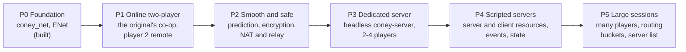
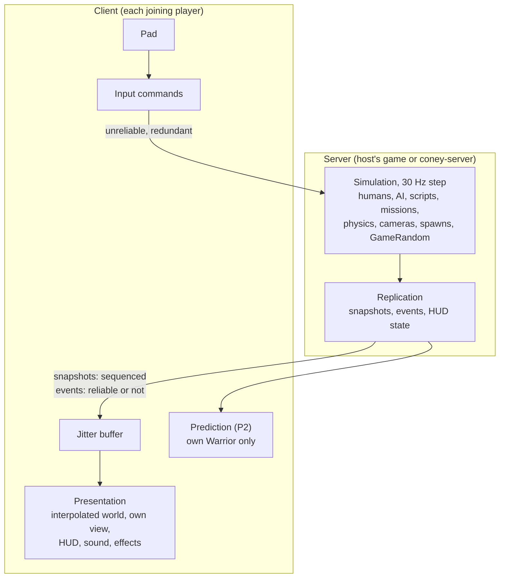
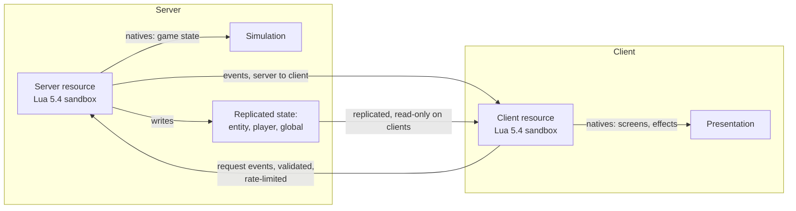

# Network architecture

**A design.** This page is the plan for Coney's online play, from two friends in the original's own co-op to
dedicated servers that run their own scripts. What is built, and the exact protocol, are on [Network
multiplayer](multiplayer.md), which owns the layers, the messages and the sessions; this page links there and does not
repeat them. When a part of this design is built, it moves to that page (or to the subsystem's research page) and
this page keeps only a link. Questions only a maintainer can answer are in [Maintainer decisions](#decisions).

Every engineer reads [The networking checklist](#checklist) before writing a subsystem: it is short, and it is what
keeps everything below possible without rewriting the game later.

## Contents {#contents}

1. [Where we start](#start): the original's own two-player game, and what Coney has.
2. [Goals and phases](#phases): from the original's co-op over a network to scripted servers.
3. [The authority model](#authority): who decides what.
4. [Replication](#replication): network ids, snapshots, events, interest, interpolation and prediction.
5. [Subsystem by subsystem](#subsystems): what each part of the game syncs and how, and what in today's code is in
   the way.
6. [Story, missions and cutscenes in co-op](#story).
7. [Scripting across the network](#scripting): server and client resources, events and state.
8. [Security](#security): the trust model, validation, encryption and cheats.
9. [Transport](#transport): ENet now, and what changes later.
10. [Saves and persistence](#saves).
11. [Tick rate: should the simulation run at 60 Hz?](#tick-rate)
12. [Testing](#testing).
13. [The networking checklist](#checklist), for every engineer.
14. [Roadmap](#roadmap): the work in order.
15. [Maintainer decisions](#decisions) and [Prior art and sources](#sources).

## Where we start {#start}

### The original already has two-player co-op {#original-coop}

*The Warriors* has **drop-in, drop-out two-player co-op in story mode**, on one console with a dynamic split screen,
and two-player co-op and versus in Rumble and Armies of the Night. That is the most important fact for this design:
two players in the story are **faithful**, not an enhancement. The original's own code and scripts already handle a
second player everywhere a network game needs them to.

| What the original does with two players | Where | Evidence |
| --- | --- | --- |
| Player 2 joins when a second pad presses START and joining is allowed (`CfgMultiplayerJoin`): `GameState_SyncPlayers` takes the player gang's next human by hand-over priority, makes him a player and calls the level's multiplayer callback; a pad leaving releases him | `0x0041a460`, `0x0041b148` ([Scripting: player 2](../research/scripting.md#level99-p2-vermin-fence)) | confirmed (code) |
| Whether player 2 is in play is kept per mode (story, Rumble, Armies) | `GameState_IsTwoPlayerActive` `0x00419a80` ([Front end](../research/frontend.md#warriors-functions)) | confirmed (code) |
| Every level script guards player 2's steps with `HuIsAPlayer(player2)`, and registers `SetPlayer2Callback` to resume, place or hide the second Warrior | `level99` scripts ([Scripting](../research/scripting.md#level99-p2-vermin-fence)) | inferred (script disassembly) |
| The cameras split and merge the screen: merged when both players are in view within 11 m, else split, with 0.72 s timers and a flash | `Cam_Follow_DecideSplit` `0x00126c40`, `Cameras_LayoutViews` `0x00122ed0` ([Cameras](../research/camera.md)) | confirmed (code) |
| The AI knows about two players: Warriors far from player 1 defend player 2, reactions and enemy counting change in co-op | `DefendTactic_GiveGoals` `0x00310288`, `WarriorFollowTactic_GiveGoals` `0x00310f38`, `HideTactic_RegiveMember` `0x00313028` ([AI code](../research/ai-code.md)) | confirmed (code) |
| Spawners place new humans where no player's camera can see them | `Camera_AnyPlayerCanSeePoint` ([AI: spawners](../research/ai-gangs.md#spawner-unseen)) | confirmed (code) |
| The pause menu offers a co-op quit (player 2 or all) | [Pause menu](../research/pause.md) | confirmed (code) |

So the first online game is **the original's two-player story with player 2's pad and screen on another machine**.
The host simulates exactly what a PS2 with two pads would; nothing in the simulation changes, only where the second
pad's samples come from and where the second view is drawn. More than two players is Coney's own, and comes later
behind a session rule ([Phases](#phases)).

### What Coney has {#coney-has}

- **The foundation:** `coney_net` (bit stream, transport interface, loopback, link conditioner, protocol, server and
  client sessions) and the ENet transport ([Network multiplayer](multiplayer.md)).
- **A loop built for this:** a fixed 1/30 s step at any frame rate, bit for bit the same at every rate, game time
  counted in steps, `render()` that only draws and blends the last two steps, pads read once per step, no clock
  outside the frame pacer, a headless lockstep test mode ([Update and render](conventions.md#update-and-render)).
- **The game's own random numbers** in one place (`GameRandom`), as the original's one shared table walk.
- **One player.** Coney does not yet build the original's two-player game; the pause menu leaves out the co-op quit
  and the scripts' `HuIsAPlayer(player2)` is answered for one player. That is the first blocker
  ([Readiness](#subsystems)).

## Goals and phases {#phases}

The goal: online story co-op with friends first, then servers that anyone can host, whose own scripts drive the game
and talk to scripts on the players' machines, in the spirit of FiveM. Each phase is usable on its own and none
rewrites the one before.

| Phase | What a player gets | Faithful? | Depends on |
| --- | --- | --- | --- |
| **P0 Foundation** (built) | nothing visible: the library, ENet, the tests | n/a | |
| **P1 Online two-player** | a friend joins the story, Rumble or Armies as player 2 over LAN or a direct address; the host's game is the one true game | **yes**: the original's two-player game, only the pad and the view travel | the original's two-player game built offline first |
| **P2 Smooth and safe** | the joining player's own Warrior answers at once (prediction); the session is encrypted; joining across the internet works through NAT, with a relay when it must | yes (presentation and transport only) | P1 |
| **P3 Dedicated server** | a server program with no window hosts a session; players join and leave at any time; three or four players | two players: yes; more: **no**, Coney's rule set | the simulation out of `src/platform/` ([Readiness](#subsystems)) |
| **P4 Scripted servers** | a server runs its own resources: server scripts that drive the game, client scripts that add screens and effects, events between them | no: Coney's own, a modded session | P3, the script split ([Asset and script architecture](asset-and-script-architecture.md#scripts)) |
| **P5 Large sessions** | dozens of players, several worlds on one server, a server list | no | P4 |

**Faithful first.** The original's game is complete before anything beyond it ([AGENTS.md](repo:AGENTS.md), Rules).
P1 needs no exception: the second player is the original's. P2 adds nothing to the simulation. From P3 on, everything
beyond two players or the original's levels runs only in a session marked with **Coney's rule set**, which a test
mode and a single-player game never turn on. The rule set is the one switch for every limit raised beyond the
original's ([Limits](#limits)).

**Single-player is untouched.** With no session open, no network code runs and the game is the same, bit for bit, as
a build without networking; a test proves it ([Testing](#testing)). The networking hooks in the loop cost one branch
when no session exists.

## The authority model {#authority}

One machine, the **server**, runs the one true simulation. In P1 and P2 it is the host's own game (a listen server);
from P3 it may be a dedicated server with no player of its own. The other machines are **clients**: they send what
their players do and show what the server says.

| The server owns | The client owns |
| --- | --- |
| every human's position, state, health and animation; every brain, gang, formation and goal | its pad, and nothing else of the game |
| every script (the original's level scripts and, from P4, server resources) | its client resources (P4): screens and effects, never game state |
| missions, checkpoints, flags, story progress, the save | its options, its display, its audio mix |
| `GameRandom` and every gameplay draw | its own cosmetic random numbers, seeded per client |
| physics, collision, thrown objects, doors, props, cars, spawns | particles and decals from the server's events |
| **every player's camera** (the simulation reads cameras: spawners, scripted shots, the split decision) | drawing its player's view from the server's camera, smoothed; P2: its own camera predicted for feel |
| HUD state: messages, objectives, counters, radar blips, prompts | drawing the HUD from that state |
| when a cutscene or movie starts and ends | playing it, and saying when it has finished or been skipped |

Why server-authoritative and not peer-to-peer lockstep or rollback:

- **The world is large and busy.** Up to about 40 AI humans, brains, gangs, scripts and streaming. Lockstep makes
  every machine wait for the slowest and needs bit-exact floats across compilers and platforms; rollback must copy
  and re-simulate all of that several times a frame. Both are right for a fighting game with two characters
  ([GGPO](#sources)), not here.
- **Joining late.** Snapshots let a player drop in mid-level, as the original's player 2 does; lockstep needs the
  whole history.
- **The trust model.** One authority decides every hit, item and mission step; a client that lies about its position
  or its money has nothing to lie with ([Security](#security)).
- **One code path.** A listen server and a dedicated server are the same session code; only the front end differs
  ([Model](multiplayer.md#model)).

Determinism is still kept, but for other reasons: replays, the tests, prediction (a client's re-simulation of its own
Warrior should match the server's on the same inputs) and the [runtime comparison](testing.md#runtime-comparison).
Nothing depends on two machines computing the same floats.

## Replication {#replication}

### Network ids {#net-ids}

Nothing crosses the wire as a pointer, an index into a pool or a script handle. Every replicated thing gets a
**`NetId`** from the server: 16 bits of slot and a few bits of generation, so an id reused after a human dies is not
mistaken for the old one. Each side keeps a table from `NetId` to its own handle. The server assigns ids when a
thing becomes replicated (spawned, or a placed object first touched) and frees them when a client has acknowledged
its removal.

| Kind | Identified by | Notes |
| --- | --- | --- |
| Humans (players and AI) | `NetId` | the largest share of every snapshot |
| World objects (doors, props, glass, pickups, loose objects) | `NetId`, mapped from the object's script handle | replicated only once changed from the level's data |
| Cars | `NetId` | |
| Cameras | the player's slot, and the camera's kind | one active camera per player |
| Players | slot 0-3 (the host's player is 0, as the original's player 1) | from the handshake ([Sessions](multiplayer.md#sessions)) |
| Sounds, particles, messages | none: they are events | |
| Assets (clips, models, sounds, texts) | the game's own name hashes and ids, the same on both sides | both sides load the same disc |

Both sides must load **the same simulation data**: the handshake compares the store's simulation digest
([Asset and script architecture](asset-and-script-architecture.md#asset-layers)) and refuses a client whose disc
region, executable or simulation overrides differ.

### Three kinds of data {#data-kinds}

Following Halo Reach's split ([sources](#sources)), each piece of data travels as one of three kinds, each with its own
delivery:

| Kind | What | Delivery | Example |
| --- | --- | --- | --- |
| **State** | what a thing is now; only the newest matters; eventually consistent | snapshots: UnreliableSequenced, delta against an acknowledged baseline | a human's position, heading, clip and health; a door's angle |
| **Events** | something happened at a step; cosmetic ones may be lost, important ones may not | Unreliable for cosmetic (a spark, a footstep), ReliableOrdered for the rest (a scene starts, a message shows, a mission ends) | `SoundPlayed(id, emitter, step)`, `SceneStarted(scene, step)` |
| **Control** | the session itself | ReliableOrdered | join, leave, ready, load level, pause |

Input commands go the other way ([Input](#input)).

### Snapshots {#snapshots}

Quake 3's model ([sources](#sources)): the server keeps, for each client, the last 32 snapshots it sent; each new
snapshot is written as a delta against the newest one that client has acknowledged, or against nothing (a full
snapshot) when there is none. Loss costs nothing to repair: the next delta is just against an older baseline.

- **Per entity:** a "changed" bit, then a changed bit per field group. Fields are declared once in a table (name,
  bits, range), the way Quake 3's `netField_t` and our [bit stream](multiplayer.md#bit-stream) quantized floats work,
  so the encoder, the decoder and the tests read one definition.
- **Quantization:** positions to 1 cm in the level's bounds (18 bits a coordinate in a 2 km level), heading to 10
  bits, health to its own range, a playhead to the clip's frame count.
- **Budget:** one snapshot fits one datagram of at most 1,200 bytes of payload; what does not fit waits, ordered by a
  [priority accumulator](#interest).
- **Rate:** every step (30 Hz) on a LAN, 15 Hz as the default across the internet, chosen per client from its link
  quality ([Link quality](multiplayer.md#link-quality)).

A rough budget, to show it fits: a moving human is about 15-25 bytes as a delta (position, heading, clip and
playhead, a few flags), a still one 1-2 bytes. Forty humans of which twelve move near a player: about 300 bytes a
snapshot, 9 KB/s at 30 Hz per client, 72 kbit/s. The host's upstream for three clients is about 220 kbit/s.

### Interest management {#interest}

Not everything goes to everyone. A client gets an entity when it is **relevant** to its player:

1. Always: every player, the player's own gang, everything a running scene or the mission names.
2. By distance: within 70 m of the client's player, the radius the original already uses to spawn objects around a
   player (`ObjectTaskManager_UpdateSpawns`, [Tasks](../research/tasks.md#tick)), on a grid of level cells.
3. Never: what the client cannot see or hear and no rule above keeps.

Within the relevant set, each entity's **priority** grows every step it is not sent (faster when near the player, on
screen, or in a fight with him) and resets when it is sent; the snapshot fills in order of priority until the budget
is spent. Far humans thus update a few times a second and near ones every snapshot, with no rule naming a rate.

With two to four players in one level, most of the level is relevant to someone; interest matters for bandwidth on
the internet and for [large sessions](#phases) (P5), where routing buckets, FiveM's separate worlds on one server,
keep groups of players apart.

### Interpolation {#interpolation}

A client draws everything the server owns **in the past**: a jitter buffer of snapshots, and the world drawn between
two of them, about 100 ms behind the newest (three snapshots at 30 Hz, two at 15 Hz), so one lost snapshot still
leaves two to blend. This is the same blend Coney already does between the last two steps
([Update and render](conventions.md#update-and-render)): `Interpolated<T>` and `DrawnPoses` get their two ends from
the jitter buffer instead of the last two steps. A thing that jumps (a teleport, a new clip) is marked in the snapshot
and drawn unblended, as `reset()` already does offline.

### Input commands {#input}

A client sends its pad, never its result. Each step's command is the pad sample the simulation would read on that
step ([Input: commands](../research/input.md#commands)): buttons, pressures and both sticks, tagged with the step it
belongs to. Each packet repeats the last several commands, so a lost packet costs nothing. The server keeps a short
buffer per client and applies each command on its step to that player's **pad record**, the place where the
original's per-player record already reads a pad; from there on, the server's game cannot tell a remote pad from a
local one. This is the step in progress on pad port 2 ([The plan](multiplayer.md#plan)).

If a command is late, the server repeats the last one (a held button stays held), and tells the client to send a
little earlier; if commands pile up, a little later (Overwatch's command-frame tuning, [sources](#sources)).

### Prediction (P2) {#prediction}

Until P2, a client sees its own Warrior after a round trip: fine on a LAN (a few ms), sluggish across the internet.
P2 adds prediction for the **client's own player only**: the client runs its Warrior's step from its own commands
at once, keeps the commands the server has not acknowledged, and when a snapshot arrives resets its Warrior to the
server's state for that step and replays the rest. Small differences are blended away over a few frames; large ones
snap. Everything else, including every AI human, is interpolated and never predicted.

Prediction needs the human's step to run on a client against a partial world (the other humans as the snapshot has
them), which is the hardest requirement on the [human code](#subsystems). Hits are never predicted as decided: a
client may play its own swing and a spark at once, but whether it hit and what it did is the server's, checked
against what the attacker saw ([lag compensation](#lag-compensation)).

### Lag compensation {#lag-compensation}

With interpolation, a client sees the others about 100 ms plus half its round trip in the past. In a brawler the
question "did my punch connect" is settled by the server at the step it runs the attack's sweep. P2 adds Source's
answer ([sources](#sources)), restricted to strikes: when a remote player's attack reaches its hit frames, the server
tests it against the targets' positions as that client drew them (rewound by the client's interpolation delay and
round trip, at most 200 ms), then restores them. Movement, grabs and throws are never rewound.

## Subsystem by subsystem {#subsystems}

What each part of the game must sync, who owns it, how it travels, and what in today's code is in the way. Surveyed
on `main` at `96644c00a`; paths are under `src/`. The summary first:

| Ready now | In the way |
| --- | --- |
| One fixed 1/30 s step, no clock outside the frame pacer, game time from the step count | **One player** is built into the level glue: `PlayLevelMode::m_player`, pad port 0, HUD panel 0, the radar, crew, hiding, tagging, revive, uncuff |
| Pads sampled once per step through one `InputSource` and the pad record; the AI writes the same `PlayerRecord` | **Simulation inside `src/platform/`**: about 4,800 lines of `play_level_*.cpp` mix player-1 gameplay (pickups, throw aim, mugging, object attacks) with drawing |
| Script handles from one deterministic counter, and ordered `std::map<double, ...>` almost everywhere | **No copy or restore** of simulation state; `Human`, `Brain` and `Player` are not copyable, and humans link to each other by raw pointer |
| Per-human and per-brain `CombatRandom` streams; cosmetic effects on their own streams | **The shared `GameRandom` stream** is also drawn by presentation-adjacent code (system music, radios), in subsystem order |
| A headless mode that runs the whole simulation, and input scripts | **Sounds, particles and HUD changes** are direct calls from the simulation, with no event that could be sent |
| `PlayerSnapshot` and `TargetSnapshot`, ready-made per-human presentation state | **Tuning singletons** the debug menus change live, and debug tools that change the game out of band |

### Loop, time and input {#sub-loop}

- **Sync:** nothing directly: the server's step number is the clock every message carries.
- **Today:** `GameModeStack::runUntilEmpty` (`gamemodes/game_mode_stack.cpp`) asks `FrameClock` for 0-4 steps a
  frame; each step samples the pads, advances the timer and updates the top mode. `--headless` runs the whole game on
  librw's null renderer, lockstep. Work in progress adds `beforeStep` and `afterStep` hooks and a `NetInput` source
  that puts the guest's pad on port 2.
- **In the way:** an overloaded `FrameClock` drops time rather than catching up. On a server that is right (the
  clients follow its step numbers), but a client's jitter buffer must then expect gaps in step numbers. The mode
  stack freezes everything under a pushed mode (pause, movie, menus); with one simulation on the server that is the
  original's behaviour for both players and is kept ([Story](#story)).

### Humans and players (`human/`) {#sub-human}

- **Sync:** position, heading, the animation layers (clip id and playhead, fade), health, stamina, held object,
  state flags. **Owner:** server. **How:** snapshots.
- **Today:** `Human` owns its `PlayerRecord`, animator, `Fighter`, stamina and body; `Humans::update` steps them in
  five passes; `Player` bundles one human, the `Humans` stepper and one follow camera. Only `Player::update` reads a
  pad; everything below sees the `PlayerRecord`, the cleanest seam in the code. `Humans` already accepts several
  pad-controlled humans.
- **In the way:** the level holds one `Player`. `Fighter` keeps raw pointers to its target, the held and the thrown
  object; snapshots need them as ids. `PlayerRecord::cameraForward` comes from that player's follow camera, so the
  server needs each player's camera (it simulates them, as the original does). Five tuning singletons (`bodyTuning`,
  `climbTuning`, `jumpTuning`, `locomotionTuning`, `staminaTuning`) are mutable statics.

### Combat (`combat/`) {#sub-combat}

- **Sync:** the attack chain's state, power and rage meters, grabs, mugging, the hits. **Owner:** server. **How:**
  meters and grab state in the snapshot; a hit as an event (who, by whom, which reaction) for sparks and sounds.
- **Today:** pure functions and a `CombatInput` struct, no globals except `combatTuning()`, randomness per human.
  Ready.
- **In the way:** prediction (P2) runs a player's combat step on the client, which needs the same tuning; the
  tuning is then part of the session's handshake.

### Animation (`animation/`, `characters/`) {#sub-animation}

- **Sync:** per human, each active layer's clip id, playhead and fade; not bones. **Owner:** server. **How:**
  snapshots; the client evaluates poses from the same disc clips and blends playheads with `lerpLooping`.
- **Today:** `AnimTaskStack` (up to 12 layers) inside `HumanAnimator`; clip events drive combat timing and root
  motion drives movement, so animation is simulation on the server and presentation on a client.
- **In the way:** layers hold `const AnimClip*`; replication needs the clip's id (`animId`), which every layer
  has. `DynamicClips` loads clips by name on demand: a client must load a clip the first time a snapshot names it.

### AI (`ai/`) {#sub-ai}

- **Sync:** nothing of the brains. Their results are humans, and humans replicate. Radar blips and HUD prompts the
  brains cause go through the HUD state. **Owner:** server only.
- **Today:** `Brains` own brains, gangs and formations; thinking is staggered by index; randomness per brain and
  per gang, seeded by slot; spawner placement draws from `GameRandom` and reads the player's camera.
- **In the way:** `m_playerBrain` in `AiHumans` and `ScriptedBrains::m_player` are single pointers, with about 116
  references to the player brain in `ai/`. The original's two-player rules (a Warrior defends the other player) are
  not built.

### Physics, collision and paths (`physics/`, `raycast/`, `world/`) {#sub-physics}

- **Sync:** nothing on its own: humans and objects carry their results. The collision mesh's triangle flags and the
  path map's edges change when doors open and panes break; the server owns them, and a client needs them only when
  it predicts (P2), from the replicated door and pane states. **Owner:** server.
- **Today:** stateless sweep kernels; `CollisionMesh` and `PathMap` are mutated by object logic and scripts through
  `mutableTriangles()` and `mutableEdges()`; `ObjectWorld` keeps the writes to re-apply them.
- **In the way:** for P2 prediction, the client must apply the same writes in the same order; derived from replicated
  door and pane states, not sent separately. `CollisionMesh::m_checked` is mutable scratch, so queries are not
  re-entrant (one simulation per thread).

### Cameras (`camera/`) {#sub-camera}

- **Sync:** each player's current camera: kind, position, orientation, field of view, and the split decision.
  **Owner:** server (the simulation reads cameras). **How:** per-player camera state in that player's snapshot,
  interpolated; scene and scripted cameras are cameras like any other.
- **Today:** one `Cameras` per level holding one `FollowCamera` (owned by `Player`), the scripted cameras by handle,
  shake and slow motion. The camera feeds the simulation in four places: the stick's direction, slow motion's step,
  the world objects' streaming view, and the spawners' visibility test.
- **In the way:** one follow camera; the original's per-player cameras and the split decision are not built.
  `followTuning()` and `followDefaults()` are mutable statics. Camera shake and sway draw from their own streams, so a
  client can play them as presentation.
- **Presentation choice:** the server decides the split exactly as the original; each client then draws its own
  player's view. Full screen (default online) or the original's split layout is a display option of each machine.

### World objects (`world_objects/`) {#sub-objects}

- **Sync:** doors (angle, state), props and glass (broken or not), loose and thrown objects (position, rotation,
  holder), pickups, cars, radios, tag spots; the triggers stay on the server. **Owner:** server. **How:** snapshots
  keyed by the object's handle; a break or a pickup also as an event for its sound and particles.
- **Today:** `SpawnRecords`, `LevelObjects`, `LooseObjects`, `Pickups`, `Cars` and the rest, keyed by `double`
  handles in ordered maps (the best replication keys in the code); doors and props tick at 60 Hz, two ticks a step.
- **In the way:** doors, glass, props and radios draw from the shared `GameRandom` through `ObjectWorld::random`:
  fine on the server, so a client must never run that logic itself. Player-specific object code (carrying, the
  object attack) lives in `PlayLevelMode` for player 1.

### Effects (`effects/`) {#sub-effects}

- **Sync:** nothing of their state. **Owner:** each machine. **How:** events (an object broke, a hit landed, a script
  started particle system *n* at a place) start them on the client.
- **Today:** particles, glints, fog, litter, smoke and light tasks each have their own fixed-seed stream; nothing in
  `human/`, `ai/` or `combat/` includes `effects/`. Ready.
- **In the way:** particle starts are calls from simulation code, not events; they need the one call the
  [checklist](#checklist) asks for.

### Scripts (`scripting/`) {#sub-scripts}

- **Sync:** nothing of the Lua state; its effects. **Owner:** server only ([Scripting](#original-scripts)).
- **Today:** one Lua 4.0 state per level; 632 of the original's 956 natives built; bindings hold about 28 pointers
  into the game through `BindingContext`; callbacks by name (message handlers, pad handlers, anim callbacks,
  triggers, `ScheduleFunc`); handles from one counter per state.
- **In the way:** the Lua state is game state no snapshot can copy, which is why scripts stay on the server. The
  original's two-player natives (`CheckMultiplayer`, `SetMultiplayerCallback`, `CfgMultiplayerJoin`) are stubs
  (`scripting/hub_world_bindings.cpp`). Natives that show something on screen or play a sound must go through the
  HUD state and sound events.

### Missions, story and saves (`warriors/`, `gamemodes/`) {#sub-missions}

- **Sync:** the level and checkpoint, mission success or failure, per-player inventory and statistics (two slots
  already), money. **Owner:** server. **How:** control messages for level loads and endings; per-player state in that
  player's snapshot.
- **Today:** `GameState` owns the level table, checkpoint, `GameRandom`, `PlayerState` (inventory, stats, two slots),
  story and hub state, and the `twoPlayers` flag (set by the front end, read by nothing in play). Level jumps happen
  in `beginFrame`, outside any step. The save is the profile record only.
- **In the way:** the two-player game state paths are unbuilt; level changes need a load barrier
  ([Story](#story)).

### HUD, menus and pause (`hud/`, `gui/`, `gamemodes/`) {#sub-hud}

- **Sync:** each player's panel (health, meters, money, items), messages, objectives, counters, radar blips,
  prompts. **Owner:** server. **How:** a per-player HUD state in that player's snapshot, and messages as reliable
  events; the client draws it.
- **Today:** `HUD` has two player panels, of which only panel and radar 0 are driven. Menus read pad port 0; the
  pause menu leaves out the co-op quit.
- **In the way:** panel 1 and the second radar; a menu driven by whichever player opened it (the original's pause
  stores the player).

### Audio (`audio/`, `platform/audio_output`) {#sub-audio}

- **Sync:** what plays: sound id, emitter (`NetId` or position), start step; music changes; the listener is each
  machine's own player. **Owner:** server decides, client plays. **How:** events, unreliable for one-shots,
  reliable for music and loops.
- **Today:** the simulation calls `GameSound` and the sound engine directly; the listener is player 1; system music
  draws from `GameRandom`, and the sound engine's randomisation calls back into it.
- **In the way:** no sound event can be recorded today; the music's draws must stay on the server, with the client
  playing what the server picked.

### Movies and scenes (`movies/`, `scenes/`) {#sub-movies}

- **Sync:** scene start and end (its roles are humans, its camera a camera); movie start, skip and end.
  **Owner:** server. **How:** reliable events ([Story](#story)).
- **Today:** `SceneSystem` steps inside the simulation and holds the player; `MovieMode` stops the game clock and any
  pad's button skips it.
- **In the way:** nothing beyond the events and the barrier.

### Debug tools (`debug/`) {#sub-debug}

- **Today:** the Lua console, the native caller, teleport, time control and the tunables change the game outside the
  step.
- **Plan:** in a session they run on the server only (the host's debug menus), go through the step like any input,
  and are refused on a client; time control stays local to an offline game. A session shares the server's tunables
  in the handshake.

## Story, missions and cutscenes in co-op {#story}

The rule for P1 and P2 is the original's own: **the host's game is the story**, and the second player is a guest in
it, exactly as player 2 on one PS2 is. Every decision the original makes for "any player's pad" is kept, with the
pad now possibly remote.

| Moment | What the original does with two pads | Online (P1, P2) |
| --- | --- | --- |
| Joining | player 2 presses START when joining is allowed; `GameState_SyncPlayers` makes the gang's next human a player and calls the level's callback | a client connecting **is** a second pad coming in: its first command with START is the same press, through the same `SyncPlayers` path. Until joining is allowed, the client waits in a lobby view |
| Leaving | the pad leaving releases the human, the callback hides him again | a client leaving or timing out is the pad leaving, on that step |
| Pause | either player's START pauses the whole game ([Pause](../research/pause.md#pausing)) | the same: a client's START pauses the host's game, both see the menu, the pauser's pad drives it. The co-op quit's Player 2 entry disconnects the guest |
| Scenes (in-engine cutscenes) | the scene runs in the simulation; either player's cross or START skips a skippable scene after 2 s ([Scenes: skipping](../research/scenes.md#skipping)) | the scene runs on the host as any simulation; the client sees it through snapshots and its view's scene camera. Either player skips, as in the original |
| Movies (Bink FMV) | the game stops while a movie plays; any button on any pad skips a skippable one ([Movies](../research/movies.md)) | a reliable `MovieStarted(name, skippable)` event; each machine plays its own copy from its own disc; any player's skip ends it for both; the host resumes when its movie has ended and every client has said it has, or after a time-out |
| Checkpoints, mission fail, restart | the host's game decides; both players restart | the same, sent as reliable control; the client reloads with the host |
| Level change | the next level loads | reliable `LoadLevel(level, checkpoint)`; the server waits until every client has loaded (a barrier with a time-out that drops a client who never finishes) before the first step |
| Story progress, unlockables, the save | the one profile on the memory card | the host's profile only ([Saves](#saves)) |

**Scene and movie timing.** Both start on a server step; a client that joins mid-scene starts drawing it from the
current snapshot (the roles are humans like any other, the scene camera is replicated as the player's camera), so
there is no separate "cutscene sync".

**P3 and beyond (Coney's rule set).** With more than two players, the original's two-player rules decide nothing for
players 3 and 4. Coney's own rules, to design with the maintainer before P3: which human each extra player takes
(the gang's next by hand-over priority, as `Gang_PickNextPlayer` does for player 2, is the natural extension), what
the AI's two-player rules do with more (a Warrior defends the nearest player), and how cameras decide views when there
is no shared screen (every client always has its own view; the split decision is skipped). A skip in that rule set
may become a vote. None of it changes a one- or two-player session.

**What the original reads from cameras stays simulation.** Spawners place humans where no player's camera sees them
and the split decision depends on both players being in view. The host therefore simulates both players' cameras
exactly as the original does, split decision included, even though each machine then shows only its own player's
view. Whether a client draws its view full screen or the original's split layout is a presentation choice
([Cameras](#sub-camera)).

## Scripting across the network {#scripting}

### The original's scripts (P1-P3) {#original-scripts}

The original's level scripts are simulation: they spawn humans, move the story on, start scenes, set the HUD. They
run **on the server only**, in the one Lua 4.0 state per level Coney already has ([Asset and script
architecture](asset-and-script-architecture.md#scripts)). A client runs no level script; what the scripts change
reaches it as replicated state and events like anything else. That keeps one script run, so `GameRandom` draws, the
order of natives and every callback are exactly the original's.

Three consequences for script bindings, today:

- A native whose effect a player sees on a client must leave a trace the replication can carry: a state change on a
  replicated thing, or an event. A native that draws straight to the screen or plays a sound directly (bypassing the
  HUD state or the sound events) cannot be seen by a client. The [checklist](#checklist) asks for this.
- A native that reads a **player's** state (`HuIsAPlayer`, the pad, the camera) must take the player's slot, not
  assume player 1; the original's take a handle or a player number already.
- Handles that scripts hold are the server's own; they never cross the wire ([Network ids](#net-ids)).

### Coney resources (P4) {#resources}

From P4 a server runs **resources**, FiveM's idea in Coney's terms: a folder with a manifest, server scripts, client
scripts and data. They are Coney's own content, so a session that runs any is a modded session
([Asset and script architecture](asset-and-script-architecture.md#asset-layers)) and never a faithful one.

| Piece | Rule |
| --- | --- |
| Manifest | names the resource, its version, its server, client and shared files, the events it accepts from clients with their argument schemas, its dependencies |
| Runtime | a modern Lua (5.4) beside the original's 4.0, behind the same native API ([Asset and script architecture](asset-and-script-architecture.md#script-parts)); one state per resource, never sharing globals |
| Server natives | the game's own: spawn, move, give, set mission state, start scenes, send events. Only server scripts have them |
| Client natives | presentation only: draw screens, play local sounds and effects, read replicated state, send a request event. **No client native writes game state** |
| Events | named (`resource:name`) with a declared argument schema; a client-to-server event the receiving resource has not declared is dropped; the server always knows the sender's slot, which a script cannot forge; a client-to-server event carries a request ("buy item 3"), never a result ("I have 500 dollars") |
| Replicated state | key-value state per entity, per player and global, written **only by the server** (FiveM's strict mode as the only mode), read on clients, with change callbacks |
| Large data | a rate-capped reliable stream for big payloads (FiveM's latent events), so one resource cannot flood the reliable channel |
| Client files | everything in a client script is public: it is downloaded and runs on the player's machine. Secrets live in server scripts |

### Sandboxing {#sandbox}

Both sides run code they did not write: a server runs its operator's resources, a client runs what a server sends
it. Every resource state opens only Coney's allowed libraries (no `io`, `os`, `debug`, `package`, no loading of
bytecode, no `dofile` or `require` outside the resource), has its own environment over a read-only API table, an
instruction budget per call (a count hook that aborts the call) and a memory cap (an allocator that refuses growth
past it). A client script can never open a file, a socket or another resource's state. The original's Lua 4.0 state
has none of these limits and needs none: it runs only the disc's scripts.

## Security {#security}

### The trust model {#trust}

| Who | Trusts | Does not trust |
| --- | --- | --- |
| Server | its own simulation and its own resources | any byte from a client: every message is decoded strictly, checked against ranges and rates, and read only as a request |
| Client in P1-P2 (friends) | the host's game, as a player trusts the friend holding the other pad | anything else on the network |
| Client in P3+ (public servers) | the server's game state | the server's client scripts: they run sandboxed and can only draw, play and request |
| Everyone | | other clients: a client never talks to another client and never learns another client's address |

The topology is a **star**: every client talks only to the server (or to a relay that forwards to it). No client
learns another's address, which removes the class of attacks on other players' connections that peer meshes such as
GTA Online's suffer ([sources](#sources)).

### What a client can try, and the answer {#cheats}

| Cheat class | Possible? | Why not, or how it is limited |
| --- | --- | --- |
| Teleport, speed, fly, god mode, infinite health | no | the client sends a pad; the server moves the human and keeps the health |
| Hit from afar, hit through walls | no | the server runs every sweep; lag compensation rewinds at most 200 ms and only the targets' positions |
| Item, money, flag or mission injection | no | no message sets state; requests are checked against the game (FiveM's classic `amount` exploit has no message to ride) |
| Impossible input (a stick past its range) | no | commands are clamped to the pad's range; a pad can only do what a pad can do. Turbo and macros remain possible, as on a PS2 |
| Seeing what is hidden (wall hacks) | partly | a client gets only what is relevant to it, but anything within 70 m is on the client. Accepted for co-op |
| Combat bots | partly | a bot plays through a pad; the protocol cannot prevent it. Out of scope for co-op |
| Flooding: packets, events, chat | limited | per-client rate limits on every message kind; over the limit is dropped, far over it is a kick |
| Malformed packets, decoder exploits | no (by design) | strict decoding, every read checked, limits checked before allocating, fuzzed ([Testing](#testing)) |
| Spoofed source address, amplification | fixed in P2 | ENet's handshake is unauthenticated; P2 adds a challenge before any state is kept, and replies never larger than requests |
| Eavesdropping, tampering | fixed in P2 | P2 encrypts and authenticates every packet |
| A malicious server | limited from P4 | sandboxed client scripts with presentation-only natives; downloads are scripts and data under size limits, never native code |
| A malicious host in P1 | yes | the host's game is the story: a host can cheat in his own game as on his own PS2. Accepted |

### Encryption and authentication (P2) {#crypto}

ENet sends plain UDP and its connect handshake is not authenticated. Before a session is offered across the internet
(P2), every packet after the handshake is encrypted and authenticated:

- **Joining by address or invite (P2):** an ephemeral key exchange (X25519) in the handshake, then every payload
  sealed with an AEAD (XChaCha20-Poly1305 or AES-GCM) with the packet sequence as nonce and a replay window. A
  session password or invite code, if set, is checked inside the encrypted channel. This needs a cryptography
  library (libsodium, ISC licence, is the candidate): a [maintainer decision](#decisions).
- **Dedicated servers with accounts (P3+):** the netcode.io connect-token pattern ([sources](#sources)): a web service
  the operator trusts issues short-lived tokens bound to the server's address; the server checks the token and sends
  a challenge before it keeps any state for the client. Whether Coney has any such service is a maintainer decision.

### Limits a client cannot raise {#limits}

Every pool the original sizes for one level's play (brains, gangs, formations, routes, enemies, shards) keeps the
original's size in a faithful session. Raising one belongs to Coney's rule set only ([Asset and script
architecture](asset-and-script-architecture.md#benefits), memory hardcodes). A server sets its rule set; a client
cannot ask for more.

## Transport {#transport}

ENet over UDP, behind the `Transport` interface, with three deliveries
([Transport and delivery](multiplayer.md#transport)). What changes later, each behind the same interface so nothing
above it notices:

| Need | When | Plan |
| --- | --- | --- |
| Encryption and authentication | P2 | a sealing layer between the sessions and ENet ([above](#crypto)); or, if the maintainer prefers a library that has it, Valve's GameNetworkingSockets (BSD-3: encryption, reliability, ICE), a heavier dependency |
| NAT traversal | P2 | in order: LAN discovery (a broadcast on the local network), UPnP or NAT-PMP port mapping on the host's router, UDP hole punching through a rendezvous service, and a **relay** when nothing else works (symmetric NATs). A relay is a service someone runs: a maintainer decision |
| IPv6 | P2 | a dual-stack transport before P2 ships (check what ENet 1.3.18 offers, or replace it) |
| MTU | P1 | payloads of at most 1,200 bytes, below every common path's MTU, VPNs and IPv6 included |
| Bandwidth control | P1 | the snapshot budget and rate per client from link quality |
| A server list | P5 | a master list service: a maintainer decision |

## Saves and persistence {#saves}

- **The host's profile is the story.** In P1-P2 the host's game saves to the host's profile, as the original's one
  memory card does ([Profiles and saving](../research/save.md)). The guest's own profile is not touched: no story
  progress, unlockables or statistics move to it, which is what the original gives player 2.
- **Later, in Coney's own store** (never the original's profile record): a guest's co-op record (levels finished as a
  guest) may be kept, never merged into the guest's own story. A maintainer decision before it is built.
- **A dedicated server's world** (P3+) saves on the server, in the server's own folder, never on a client.
- **Resources' data** (P4) is saved by the server in a key-value store per resource, never by a client.
- **Copying the simulation** (save and restore the whole state in memory) is a [checklist](#checklist) item for
  every subsystem: it gives late join a full state and tests a reset.

Host migration (another player takes over when the host leaves) is not planned: the host's game is the story, and it
ends with the host, as the original's ends when the console is switched off.

## Tick rate: should the simulation run at 60 Hz? {#tick-rate}

The question: should Coney move its simulation to a fixed 60 Hz everywhere, and would that help networking?
**Recommendation: no.** Keep the original's rates, already built: a 30 Hz step with the original's two 60 Hz object
ticks inside it, drawn at any frame rate. A 60 Hz simulation cannot be made identical to the original, and networking
gains little from it. The decision is a maintainer's ([Maintainer decisions](#decisions)).

### The original's rates {#original-rates}

All on NTSC-U `SLUS_212.15`.

| What | Rate | Evidence |
| --- | --- | --- |
| The play tick | `TaskManager_TickGame` (`0x003a2ea0`) once per frame; while the bus clock holds at least two 60 Hz ticks (`0x960000` COP0 counts), it runs **two** 60 Hz ticks, and the rest carries over | confirmed (code) and (runtime), [Tasks: the play tick](../research/tasks.md#tick) |
| Frames | 29.97 a second, two fields each | confirmed (runtime), same page |
| Characters: movement, combat, animation, brains | `Humans_Update` (`0x00249108`) is called on both ticks, its body runs on every second: **30 Hz** | confirmed (code) and (runtime), same page |
| AI thinking | inside the characters' step; some rules count steps (a think every fifth step) | confirmed (code), [AI](../research/ai.md) |
| Scheduled objects: doors, props, particles, cars, scene tasks | the timing wheel, one bucket per **60 Hz** tick, each object every `interval` ticks | confirmed (code) and (runtime), [The wheel](../research/tasks.md#wheel) |
| Physics step | every **60 Hz** tick; it settles landed objects and refreshes a bound, and moves no human | confirmed (code), [Physics: 30 or 60 Hz](../research/physics.md#tick-rate) |
| Cameras | at the end of each characters' step, **30 Hz** | confirmed (code), [Cameras](../research/camera.md) |
| Game state, spawns, HUD, the level scripts' update and schedule | once per frame, **30 Hz** | confirmed (code), [Tasks](../research/tasks.md#tick), [Level loading](../research/level-loading.md) |
| Scenes | in 1/30 s frames | confirmed (code), [Scenes: timing](../research/scenes.md#timing) |
| Slow motion | changes the characters' `dt` (1/60, 1/120 or 1/150 s), not the step rate | confirmed (code), [Cameras](../research/camera.md) |
| PAL | the tick counts the CPU's bus clock, not video fields, so at 25 frames a second it would run on average 1.2 pairs a frame and keep the same game speed | inferred from the NTSC-U code; no PAL executable studied, so speculative for PAL itself |

### Coney's rates today {#coney-rates}

One fixed step of exactly 1/30 s at any display rate, bit for bit the same at every rate
([Update and render](conventions.md#update-and-render)). Inside it the objects take the original's two 60 Hz ticks
(`src/platform/play_level_objects.cpp`, `LooseObjects::kTicksPerStep`, the doors', glints' and light tasks' ticks);
the humans, cameras, scripts and HUD step once. Drawing blends the last two steps, so 60, 144 or 240 frames a second
already look smooth.

### What a 60 Hz simulation would change {#sixty-faithful}

Everything the player feels. A human's step is a short sequence of float operations (velocity, then position; an
acceleration per step²; a clip advanced by a step's time); halving the step does not halve each result, it changes
it, and the difference compounds. Every step-counted rule (the five updates after a block, a think every fifth step,
60 updates before a scene may be skipped) would have to be rescaled, and an odd count has no exact half. The
[runtime comparison](testing.md#runtime-comparison) against the original, step by step, would stop being possible.
A faithful game at 60 Hz is not a reachable target; a 60 Hz game is a different game that is close.

What a player wants from "60 Hz" is smooth motion and quick response. Smooth motion is already built (interpolated
drawing). Response gains at most half a step of input delay: about 17 ms on average at 30 Hz against 8 ms at 60 Hz,
one displayed frame at 60 fps.

### Networking at 30 or 60 Hz {#sixty-networking}

| | 30 Hz step (keep) | 60 Hz step |
| --- | --- | --- |
| Input delay from the tick | about 17 ms on average | about 8 ms |
| Input commands | 30 a second, each repeating the last few | 60 a second: twice the packets, or bigger ones |
| Snapshots | at most 30 a second (15 across the internet) | the snapshot rate is set apart from the tick; games at 60 Hz usually still send 20-30, so little changes |
| Server work, prediction replays | one step per 33 ms; replaying 100 ms is 3 steps | twice the work for the same span |
| Determinism and replays | the same | the same |
| What hides latency | the interpolation delay and prediction, which depend on the round trip, not the tick | the same |

Source simulates at 66 Hz but sends 20-30 updates a second; Overwatch runs about 62.5 Hz. Those games were designed
at those rates. *The Warriors'* rules were written at 30 Hz, and a brawler at 30 Hz with prediction feels as the
original felt.

### Recommendation and cost {#sixty-recommendation}

1. **Keep the 30 Hz step with its 60 Hz object ticks**, the original's rates, everywhere: offline, host and server.
2. **Keep high frame rates as drawing only**, as built; what is not yet blended is listed on
   [Enhancements](enhancements.md#screen-and-timing).
3. **For networking, recover response with prediction (P2)**, not with the tick rate.
4. **Keep the door open at no cost:** every duration named as steps or as time
   ([Update and render](conventions.md#update-and-render)), so a later Coney-only 60 Hz mode, if ever wanted, has its
   list to rescale.

Moving to 60 Hz would cost a rescale and re-verification of every gameplay constant and rule in every subsystem
(months of the whole team's work), the loss of the step-by-step comparison with the original, and a game that no
longer plays exactly as the original.

## Testing {#testing}

Networking is tested like the rest of the engine: no real time, no window, no human ([Testing](testing.md)). What
each phase adds:

| Test | What it proves | Phase |
| --- | --- | --- |
| Encodings, refusals, sessions | built: [Testing](multiplayer.md#testing) | P0 |
| **Offline is untouched** | a level played by an input script gives the same state digest with networking compiled in and no session as before; run by every networking pull request | P1 |
| **Loopback co-op** | a server and a client in one process over the loopback, each with an input script: the server's digest equals a one-machine, two-pad run of the same inputs (the remote pad changes nothing) | P1 |
| **What a client sees** | once the jitter buffer settles, every replicated field on the client equals the server's at the drawn step, within quantization | P1 |
| **Bad links** | the same runs behind the link conditioner (latency, jitter, 5% loss, duplicates, reordering): the server's game is unchanged and the client converges | P1 |
| **Two processes** | `coney --headless --host` and `coney --headless --join 127.0.0.1`, each with an input script, over ENet, in CI | P1 |
| **Replays** | the server records input commands and session events; replaying them headless gives the same digests | P1 |
| **Disc-backed** | one level with two players over the loopback, printing counts and hashes only ([No game data](testing.md#no-game-data)) | P1 |
| **Bandwidth** | bytes per snapshot and per second in a busy level, against a budget a test pins | P1 |
| **Prediction** | a client's predicted Warrior equals the server's after corrections, with and without loss | P2 |
| **Fuzzing** | random and mutated packets into every decoder and session: no crash, no hang, only clean refusals | P2, nightly |

The **state digest** is the key tool: a hash of the replicated state at each step, printed by the headless server and
the client, compared by the tests and shown on the Network page. When two digests differ, a debug dump names the
first entity and field that differ.

## The networking checklist {#checklist}

For every engineer writing any subsystem, faithful work included. Each item is cheap now and expensive to retrofit.

1. **Say who owns each piece of state:** simulation (the server decides; it lives in the game's state and changes
   only in `update()`) or presentation (each machine's own; it may read the simulation, never write it). Write it in
   the class's doc comment when it is not obvious.
2. **No hidden mutable globals.** Simulation state lives in objects the game mode owns, so a server can run a session,
   copy it, or run two in one process. A `static` or file-scope variable that changes during play breaks all three.
3. **Never assume one player.** Take a player slot or a pad record; never read "the player", pad 0 or camera 0
   directly. The original already has two players; write for a player count.
4. **Ids, not pointers, for anything another machine names.** Keep a stable handle or id for every human, object, car
   and camera; never keep a raw pointer across steps where an id will do, and never send one.
5. **Gameplay randomness from `GameRandom` only.** Presentation randomness (particles, idle sounds, decals) comes from
   its own stream, never from `GameRandom`, so a client's effects cannot shift the game's draws.
6. **No real clock.** Time is steps and game time, already enforced ([Update and render](conventions.md#update-and-render));
   name durations `...Steps` or `...Ms`.
7. **Input only through the pad record.** A subsystem reads the pad record it is given, filled once per step; a remote
   pad must be indistinguishable from a local one.
8. **Make visible effects observable.** What the simulation causes a player to see or hear (a sound, a particle
   burst, a HUD message, a screen flash, a rumble) goes through one call that can be recorded as an event, never
   straight to the renderer or the audio device from inside the simulation.
9. **Keep presentation out of the simulation.** The simulation never reads the window, the display's field of view,
   the frame rate or a GPU result; `render()` never writes what `update()` reads.
10. **State that can be copied.** Prefer plain data that can be copied and compared; say on the research page what a
    subsystem's state is, so replication knows what to send.
11. **Iterate in a stable order.** No iteration over an unordered container, or by pointer value, where the order
    changes the result.
12. **Validate what comes from outside.** Anything decoded from a file or a packet returns `std::expected` and is
    range-checked before use.

## Roadmap {#roadmap}

The work in order; each row is about one pull request.

| # | Unit | Phase | Needs |
| --- | --- | --- | --- |
| 1 | The Network page, `--host` and `--join` (in progress) | P1 | the foundation |
| 2 | The remote player's pad on pad port 2 (in progress) | P1 | 1 |
| 3 | **The original's two-player game, offline:** `GameState_SyncPlayers`, player 2's human, `HuIsAPlayer`, the multiplayer callbacks, the co-op quit | P1 | faithful work with two local pads |
| 4 | Two players' cameras: the split decision and the layout, offline | P1 | 3 |
| 5 | The AI's two-player rules | P1 | 3 |
| 6 | Players by slot everywhere: the single-player assumptions in gameplay, HUD and bindings | P1 | 3 |
| 7 | Input commands: tagged, redundant, the server's buffer and timing feedback | P1 | 2 |
| 8 | Network ids and the replicated-field tables | P1 | |
| 9 | Snapshots: humans first, deltas against acknowledged baselines, the budget | P1 | 8 |
| 10 | The client's world: jitter buffer, interpolation through `Interpolated<T>` and `DrawnPoses`, a client game mode with no simulation | P1 | 9 |
| 11 | Events: sounds, particles, HUD messages, scenes, movies | P1 | 9 |
| 12 | Level loads, checkpoints and the loading barrier | P1 | 11 |
| 13 | The state digest, two-process tests in CI, replays | P1 | 9 |
| 14 | Prediction of the client's own Warrior | P2 | 10 |
| 15 | Lag compensation for strikes | P2 | 14 |
| 16 | Encryption and authentication | P2 | maintainer decision |
| 17 | NAT traversal: LAN discovery, UPnP, hole punching, relay | P2 | maintainer decision |
| 18 | The simulation out of `src/platform/`, so a server needs no renderer | P3 | |
| 19 | `coney-server`, the headless dedicated server | P3 | 18 |
| 20 | Coney's rule set: three and four players | P3 | maintainer decision |
| 21 | Resources: manifest, Lua 5.4 sandbox, events, replicated state | P4 | the script split |
| 22 | Server list, routing buckets, many players | P5 | maintainer decision |

## Maintainer decisions {#decisions}

1. **The tick rate:** keep the 30 Hz step (this page's recommendation) or move to 60 Hz ([Tick rate](#tick-rate)).
2. **Order of work:** P1 needs the original's two-player game built offline first (roadmap 3-6). That is faithful
   work the reimplementation team can take now.
3. **A cryptography dependency** for P2 (libsodium), or GameNetworkingSockets in place of ENet.
4. **Services Coney would run:** a relay for NAT traversal (P2), a token service (P3), a server list (P5). Each costs
   money and operation, and raises legal questions.
5. **Coney's rule set** (P3): more than two players, which humans they take, how the AI and cameras treat them.
6. **A guest's co-op record** in Coney's own store ([Saves](#saves)).
7. **A second Lua runtime** (5.4) for resources (P4).

## Prior art and sources {#sources}

Ideas only: no code is taken from any of these. FiveM's code is under the Rockstar Games Creator Platform License
Agreement, not an open-source licence, so only its public documentation was read. Sources marked *(not re-checked)*
could not be fetched when this page was written.

| Idea used here | Source |
| --- | --- |
| Entity ownership, routing buckets, strict mode | FiveM, [OneSync](https://docs.fivem.net/docs/scripting-reference/onesync/) |
| Server-written replicated state; the risk of client-writable state | FiveM, [State bags](https://docs.fivem.net/docs/scripting-manual/networking/state-bags/) |
| Events; latent events with a rate cap | FiveM, [Triggering events](https://docs.fivem.net/docs/scripting-manual/working-with-events/triggering-events/) |
| Never trust event arguments | FiveM, [Server security](https://docs.fivem.net/docs/developers/server-security/) |
| Snapshots, prediction, interpolation delay, lag compensation | Valve, [Source Multiplayer Networking](https://developer.valvesoftware.com/wiki/Source_Multiplayer_Networking) and [Latency Compensating Methods](https://developer.valvesoftware.com/wiki/Latency_Compensating_Methods_in_Client/Server_In-game_Protocol_Design_and_Optimization) *(not re-checked)* |
| Encryption and ICE in one transport | Valve, [GameNetworkingSockets](https://github.com/ValveSoftware/GameNetworkingSockets) (BSD-3) |
| RPC kinds, validation that disconnects, relevancy, the replication graph | Epic, [Remote procedure calls](https://dev.epicgames.com/documentation/en-us/unreal-engine/remote-procedure-calls-in-unreal-engine), [Replication Graph](https://dev.epicgames.com/documentation/en-us/unreal-engine/replication-graph-in-unreal-engine) |
| Deltas against the last acknowledged snapshot; field tables | Fabien Sanglard, [Quake 3 network model](https://fabiensanglard.net/quake3/network.php) |
| Command frames, tuning the server's input buffer | Tim Ford, *Overwatch Gameplay Architecture and Netcode*, [GDC 2017](https://gdcvault.com/play/1024001) |
| State, events and control; priority under a budget | David Aldridge, *I Shot You First*, [GDC 2011](https://www.gdcvault.com/play/1014345/I-Shot-You-First-Networking) |
| Choosing a model; snapshot compression; fixed steps; connect tokens | Glenn Fiedler, [What every programmer needs to know](https://gafferongames.com/post/what_every_programmer_needs_to_know_about_game_networking/), [Snapshot compression](https://gafferongames.com/post/snapshot_compression/), [Fix your timestep](https://gafferongames.com/post/fix_your_timestep/), [netcode standard](https://github.com/mas-bandwidth/netcode/blob/main/STANDARD.md) |
| Rollback, and why it does not fit here | [GGPO](https://github.com/pond3r/ggpo) (MIT) |
| Host-owned story with guests as visitors; the risks of a peer mesh | GTA Online, Dark Souls, Borderlands *(general knowledge, no single source)* |
| NAT traversal | [ICE, RFC 8445](https://www.rfc-editor.org/rfc/rfc8445), [STUN, RFC 8489](https://www.rfc-editor.org/rfc/rfc8489), [TURN, RFC 8656](https://www.rfc-editor.org/rfc/rfc8656) |
| Lua sandboxing: instruction hook, allocator cap | [Lua 5.4 manual](https://www.lua.org/manual/5.4/manual.html#lua_sethook), [lua-users: Sand boxes](http://lua-users.org/wiki/SandBoxes) |
