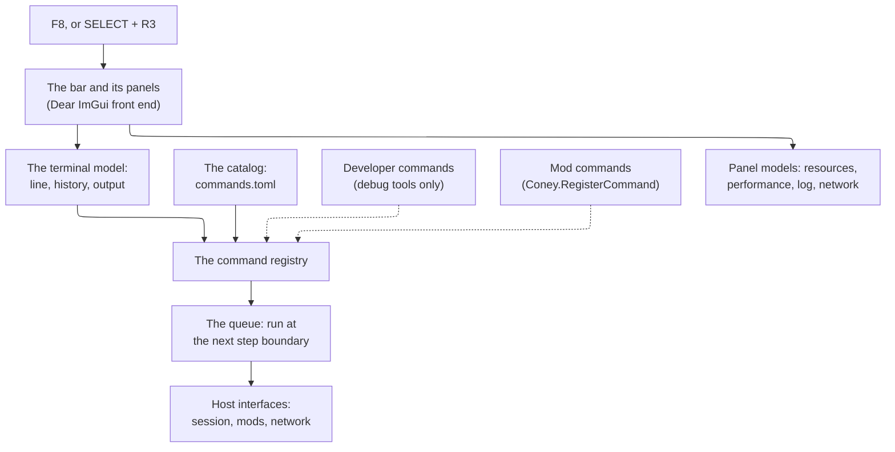

# Coney Studio: the Coney console

The design of the **Coney console**: the terminal F8 opens in the game, the commands it knows, the access levels that
keep the developer commands out of the build a player gets, the commands mods add, and the menu bar over it with the
runtime profilers and the log viewer. It covers input and the gamepad, where the code lives, how the release checks
prove the split, and the tests, and it ends with the build issues it proposes, in order. The parent issue is
[#1054](issue:1054); this page is [#1064](issue:1064).

**Status: design.** Nothing on this page is built. It is a design in the sense of
[Page kinds](../writing-docs.md#page-kinds): what is built moves into a guide. It builds on the debug tools' split
([The debug tools and the game](../building.md#debug-tools)), the [debug menus](../debug-menu.md), the
[run log](../run-log.md), the [profiler](../performance.md#zones) and the [Lua SDK](lua-sdk.md), and does not repeat
them. What the mods' own commands do to mods (start, stop, enable, disable, all for the running session only) belongs
to the mods design of [#1062](issue:1062); this page owns the console those commands run in.

Three rules shape every section:

- **One console, two sets.** The release game and the debug-tools builds have the same console, the same terminal and
  the same bar. A build with the debug tools adds the developer set to it; the release build never contains that code
  at all (a maintainer decision: a limited console may ship in release, its code cleanly apart from the debug tools).
- **In release, a second way in, never a wider one.** Every release command is something the player can already do
  from the game's menus, the options or the player's command line, or a reading that changes nothing (a profiler, the
  log). Nothing in the release set teleports, spawns, changes a rule of play, runs Lua or calls a native.
- **Closed, it is not there.** With the console closed and nothing pinned on screen, the game draws, steps and reads
  input exactly as it does without it.

## Contents {#contents}

1. [Terms](#terms).
2. [What other games do](#prior-art), and what Coney takes.
3. [The parts](#parts).
4. [The terminal](#terminal): a line, completion, history, output, when a command runs.
5. [The command catalog](#catalog): commands as data, as the PCSX2 recipes are.
6. [The built-in commands](#commands): the release set and the developer set.
7. [Access levels and scope](#access).
8. [Mod commands](#mod-commands).
9. [The F8 bar](#bar): [Resources](#resources), [Performance](#performance), [Log](#log), [Network](#network),
   [profiler captures](#captures).
10. [Input and the gamepad](#input).
11. [The code boundary](#boundary) and [how the release build keeps only the release set](#release).
12. [Determinism, replays and the network](#determinism).
13. [Tests](#tests).
14. [What changes on other pages](#other-pages), [Maintainer decisions](#decisions), [Open questions](#open-questions).
15. [Proposed build issues](#build-issues), [Sources](#sources).

## Terms {#terms}

| Term | Meaning |
| --- | --- |
| **The console** | The whole of it: the terminal, the command catalog, the bar and its panels. Opened with F8 |
| **The terminal** | The console's text half: a line to type a command into and the output above it |
| **Command** | A name and arguments the terminal runs: `mission 3 2`. Every command has an entry in the catalog |
| **Built-in command** | A command that comes with Coney, from the [catalog](#catalog); as against a **mod command**, which a running mod registers ([Mod commands](#mod-commands)) |
| **Access level** | Which builds hold a command or panel: **player** (every build, the release build included) or **developer** (only builds with the debug tools) ([Access levels](#access)) |
| **Scope** | What a command touches: **local** (this machine's view: the log, a panel, quitting) or **session** (the game everyone in the session plays) |
| **The bar** | The menu bar across the top of the screen while the console is open, with its panels ([The F8 bar](#bar)) |
| **Panel** | A window of the bar: the terminal, Resources, Performance, Log, Network. A panel can be **pinned** to stay on screen with the console closed |
| **Setting** | A player option the console can read and change for the session: `fps_cap`, `vsync`, `show_fps`. The console's convars, in FiveM's word; the developer's **tunables** are the debug menus' ([Tunables](../debug-menu.md#tunables)) |

The other words are the SDK's: **mod**, **project**, **native**, the **game state** and a **project state**
([Terms](lua-sdk.md#terms)), and **level** for a game level or one a user builds.

## What other games do {#prior-art}

Only public documentation was read; no code is taken from any of these ([Sources](#sources)).

| Game | The console | Levels and permissions | Profiling |
| --- | --- | --- | --- |
| **FiveM** | F8 in the normal client; a developer GUI above it that commands and convars can add entries to (`devgui_cmd`, `devgui_convar`); selected channels can show on screen with the console closed (`con_miniconChannels`) | User commands (`connect`, `disconnect`, `quit`, `bind`, `storymode`, `cl_drawfps`) always; developer commands (`cmdlist`, `resmon`, `netgraph`, `strdbg`, `localGame`, `set`) only in developer mode, refused otherwise with "disabled in production mode". On servers, ACE: `add_ace <principal> <object> allow` (or `deny`) over objects such as `command.<name>`, `add_principal` for inheritance, `test_ace` to check; a script's `RegisterCommand` can be restricted to principals allowed `command.<name>` | `resmon`: one row per resource with its CPU time per tick and memory; `profiler record <frames>`, `status`, `view`, `saveJSON <file>`: frames with each resource's ticks and the file and line behind each event, opened in Chrome's performance view |
| **Source engine** | `~` with `-console`; `bind`, `alias`, `exec` of config files | Console variables carry flags: a cheat variable works only while the server sets `sv_cheats 1`; development-only variables are hidden in release builds; archived ones are saved | `net_graph`, `vprof` |
| **Unreal Engine** | `~`; console variables and commands registered with the console manager | A variable remembers who set it last, in a fixed priority from the constructor up to the console, so settings can arrive in any order; development features are compiled out of shipping and test builds by a preprocessor check on `UE_BUILD_SHIPPING` and `UE_BUILD_TEST` | `stat unit`, `stat fps`, Unreal Insights |
| **Minecraft** | `/` commands with typed arguments and suggestions as you type | Permission levels 0 to 4, each including the ones below: a normal player's `/list`, `/msg`, `/help` at 0; game rules, `/give`, `/tp` higher; server administration at the top | The debug screen (F3), the tick-time graph at level 0 |
| **Roblox** | The Developer Console (F9) in every game, for players as well as developers | A player sees the client's side; the game's developer also sees the server's | Tabs for the log, memory by category, each script's activity and rate, the network, and the MicroProfiler |

What Coney takes:

- **F8, a console in the normal game, and a developer set it cannot reach** (FiveM). Coney goes further than a
  developer *mode*: the developer set is not in the release build at all, as Unreal compiles development features out
  of shipping builds. There is nothing to switch on.
- **Levels that include the ones below** (Minecraft), only two of them: player and developer. Online, the host and
  guest roles of [scope](#access) play the part of FiveM's ACE, without a permission language: one machine is the
  host, and only it changes the session.
- **Typed arguments with completion** (Minecraft), so the gamepad can choose every argument from a list
  ([Input and the gamepad](#input)).
- **A resource monitor and a recorded profile** (FiveM's `resmon` and `profiler`, Roblox's script activity): one row per
  mod, live, and a capture in Chrome's trace format.
- **Panels that stay on screen** with the console closed (FiveM's on-screen channels).
- **Not taken:** binds, aliases and config files that run commands (a file that runs commands is a script, and the
  console is not a scripting language; [Open questions](#open-questions)); a cheat switch like `sv_cheats` (the release
  set changes no rule, so there is nothing to unlock); `ExecuteCommand` for scripts ([Mod commands](#mod-commands)); a
  remote console.

## The parts {#parts}



*Figure: a typed line goes through the registry and the step-boundary queue to the game; the panels only read.*

The console's model (the registry, the terminal, the panels' data) has no user interface and lives in the game's own
library; the bar that draws it is a front end, as the debug menus' model has front ends
([One model](../debug-menu.md#one-model)). The developer set and mod commands come into the registry from outside,
through one registration call; the console itself never names them ([The code boundary](#boundary)).

## The terminal {#terminal}

**A line is a command name and its arguments**, separated by spaces: `mission 3 2`, `set fps_cap 60`. An argument with
spaces is written in double quotes (`log --find "level load"`), and `\"` is a quote inside one. One command per line:
no `;`, no variables, no expressions, so a line is never a program. Names are lower case, words joined by `-` or `_` as
the catalog spells them; a mod command may be written `mod:name` ([Mod commands](#mod-commands)). A line is at most
512 bytes; a longer one is refused, not cut.

**Completion.** Tab completes the command name, then each argument from its type's source: a mission number from the
missions the profile has completed, a mod's name from the installed mods, a setting's name, a level from the levels
the command may start. A list of candidates shows above the line while typing, with the argument's help. The same
sources fill the gamepad's [command picker](#input), so an argument that can be completed can be chosen without
typing.

**Output.** Each command prints lines into the terminal: its result, or an error that says what was wrong and what to
type instead (`unknown command "noclp"; did you mean "noclip"? help lists the commands`, or, in the release build,
`unknown command "noclip"; help lists the commands`: a developer command is unknown there, never "not allowed"). Lines
from a mod command carry the mod's name. The terminal keeps the last 2,000 lines; the [Log panel](#log) is where the
whole run log is read.

**History.** Up and Down walk the lines entered before, kept across runs in `console-history.txt` in the user's data
folder (beside `coney.log`, [Where it goes](../run-log.md#outputs)), at most 200 lines. A test-mode run reads and writes
no history, as it touches no user folder.

**When a command runs.** A **local** command that only reads (help, a panel, the log, a profiler reading) runs at once.
A **session** command, and any command that changes something, is checked at once (its name, access level and
arguments, so a typo is answered while you type) and then queued, and the queue runs between two simulation steps, in
the order the lines were entered, as the Entity editor's edits are ([Entity editor](../debug-menu.md#entity-editor)). A
step therefore never sees the game change half-way, and a paused game takes the command at the next frame.

**What the console writes.** Its history, a bug report into the run log ([`bugreport`](#commands)) and profiler
captures into a `captures/` folder in the user's data folder ([Captures](#captures)). It never writes a file at a path
the player types, never writes `mods/enabled.toml`, and never writes the player's options or profile: a setting changed
at the console lasts for the session, as a command-line option does.

## The command catalog {#catalog}

The PCSX2 recipes are the model ([PCSX2 recipes](../pcsx2-recipes.md)): each recipe is one common action, with a name,
a group, a line saying what it does, named arguments and its preconditions, kept as data in one file from which the
reference pages are generated and which the runner reads. The console's built-in commands are kept the same way:

```toml
# src/console/commands.toml: the player set (src/debug/console_commands.toml holds the developer set)
[[command]]
name = "mission"
group = "Levels and missions"
access = "player"                # player | developer; the developer file may only say developer
scope = "session"                # local | session
summary = "Start a mission you have completed, at one of its checkpoints, as the mission select does."
needs = ["game", "profile"]      # what must exist: the game session, a profile, a level in play, a disc
available = "mission-select"     # the Coney feature it waits for; absent while that feature is not built
args = [
  { name = "mission", type = "mission", help = "A completed mission's number in the story" },
  { name = "checkpoint", type = "checkpoint", default = "1", help = "One of that mission's checkpoints" },
]
```

- **Two files, two access levels.** `src/console/commands.toml` holds the player set and is compiled into the game
  library; `src/debug/console_commands.toml` holds the developer set and is compiled into the debug tools. A player
  entry in the developer file, or a developer entry in the player file, fails the generator. The key is `access`, not
  `level`, so it never reads as a game level.
- **One name, one command.** A name is in one catalog only: the generator reads both files and refuses a name that is
  in both, so a developer build, which registers both sets into one registry, never has two built-ins of one name, and
  the registry refuses a second registration of a name at run time as well. A developer variant of a player command
  takes a name of its own (the developer set's `any-mission` beside the player set's `mission`).
- **Generated, not hand-kept.** `coney-tools console cpp` turns each file into its table of command specifications
  (names, groups, summaries, arguments, access levels, scopes, needs), as `coney-tools natives cpp` makes the natives'
  signatures, and CI fails when a table is not current. Each handler is a C++ function bound by name; a test fails when
  a catalog entry has no handler or a handler no entry.
- **One reference page.** `coney-tools console render` writes a generated guide, the console commands reference, one
  section per group, each command with its arguments, access level, scope, needs and the Coney feature it waits for,
  as the recipe pages are written from `research/pcsx2-recipes.toml`.
- **Argument types** each bring their check and their completion: `int`, `number`, `bool` (`on`, `off`), `text`,
  `choice` (a fixed list), and the game's own kinds, `mission`, `checkpoint`, `level`, `mod`, `setting`, `command`.
- **`available`, as the SDK reflects Coney.** A command that drives a Coney feature names it, and is absent (not
  listed, not completed, unknown when typed) until that feature is built, so the console grows with Coney the way the
  SDK does ([How a native reaches the SDK](lua-sdk.md#availability)).
- **The same words as the recipes.** Where a console command and a recipe do the same thing, they share the name
  (`where`, `teleport`, `load-checkpoint`), so an engineer who drives the original with recipes drives Coney with the
  same vocabulary.

## The built-in commands {#commands}

### The release set {#release-set}

Every build has these. Each is a second way to something the player can already do, or a reading.

| Command | Scope | Does | The way in it doubles |
| --- | --- | --- | --- |
| `help [command]` | local | Lists the commands this build and the running mods offer, by group, or one command's arguments and help | none: a reading |
| `clear` | local | Empties the terminal's output | none |
| `quit` | local | Ends the game through its normal exit, as closing the window does | Closing the window, the menus |
| `version` | local | Coney's version and build, the SDK level, the disc's region, the renderer | none: a reading |
| `where` | local | The level, the checkpoint, the step and the play time, as the run log stamps them ([Reading a line](../run-log.md#reading)) | none: a reading; the name of the recipe that reads the same in the original |
| `settings` | local | Lists the settings with their values | The options and the player's command line |
| `get <setting>`, `set <setting> <value>` | local | Reads or changes a setting for this session: `fps_cap`, `vsync`, `show_fps`, the volumes, the PS2 look; never written to a file | The options and `--fps-cap`, `--vsync`, `--show-fps` and the other player options ([The debug tools and the game](../building.md#debug-tools)) |
| `bugreport` | local | Writes the last 30 s of the run log, every level, into the log file and says where, as the Time page's *Write bug report log* does in a developer build ([Bug reports](../run-log.md#bug-reports)) | The debug menus' Time page, which the release build lacks: today a player has no way to write one |
| `missions` | local | The missions the active profile has completed, with their checkpoints | The original's mission select, which lists the completed missions per area with their checkpoints ([Front end: mission select](../../research/frontend.md#fn-missionselecthud)) |
| `mission <n> [checkpoint]` | session | Starts a completed mission at a checkpoint, as the mission select starts it | The same screen; available once Coney's mission select is built |
| `log [filter]`, `resmon`, `perf`, `net` | local | Open the [Log](#log), [Resources](#resources), [Performance](#performance) and [Network](#network) panels; `log` with a filter opens it filtered (`log error`, `log yard-brawl`) | none: readings |
| `profiler record <frames>`, `profiler status`, `profiler save` | local | Records a [capture](#captures), says how far it got, writes it | none: a reading |
| `host [port]`, `connect <address>`, `disconnect` | session | Hosts a network game, joins one, leaves it ([Network multiplayer](../multiplayer.md)) | `--host`, `--join`, the player's command line |

The mods' commands (`mods`, `mod`, `start`, `stop`, `restart`, `ensure`, `refresh`, `enable`, `disable`, `play`,
`levels`) are in the release set as well; what each does to mods, always for the running session only and never
writing `mods/enabled.toml`, is the mods design's ([#1062](issue:1062)). They reach the mods loader only through its
host interface ([The code boundary](#boundary)).

**Starting a level in release** is therefore of two kinds: a story mission the player has already reached, as the
mission select allows (`mission`), and a mod's level (`play`). Any level or mission at any checkpoint is the developer
set's `level` and `any-mission`, as the debug menus' Levels and Missions pages are.

### The developer set {#developer-set}

Only builds with the debug tools have these. They reach the game through the debug tools' own capabilities, the same
calls the [debug menu pages](../debug-menu.md#pages) make, so a console command and a page item never behave
differently.

| Command | Does | The page it matches |
| --- | --- | --- |
| `level <name> [checkpoint]` | Starts any level at any checkpoint, at the start of the next frame | Levels |
| `any-mission <n> [checkpoint]` | Any of the story's missions, flashbacks and Armies of the Night stages, completed or not (the player set's `mission` keeps to completed ones) | Missions |
| `load-checkpoint <n>` | Restarts the level in play at a checkpoint, as the story does after a death | Missions (the recipe of the same name) |
| `teleport <x> <y> <z> [heading]` | Puts player 1 there, dropped to the ground | Player |
| `noclip [on\|off]` | The noclip | Player ([Noclip](../debug-menu.md#noclip)) |
| `timescale <x>`, `pause`, `step [n]` | The time controls | Time |
| `spawn-fighters <n> [side] [model]`, `clear-fighters` | AI fighters in front of the player | AI fighters |
| `tune <category/name> [value]`, `tunables [category]` | Reads or sets a tunable, applied between steps | Tunables |
| `lua <line>` | Runs a line in the game state, with the same evaluator as the Lua console | [Lua console](../debug-menu.md#lua-console) |
| `native <name> [args...]` | Calls a script binding with arguments, as a script would | [Natives](../debug-menu.md#natives) |
| `cheat <n>` | Sends a retail cheat code to the script's cheat callback | Cheats |
| `movie <name>` | Plays a disc movie, then gives the game back | [Movies](../debug-menu.md#movies) |
| `menu <page/item> [value]` | Runs any item of the debug menus by its path: an action, a toggle, a number, a choice (`menu "Display/FPS counter" on`) | Every page |

`menu` makes the console a third front end of the debug model: every page and item, present and future, is reachable
from the terminal with no code of its own, so a new debug feature added as the [debug menus' rule](../debug-menu.md#adding-a-feature)
says needs no console work. The named commands above are short ways to the commonest items. In Studio, the developer
set is in Studio's Console panel ([The code boundary](#boundary)).

## Access levels and scope {#access}

| Access level | In which builds | Who adds commands and panels to it |
| --- | --- | --- |
| **player** | Every build, the release build included | `src/console/commands.toml` and the console's own panels; running mods, for their own commands |
| **developer** | Only builds with the debug tools (`dev`, `playtest`, `ci`, `asan`) and Studio | The debug tools, through the registry's registration call at start-up |

An access level is a property of the code, not a switch: the release build has no developer commands to unlock, as it
has no debug menus. A developer build shows both sets in `help`, the developer commands marked `[dev]`.

**Scope** decides who may run a command in a network session:

| Scope | Offline | Online, the host (and, later, a server's operator) | Online, a guest |
| --- | --- | --- | --- |
| **local** | yes | yes | yes |
| **session** | yes | yes | refused: "only the host can do this in a network game" |

A developer build is used online only between developers; there, the developer commands are session commands too,
held to the host. A guest never sends a built-in command to the host: a guest's console runs its local built-in
commands and nothing more, and there is no remote console in this design ([Open questions](#open-questions)). The one
thing a guest's line can send is an unrestricted command of a mod's server script, as a request the mod checks
([Mod commands](#mod-commands)).

## Mod commands {#mod-commands}

A mod can add commands to the console, as a FiveM resource does with `RegisterCommand`, through an SDK function in the
`Coney` table ([Names and namespaces](lua-sdk.md#names)):

```lua
Coney.RegisterCommand("wave", function(args, slot)   -- slot: the player slot that typed it
  local n = args.count
  StartWave(n)
  return "wave " .. n .. " started"
end, {
  help = "Start an ambush wave",
  args = { { name = "count", type = "int", default = 1 } },
  restricted = true,   -- online, only the host may run it (FiveM's restricted flag); offline, the one player
})
```

A mod command is an **entry point** like an event handler ([Entry points](lua-sdk.md#events)), so everything the
sandbox holds for a handler holds for it ([The sandbox](lua-sdk.md#sandbox); the script security design of
[#1062](issue:1062) owns those rules and their limits):

- **It runs in the mod's own state**, with only the natives that state has, under the mod's instruction budget, memory
  cap and print limits. A command cannot do anything the mod's scripts could not already do in a handler.
- **At a step boundary**, queued like every session command, in the order typed. The handler gets its arguments
  already checked against the declared types (a table of named values; an argument it cannot read is refused before the
  handler runs, with the help line); the string it returns, and what it prints, go to the terminal under the mod's
  name and to the run log in the `mods` category ([Log](#log)).
- **Names.** A mod command can never take a built-in's name: registering one fails with an error in the mod's log. Two
  mods' commands of the same name are both reached as `<mod>:<name>` (`yard-brawl:wave`), and the bare name is refused
  as ambiguous, with both listed. A name follows the catalog's spelling, at most 32 characters, and a mod registers at
  most 64 commands.
- **No way to the console from a script.** The SDK has no `ExecuteCommand`: a mod cannot run a built-in command
  (`quit`, `disable`, a developer command in a developer build) or another mod's command. Mods call each other through
  exports ([#1062](issue:1062)).
- **Access and the network.** A mod command is at the player access level, in every build. Where it runs follows the
  script that registered it, not the scopes of the built-in commands, and agrees with the script security design's
  line ([#1062](issue:1062)):
    - **A server script's command** runs in the server state, where the simulation runs. Offline that is the one
      machine. Online, the host's own line runs it; a `restricted` command is the host's (or a server operator's) only,
      and a guest typing it is refused on its own machine. An unrestricted one typed by a guest is sent as a request,
      as a client's event is ([Coney resources](../network-architecture.md#resources)): the server runs it at a step
      boundary with the guest's player slot as `slot`, so the handler decides what that guest may do, and the reply
      comes back to the guest's terminal.
    - **A client script's command** (ConeyMP, P4) runs on the machine that typed it, in its client state, with client
      natives only ([Deterministic and network-safe calls](lua-sdk.md#determinism)); it sends nothing.
- **It lives as long as the mod runs.** Stopping, disabling or reloading the mod removes its commands; a hot reload
  registers them again from the new state ([Hot reload](lua-sdk.md#hot-reload)).
- **Shown as the mod's.** `help` lists mod commands under each mod's name; the completion and the gamepad picker use the
  declared argument types like any built-in's.

## The F8 bar {#bar}

F8 opens the console: a bar across the top of the screen and the terminal under it, over the game. The bar's menus
open its panels, each a window that can be moved, resized, docked to an edge and **pinned**: a pinned panel stays on
screen when the console closes, drawn but taking no input, as FiveM shows a resource graph with its console closed.

| Menu | Panels and actions | Level |
| --- | --- | --- |
| **Console** | The terminal; *Clear*; *Write bug report* (`bugreport`); *Quit* | player |
| **Resources** | The [resource monitor](#resources): one row per running mod, and the game scripts | player |
| **Performance** | The [engine's frame and step timings](#performance); *Record capture* | player |
| **Log** | The [log viewer](#log) | player |
| **Network** | The [network figures](#network), in a network session | player |
| **Mods** | The installed mods as the `mods` command lists them, each with its commands' buttons (start, stop, restart, enable, disable) | player |
| **Debug** | Every page of the debug menus as a window, as the developer overlay shows them ([The developer overlay](../debug-menu.md#the-developer-overlay)) | developer |

The panels read the game; none changes it, except through the commands their buttons run, which go through the same
registry and queue as a typed line. Where the panels were and which were pinned is kept for the next run in
`coney-console.ini` in the user's data folder; a test-mode run keeps nothing.

### Resources: the mods' monitor {#resources}

The release-ready answer to "which mod makes my game slow", as FiveM's `resmon` is. One row per running mod, one per
state when a mod runs a server and a client state, and a row for the game scripts (the game state) to measure against:

| Column | What it shows | Where it comes from |
| --- | --- | --- |
| Mod | Name and version, `server` or `client` | The mods loader |
| CPU per step | The real time the mod's calls took in a step: the mean of the last 60 steps and the worst | Each call into the state, timed with the profiler's clock ([Zones](../performance.md#zones)) |
| Share | That time as a share of the whole step | The `step` zone |
| Instructions | Lua instructions run per step, and the share of the mod's budget the busiest call used | The instruction budget's count hook, which the sandbox runs anyway |
| Memory | Bytes the state holds now, its peak, and its cap | The state's allocator, which keeps the cap |
| Threads | Threads running and waiting | `Coney.CreateThread` ([Threads and waits](lua-sdk.md#threads)) |
| Handlers | Event handlers and callbacks registered, and how many ran this step | `Coney.On`, the natives' callbacks |
| Natives | Native calls per step; opening the row lists the ten most called, with counts | The value bridge, which every native call crosses ([The value bridge](lua-sdk.md#bridge)) |
| Exports | Calls into other mods' exports, and from them | The exports bridge ([#1062](issue:1062)) |
| Errors | Errors raised since the mod started, the last one's file and line | The project state |

- **The counts are exact and the times are not.** Instructions, memory, threads, handlers, native calls and errors are
  counted by the runtime and are the same in every run of the same input; the times are real time on the player's
  machine, shown and plotted, never read by a step ([Determinism](#determinism)).
- **Cheap while closed.** The counts are kept anyway, since the budget and the cap need them; the times are taken only
  while Resources is open or pinned, or a capture records, and otherwise cost one branch per call, as a zone does with
  measuring off.
- **Sorting and plots.** Any column sorts; a row's CPU time plots over the last 300 steps.
- **In Studio** the same model is a docked panel, for the project in Play ([The code boundary](#boundary)).

The rows exist once the mods loader and the project runtime do (the SDK's build issues 2 and 3); until then the panel
shows the game scripts' row alone.

### Performance: the engine's timings {#performance}

The [profiler](../performance.md#zones) is already part of the game: its zones and counters are in the game library,
and the release build carries them. The Performance panel is their release front end, as the debug menus' Performance
page is the developers' ([The in-game view](../performance.md#overlay)):

- **The frame and the step.** Frames a second, the frame time and the step time, plotted over the last 300 frames, with
  the mean, the 95th percentile and the worst of the last 60, and the steps run per second (30 at 1x).
- **The zones** (`step`, `play.humans`, `humans.brains`, `render`, `present.swap` and the rest), each one's mean over
  the last 60 frames, nested as they nest.
- **The counters** the release build keeps: draws, triangles and the scene counters by kind
  ([Counters](../performance.md#counters)).

Measuring is on while the panel is open or pinned, or a capture records, and off otherwise, as the debug page's
*Measure* is.

### Log: the run log, filtered {#log}

The [run log](../run-log.md), read in the game. The panel keeps its own copy of the lines since the console was first
opened, up to the last 10,000, fed by a listener on the logger (the ring keeps only 30 s,
[The ring](../run-log.md#ring)):

- **Filters**, combined: by level (`error`, `warn`, `info`, and `detail` where the run keeps it), by category (`player`,
  `ai`, `combat`, `script`, `world`, `engine` and a new `mods`, [Levels and categories](../run-log.md#categories)), by
  mod (the lines a mod printed or raised), and by text. `log error` and `log yard-brawl` open the panel filtered.
- **Follow.** The view follows new lines until scrolled up, and again once scrolled to the bottom.
- **Copy.** Selected lines copy as the log file writes them. A line the run log keeps out of the file, the game's own
  text that a level script prints ([What a log may hold](../run-log.md#rules)), shows in the panel, as it shows on the
  console today, but copies as the file writes it, with its length only, so a pasted log never carries game text.
- **Write bug report** writes the 30 s ring into the file and names it, as `bugreport` does.

The new `mods` category holds what a mod's scripts print and the errors they raise, each line tagged with the mod's
name (`mods: yard-brawl: wave 3 started`), within the print limits of the sandbox.

### Network {#network}

In a network session, the figures the debug menus' Network page shows, read-only: the ping (plotted), loss, bytes and
packets a second, and the players ([Link quality](../multiplayer.md#link-quality)). Host, Join and Disconnect are the
`host`, `connect` and `disconnect` commands; the simulated network stays the developers' ([The pages](../debug-menu.md#pages)).

### Profiler captures {#captures}

`profiler record <frames>` (at most 3,600) records every frame's zones, every mod's calls with the entry point, the
file and the line of the handler, and each step's boundary, then `profiler save` writes them as a Chrome trace event
file, the format Chrome's performance view and Perfetto open, as FiveM's `saveJSON` does. The file goes into
`captures/` in the user's data folder, named by the level and step (`capture-level95-step4518.json`), and the terminal
prints its path. A capture holds names, files, lines and times, never script source or game text, so it can be attached
to a bug report.

## Input and the gamepad {#input}

| Input | Does |
| --- | --- |
| F8 | Opens and closes the console, the terminal's line taking the keyboard |
| SELECT and R3 together (a gamepad's back button and the right stick's press) | Opens and closes it from a pad |
| Escape | Closes the console (while it is open, Escape does not quit the game) |
| Tab, Up and Down, Page Up and Page Down | Completion, history, scrolling the output |
| Ctrl+C, Ctrl+V | Copy the selected output, paste into the line |

- **The keyboard is the console's while it is open.** The keyboard does not play on port 1 (Backspace is SELECT on the
  keyboard, [Controls](../running-input.md#controls)), and the mouse acts on the bar and its panels. Closed, the
  console takes no key but F8.
- **The pad.** The chord is caught before the game, by the same rule as the noclip's hotkey: from the moment both are
  held, neither reaches the game until they are let go ([Noclip](../debug-menu.md#noclip)). The debug tools' input
  gate (`src/debug/input_gate.h`) is not in the release build, so the console has its own small gate in its model
  (`src/console/`), which catches only its chord and holds port 1 while the console is open; the debug tools' gate
  keeps its own chords. No control of the original holds SELECT and R3 together: the player's held combinations with
  SELECT are SELECT with a d-pad direction and SELECT with L3 ([Commands](../../research/combat/index.md#commands),
  confirmed (runtime) there), and the cheat codes press single buttons one after another
  ([Cheat codes](../../research/debug.md#cheats)). While the console is open, the game sees port 1 with nothing
  pressed, and the buttons still held when it closes stay hidden until let go, as with the debug menus
  ([Opening it and the controls](../debug-menu.md#controls)); port 2 always reaches the game.
- **Driving it with a pad.** The d-pad and left stick move between the bar's menus, the panels' rows and the
  buttons, cross chooses and circle goes back (Dear ImGui's gamepad navigation). The terminal offers a **command
  picker**: the commands by group, then one row per argument, each a list filled by its type's completion (the
  completed missions, the installed mods, a setting's values) or a number changed with left and right; cross runs the
  line it built, shown in the terminal as if typed. A `text` argument opens the platform's on-screen keyboard where
  there is one (SDL's text input, which the Steam Deck answers), and otherwise the debug menus' pad typing
  ([Typing with the pad](../debug-menu.md#controls)), which moves into the console's model for it.
- **The game does not pause.** As in FiveM, opening the console leaves the game running, so the Resources and
  Performance panels measure real play; a player who wants the game still opens the pause menu first, and the console
  works over it.
- **Size.** The bar is drawn at the same physical size at any resolution, by the rule the developer overlay uses
  ([Size at any resolution](../debug-menu.md#ui-scale)); that rule moves from the debug tools into a shared place the
  console reaches.
- **In Studio**, F8 belongs to Studio's own keymap (the editor experience design of [#1055](issue:1055) gives it to
  Eject during Play), and the console's terminal is Studio's Console panel; its other panels are Studio panels
  ([The code boundary](#boundary)).

## The code boundary {#boundary}

| Part | Folder | Target | In the release build | May include |
| --- | --- | --- | --- | --- |
| The console's core: command specifications, the registry, the tokenizer and argument checks, completion, the terminal (history, output), the step-boundary queue, the pad chord's gate, the host interfaces | `src/console/` | `coney_core` | yes | `console/`, `core/` |
| The player commands' handlers and their generated table | `src/console/`, from `commands.toml` | `coney_core` | yes | `console/`, `core/` |
| The panels' models: resource rows, performance readings, the log view and its filters, network figures, captures | `src/console/panels/` | `coney_core` | yes | `console/`, `core/` |
| The host implementations: the game session's (quit, where, missions, settings, levels), the mods loader's, network play's | beside what they implement, set up in `platform/game_run.h` | `coney_platform` and the libraries they belong to | yes | anything of the game |
| The front end: the bar, the terminal's widgets, the picker, the panels, reading F8 and the pad from the window (the chord itself is caught by the console's gate in `src/console/`) | `src/platform/console_*` | `coney_console_ui` (new) | yes | `console/`, the platform's window and input, Dear ImGui |
| The developer commands and their generated table; the bar's Debug menu | `src/debug/`, from `console_commands.toml`; `src/platform/` | `coney_debug`, `coney_devtools` | no | anything of the game and the console |
| Studio's Console panel and the panels docked | `src/studio/` | `coney-studio` | no (a program of its own) | the console and the debug tools |

- **The dependency goes one way.** The console names nothing of the debug tools, the scripting runtime, the native
  table, the entities or the game modes. It reaches the game through three narrow interfaces it declares itself in
  `src/console/` (the session's, the mods loader's, network play's) and the game implements, so a command added later
  cannot reach further without a change to an interface, which review sees. The debug tools and the mods loader add
  their commands through the registry's one registration call; in the release build only the game's player commands
  and the running mods ever call it.
- **Why Dear ImGui in release.** The bar needs a text line with a cursor, selection, clipboard and completion,
  scrolling views of thousands of lines with filters, sortable tables and plots, all driven by mouse, keyboard or pad.
  The game's own widgets are a PS2 front end's (menus of circled text, [Front end](../../research/frontend.md)) and
  have none of these; drawing them in the game's font would mean writing a widget toolkit. Dear ImGui is already
  pinned and MIT, is the toolkit decided for the launcher's screens ([The launcher](../launcher.md#decided)) and for
  Studio ([The GUI library](technology.md#gui)), has gamepad navigation, and FiveM's console is drawn the same way. No
  program a player gets carries Dear ImGui today: the launcher's screens are planned, and `cmake/deps.cmake` fetches
  Dear ImGui only with the debug tools, so the console would be the first part of a player's download to use it. The
  split from the debug tools is by target and by model, not by library: `coney_console_ui` links Dear ImGui for the
  console alone and includes nothing of the debug tools, and the developer overlay stays in `coney_devtools`. It is
  listed under [Maintainer decisions](#decisions), since it changes what players download.
- **One registry in every program.** The game's debug-tools `coney` registers both sets into one registry, so the F8
  terminal of a developer build has every command. Studio links the same console core, registers both sets, and shows
  the terminal as its Console panel and Resources, Performance and Log as docked panels, for the project in Play.

## How the release build keeps only the release set {#release}

The release build is checked today by the split test, the markers and the release smoke tests
([What proves it](../building.md#debug-tools)). With the console, each check changes so that it still proves no debug
tool ships, and newly proves the console does:

1. **The split test** (`python/tests/test_debug_tools_split.py`) keeps refusing a game source that includes a debug
   header or links a debug library, and gains: every file of `src/console/` includes only `console/`, `core/` and the
   standard library; `coney_console_ui`'s files include only `console/`, the platform's window and input headers and
   Dear ImGui; and only `coney_devtools` and `coney_console_ui` link `imgui`.
2. **The catalog checks.** The generator refuses a developer entry in `src/console/commands.toml`; CI fails when a
   generated table is not current; a unit test in the release build's list compares the registry's commands with the
   player catalog, so a command registered from code without an entry fails.
3. **The markers: the release marker list changes.** Today `cmake/debug_tools_markers.cmake` treats Dear ImGui itself
   as a debug tool: its default settings file name, `imgui.ini`, is one of the markers. With the console, the release
   build links Dear ImGui and so contains that name, and **`imgui.ini` leaves the list**. Debug-only markers take its
   place: the list keeps the debug pages' titles and the developer overlay's settings file (`coney-imgui.ini`), and
   gains the developer commands' summaries, generated from `src/debug/console_commands.toml`, so a developer command
   linked into the release build is found. No player command's text uses a marker's words.
4. **The twin check.** A new test, `coney.release.has_player_console`, finds the console's own marker (its banner,
   `Coney console`) in the release executable, so the release build is proved to carry the console, as
   `coney.debug_tools_markers_found` proves the markers check finds something.
5. **The release smoke tests.** An input script's new `console` line types a line into the terminal. On the release
   executable: `help` prints exactly the player catalog's names; `noclip` and `lua print(1)` print "unknown command";
   `quit` ends the run with exit code 0. On the debug tools' `coney`, the same `noclip` is accepted.

The rule that the release build holds no debug tools is written in one place,
[The debug tools and the game](../building.md#debug-tools), and checked by the split test above, which names
`coney_devtools` as the one target that links `imgui`. The text gains the console as the one console the release
build holds and Dear ImGui as the console's toolkit. That change of text is shared: it is build issue 7 of the script
security design ([#1062](issue:1062)), made once for both designs, and this page's front-end issue depends on it
([Proposed build issues](#build-issues)).

## Determinism, replays and the network {#determinism}

The [networking checklist](../network-architecture.md#checklist) holds for the console as for any input:

- **Commands are input.** A session command runs at a step boundary from the queue, never in the middle of a step, and
  is written to the run log with its step (`console: mission 3 2`). A replay records every session command with the
  step it ran at and runs it again there, so a run in which the player typed `stop yard-brawl` replays the same. A test
  types lines with the input script's `console` action, which counts frames as every other action does.
- **Local commands are not.** Help, the panels, the log and the profiler change nothing in the game and are neither
  recorded nor replayed.
- **No real clock in the game.** The profilers' times come from the profiler's clock, installed by the platform; they
  are shown, plotted and written to captures, and no step reads them ([Update and render](../conventions.md#update-and-render)).
- **Developer commands mark a run** that changes the game (a teleport, a tunable, a Lua line), as the Entity editor's
  edits are logged ([Entity editor](../debug-menu.md#entity-editor)).
- **Online**, only the host runs session built-in commands ([Access levels and scope](#access)), a guest's
  unrestricted mod command reaches the server as a request ([Mod commands](#mod-commands)), and the effects of both
  reach the guests as any change of the host's game does: as state and events
  ([The authority model](../network-architecture.md#authority)).

## Tests {#tests}

Every check runs without a person, as [Testing](../testing.md) asks:

- **The console's core** (unit tests in the release build's list): the tokenizer (quotes, escapes, empty and overlong
  lines, a `;` taken as text); each argument type's check and completion; the registry (a name in both catalogs
  refused by the generator, a second registration of a built-in's name refused, a mod's name clash, the `mod:name`
  form, an ambiguous bare name, `available` hiding a command); the queue (a session command runs between steps, in
  typed order; a paused game takes it at the next frame); the scope rules with a fake network host (a guest's
  session command refused).
- **Each player command** against fake hosts: `mission` refuses a mission the profile has not completed; `set` changes
  a setting and writes no file; `bugreport` dumps the ring; `quit` asks the session to end.
- **Through the player's path** ([Test through the player's path](../testing.md#test-through-the-players-path)): an
  input script presses F8, types `where` and checks the terminal's line; another presses SELECT and R3, walks the
  command picker with the d-pad to `missions`, and runs it with cross ([Drive it like a gamepad](../testing.md#gamepad));
  on a disc, `mission` starts a completed mission from a synthetic profile at its checkpoint, the same level and
  checkpoint the mission select would start.
- **The front end** over a bare Dear ImGui context with no renderer, as the developer overlay's tests run: every panel
  draws every row of its model; a pinned panel draws with the console closed and takes no input.
- **Closed means untouched**: the last frame of a windowed run that opens and closes the console in its first frames
  (`--console-open N`) is byte-identical to the same run without it, as `--dev-overlay` is checked
  ([The developer overlay](../debug-menu.md#the-developer-overlay)).
- **The panels' numbers**: a synthetic mod with a known loop shows its exact instruction count, memory and native calls
  in its Resources row, the same in two runs; the times are only checked to be present and not negative.
- **The log viewer**: the filters by level, category, mod and text; a line kept off the file copies with its length
  only.
- **Captures**: a recorded capture parses with Coney's JSON reader as a trace event file and holds every zone and mod
  call of its frames.
- **Mod commands** (with the mods loader): a fixture mod's command runs in its state at a step boundary; a runaway
  handler stops at the budget and the game goes on; a built-in's name is refused; a mod cannot reach `quit`; a reload
  removes and registers its commands again; over a loopback session, a guest's restricted command is refused on the
  guest and an unrestricted one runs on the host with the guest's slot.
- **The release checks** of [the list above](#release): the split test, the catalog checks, the markers and their twin,
  the release smoke lines.

## What changes on other pages {#other-pages}

When this design is accepted:

- [Building and testing: The debug tools and the game](../building.md#debug-tools): the console as the one console the
  release build holds, `coney_console_ui` beside the game's targets, Dear ImGui fetched for it, the new checks of
  [How the release build keeps only the release set](#release).
- [The run log](../run-log.md): the `mods` category; players write a bug report with `bugreport` (the
  [Bug reports](../run-log.md#bug-reports) section sends them to the debug menus, which the release build lacks); the
  console's `console:` lines.
- [Controls](../running-input.md#controls): F8 and SELECT + R3; Escape closes the console while it is open; the input
  script's `console` action ([Input scripts](../running-input.md#input-scripts)).
- [The debug menus](../debug-menu.md): the console as a third front end of the model (`menu <page/item>`); the pad
  typing and the UI scale rule moved where the console reaches them; the Performance page beside the console's
  release panel.
- [The Lua SDK](lua-sdk.md): `Coney.RegisterCommand` among the SDK functions, and a mod command among the entry points
  the budget covers.
- The mods design of [#1062](issue:1062): its console section links this page for the console itself, and its line on
  the console's screen follows [the choice above](#boundary).
- [Asset and script architecture: Debug console needs](../asset-and-script-architecture.md#console-needs): the console
  there is the debug menus' Lua console, reached here as the developer command `lua`.

## Maintainer decisions {#decisions}

1. **Dear ImGui in the release build**, for the console alone, in its own target ([The code boundary](#boundary)). The
   release build fetches and links no Dear ImGui today, by the debug tools' split, and no program a player gets carries
   it yet (the launcher is decided on it, its screens are planned); the console needs it, and the split stays by target
   and model. The coordinator approved it as fitting the decided clean
   separation; it is listed here because it changes what players download and the release marker list
   ([How the release build keeps only the release set](#release)).
2. **The release set** ([The release set](#release-set)): `mission` limited to completed missions (as the mission
   select), the session's settings, `host`, `connect` and `disconnect`, the profilers and the log. Each doubles a way
   in the player already has or only reads; a maintainer confirms the list, and any command added to it later.

Decided and built into this page: a limited console ships in release with its code apart from the debug tools; console
changes to mods last for the running session only and never write `mods/enabled.toml`.

## Open questions {#open-questions}

- **Binds and config files.** FiveM and Source let a player bind a key to a command and run a file of commands at
  start. Wanted later, at the player level, and if so, which commands may a bind run?
- **Mods binding keys** (FiveM's key mappings for resource commands): a mod's command on a key the player chooses in
  the options.
- **A remote console** for ConeyMP's dedicated servers (P4): an operator's console over the network, as FiveM's server
  console is reached; it belongs with the network page's operator design.
- **Retail cheat codes** at the player level once Coney has the retail cheat checker: every player can enter them with
  the pad, so `cheat` would double a way in; or keep it the developers'.
- **The developer overlay and the bar**: whether F1's overlay folds into the bar's Debug menu once the bar exists, so a
  developer build has one menu bar.
- **The budget for mod commands**: whether a command's handler gets the per-call budget of a handler or a larger one,
  measured on real mods with the SDK's other budgets.

## Proposed build issues {#build-issues}

In the order they should come. Issues 1 to 6 need nothing from the mods runtime; 7 and 8 follow the Lua SDK's issues 2
and 3 ([Proposed build issues](lua-sdk.md#build-issues)) and the mods loader of [#1062](issue:1062); 9 follows
Studio's shell ([Build issues](technology.md#build-issues)).

1. **core: Add the console core with its command catalog and access levels.** `src/console/` in `coney_core`: command
   specifications with levels, scopes, needs and `available`; the registry and its registration call; the tokenizer
   and the argument types with their checks and completions; the terminal model with output and history; the
   step-boundary queue; the host interfaces. `src/console/commands.toml` and `coney-tools console cpp` and `console
   render` with their CI checks, and the generated console commands reference. The input script's `console` action.
   The split test's include rules for `src/console/`. No front end yet: lines come from input scripts. Tests: the
   tokenizer, the types, the registry's rules, the queue's order between steps, a guest's session command refused, the
   generated table current.
2. **core: Add the player commands to the console.** The release set's handlers over the game session's host: `help`,
   `clear`, `quit`, `version`, `where`, `settings`, `get`, `set`, `bugreport`, `host`, `connect`, `disconnect`, and
   `missions` and `mission` behind `available = "mission-select"` until Coney's mission select is built. The
   `coney.release.has_player_console` check and the release smoke lines (`help` lists the player set, `noclip` unknown,
   `quit` exits 0). Tests: each command against fake hosts; a setting changed at the console writes no file; the
   release executable's `help` equals the catalog.
3. **platform: Add the F8 console bar to the release build.** The `coney_console_ui` target with Dear ImGui (fetched
   in the release configure for it), the bar, the terminal's widgets with completion and the picker, pinned panels,
   `coney-console.ini`, F8 and the SELECT + R3 chord caught by the console's own gate in `src/console/` (the debug
   tools' input gate's rule, not its code), Escape, the UI scale rule moved out of the debug tools, the pad typing
   moved into the console's model; the split test's rules for the new target and the `imgui` link; the release marker
   list changed (`imgui.ini` out, the developer commands' summaries in); `--console-open`. It depends on the shared
   change of the rule's text, build issue 7 of the script security design ([#1062](issue:1062)). Tests: the front end
   over a bare context, the frame unchanged with the console opened and closed, the pad chord and the picker running
   `missions` from an input script.
4. **core: Add the console's log viewer and the run log's mods category.** A listener list on the logger, the Log
   panel's buffer of 10,000 lines with filters by level, category, mod and text, follow, copy that writes kept-off
   lines by their length, *Write bug report*; the `mods` category. Tests: each filter; the copy of a local-only line;
   the bug report from the panel.
5. **core: Add the Performance and Network panels to the console.** The zones, counters, frame and step readings with
   their plots, measuring on only while a panel is open or pinned; the network figures; `profiler record`, `status`
   and `save` with the trace event file in `captures/`. Tests: the readings exist and measuring is off when closed; a
   capture parses and holds its frames' zones.
6. **core: Add the developer commands to the console.** `src/debug/console_commands.toml` and its handlers in
   `coney_debug`, over the debug tools' own capabilities: `level`, `any-mission`, `load-checkpoint`, `teleport`,
   `noclip`, `timescale`, `pause`, `step`, `spawn-fighters`, `clear-fighters`, `tune`, `tunables`, `lua`, `native`,
   `cheat`, `movie`, and `menu <page/item>` over the debug model; the bar's Debug menu in `coney_devtools`; the
   developer commands' summaries generated into the markers. Tests: each command does what its page does, through an
   input script; `menu` reaches an item of every kind; the release smoke lines still refuse them.
7. **core: Add mod commands through Coney.RegisterCommand.** The SDK function with its spec (help, typed arguments,
   `restricted`), handlers run in the mod's state at a step boundary under its budget, names that never take a
   built-in's, the `mod:name` form, removal on stop and reload, `help` and the picker listing them; online, a guest's
   unrestricted server-script command sent as a request with its slot, and a restricted one refused on the guest.
   Tests: a fixture mod's command runs and prints under its name; a runaway handler is stopped; a built-in's name is
   refused; no SDK function runs a built-in command; a reload registers the commands again; the two network cases
   over a loopback session.
8. **core: Add the mods' resource monitor and their profiler captures.** The Resources panel's rows from the
   scheduler, the count hook, the allocator, the threads, the handlers and the value bridge, with the game scripts'
   row; mod calls with their file and line in captures. Tests: a synthetic mod's exact counts in two runs; times
   taken only while the panel is open; a capture holds the mod's calls.
9. **tools: Add the console to Coney Studio's panels.** Studio registers both sets into the console core and shows the
   terminal as its Console panel and Resources, Performance and Log as docked panels for the project in Play, with F8
   left to Studio's keymap. Tests: the Test Engine types a command into the Console panel and reads its output; the
   Resources panel lists the project in Play.

## Sources {#sources}

Ideas only; no code is taken from any of these.

| Idea | Source |
| --- | --- |
| F8; user and developer commands; developer mode and the "disabled in production mode" refusal; the developer GUI's entries; on-screen channels; `resmon`, `netgraph`, `cmdlist`, `list_aces`, `test_ace` | FiveM, [Client console commands](https://docs.fivem.net/docs/client-manual/console-commands/) |
| `profiler record`, `status`, `view`, `saveJSON`; per-resource ticks with file and line; Chrome's performance view | FiveM, [Using the profiler](https://docs.fivem.net/docs/scripting-manual/debugging/using-profiler/) |
| ACE: `add_ace`, `add_principal`, `test_ace`, `command.<name>` objects; `start`, `stop`, `restart`, `ensure`, `refresh` | FiveM, [Server commands](https://docs.fivem.net/docs/server-manual/server-commands/) |
| `resmon`'s columns (CPU time per tick, memory) | Community guides, for example [Reading resmon](https://xgamingserver.com/blog/fivem-server-performance-resmon-guide/) *(not official)* |
| `RegisterCommand` with a restricted flag checked against `command.<name>`; `ExecuteCommand`; FiveM's console drawn with Dear ImGui | FiveM's scripting reference *(general knowledge, not re-checked)* |
| Console variable flags: cheat variables under `sv_cheats`, development-only variables hidden in release, archived variables; `bind`, `alias`, `exec`; `net_graph` | Valve Developer Community, Source console variables *(general knowledge, not re-checked)* |
| Console variables set by priority; compiling development features out of shipping builds | Unreal Engine, [Console variables in C++](https://dev.epicgames.com/documentation/en-us/unreal-engine/console-variables-cplusplus-in-unreal-engine) |
| `stat unit`, `stat fps`, Unreal Insights | Unreal Engine documentation *(general knowledge, not re-checked)* |
| Permission levels 0 to 4, each including the ones below | Minecraft Wiki, [Permission level](https://minecraft.wiki/w/Permission_level) |
| Typed command arguments with suggestions (Brigadier) | Minecraft *(general knowledge, not re-checked)* |
| The Developer Console (F9): log, memory, scripts' activity, network, MicroProfiler; client and server views | Roblox Creator documentation *(general knowledge, not re-checked)* |
| The trace event format read by Chrome and Perfetto | Chrome's trace event format *(general knowledge, not re-checked)* |
