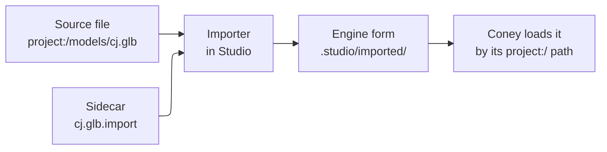

# Coney Studio: content and formats

**Status: design.** Nothing on this page is built. It decides, for each kind of content, what Coney Studio shows from
the player's disc, what a user edits, imports and exports, the files a project saves in formats of Coney's own, and what
Studio needs from the engine for each, so that the Studio roadmap can say which kinds wait on Coney. It is one of the
Studio designs under [#1054](issue:1054); the panels, the project folder and the import flow are the editor
experience design's ([#1055](issue:1055)), the program and its libraries the technology design's ([#1056](issue:1056)),
and the scripting terms, the mods runtime and the natives' names the [Lua SDK design](lua-sdk.md)'s
([#1057](issue:1057)). It uses their terms (the `.studio/` cache, the Level view where other editors have a Scene view,
the Game view; what other editors call a scene, Studio calls a level) and does not repeat them. The path scheme
(`project:/`, `game:/` and `#` for a part of a file) is named on the editor experience page, and scripts use it through
the [Lua SDK's assets by path](lua-sdk.md#assets); this page owns its detail: which names `game:/` holds and how a path
resolves ([Paths](#paths)).

## Contents {#contents}

- [Principles](#principles): the four rules every section below follows.
- [Paths](#paths): how a project names its own files and the disc's, and how scripts use the same names.
- [The import step](#import): from a source file (glTF, FBX, PNG, WAV) to what the engine loads.
  [What stays editable after import](#editable) is its last part.
- [Readers](#readers): glTF, FBX and Blender, and the choice of FBX reader.
- [Content by kind](#kinds): per kind, what Studio shows, edits, imports and exports.
- [Project formats](project-formats.md): the files a project saves, the level's entity tree and prefabs (its own page).
- [Export](#export): what leaves Studio, and where to.
- [What Studio needs from Coney](#engine-needs): one table, for the roadmap.
- [Maintainer decisions](#decisions), [Open questions](#open-questions) and the
  [proposed build issues](#build-issues).

## Principles {#principles}

1. **Studio offers what Coney reads and uses.** Every kind below is shown through one of Coney's own parsers (the 37
   of [Where Coney stands](../asset-and-script-architecture.md#where-coney-stands)), and every thing a user places
   becomes something Coney already runs: a sandbox primitive, a collision triangle, or a call of a script native that
   Coney implements. A kind whose parser or native Coney lacks is listed as *waits on Coney*, never faked in Studio.
2. **A placed entity is a native call.** In the original, a level's flags, paths, boxes, doors, panes, lights, cars,
   spawners and characters are not data in the level file: the level script makes them at entry by calling natives
   (`AddFlag`, `AddPath`, `AddVolumeBox`, `SpawnDoor`, `SpawnBreakableGlass`, `SetLight`, `CarSpawn`,
   `GangAddSpawner`, `HuCreate`; [Flags: where flags come from](../../research/flags.md#sources),
   [Objects: how they get into a level](../../research/objects.md#placement)). Studio saves them as data and Coney
   makes them at level entry through the same natives, so a placed door behaves exactly as a scripted one. Which
   kinds Studio's *Create* menu offers follows from the masterlist: a kind is offered when its native is
   `coney: implemented` in `research/bindings/` ([Script bindings](../../references/bindings/index.md)).
3. **A project holds the user's own content and references to the disc, nothing else.** A disc asset is named by its
   `game:/` path and resolved on the player's machine; its bytes are never copied into a project, the repository, a
   fixture or a document ([LEGAL.md](repo:LEGAL.md#no-game-data),
   [Asset and script architecture: legal](../asset-and-script-architecture.md#legal)).
4. **The engine loads Coney's forms; Studio reads outside formats.** The readers of outside formats (glTF, FBX) live in
   Studio's import step; the game loads only small engine forms of Coney's own that the import writes, read by core
   parsers like the 37 (bytes in, struct out). The game gains no dependency on an outside format.

## Paths {#paths}

Every asset a project uses has one path, a string. The same string is what a level file, a character file and a Lua
script use, as Godot's `res://` paths and Unity's `Resources` paths are.

| Root | Names | Example | Resolved by |
| --- | --- | --- | --- |
| `project:/` | A file in the project folder, by its path from the root | `project:/models/cj.glb` | The import table ([The import step](#import)) |
| `project:/...#name` | One part of a file that holds several: a clip of a glTF or FBX, a mesh of a map file | `project:/anims/dance.glb#Spin` | The same, then the part by name |
| `game:/` | An asset on the player's disc, by the names `coney-tools extract` writes ([extract](../coney-tools-disc.md#extract)) | `game:/textures/warr_re_cv/warr_re_cv` | The asset store, by the original's id |

**The `game:/` names** are the extract tool's, so a modder sees one set of names in Studio, in the `open/` modding kit
and in overrides ([Risks: two naming schemes](../asset-and-script-architecture.md#risks)). Where the extract tool
writes a hash in hex because the name is not recovered, so does the path.

| Kind | `game:/` path | The original's id behind it |
| --- | --- | --- |
| Level | `game:/levels/<level>` (`level99`) | The level name: its `.lev`, script, object list and packs ([Level loading](../../research/level-loading.md#the-level-record)) |
| World | `game:/worlds/<world>` | `<world>s_sec.wld` and `<world>d_sec.wld` ([The streamed world](../../research/world.md#file-names)) |
| Model | `game:/models/<name>` | A model resource's hash ([WAD contents](../../research/formats/wad-contents.md)) |
| Character type | `game:/characters/<type>` (a `CfgChar` type number) | The type, and through it the model name ([From a type to a model](../../research/characters.md#type-to-model)) |
| Object type | `game:/objects/<type name>` (`dyn_door_swinging`) | The Object List record ([Objects](../../references/objects.md)) |
| Texture | `game:/textures/<dictionary>/<texture>` | The dictionary's resource hash and the texture's name |
| Clip | `game:/animations/<clip>`, or `game:/characters/<type>#<anim id>` | The clip resource, or the anim id through the type's character data ([Files of a character](../../research/characters.md#files)) |
| Sound | `game:/sounds/<name>`, `game:/music/<track>` | The sound's name hash ([Audio data](../../research/formats/audio.md)) |
| Script | `game:/scripts/<name>.lua` | The chunk's WAD entry |
| Scene, movie | `game:/scenes/<record>`, `game:/movies/<name>` | The scene record, the `PSS/` file |

- **Resolution goes through the asset store**, by the ids of [the interface
  sketch](../asset-and-script-architecture.md#asset-interface) (`FileId`, `DiscFileId`, `ResourceId`): a path is turned
  into an id once, and Studio and Coney never open the disc or a WAD themselves
  ([Layers](../asset-and-script-architecture.md#asset-layers)).
- **A project names the disc it was made against.** The manifest records the disc's identity from
  [The discs Coney installs from](../../research/discs.md) (the NTSC-U disc today). Studio opens a project made against
  another disc and lists the `game:/` paths that do not resolve on the player's.
- **A path that does not resolve is shown as broken**, in the File system panel, the Inspector and the level, and the
  level still opens; Play refuses to start while a level refers to a missing asset, with the list.
- **Renames keep scripts working.** Studio rewrites the references in level, character and mission files when a file
  is moved in the File system panel ([#1055](issue:1055)). A script holds paths as strings Studio cannot always find,
  so the import table keeps the old path as a redirect, and a script that uses it gets the asset and a warning in the
  Console naming the new path.

## The import step {#import}

Importing turns a **source file** a user brings (a `.glb`, an `.fbx`, a `.png`, a `.wav`) into the **engine form**
Coney loads. Unity and Godot work the same way; this is Coney's version.

*Figure: a source file and its settings go in, the engine form comes out; the source is never changed.*

- **The source stays in the project, as it is.** It is the user's own file, the one to reimport from and to edit in
  Blender.
- **A sidecar beside it holds the settings**: `<file>.import`, a small text file with the importer, its settings (the
  scale, the bone map, which clips to keep), a stable id for the asset and its provenance. Its format is the
  statement format of [Project formats](project-formats.md#formats).
- **The engine form goes in the cache**, `.studio/imported/<id>.<kind>`, which Studio rebuilds from the sources at any
  time ([#1055](issue:1055) leaves `.studio/` out of a shared project). The import table (`.studio/imported/table`)
  maps each `project:/` path, and each redirect, to its engine form.
- **Coney loads engine forms only**, by `project:/` path, through a project source in the asset store beside the disc
  sources ([Sources](../asset-and-script-architecture.md#sources)). A finished project reaches players who do not
  run Studio as a `.cmod` holding its engine forms ([The `.cmod` package](project-formats.md#cmod)); how Coney loads
  one is the Lua SDK design's ([The mods folder](lua-sdk.md#mods-folder)).

| Source | Kind | Engine form | Read in Coney by |
| --- | --- | --- | --- |
| `.png` | Texture | The PNG, checked (size, depth) | The texture loader (librw reads PNG today, as the sandbox's textures show) |
| `.gltf`, `.glb`, `.fbx` | Static model (a prop, a map's geometry) | `.cmesh`: triangles, normals, two texture coordinate sets, materials naming textures by path, in game axes | A new core parser to a mesh struct, beside the sandbox's mesh |
| `.gltf`, `.glb`, `.fbx` | Skinned model (a character) | `.cmodel`: a `CharacterModel` (vertices with up to the format's bone weights on the 32 skin bones, triangles, bind matrices) and its textures | A new core parser to the struct `decodeCharacterModel` returns today |
| `.gltf`, `.glb`, `.fbx` | Clip | `.cclip`: the clip format's sections in Coney's own layout: root velocity, root translation, one rotation channel per pose bone, events, flags | A new core parser to the struct `parseAnimClip` returns today |
| `.gltf`, `.glb`, `.fbx` | Map | Several `.cmesh`, a collision mesh's triangles and the level statements its nodes asked for ([Levels](#levels)) | The two above and the collision builder |
| `.wav` (PCM 8, 16, 24 bit or float, any rate) | Sound | WAV, signed 16-bit PCM, mono or stereo, at most `kMaxSourceRate` | A WAV reader to `PcmSound`, which the mixer plays at any rate ([`pcm_sound.h`](repo:src/audio/pcm_sound.h)) |
| `.lua` | Script | The source as it is | The Lua 5.4 mods runtime ([Lua SDK: the runtime](lua-sdk.md#runtime)) |

- **Every engine form starts with a magic, a format version and the Studio version that wrote it**, and a parser
  refuses a version it does not know, with a message to reimport. The forms are Coney's own and may change; the sources
  are what a project keeps.
- **Imports are deterministic**: the same source and settings give the same engine form byte for byte, so a test can
  hash it and two users get the same result.
- **Provenance.** A file imported from the player's own export of a disc asset (a repainted texture from `open/`, a
  character exported to glTF and reshaped) is still the game's data
  ([legal](../asset-and-script-architecture.md#legal)). Studio recognises an export it made (its record in `open/`,
  [Export](#export)) and writes `derived=game:/...` in the sidecar. A derived file is usable on the player's machine
  like any other; a package or share step leaves it out and says so, and the project's Problems list names it.

**Scripts use the same paths.** A script loads, plays or spawns an asset by its path string, as game engines do:
`Coney.PlaySound("project:/sounds/horn.wav", pos, volume)`, `Coney.SpawnModel("project:/models/bench.glb", pos,
heading)`, `Coney.PlayClip(human, "project:/anims/dance.glb#Spin", loop, speed)`. The natives and their names are the
Lua SDK design's ([Assets by path](lua-sdk.md#assets)), which uses this same scheme. What this page fixes is that
the string is the asset's `project:/` or `game:/` path, resolved through the import table and the asset store, and that
a path that does not resolve returns an error with the path in it that the script can test, never a silent nothing.
Coney's existing native candidates take ids today (a character type for `Coney.ChangeCharacter`, an anim set and id for
`Coney.PlayAnim`, [Coney native candidates](../asset-and-script-architecture.md#coney-native-candidates)); a path form
beside each is the change.

### What stays editable after import {#editable}

Studio does not model or animate: that is Blender's work, and Studio imports its results. What a user changes in
Studio is how an imported asset is **used** (where it stands, what it collides as, which texture it wears, which slot a
clip fills), never its vertices or keys. So each kind splits into what the import fixes, changed only by editing the
source in Blender and reimporting, and what stays editable in Studio, saved in the sidecar or the level and kept
across a reimport.

| Imported kind | Fixed at import (edit the source, reimport) | Editable in Studio |
| --- | --- | --- |
| Static model, prop | Its vertices, normals, texture coordinates, materials and their names | Its transform where placed (each placement its own); its collision: **generated** from the mesh (every triangle, or a convex hull), **replaced** by primitive colliders the user arranges, or **hand-edited** (below); the collision material, flags and area per material or per face; which texture each material wears; the import scale |
| Map (a whole Blender scene) | The same, per mesh; the node names | Every node as a placed mesh (move, hide, delete from the level); per node: drawn, collision or both; the collision, as for a prop; the statements its empties became (spawns, flags), which become ordinary level statements once imported |
| Skinned model (a character) | Its mesh, its weights, its source armature | The bone map, and so the rest pose it is bound in (reimports at once); its textures; the custom character it serves (base type, scale) |
| Clip | Its keys | Which clips of a file are kept and their names; the bone map it shares; the slot it fills in a custom character's anim set; its events (a hit frame, a sound) on the timeline; its reach and ranges when it fills an attack slot |
| Texture | Its pixels | What it overrides, its filtering and addressing, the materials that use it |
| Sound | Its samples | Its loop points, whether it streams, what plays it (overrides, clip events, scripts) |
| Script | | Everything, in the script editor ([Lua SDK](lua-sdk.md)) |

**Hand-edited collision** means working on the collision triangles as data, not modelling them: select faces of a
generated collision mesh and set their material, flags (climbable, sneak zone, two-sided) and area, delete faces
(an archway the player should walk through), and add primitive colliders beside them. The edits are saved in the level
as a list against the mesh's triangle order, so a reimport of an unchanged mesh keeps them and a changed mesh lists
the edits that no longer apply. Moving a collision vertex is modelling, and goes back to Blender.

## Readers: glTF, FBX and Blender {#readers}

Studio is Blender-compatible through the two formats Blender exports with its own add-ons: glTF 2.0 and FBX.

| Format | What Studio reads | Reader | Licence |
| --- | --- | --- | --- |
| glTF 2.0 (`.gltf` with `.bin`, `.glb`) | Meshes, materials and their base colour textures, one skin per character, the armature, every animation (Blender exports each action as one) | **cgltf** (single-file C) | MIT |
| FBX (binary and ASCII) | The same, from FBX's meshes, skin deformers and animation stacks (Blender's actions, or one take each) | **ufbx** (single-file C) | MIT, or public domain (the Unlicense) |
| `.blend` | Not read | | |

- **FBX: ufbx, not the Autodesk FBX SDK.** Autodesk's SDK is closed source under Autodesk's own licence, shipped as
  prebuilt libraries per compiler and platform; it cannot be built from source by `cmake/deps.cmake`, its licence
  terms are not compatible with distributing it inside a GPL-3.0-or-later program, and it would be the one dependency a
  contributor could not build or read. ufbx is an open reader written from the format's public descriptions, fetched
  and built like the other dependencies, licensed MIT, and reads FBX as Blender, Maya and Mixamo write it, skinning
  and animation included. Adding either reader is a dependency to approve ([Maintainer decisions](#decisions)).
- **No `.blend` reader.** Blender's own file format is an internal one that changes between versions; Blender's glTF
  and FBX exporters are the supported way out of it, as in Unity and Godot (Unity reads a `.blend` only by starting
  Blender to export FBX behind the scenes). The import guide will say how to export from Blender (glTF Binary, +Z up
  left as exported, apply transforms).
- **Axes and units.** glTF is metres with +Y up; FBX states its units and up axis in its header. The importer turns
  every source into the game's axes and units, metres with z up, the axes of every level, layout and native
  ([Collision](../../research/collision.md), [The layout format](../sandbox.md#the-layout-format)), and skinned data
  into the pose's axes ([Character geometry](../../research/characters.md#character-geometry)); the sidecar can add a
  scale.
- **Other audio formats** (Ogg Vorbis, FLAC, MP3) are a later importer each, decoding to the same WAV engine form; the
  first importer takes WAV.
- **These readers live in Studio's import step**, not in the game (principle 4): `coney` itself reads `.cmesh`,
  `.cmodel`, `.cclip`, PNG and WAV only.

## Content by kind {#kinds}

The summary first, then a section per kind. *Show* is what Studio opens from `game:/` (read-only); *edit* is what a
project changes; *import* and *export* are outside files. "Exists" names what Coney has on `main` today; "waits" names
the engine work the kind needs, collected in [What Studio needs from Coney](#engine-needs). What of an imported asset
stays editable in Studio, and what only Blender changes, is [What stays editable after import](#editable).

| Kind | Show (disc) | Edit (project) | Import | Export | Coney today |
| --- | --- | --- | --- | --- | --- |
| [Levels and worlds](#levels) | A level: world, collision, paths, occluders, placed objects, the entities its script makes | Project levels; a project level on top of a disc level | glTF or FBX map | World and collision as glTF | Sandbox levels play; disc levels play; a level from project data waits |
| [Colliders and primitives](#collision) | A level's collision triangles by flag and material | Primitives and colliders with full transforms, material, flags, area | A collision mesh from glTF or FBX | glTF | Exists: primitives (yaw only), the collision builder |
| [Paths](#paths-kind) | The path map's areas, holes and route graph; script paths; flag networks | Walkable areas and links, script paths, flag networks | | glTF, JSON | Path map decoder exists; building one from Coney data waits |
| [Level objects and spawners](#entities) | The entities a level makes, by kind | Placed entities of every kind whose native Coney implements | | | The natives exist; making them from level data waits |
| [Models and textures](#models) | Models (shaded, wireframe, by material, normals, bones), texture dictionaries | Texture overrides on existing models; custom props | glTF, FBX, PNG | glTF, PNG | Decoders and views exist; overrides and custom meshes wait |
| [Skeletons and animations](#animations) | The 34-bone skeleton, clips with their events and flags, a type's anim set | Custom player models on an existing moveset; custom clips | glTF, FBX (skinned, clips) | glTF | Clip and rig code exists; outside models and clips wait |
| [Sounds](#sounds) | Sound banks, streams, music | Sound files a project plays | WAV | WAV | The mixer exists; sounds from a project wait |
| [Missions and scripts](#missions) | A level's script chunk: its functions and the natives it calls | Project missions, checkpoints, objectives, scripts | Lua | | Natives exist; the mods runtime waits |
| [Scenes, movies, text](#scenes) | Scene records played; movies played | Nothing | | | Players exist |

### Levels and worlds {#levels}

**What a level is in the original.** A level is its name, from which `InitLevel` reads the two streamed worlds, the
level file `<level>.lev` (collision, path data, occluders, sky models, glows, subtitles), runs the level script, reads
the placed objects of `<level>_objs.txt` and preloads its section's pack
([Level loading](../../research/level-loading.md#the-level-file), [Objects](../../research/objects.md#objs-file)).
Everything else in a level is made by the script.

**Show.** Opening `game:/levels/level99` loads it as `--play-level` does, with the clock stopped, and shows its parts as
layers the Hierarchy can hide: the streamed world (as the world viewer draws it, [the world
viewer](../running-viewers.md#the-world-viewer)), the collision mesh, the path map, the occluders, the placed objects,
and **the entities the level script makes**. Those last are found by running the level's set-up in Coney and recording
every call of an entity-making native with its arguments and returned handle, which the script call trace already
records (`--script-trace`, [Coney native candidates](../asset-and-script-architecture.md#coney-native-candidates));
Studio shows each as an entity of its kind ([Level objects](#entities)), read-only, with the script and function that
made it. The trace is made on the player's machine and kept in `.studio/`, never in the project.

**Edit: project levels.** A project level is a level file of Coney's own ([The level
file](project-formats.md#level-file)), grown from the sandbox layout: Coney plays one today with the player at a spawn
(`--play-level sandbox:NAME --spawn NAME`, [The sandbox](../sandbox.md)). Its geometry is primitives, imported meshes
and colliders; its contents are entities. At level entry Coney builds the collision mesh from the level's solid geometry
and colliders, the path map from its walkable areas, then makes each entity through its native, in the order of the
file. The project's scripts are loaded from the manifest, never from a level ([Play, step by step](lua-sdk.md#play)); a
script finds a level's entities by id, name or tag ([Names and tags](project-formats.md#names-tags)).

**Live edits during Play.** The Studio brief ([#1054](issue:1054)) asks that a change made in the Level view show in the
running game where it can; how Play and the Game view run is [#1055](issue:1055)'s and [#1056](issue:1056)'s. What a
level's data allows: a moved entity is moved in the running level through the native that places it (`Teleport` for a
human or an object, a flag's position for a flag); a changed primitive, collider or face rebuilds the collision mesh
between two steps; a texture or sound override swaps the asset; a changed walkable area rebuilds the path map, and the
AI plans its next route on it. A change that only level entry can make (a new spawner, a `base` level, a door's
triangles) waits for the next Play, and Studio says so.

#### How a level starts {#level-start}

A new level is a **blank slate**: an empty level file with one spawn point at the origin, a ground plane and the
sandbox's default light, which plays at once. From there the user takes one of three roads, and may mix them later
(a Blender map placed in a level built from primitives, primitives added to a game level):

| Road | What the level file holds | What Coney loads at Play |
| --- | --- | --- |
| **(a) Load a game level** | `base game:/levels/<level>` and the project's edits to it, as overrides | The disc level as it is, then the edits and the project's additions |
| **(b) Build from scratch** | Primitives, colliders, placed imported meshes, walkable areas and entities | Only what the file holds |
| **(c) Import a whole map from Blender** | One `map` statement naming the imported file, the statements its markers became, and the edits made since | The map's meshes and collision, then the rest of the file |

**(a) Loading a game level** puts a reference to it in the project, never a copy. The level file says `base
game:/levels/level99`; the world, collision, path map, placed objects and script stay on the player's disc and are read
through the asset store each time ([Paths](#paths)). Everything the user changes is saved as an **override** in the
level file: a statement that names the disc thing it changes and says what changes, so the project holds only the edit.
At Play such a level is the `game:/` level of the Lua SDK's Play order: the game state runs `global.lua` and the level's
own script as the game does ([Play, step by step](lua-sdk.md#play), step 4), then Coney applies the overrides and makes
the project's additions, before the `levelStart` handlers; a level file with no `base` runs no level script, as that
step says. Such a level is a modded session in the store's terms (simulation kinds from outside the disc,
[Layers](../asset-and-script-architecture.md#asset-layers)).

| What is changed | Override | How Coney applies it |
| --- | --- | --- |
| A placed object of `<level>_objs.txt` | `edit objs:<line> move at= rot=`, `edit objs:<line> remove` | Coney reads the object list itself ([Objects](../../research/objects.md#objs-file)), so it moves or skips that line before `ObjSpawn`-ing it |
| An entity the level script makes | `edit call:<function>:<n> move at= rot=`, `edit call:<function>:<n> remove` (the *n*-th entity native the function calls) | After the script's set-up, through the handle the call returned: `Teleport` to move, `ObjDestroy` or the kind's own removal to remove; a change that only the call itself could make (a door's type) is refused with the reason |
| A collision triangle | `faces mesh=base faces=LIST ...` or `remove`, as for an imported mesh ([What stays editable](#editable)) | The disc mesh's triangles by index, changed before the level's first step; the disc file is untouched |
| A walkable area of the path map | `edit nav:<area> remove`, or a new `navarea` | The path map rebuilt with the change at entry |
| A texture or a sound | `override GAME_PATH PROJECT_PATH` in the project's overrides ([Models and textures](#models)) | The override source |
| Anything added | Ordinary statements: primitives, colliders, meshes, entities | After the disc level's own set-up |

An override that no longer matches (another disc, a line or call that is not there) is listed when the level opens
and skipped at Play, never applied to the wrong thing. The disc's own entities show in the Hierarchy greyed until
edited (from the trace above); editing one writes its override.

**(b) Building from scratch** is the sandbox layout grown: primitives, colliders, imported props from the File system,
walkable areas and entities from the *Create* menu, each with full transforms. Nothing in such a level comes from the
disc but what its entities name (a character type, an object type, a texture).

**(c) Importing a whole map from Blender** turns one Blender scene, exported as glTF or FBX, into a level's geometry,
collision, materials and markers. The source file stays in the project and the level holds
`map project:/maps/yard.glb`; the importer reads the scene's **naming convention** and, where present, its **custom
properties** (Blender writes an object's custom properties into glTF as `extras` and into FBX as user properties; a
property beats a name):

| In Blender | Name convention | Custom property | Becomes |
| --- | --- | --- | --- |
| A mesh | any name | `coney=mesh` | Drawn geometry and its collision (every triangle, or `coney_collide=hull\|none`) |
| A mesh for collision only | ends `_col` | `coney=collider` | Collision triangles, not drawn |
| A mesh drawn only | ends `_vis` | `coney_collide=none` | Drawn, no collision |
| A material | `MAT_<NAME>` (`MAT_GRASS`) | `coney_material=GRASS`, `coney_climb=player`, `coney_sneak=1`, `coney_area=` | Its triangles' collision material, flags and area ([Colliders](#collision)); its base colour texture imported as PNG |
| An empty | `spawn_<name>` | `coney=spawn`, `coney_character=` | A spawn point (its +Y the heading) |
| An empty | `flag_<name>` | `coney=flag` | A flag |
| Empties in order | `path_<name>_<n>` | `coney=path`, `coney_order=` | Flags and a script path through them (at most eight) |
| A flat mesh | `nav_<name>` | `coney=navarea`, `coney_area=` | Walkable areas: each face loop's outline, inner loops as holes ([Paths](#paths-kind)) |
| An empty | `obj_<type>` | `coney=object`, `coney_type=` | An object of that Object List type |
| A light | `light_<name>` | `coney=light` | A light, its colour and range from Blender's |

The markers become ordinary statements in the level file, written once at import and then edited in Studio like any
other; the geometry, collision triangles and materials stay tied to the source and come again on reimport, with the
collision edits of [What stays editable](#editable) kept against them. Coney draws an imported map as static meshes,
not as streamed sectors. An object with an unknown `coney=` value, or a name prefix Studio does not know, is imported as
plain geometry and listed, so a typo never silently drops a spawn.

**Export.** A disc level's world as glTF (the world as `extract` assembles it) and its collision as glTF, to the export
folder ([Export](#export)). A project level exports its own geometry the same way.

**Needs from Coney:** the asset store, so Studio reads a level through it; a game mode that plays a level from a level
file of Coney's own (collision built, path map built, entities made through natives, scripts run); drawing an imported
static mesh; the overlay of a project level on a disc level, with its overrides applied.

### Colliders and primitives {#collision}

Coney's collision is the original's: one static mesh of triangles in game axes, each with a flags word, a material
id and an area byte, queried through a grid ([Collision](../../research/collision.md#triangles)). Coney builds such a
mesh from its own triangles today (`buildCollisionMesh`, [`collision_builder.h`](repo:src/raycast/collision_builder.h)),
which is how the sandbox's primitives collide. A project's collision is written in those terms, and only those.

- **Primitives** are the sandbox's shapes (box, ramp, stairs, cylinder, sphere, capsule), drawn and solid by default.
- **Colliders** are collision without drawing: a box, a sphere, a capsule, a convex hull or a mesh (from an imported
  file). They become triangles of the same mesh; Coney has no separate collision shapes for the level.
- **An imported mesh's collision** is generated from it (every triangle, or a hull), replaced by primitive colliders the
  user arranges, or hand-edited face by face ([What stays editable after import](#editable)).
- **Full transforms**: position, rotation and scale on every primitive and collider, with the Unity gizmo of
  [#1055](issue:1055). The sandbox's primitives take a yaw only today; a full rotation and a scale are the engine
  change.
- **Per primitive or collider** a user sets what a triangle carries, by name, never a raw number in the Inspector:

| Setting | Values | In the triangle |
| --- | --- | --- |
| Material | The `MATERIAL_*` names | `+0x08`, the material id; it chooses sounds and effects, and 30 `LOW_FENCE` makes a climbable fence ([Materials](../../research/collision.md#materials)) |
| Climbable | no, by anyone, by a player | Flag bits 7 and 2 ([Triangles](../../research/collision.md#triangles), [Climbing](../../research/characters.md#climb)) |
| Sneak zone | on or off | Flag bit 4, the shadow ground where a human may hide ([Stealth](../../research/stealth.md#shadow-ground)) |
| Two-sided | on or off | Flag bit 1 |
| Area | 0 to 124 | `+0x09`, the area byte; a path area is matched against it ([Path data](../../research/level-loading.md#path-data)) |
| Solid | yes or no | Left out of the mesh when no (a marker) |

The flag bits whose meaning is not known (3, 5, 6, 8-10; bit 5's one traced use sets a byte of the human standing on it,
whose effect is open) are not offered by name; an *Advanced* field takes the raw word, as the layout's `flags=` does
today. **Sneak zones are collision.** The Studio brief asks that a sun's shadows decide where the player hides; in Coney
today, as in the original, hiding is decided by the shadow-ground bit of the triangle under the human, so a project
marks its sneak zones on its colliders. A sun that computes them waits on the enhancements' lighting ([Realtime
lighting](../realtime-lighting.md)), and when it exists it writes the same bit.

**Needs from Coney:** primitives with a full rotation and a scale; colliders of every shape built into the same mesh;
collision triangles from an imported mesh.

### Paths: the path map, script paths and flag networks {#paths-kind}

"Pathing" is three different things in the game, and a project edits each in its own terms:

| Thing | In the original | In a project |
| --- | --- | --- |
| **The path map** | Walkable polygons in areas (an outline and its holes), route nodes and edges, chunk `0x40` of the level file; the AI's route planner searches it ([Path data](../../research/level-loading.md#path-data), [AI: path planning](../../research/ai-moving.md#path-planning)) | **Walkable areas** (an outline and holes, drawn on the ground) and **links** between areas (walk, jump, climb, door), from which Coney builds the path map |
| **Script paths** | Up to eight flags in order, made with `AddPath` and handed to `GoalTravelPath` and its kin | A **path** entity: a list of flag entities |
| **Flag networks** | Links between flags that wandering pedestrians walk, `FlagNetAddLink` | **Flag links** between flag entities |

- **The path map is built, not drawn node by node.** A user draws areas (each a polygon with its flags: a door hole,
  ignored by the AI) and marks links; Coney's builder turns them into the polygons, slab edge lists, route nodes and
  edges that `world::PathMap` reads, with the edge flags the follower acts on (4 a jump, 8 and `0x80` a climb, `0x10` a
  door, [AI: following a route](../../research/ai-moving.md#route-follow)). How the original's tool placed its route
  nodes is not known (a node lies inside its area in 42,373 of 43,234 cases, [Path
  data](../../research/level-loading.md#path-data)); Coney's builder is its own, marked as Coney's choice, and the AI is
  tested on built maps.
- **Show** draws a disc level's areas, holes and route graph (nodes and edges coloured by flag), from the `PathMap`
  Coney decodes today.
- **Export** writes the path map as JSON (as `extract` writes `paths.json`) and as glTF lines, to the export folder.

**Needs from Coney:** a `PathMap` made from Coney's own areas and links (it decodes the chunk's bytes today) and the
route graph builder; the script paths and flag networks need nothing new (`AddPath` and `FlagNetAddLink` are
implemented).

### Level objects and spawners {#entities}

Every placed thing that is not geometry is an **entity**: a kind, a stable id, a transform, a parent, and the arguments
of its native. Studio's Inspector shows the arguments by name and kind from the masterlist (enums from the references:
[object types](../../references/objects.md), [character types](../../references/characters.md),
[glass types](../../references/glass-types.md), [doors](../../references/doors.md),
[spawner states](../../references/spawner-states.md), [zones](../../references/zones.md)).

| Entity | Native Coney calls at level entry | Notes |
| --- | --- | --- |
| Spawn point | `AddFlag`, then the project's player made at it (`HuCreate` with a player slot) | The character to spawn is a character type or a project character ([Custom player models](#custom-player)) |
| Flag | `AddFlag(name, pos, heading, a, b)` | A flag keeps 15 characters of its name, so `FindFlag` never matches a longer one ([Flags](../../research/flags.md#findflag)); Studio warns |
| Path | `AddPath(name, {flags})` | At most eight flags, 32 paths a level |
| Flag link | `FlagNetAddLink(flag, ...)` | Up to four links a flag |
| Volume box | `AddVolumeBox(name, kind, corner, size, ...)` | Axis-aligned: Studio's gizmo offers no rotation ([Volume boxes](../../references/boxes.md)) |
| Turf | `GangAddTurfBox` on a volume box | |
| Object | `ObjSpawn(type, pos, rot, -1, zone, flags, tint, flag)` | Any Object List type; streamed in within 70 m as the original's ([Streaming](../../research/objects.md#streaming)) |
| Emitter | `SpawnParticle(type, pos, rot)` | The `part_*` types ([Particles](../../references/particles.md)) |
| Door | `SpawnDoor(type, pos, rot, triangles, number)` | The two collision triangles it names are built into the level's mesh by Coney and passed by index |
| Glass pane | `SpawnBreakableGlass(type, corners, ..., triangles)` | The same: its two triangles are built and passed |
| Car | `CarSpawn(type, pos, rot)` | The six types ([Cars](../../references/cars.md)) |
| Light | `SetLight`, the long form | The level's lamps ([Lights](../../references/lights.md)) |
| Character | `HuCreate(name, type, pos, heading, nil, player, gang, ...)` | A human of any type, in a gang; behaviour from the project's script or a gang's goals |
| Spawner | `GangAddSpawner(gang, name, ..., pos, heading, ...)` | Its state switched by script with `GangStartSpawner` |
| Trigger sphere | `TriggerSphereCfg(object, enable, radius, ...)` | On an object |

- **Transforms are stored once, converted per native.** The level file keeps a position and a rotation (and a scale
  where the kind has one); Coney turns them into what each native takes. Headings differ by native: a flag's,
  `Teleport`'s and `TeleportToFlag`'s grow clockwise seen from above, `HuCreate`'s anticlockwise
  ([Flags: which way a heading turns](../../research/flags.md#position), confirmed (code) at `Flag_Heading`
  `0x00416258`, `TeleportToFlag` `0x00385db0` and `Human_Create` `0x00233d60`); Coney already converts with
  `world_objects::placementHeading()`. Kinds whose native takes no rotation or no scale have those gizmo handles off.
- **The capacity limits are the game's.** Flags, paths, objects, spawners and lights have the pools the original
  sizes (`CfgSetDatabaseSizes` and fixed tables); Studio counts each kind against its limit and says when a level is
  over it, rather than letting Coney drop the extra ones at entry.
- **Entities as an original level makes them.** In a project level on a disc level, the disc level's entities are
  shown read-only (from the trace, [Levels](#levels)); the project's are editable.

**Needs from Coney:** making a level's entities from data at entry (one call of the same native per entity, the
handle kept by entity id so scripts find them); door and pane triangles built into the collision mesh with their
indices; nothing else, since the natives above are implemented.

### Models and textures {#models}

**Show.** A `game:/models/` entry opens in the Model viewer with the debug menus' mesh views (shaded, wireframe, by
material, normals, bone axes, [Mesh views](../debug-menu.md#mesh-views)) and its counts (vertices, triangles,
materials, bones); a texture dictionary in the Texture viewer (each texture, its size, depth, palette, mipmaps and
addressing, as `--view-txd` shows them, [the 2D viewers](../running-viewers.md#viewing-texture-dictionaries)). The
viewers are the editor experience design's ([#1055](issue:1055), build issue 9).

**Edit: texture overrides on existing models.** A project replaces a disc texture with a PNG of its own: `override
game:/textures/<dictionary>/<texture> project:/textures/<file>.png` in the project's overrides file ([Project
formats](project-formats.md#formats)). It applies wherever the game draws that texture (a character, an object, the
world), in that project's sessions only. This is the override source of [The install
folder](../asset-and-script-architecture.md#install-folder), scoped to a project: the same key (the dictionary and the
texture, as the extract tool names them), the same rule (an entry matching no texture on the disc is ignored and
listed), and textures are a presentation kind, so an override changes no gameplay
([Layers](../asset-and-script-architecture.md#asset-layers)). The PNG keeps its own size: a texture twice as large is
drawn with the same coordinates, as a texture pack's is ([Texture packs](../enhancements.md#packs)). A character entity
may also take a texture of its own, for that one human: the game binds a character's one texture to its material at each
draw ([Character geometry](../../research/characters.md#character-geometry), [Drawing a
human](../../research/graphics.md#human-draw)), so one human can wear another texture without touching the rest.

**Edit: custom props.** An imported static model placed in a level is drawn at its transform, with the collision its
sidecar asks for (none, its mesh, or a hull). It is level geometry, not an object of the game: it cannot be picked up,
broken or thrown, since that needs an Object List type with a class, which the original's types define and a project
cannot add until Coney has a way to register a type of its own (a Coney native, [Lua SDK: names](lua-sdk.md#names)).

**Export.** A model to glTF (a character with its skin) and a texture to PNG, as `extract` writes them, to the export
folder.

**Needs from Coney:** the texture resolver with an override source (F4 of [Enhancements
plan](../enhancements.md#foundations)), scoped to a project; a per-human texture; drawing imported static meshes; later,
object types of a project's own.

### Skeletons, animations and custom player models {#animations}

**What Coney has.** Every character shares one skeleton: 34 pose bones (0 the root's motion, 1 the pelvis, then 32
skin bones, the HAnim nodes `n + 2`), with each model's bone offsets ([`skeleton.h`](repo:src/animation/skeleton.h),
[Character geometry](../../research/characters.md#character-geometry)). A clip is a root velocity, a root translation,
one rotation channel per animated bone, events and flags ([Animation](../../research/formats/animation.md)). A type's
anim set is its character data's 722 slots over the generic set, and the anim slots choose what it plays for each
movement ([Anim slots](../../research/characters.md#anim-slots)). The Animation player plays any set's clips on any
character ([Animation player](../debug-menu.md#animation-player)).

**Show.** The Animation viewer plays a clip on any character, with a timeline, the bones it animates, its events (with
their frames) and its flags; a type's anim set as the 722 slots with the clip in each; the skeleton with bone axes and
names. **Export** writes a clip or a whole set as glTF animations on the character's skin, so Blender opens it.

#### Custom player models {#custom-player}

The Studio brief's first test ([#1054](issue:1054)), a model brought from elsewhere playing an existing character's
moves (the roadmap's CJ with Cleon's moves, [Custom content](../../roadmap.md#custom-content)), is a **custom
character**: a project file naming a **base type** (whose class, moveset, anim set, power class and every other number
are kept) and a **model** that replaces only what is drawn. A debug menu change in work swaps a human's model while
keeping everything else about the character ([#1053](issue:1053)); a custom character is that swap with a model from the
project.

Importing a skinned glTF or FBX as a character:

1. **Bone map.** Each bone of the source armature is mapped to one of the 32 skin bones. Studio guesses from the names
   (common rigs: Blender's Rigify and metarig, Mixamo, the game's own `bip_sw_*` when a disc model was exported and
   reshaped) and the user corrects it in the sidecar. A source bone with no match gives its weights to its nearest
   mapped ancestor; a skin bone with no source bone follows its parent.
2. **Rest pose.** The game's clips rotate bones from the skeleton's rest pose, so the model is bound in the shape of
   the base type's rest pose: Studio poses the source armature onto the base skeleton (each mapped bone turned to the
   base bone's direction), bakes that pose into the mesh and takes the result as the bind pose. The bone offsets come
   from the source's joints, so a taller model keeps its proportions; the clips' root heights are scaled by the
   pelvis heights' ratio.
3. **Weights.** At most the number of weights the model format carries per vertex, the smallest dropped and the rest
   renormalised.
4. **Textures.** The model's materials and their base colour textures, imported as PNG. The game's characters have one
   material and one texture ([Character geometry](../../research/characters.md#character-geometry)); a custom model
   may have several, which needs the renderer to draw a human with more than one material.

The result is a `.cmodel` (a `CharacterModel`) that Coney skins exactly as a disc model, with
[`character_rig.h`](repo:src/characters/character_rig.h), and the custom character file that names it. Hats, the blood
layer and anything else drawn at a bone keep working because the bones are the same.

#### Custom clips {#custom-clips}

A glTF or FBX animation imports as a clip: sampled at the clip format's key rate onto the 34 pose bones through the
same bone map and rest pose, the pelvis's motion split into the root velocity and the root translation as the format
holds them. A clip is used in two ways:

- **Played by a script** by its path (`Coney.PlayClip(human, "project:/anims/dance.glb#Spin", loop, speed)`), as the
  Animation player plays any clip today. Gameplay is untouched.
- **Put in a slot** of a custom character's anim set (its walk, its idle, an attack). That changes how the character
  plays, which is the point of a project, and it is allowed only in a project's sessions. An attack clip's reach and
  ranges come from the Anim Range List record of the slot it replaces
  ([Anim Range List](../../research/formats/animation.md#anim-range-list)) unless the sidecar sets them; its events
  (the hit frame, sounds) are authored on the Animation viewer's timeline. Clip flags (paired, grab, tackle) are copied
  from the replaced clip and not offered as free choices, since a paired clip needs its partner's.

**Needs from Coney:** a `CharacterModel` and a clip loaded from engine forms; a custom character (a type with a model
from the project) that `HuCreate`, the spawn point and `Coney.ChangeCharacter` can name; drawing a human with several
materials; an anim set whose slots a project overrides; clip playback by path.

### Sounds {#sounds}

**Show.** Sound banks and their sounds, the streamed sounds of `IOP/BFW.SND` and the music of `IOP/MUSIC.SND`, played
through Coney's mixer with their rate, loop points and length ([Audio data](../../research/formats/audio.md)).
**Import** takes WAV ([The import step](#import)); the sidecar sets the loop points and whether it streams. **Edit**
is choosing where a project's sounds play: by script (`Coney.PlaySound` with a path, at a position or attached to an
entity) and on clip events. Replacing a disc sound with a project's (`override game:/sounds/<name> project:/...`) is the
same override as a texture's, sounds being a presentation kind. **Export** writes a sound as WAV, as `extract` does.

**Needs from Coney:** a WAV reader into `PcmSound`; playing a project sound by path and at a position through the
sound engine; the sound override in the override source.

### Missions and scripts {#missions}

**Show.** A disc script opens as the functions of its chunk, its constants and the natives each function calls, with
links to their masterlist pages, from the `LuaProto` Coney parses (`parseLuaChunk`). The listing is made on the
player's machine and shown in Studio only: a script's source is game data, so it is never saved in a project or
copied out ([LEGAL.md](repo:LEGAL.md#no-game-data)). A level's checkpoints and what each sets up are on the mission
pages ([Missions](../../missions/index.md)).

**Edit: a project mission** is a mission file ([Project formats](project-formats.md#formats)) naming the level it plays
in and its **checkpoints**: for each, the spawn point the player restarts at, the function of the project's scripts
(loaded from the manifest like every project script) that sets it up and the objective text shown (`SetCheckPoint`,
`HUDSetObjective`, both implemented). The mission's logic is Lua calling natives, written in the script editor; the
runtime that loads a project's scripts, the entry points, hot reload and the sandbox are the [Lua SDK
design](lua-sdk.md)'s ([entry points](lua-sdk.md#entry-points), [Play](lua-sdk.md#play)). This page fixes only that a
mission is a level plus checkpoints that name spawn points and functions of the project's scripts, and that its
objective strings are the project's own (the game's text is never copied in).

**Needs from Coney:** the mods runtime ([Script mods](../../roadmap.md#script-mods)); starting a project mission at a
checkpoint, as `Coney.StartLevel` does for the story.

### Scenes, movies and text {#scenes}

Scene records are the game's in-engine cutscenes (Studio's word for what other editors call a scene is *level*). They
play in a viewer through Coney's scene player, with their roles, camera and tracks; movies play through the movie
decoder. Neither is edited or exported by Studio: a project's own cutscenes wait on a cutscene format of Coney's own,
and the game's text (subtitles, dialogue) is never shown outside the game's own
screens or copied (a [maintainer decision](../asset-and-script-architecture.md#maintainer-decisions) keeps it out of
anything shipped).

## Project formats {#formats-pointer}

The files a project saves (the level file with its entity tree, names, tags and prefabs, characters, missions,
overrides, import sidecars) and the `.cmod` package a finished project becomes are on their own page, [Project
formats](project-formats.md).

## Export {#export}

Export writes a disc asset, or a project's own, in an open format: glTF for models, worlds, collision, path maps and
clips, PNG for textures, WAV for sounds, the same files and names `coney-tools extract` writes
([extract](../coney-tools-disc.md#extract)), from the same parsers. A disc asset exports to the install's modding kit
folder, `<install>/open/` ([The install folder](../asset-and-script-architecture.md#install-folder)), **never into the
project**: the File system panel shows only the project and `game:/`, and an export is game data on the player's
machine. Editing an export and importing it back makes a derived file ([The import step](#import)). A project's own
models and levels export anywhere the user picks, through the system's save dialog, as the Import button reads through
its open dialog.

## What Studio needs from Coney {#engine-needs}

One row per engine change, the Studio kinds that wait on it and its state today. The Studio roadmap
([#1054](issue:1054)) takes its "waits on Coney" column from here.

| Engine change | Studio kinds that wait on it | Today |
| --- | --- | --- |
| The asset store with the disc source (N1, N3 of [Now](../asset-and-script-architecture.md#now)) | Every `game:/` view | Designed, not built |
| A project source in the store, by `project:/` path, reading engine forms | Every project asset | Designed here |
| A level from a level file: the entity tree flattened and prefabs expanded, collision and path map built, entities made through their natives, scripts run | Project levels, entities, missions | Sandbox layouts play; entities and scripts from a file do not |
| Primitives with full rotation and scale; colliders of every shape; collision names | Colliders and primitives | Yaw only; flags and material raw |
| A `PathMap` from areas and links, and the route graph builder | Walkable areas | The decoder reads the disc's chunk |
| Door and pane triangles built with the level's collision | Doors, glass | The natives take a disc level's triangles |
| Drawing an imported static mesh (`.cmesh`) | Maps, props | The sandbox draws its own mesh only |
| A project level on a disc level | `base` levels | Not built |
| The texture resolver with an override source, per project (F4) | Texture overrides | Designed ([Enhancements plan](../enhancements.md#foundations)) |
| A per-human texture | A character's own texture | Not built |
| A custom character: a type with a project model, named by `HuCreate`, spawns and `ChangeCharacter` | Custom player models | The model swap is in work ([#1053](issue:1053)) |
| `CharacterModel` and clips from engine forms; humans drawn with several materials | Custom models, clips | Disc decoders only; one material |
| Anim set slots a project overrides | Custom clips in a moveset | Not built |
| A WAV reader into `PcmSound`; project sounds by path and position | Sounds | The mixer plays any `PcmSound` |
| The mods runtime and natives by path ([Lua SDK](lua-sdk.md#assets)) | Scripts, missions, assets by string | Designed ([Script mods](../../roadmap.md#script-mods)) |
| A recorded trace of a level's entity natives, kept for Studio | Showing a disc level's entities | `--script-trace` writes every call |

What needs nothing new: the viewers of models, textures, clips, scenes and movies (the debug menus' parsers and views),
flags, script paths, flag networks, volume boxes, objects, emitters, cars, lights, characters and spawners (their
natives are implemented), and the export of every kind the extract tool writes.

## Maintainer decisions {#decisions}

1. **Two Studio dependencies**: cgltf (MIT) to read glTF and ufbx (MIT, or the Unlicense) to read FBX, in Studio's
   import step only, fetched at pinned commits like the others in `cmake/deps.cmake` and listed in
   [LEGAL.md](repo:LEGAL.md#licences). A new dependency's licence is a maintainer decision. The Autodesk FBX SDK is not
   proposed ([Readers](#readers)).
2. **Derived files in projects**: this page lets a project hold a file the user made from a disc export on their own
   machine, marked and left out of packages ([The import step](#import)), rather than refusing it. Whether Studio should
   refuse instead is a legal question.

## Open questions {#open-questions}

- **Route nodes.** How the original's tool placed the path map's route nodes, and what an A record's `+0x08` means
  ([Path data](../../research/level-loading.md#path-data)); Coney's builder is its own until then.
- **Collision bits of unknown meaning** 3, 5, 6 and 8-10, and the meaning of the area byte
  ([Triangles](../../research/collision.md#triangles)): named in Studio once researched.
- **A player box's behaviour** against a volume box ([Volume boxes](../../references/boxes.md)): Studio offers both
  kinds with the reference's wording until it is traced.
- **Weights per vertex** a custom model may carry, and whether Coney's renderer takes a human of several materials as
  the original's single-texture draw does not ([Drawing a human](../../research/graphics.md#human-draw)).
- **Removing what a disc level's script makes.** An override removes such an entity after the script made it and may
  still hold its handle; a later call of the script on that handle then meets nothing. Which kinds can be removed
  safely, and whether stopping the call itself is better, is to be tried per kind with the Lua SDK design
  ([Lua SDK](lua-sdk.md)).

## Proposed build issues {#build-issues}

In the order they should come, after the editor experience design's shell, File system panel and Level view
([#1055](issue:1055)); each states the engine change it needs first, from [What Studio needs from Coney](#engine-needs).

1. **core: Add the asset store with the disc and project sources.** N1 and N3 of the asset architecture
   ([Now](../asset-and-script-architecture.md#now)), and a project source that resolves `project:/` paths through an
   import table to engine forms and `game:/` paths to the original's ids, with the redirects of renamed files. Tests:
   synthetic WADs and a synthetic project resolve every path kind of [Paths](#paths); a missing path fails with its
   name; disc checks print counts only.
2. **core: Add level files of version 2 with the entity tree and colliders.** The layout parser reads `format`, ids,
   names, tags, parents and groups ([The entity tree](project-formats.md#entity-tree)), `rot=` and `scale=` on every
   entity, `collider` statements and collision names (`material=GRASS`, `climb=`, `sneak=`); the tree is flattened into
   world transforms and the solid geometry built into the collision mesh; version 1 layouts read unchanged and play the
   same. Tests: every shipped layout parses to the same primitives; a box under a rotated, scaled group lands where the
   composed transform puts it; a sneak collider sets bit 4 under a human; ids, names and tags reach the table scripts
   read ([Names and tags](project-formats.md#names-tags)).
3. **gameplay: Add level entities made from a level file at entry.** The entity statements of
   [Level objects](#entities), each made through its native in file order with its handle kept by id, the heading
   converted per native, door and pane triangles built into the mesh and passed by index, pool limits checked. Tests:
   a synthetic level's flags, paths, objects, doors, characters and spawners match the same natives called by a
   script, call for call on the trace.
4. **core: Add prefabs and prefab instances to level files.** `format prefab 1` files, `instance` lines, `set` and
   `drop` overrides, nested instances with `INSTANCE/LOCAL` ids, cycles refused, stale overrides listed, and instances
   expanded before the tree is flattened, with unique game names suffixed ([Prefabs](project-formats.md#prefabs)).
   Tests: two instances of one prefab, one with an override and a dropped entity, expand to the expected entities; a
   change to the prefab reaches both except the overridden key; a prefab that contains itself is refused.
5. **gameplay: Add path maps built from walkable areas and links.** A `PathMap` from `navarea` and `navlink`
   statements, with Coney's own route graph builder, marked as Coney's choice; the AI's route planner and follower
   unchanged. Tests: an AI fighter walks round a hole, jumps a jump link and opens a door link on a built map; the
   built map passes the same queries as its polygons.
6. **tools: Add the Coney Studio import step with PNG and WAV.** The `.import` sidecar, stable ids, the import table,
   engine forms in `.studio/imported/`, deterministic output, provenance; PNG to textures and WAV to sounds, with a WAV
   reader into `PcmSound` in Coney and `override` statements for textures and sounds. Tests: the same source gives the
   same bytes; a rename keeps a redirect; a WAV plays through the offline mixer.
7. **tools: Add glTF and FBX import of static meshes and maps.** cgltf and ufbx (after the maintainer's approval) in
   the import step, the `.cmesh` form and its core parser, Coney drawing an imported mesh, and whole maps by the naming
   convention and custom properties of [How a level starts](#level-start): meshes, collision, materials, spawns,
   flags, paths, walkable areas, objects and lights. Tests: a synthetic glTF and FBX cube import to the same `.cmesh`;
   a synthetic map's spawn, path and walkable area become statements; its collider stops the player.
8. **tools: Add Coney Studio's disc level view.** Opening a `game:/` level shows its world, collision (by flag and
   material), path map (areas, holes, route graph), occluders, placed objects, and the entities its script makes from
   a recorded trace kept in `.studio/`, each with the function that made it; loading it into a project as `base`,
   with `edit` and `faces` overrides applied at Play and stale ones listed. Tests: a synthetic level's trace lists its
   entities; an override moves one object and removes another, and the disc file is unchanged; a disc check prints
   the counts per kind.
9. **gameplay: Add custom characters with imported skinned models.** Skinned glTF and FBX import (bone map, rest pose
   onto the base skeleton, weights, textures) to `.cmodel`; the `.character` file; Coney making a human of a custom
   character through `HuCreate`, a spawn point and `Coney.ChangeCharacter`, with the base type's every number; a
   per-human texture; several materials on a human. Tests: a synthetic skinned model plays the generic walk with every
   vertex within a centimetre of the expected pose; the custom character fights with its base type's damage.
10. **gameplay: Add imported clips and anim set overrides.** Clip import to `.cclip`, clips played by path, anim set
   slots a custom character overrides, events authored on the timeline, the Anim Range List record of the replaced
   slot. Tests: an imported clip's sampled pose equals its source's at each key; an overridden walk plays and the
   character's speed is unchanged.
11. **tools: Add export of disc and project assets.** glTF, PNG, WAV and JSON exports with the extract tool's names, to
    `<install>/open/` for disc assets and to a picked folder for a project's own; the record that marks a later import
    as derived. Tests: an exported synthetic model reimports to the same `.cmodel`; a disc export never lands inside
    the project folder.
12. **tools: Add project missions with checkpoints.** The `.mission` file, starting a project mission at a checkpoint,
    objectives shown; after the mods runtime ([Lua SDK](lua-sdk.md#build-issues)). Tests: a synthetic mission starts at
    checkpoint 2 with the player at its spawn and its setup function called once.
13. **tools: Add the `.cmod` export.** A project exported as one zip with its manifest, the file list and hashes, the
    engine forms and optionally the sources, and none of the disc: derived files, files matching a disc asset's hash
    and disc traces refused and listed ([The `.cmod` package](project-formats.md#cmod)). Tests: a synthetic project
    exports to the expected entries byte for byte; a file equal to a synthetic disc asset is refused; a scripts-only
    and a level-only project both export and load.
