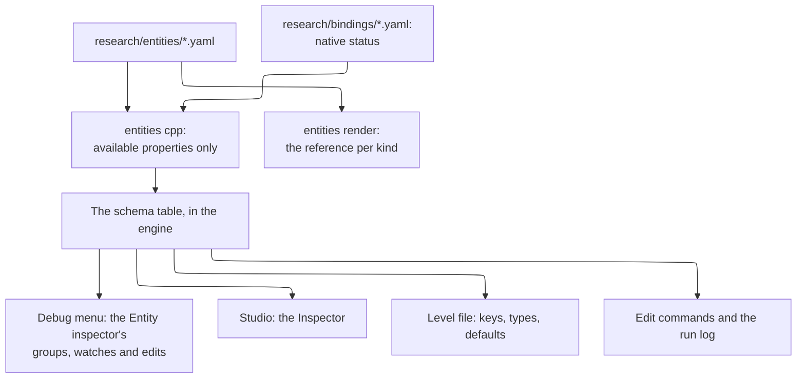

# Coney Studio: entities, kinds and the Inspector

**Status: design.** Nothing on this page is built. How Coney Studio knows what an entity is and what the Inspector shows
for it: the **kinds** of entity a level holds, the **property schema** each kind has, written once as data and drawn by
every front end, how the Inspector shows everything about an entity without bloat, each kind's **events**, and
**attributes**, the named values a project gives any entity for its scripts. The full list of a **Human**'s properties
is its own page, [A Human's properties](human-properties.md). What Studio is, and the
other design pages, are on the [Studio index](index.md); the Hierarchy and
the Inspector panel are that design's, the level file and its entity tree are [Project formats](project-formats.md)'s,
and the natives are the [Lua SDK](lua-sdk.md)'s.

The question this page answers, a maintainer's: the Hierarchy holds *entities*, and scripts are never attached to them
(a maintainer decision), so how does the Inspector know what to show? Selecting a Human must let a user set
absolutely everything about him, without bloat. The answer in five lines:

1. **An entity has one kind, and the kinds are Coney's.** A Human, a Primitive, a Spawn point, a Door: one kind per
   thing Coney's engine can make, as Roblox Studio's classes are Roblox's ([Entity kinds](#kinds)).
2. **Each kind has a property schema, as data.** Every property's name, type, range, default, group, Advanced flag,
   whether it is saved and whether it can change while playing, and the native or Coney edit that sets it. The
   Inspector, the debug menu's Entity inspector, the level file and the run log all read the same schema, so a kind
   needs no Inspector code of its own ([The property schema](#schema)).
3. **The Inspector draws the schema** in collapsible groups, with an Advanced part per group, a search box, a
   modified-only filter, pins and remembered state ([The Inspector](#inspector)).
4. **A project adds its own values with attributes**, Roblox's: typed, named values on any entity, saved with the level,
   which the project's scripts read and write through natives. They are how a mod gives an entity its own settings
   without a script component ([Attributes](#attributes)).
5. **Each kind comes with its own events**, as Godot's signals come with node types: a trigger's *On Enter* and *On
   Exit* name a function of the project's scripts, the callback by name the original's natives take, so the Inspector
   holds the connection and never the logic ([Events](#events)).

## Contents {#contents}

- [What the four editors do](#survey)
- [Entity kinds](#kinds): the list, [stealth zones](#stealth-zone), [inheritance and composition](#inheritance),
  [presets](#presets)
- [The property schema](#schema): [what a property says](#property-fields), [where it lives](#schema-source),
  [one schema, every reader](#schema-readers), [one edit command](#edit-command)
- [The Inspector](#inspector): [its layout](#inspector-layout), [no bloat](#no-bloat), [asset sources](#asset-source),
  [prefab overrides](#prefab-overrides), [Level and Running](#running)
- [Events](#events): each kind's events, connected by function name
- [A Human's properties](human-properties.md), with [a Target](human-properties.md#target) and
  [a Gang](human-properties.md#gang)
- [Attributes](#attributes)
- [Spawning a prefab from a script](#spawn-prefab): the pivot, the ground, `Coney.SpawnPrefab` and despawning
- [What the level file stores](#level-file)
- [Tests](#tests), [open questions](#open-questions), [proposed build issues](#build-issues), [sources](#sources)

## What the four editors do {#survey}

All four answer "what is this thing, and what does its inspector show" from **metadata the engine reflects**, never
from a panel written per class; they differ in who may add to it.

| | Unity | Godot | Unreal | Roblox Studio |
| --- | --- | --- | --- | --- |
| What a thing is | A GameObject: a name, a transform and a list of **components**; the components make it a light, a body or a character | A **node of a class**, the class from an inheritance chain (`Node`, `Node3D`, `CharacterBody3D`); one script may extend it | An **actor** of a class (`AActor`, `APawn`, `ACharacter`) holding **components** | An **instance of a class** fixed by the engine (`Part`, `Model`, `Humanoid`); a character is a model with a `Humanoid` child |
| What its inspector shows | Each component's serialized fields (public, or `[SerializeField]`), one foldout per component | The class's properties, one section per class of the chain, then the script's `@export` variables | Every `UPROPERTY` with an edit specifier (`EditAnywhere`, `VisibleAnywhere`), by `Category` | The class's properties from the engine's reflection, by category (Appearance, Behavior, Transform, ...) |
| Who adds properties | Any script: a script is a component | The node's one script (`@export`) | C++ and Blueprints, in the class | Nobody: a class's properties are the engine's; a place adds **Attributes** |
| Against bloat | Foldouts per component, remembered; `[Header]`, `[Range]`, `[HideInInspector]`; the Normal and Debug inspector modes | Groups and subgroups (`@export_group`), a property filter, a revert arrow per property | Categories, the **Advanced** part under each (`AdvancedDisplay`), a search box, *show only modified*, `EditCondition` | Collapsible categories whose state carries over to the next object of the class, a property filter |
| Free values on any thing | A script's fields | Node metadata (*Add Metadata*) | Tags, or a Blueprint variable | **Attributes**: typed values in their own section, saved with the place, read and written by `GetAttribute` and `SetAttribute` |
| Tags | One tag per GameObject | Groups | Actor tags | Tags (CollectionService), their own section |

FiveM, the model for the Lua SDK, has the same idea as Roblox's attributes on its entities: **state bags**, values a
script sets on an entity, owned by the server and replicated to clients.

**What Coney takes.** Roblox's model fits Coney exactly, for the same reason Roblox Studio is the model of the whole
editor ([Editor experience](editor-experience.md)): an editor for one game's content, whose classes are the engine's.
Coney's kinds are fixed by Coney, as Roblox's classes are; a project adds values with attributes, not components, which
keeps the maintainer's decision that scripts are never attached to entities. From Unreal it takes the reflected metadata
in full (category, Advanced, range, an edit condition, read-only) and the bloat tools (Advanced, search, modified only);
from Godot the rule that a property equal to its default is not written to the file; from Unity the Debug view of the
runtime values and the multiple-selection editing with mixed values shown as a dash.

## Entity kinds {#kinds}

**The rule: one kind per thing Coney's engine makes.** A kind exists in Studio when Coney can make that thing in a
level, and its properties are what Coney can set on it, each through a native or a Coney edit that exists. That is the
Studio principle of reflecting Coney ([What Studio is](index.md#principles)), applied to the Inspector. The game's own
families of run-time things are listed on [Entities](../../references/entities.md); each Studio kind below names the
family it makes and the level-file statement that stores it ([The level file](project-formats.md#level-file)).

| Kind | Level-file statement | What it makes in Coney | Its groups (beyond [Entity](human-properties.md#human-entity)) | State |
| --- | --- | --- | --- | --- |
| **Level** (the tree's root) | `title`, `texture`, `sky`, `sun`, `ambient`, `fog`, `occlusion`, `shadows`, `tessellate`; `base` ([How a level starts](content-and-formats.md#level-start)) | The level's settings ([Statements](../sandbox.md#statements)) | Level, Lighting, Base level | ready for sandbox layouts, but for `base`, which waits on a project level on a disc level |
| **Group** | `group` | Nothing of its own: a parent its children follow | Transform | waits on level files of version 2 |
| **Prefab instance** | `instance` | Its prefab's entities, expanded at Play | Transform, Prefab (its file, its overrides) | waits on level files of version 2 |
| **Primitive** | `box`, `ramp`, `stairs`, `cylinder`, `capsule`, `sphere` | A solid textured shape ([Shapes](../sandbox.md#shapes)) | Transform, Shape (the shape and its sizes), Surface (texture, tiling, tint), Collision, Repeat | ready |
| **Mesh** | `mesh` | An imported static mesh | Transform, Model, Collision | waits on the import step |
| **Collider** | `collider` | Collision with nothing drawn | Transform, Shape, Collision | waits on level files of version 2 |
| **Spawn point** | `spawn` | A world flag and, at Play, the player made at it | Transform, Spawn (character, player slot) | ready |
| **Human** | `character`; a sandbox layout's `fighter` | A human, `HuCreate` ([Human](../../references/entities.md#human)) | [A Human's properties](human-properties.md) | ready as the layout's fighter; any type waits on level files of version 2 |
| **Target** | `target` | Coney's passive sandbox human (`human::TargetHuman`) | [A Target](human-properties.md#target) | ready |
| **Gang** | `gang` ([What the level file stores](#level-file)) | A gang and its relations, `GangCreate` ([Gang](../../references/entities.md#gang)) | [A Gang](human-properties.md#gang) | waits on level files of version 2 |
| **Camera view** | `view` | A viewpoint | Transform (yaw and pitch), View | ready |
| **Flag** | `flag` | A world flag, `AddFlag` ([World flag](../../references/entities.md#flag)) | Transform (heading), Flag, Trigger, Events | waits on level files of version 2 |
| **Path** | `path` | A path of flags, `AddPath` | Path (its flags, at most eight) | waits on level files of version 2 |
| **Flag link** | `flaglink` | A flag network link, `FlagNetAddLink` | Link | waits on level files of version 2 |
| **Walkable area**, **Nav link** | `navarea`, `navlink` | The path map's areas and links | Area, Link | waits on Coney's path map builder |
| **Volume box** | `volume` | A trigger box, `AddVolumeBox`, turned about z by `RotateVolumeBox`; a gang's turf | Transform (a turn about z only), Box (who sets it off, enabled, size, repeat period, collision off inside), Turf, Events | waits on level files of version 2 |
| **Stealth zone** | `stealth` (proposed in [Stealth zones](#stealth-zone)) | Shadow ground: the floor inside it hides the player, as the original's flagged collision does | Transform (a turn about z only), Zone (its size) | waits on level files of version 2 |
| **Object** | `object`; a `trigger` on it | A world object, `ObjSpawn`; its trigger sphere, `TriggerSphereCfg` | Transform, Object (type, zone, flags, tint), Trigger, Events | waits on level files of version 2 |
| **Emitter** | `emitter` | A particle system, `SpawnParticle` | Transform, Emitter | waits on level files of version 2 |
| **Door**, **Glass pane** | `door`, `glass` | `SpawnDoor`, `SpawnBreakableGlass` | Transform, Door or Pane | waits on doors and panes built with the level's collision |
| **Car** | `car` | A parked car, `CarSpawn` | Transform, Car | waits on level files of version 2 |
| **Light** | `light` | A dynamic light, `SetLight` | Transform, Light | waits on level files of version 2 |
| **Spawner** | `spawner` | A gang's spawner, `GangAddSpawner` | Transform, Spawner (gang, types, model, total, delay, at once, off screen) | waits on level files of version 2 |

*State* is what Studio can do with the kind; "waits on level files of version 2" means the kind's natives are
implemented and what is missing is Coney making the entity from a level file, which the content design's build
issues add ([Proposed build issues](content-and-formats.md#build-issues)). The disc level's own entities, shown
read-only under a base level, have the same kinds and schemas, every property read-only.

A trigger sphere is the Inspector's *Trigger* group (armed, radius, how a human inside is accepted, repeat period) on
an Object, a Flag or a Human, not a kind of its own, because the game ties it to one of them (`TriggerSphereCfg` takes
the handle of a flag, a human or a prop); the level file keeps the project formats page's `trigger` statement for it.
A **player** is not a kind either: he is a Human whose *Player slot* is set, or the human a spawn point makes at Play.

### Stealth zones {#stealth-zone}

A maintainer decision: stealth works as *The Warriors* does it, by zones that put the player in stealth when he walks
into them, and Studio lets a user place them. In the original a stealth zone is **level collision, not a placed
thing**: a floor triangle with flag bit 4 (`0x0010`) is *shadow ground*, and every update the ground ray under each
human reads its flags; a player on such a triangle hides unless someone already hunts him or he carries a molotov
([Stealth: shadow ground](../../research/stealth.md#shadow-ground), confirmed (code) at `Human_SnapToGround`
`0x0023eab8`). The disc's levels hold 1,052 such triangles, and no script native adds, moves or tests one (inferred,
from the bindings, on the same page). A zone has no settings of its own: the rules (hunted, the molotov, the 4 s
grace, a hidden player seen only within 2 m) are the engine's and the same everywhere, and Coney implements them
([Stealth: Coney's implementation](../../research/stealth.md#coneys-implementation)) except the molotov test, a
stand-in until Coney's held objects can tell a molotov (`GameplayMode::updateHiding()`).

So Studio offers stealth two ways, both writing the same collision bit:

- **The *Stealth* switch of a surface.** The Collision group of a Primitive, a Mesh, a Collider and a `faces` edit
  has *Stealth* (`sneak=yes`, one of the project formats page's collision names), the original's own form: the
  surface's floor triangles are shadow ground. A sandbox primitive's raw `flags=16` already marks them, but Coney runs
  the hiding rules only in a scripted level (`GameplayMode::updateHiding()`, which needs the level's brains), so in a
  sandbox layout the player does not hide on it; the switch waits on level files of version 2 and on Play running
  the hiding rules for a project level.
- **The Stealth zone kind**, for marking a stretch of an existing floor (a base level's alley, an imported map)
  without editing its triangles one by one: an upright box, drawn translucent blue in the Level view, whose
  properties are its position, its turn about z (`yaw`) and its size. When Coney builds the level's collision at
  Play, every floor triangle whose centre lies inside the box gets bit 4, as if each had been marked by a `faces`
  edit; the source files, the disc's included, are never changed. The Collision view mode colours shadow ground
  either way, so a user sees exactly where the player can hide. It waits on level files of version 2, on the
  collision build applying it and on the hiding rules running at Play, as the switch does.

A **Volume box** is not a stealth zone: level87's stealth tutorial uses volume boxes only to start its hints
([Stealth: the hangout tutorial](../../research/stealth.md#level87)). **Stealth from a sun's real shadows** is not
designed here: a maintainer leaves it open as a possible future item, not for now.

### Inheritance and composition {#inheritance}

- **One base, no deep inheritance.** Every kind has the [Entity](human-properties.md#human-entity) group (id, name,
  tags, its place in the tree, its attributes). Beyond it, Coney's engine has no class tree to mirror: a human, an
  object and a flag share nothing a user would edit. Godot's chain of classes would add headings and no meaning.
- **Shared groups, defined once.** A group several kinds have is written once and named by each: *Transform* (every
  placed kind, with the axes the kind takes), *Collision* (Primitive, Mesh, Collider), *Surface*, *Shape*. A change to
  the group reaches every kind that names it.
- **No composition by the user.** Unity's and Unreal's components are how scripts and behaviours attach to a thing;
  Coney attaches no script, and a Coney entity cannot gain abilities its engine kind lacks (a crate cannot be given a
  brain). A Human's brain, meters and combat are groups of the Human kind, as Roblox's Humanoid properties come with
  the Humanoid. What a project adds is data, as [attributes](#attributes), never behaviour.
- **Conditions instead of sub-kinds.** A property shown only in some cases says so in the schema (Unreal's
  `EditCondition`): a box's `size` only for the box shape, the AI group only for a human with a brain, the gear and
  cuffs only for a player. One Primitive kind with a shape choice is simpler than six kinds with the same groups.

### Presets {#presets}

The Create menu ([Create](level-view.md#create-menu)) offers **presets**: a kind with some values set. *AI fighter* is a
Human with a fighter's type, gang and side, as the AI fighters page spawns one; *Target* is its own kind; *Box*, *Ramp*
and the other primitives are the Primitive kind with its shape set. Presets are data beside the schema (a kind, a name,
the values), so a new preset needs no code, and choosing one is the same as creating the kind and setting the values.

## The property schema {#schema}

### What a property says {#property-fields}

| Field | Means | Example (a Human's maximum health) |
| --- | --- | --- |
| `key` | Stable name: the level file's key, the run log's op, the search's match; lower case, words joined by `-`; never changed once released | `max-health` |
| `label`, `help` | What the Inspector shows, and one line of help (the tooltip; searched too) | *Maximum health*; "Its full health; setting it refills the health" |
| `group`, `order` | The group it is drawn in and its place there | Meters, 2 |
| `type` | `bool`, `int`, `float`, `angle`, `vec3`, `text`, `choice` (from a reference list), `flags`, `entity` (a reference to another entity, of given kinds), `asset` (a `project:/` or `game:/` path of a given kind), `colour`, `event` (a function name, [Events](#events)), `list` of one of these | `int` |
| `range`, `step`, `units` | The limits a value is clamped to, the slider's step, the units shown | 1 to 32767, 10, HP |
| `default` | A constant, **`from-type`** (the value the engine gives this entity when it is made, read from its character type, object type and so on), or none | `from-type`: the type's health |
| `advanced` | Drawn in the group's Advanced part ([No bloat](#no-bloat)) | no |
| `saved` | Kept in the level file (only when it differs from the default); a value of the running game alone is not saved | yes |
| `live` | What an edit does while playing: `live` (applied to the running entity at the next step), `next-play` (kept in the level; the session is marked stale), `watch` (a running value, read-only), `running-only` (an edit of the running entity that the level does not keep, such as *Frozen*) | `live` |
| `set` | What sets it: a game **native** with the argument it fills (`HuSetMaxHealth`), a **creation** argument (`HuCreate`'s `type`), or a **Coney edit** (the Entity inspector's `scale`) | `{native: HuSetMaxHealth}` |
| `read` | What reads it while playing: a Coney accessor, or a game native | `{accessor: max-health}` |
| `when` | The condition for showing it | (none) |
| `multi` | Whether a multiple selection may set it at once (never for `id` or `name`) | yes |

**Availability follows the natives.** A property set by a game native is in Studio exactly when that native is
*available* in the SDK ([How a native reaches the SDK](lua-sdk.md#availability)): implemented by Coney and allowed for
mods. The day an engineer implements `HuSetVoiceIndex`, the Human's *Voice* appears in the Inspector, the debug menu,
the level file and the reference with no other step, and before that day the property is listed as waiting, with its
native, and drawn nowhere. A property set by a Coney edit is available when the edit is. So the Inspector reflects
Coney by construction, the same way the SDK does.

**Only event fields name a script function.** A property of type `event` holds the name of a function of the
project's scripts, the way the original's natives take a callback by name; it is the one kind of property that
connects an entity to code, and it holds no logic itself ([Events](#events)). Every native argument that names a
callback (`SetMsgHandler`'s, `HuSetMugCallback`'s, `HuSetInterrogation`'s last argument, a goal's or a tactic's) is an
event field of the kind it belongs to, never a text field.

### Where the schema lives {#schema-source}

One YAML file per kind, `research/entities/<kind>.yaml`, beside the natives' masterlist that most properties point
into (`research/bindings/`), checked by the same tools:

```yaml
# research/entities/human.yaml (a sketch: two properties)
kind: human
statement: character
groups: [Entity, Identity, Transform, Meters, Carrying, Combat, Being hit, Condition, Movement, AI, Behaviour,
         Speech, Interaction, Animation, Trigger, Events, Stats, State flags, Physics, Mesh]
properties:
  - key: max-health
    label: Maximum health
    group: Meters
    type: int
    range: {min: 1, max: 32767, step: 10}
    units: HP
    default: from-type
    live: live
    set: {native: HuSetMaxHealth, arg: health}
    help: Its full health; setting it refills the health.
  - key: speed-scale
    label: Speed scale
    group: Movement
    type: float
    range: {min: 0, max: 10, step: 0.05}
    default: 1
    advanced: true
    live: live
    set: {edit: speed-scale}
    help: A multiplier on every gait speed of this human.
```

- **`coney-tools entities cpp`** writes the C++ table every reader uses (keys, types, ranges, defaults, groups,
  flags and which native or edit each names), leaving out the properties that are not available, as
  `bindings render-cpp` writes the debug menu's signature table
  ([`bindings render-cpp`](../coney-tools-references.md#bindings-render-cpp-usage)); `--check` fails when the table
  is stale, in the local gate and in CI.
- **`coney-tools entities render`** writes a reference page per kind, every property with its state and, for the
  waiting ones, what they wait on: the "what Studio can set" list a modder reads, and the roadmap's per-kind list of
  what is missing.
- **The table lives in the engine, not in the debug tools**, because the level reader reads keys and types from it
  in the release build too; the debug menu and Studio link it.
- **Checks:** every `native` exists in the masterlist and takes the named argument; every `edit` is a Coney edit;
  every key is unique in its kind and never removed once released (a removed property becomes `deprecated` and is
  read, never written); and a C++ test fails when an available property has no handler in the play mode or a handler
  has no property.

### One schema, every reader {#schema-readers}



*Figure: the schema is written once and read by every front end and by the level file.*

- **The debug menu.** Today a human's groups are code (`src/debug/human_watch.cpp` builds watch lines,
  `src/debug/entity_edit.h` lists the edits). With the schema, the Entity inspector builds its items from it, as the
  Tunables page builds its pages from the tunables registry ([Tunables](../debug-menu.md#tunables)): a `bool` is a
  toggle, an `int` or `float` a number item with the property's range and reset to its `from-type` value, a `choice` a
  choice item, a `watch` a watch line. The groups, watch lines and edits the Entity inspector and editor show (one
  panel once [#1053](issue:1053) merges them, with its Model edit) are the first schema, so nothing they show is lost,
  and every available native setter becomes an edit item, which closes most of the editor's *Not here yet* list
  ([Entity editor](../debug-menu.md#entity-editor), [#974](issue:974)).
- **Studio's Inspector** is a third front end of the same table ([The Inspector](#inspector)), as Studio's debug panels
  are of the debug model ([Panels](editor-experience.md#panel-list)).
- **The level file** reads and writes each kind's statement by the schema's keys and types
  ([What the level file stores](#level-file)).
- **Edit commands and the run log** use the keys ([below](#edit-command)).

### One edit command {#edit-command}

An edit is an `EntityCommand` of one of the `EditOp`s with up to three numbers (`src/debug/entity_edit.h`; fifteen
ops, and #1053 adds `model`). It becomes **an entity id, a property key and a value** of the property's type; the
actions that are not properties (drop to ground, move to camera, kill, delete, reset) stay as named actions. The op
names the run log writes (`health`, `scale-collision`) are kept as the properties' keys, so a recorded run log still
replays (`appliedEdits()`). The same command is:

- an **Inspector edit of the running game**, queued and applied between two steps, logged, and refused on a network
  client, as the Entity editor's edits are;
- a **level edit** in Studio, the same key and value written to the level document as an undoable command, and also sent
  to the running game when the property is `live` ([Live edits while playing](editor-experience.md#live-edits));
- the **edit command** of the technology page's live edits ([Live edits during Play](technology.md#live-edits)): plain,
  serializable data with ids, never pointers ([the networking checklist](../network-architecture.md#checklist)).

The play mode applies a command with the property's handler: for a native-backed property, the same C++ entry point
the native calls, so an Inspector edit and a script's call do the same thing.

## The Inspector {#inspector}

### Its layout {#inspector-layout}

With one entity selected, top to bottom:

1. **The header**: the kind's icon and name, the entity's *Name* and *Tags* (always shown, since scripts find entities
   by them), its id greyed beside, and the prefab it comes from when it is in an instance, with its *Overrides* menu
   ([Prefab overrides](#prefab-overrides)).
2. **Sources**: one read-only *Source* row per asset the entity uses ([Asset sources](#asset-source)).
3. **The toolbar**: the search box, the *Modified* filter, *Advanced* (open every Advanced part), and the actions of
   the kind (for a running Human: *Drop to ground*, *Move to camera*, *Teleport player to it*, *Kill*, *Delete*,
   *Reset*, *Log everything*).
4. **Pinned**: the properties the user pinned, from any group, for this kind (the debug menu's Favourites, kept per
   kind).
5. **The groups**, in the schema's order, each a collapsible section with its common properties and an *Advanced*
   part under them (Unreal's arrow).
6. **Attributes**: the project's values ([Attributes](#attributes)), with *Add attribute*.
7. **The preview** of a model, at the foot, as the editor experience design places it
   ([Previews](editor-experience.md#previews-coney)).

The Inspector is a generic renderer: one widget per property type, as the debug front ends have one renderer per item
kind ([One model](../debug-menu.md#one-model)); no Inspector code names a kind or a property.

### No bloat {#no-bloat}

A Human has well over a hundred properties ([A Human's properties](human-properties.md)); the Inspector keeps them in
reach without a wall of fields:

- **Groups, collapsed but for the first few.** Each kind's schema says which groups start open (for a Human:
  Identity, Transform, Meters). A group's open state is **remembered per kind and per user** (Roblox and Unity carry it
  to the next object of the class), in the user's settings, never in the project.
- **Advanced parts.** A property marked `advanced` (the attack weights, the damage factor, the hearing ranges, the
  scale-collision switch) sits behind its group's *Advanced* arrow; the toolbar's *Advanced* opens them all.
- **Debug groups only while playing.** The values of the running game alone (`live: watch`: the goal stack, the
  contacts, the mesh's counts, the raw flag word) are shown only for a running entity, in groups marked *Debug* that
  start closed (Unity's Debug inspector, folded in). A level entity being edited shows none of them, because they have
  no value until the game runs.
- **Search.** Typing filters every group at once by label, key and help, opening the groups with a match; `@` searches
  attributes, and a `native:` prefix finds the properties a native sets (`native:HuSetGodMode`).
- **Modified only.** The *Modified* filter shows only what differs from the default, which is exactly what the level
  file stores (Unreal's *Show Only Modified Properties*). Each modified property has a reset arrow back to its
  default, a `from-type` default included (Godot's revert arrow; the debug menu's reset to the configured value).
- **Conditions.** A property whose `when` is false is not drawn: no wheelchair switch on a non-player, no AI group
  without a brain.
- **Prefab overrides** are drawn in bold with a bar in the margin, with *Revert* and *Apply to prefab* (Unity's);
  what each does is [Prefab overrides](#prefab-overrides).
- **Multiple selection.** With several entities of one kind, every `multi` property is shown and a value they differ
  in shows as a dash; setting it sets all, as one undo step. With several kinds, only the groups they share (Entity,
  Transform, Attributes they all have).

### Asset sources {#asset-source}

A user always sees where the assets of the selected entity come from: the disc, the project or another mod. Under the
header the Inspector shows one **Source** row per asset the entity uses, read-only:

- **What is listed**: the value of every `asset` property of the kind ([What a property says](#property-fields)): a
  primitive's texture, a mesh's model, a spawn point's character file, an emitter's sound; the asset the kind implies,
  for a character of a game type its model (`game:/characters/<type>`, [From a type to a
  model](../../research/characters.md#type-to-model)); and for an instance, its prefab file. An entity with no asset
  shows no Sources part.
- **The full path**, as [Paths](content-and-formats.md#paths) writes it (`game:/textures/warr_re_cv/warr_re_cv`,
  `project:/models/bench.glb`, `mod:/crate-pack/models/crate.glb`), never shortened, with the property it fills
  (*Texture*, *Model*) as the row's label.
- **A badge for its root**: *Disc* for `game:/`, *Project* for `project:/`, *Mod* for `mod:/` with the mod's name. A
  path that does not resolve is drawn as broken, as the Paths rules have it, and names what is missing.
- **A mark on a derived file**: a `project:/` file whose sidecar says `derived` (an edited export of a disc asset,
  [Provenance](content-and-formats.md#import)) carries a *Derived* mark beside the Project badge, with the disc asset it
  came from. Its tooltip says that the file works on this machine and is never packaged, and links the reason: the
  callout on the [Studio index](index.md) and [LEGAL.md](repo:LEGAL.md#no-game-data).
- **Copy, never edit.** The row's right-click menu has *Copy path* (for a script, which loads assets by the same
  string) and *Show in File system*, which selects the file there (Unity's ping, Godot's *Show in FileSystem*). The
  path cannot be typed into: an entity's asset changes by picking another in the property's own field in its group,
  or by placing another entity, as one edit command ([One edit command](#edit-command)). Double-clicking a row opens
  the asset's viewer, which only looks ([Previews](editor-experience.md#previews-coney)).

Unity's and Godot's Inspectors show the source of a reference the same way: Unity's object field names the asset and
pings it in the Project window when clicked, and a prefab instance's header names its prefab asset with *Select* and
*Open*; Godot's Inspector names a resource and offers *Show in FileSystem* for a saved one ([Sources](#sources)).
Neither marks where an asset comes from, since neither has a disc: the badge and the derived mark are Studio's own.

### Prefab overrides {#prefab-overrides}

An instance's changed value is drawn in bold with a bar in the margin, with *Revert* and *Apply to prefab*, and the
header's *Overrides* menu lists them all. What each action does, how it is undone and what the level file holds after
it are [Prefabs](prefabs.md).

### Level and Running {#running}

While playing, the Hierarchy has a Level tab and a Running tab ([Play mode](editor-experience.md#play-coney)), and the
Inspector shows the same schema for both, with the `live` field deciding what each allows:

| Property's `live` | Selected in the Level tab | Selected in the Running tab |
| --- | --- | --- |
| `live` | Editable; kept in the level; applied to the running entity at the next step | Editable; the running entity only, lost on Stop |
| `next-play` | Editable; kept in the level; the Game view marks the session stale (*applies on the next Play*) | Read-only, its value at creation |
| `running-only` | Not shown | Editable; lost on Stop |
| `watch` | Not shown | Read-only, live |

This is the editor experience design's table of live edits ([Live edits while
playing](editor-experience.md#live-edits)), made a column of the schema instead of a list kept by hand.

## Events {#events}

A maintainer decision, Godot-like: **each kind comes with its own events**, as Godot's signals come with node types, and
an event connects an entity to a function of the project's scripts by name. The level holds the data (a trigger's
place, size and who sets it off), the script holds the behaviour, and the Inspector holds only the connecting name.

**The original works this way.** A level script makes its triggers with natives (`AddVolumeBox`, `TriggerSphereCfg`)
and connects each to a function with `SetMsgHandler(object, message, "Name")`; the name is interned and looked up when
the message fires, so dotted names (`"F.CivFlagNet"`) work and the function may be defined later. Message 3, a human
entering a box or sphere, is the most used: 567 handlers in the disc's scripts ([Script
events](../../references/script-events.md)). Confirmed (code) at `SetMsgHandler` `0x00386298` and the delivery
`0x00384c38` ([Scripts: message handlers](../../research/scripting.md#message-handlers)); a handler stops being called
once the mission is won, failed or left.

**In Studio**, an event field (a property of type `event`, in the kind's *Events* group) stores a function name. At
Play, Coney makes the entity with its natives, then calls `SetMsgHandler(handle, message, name)` for each event field
that is set, exactly what a level script would do, so the function is called with the original's arguments. The Connect
dialog (the prefilled name `On<Entity><Event>`, the script a new function goes in, the stub it appends with the
arguments), the completion of existing names and the markers that show which entities use a function are the script
editor design's ([Event fields and the Connect dialog](script-editor.md#events)). Names are global, since a project has
one script state: two functions with one name are an error. A name no script defines is listed when the level opens, and
at Play the event does nothing and the run log says so once. Making triggers in code stays possible: a script calls the
same natives itself.

| Kind | Event | Message | The function gets | Evidence |
| --- | --- | --- | --- | --- |
| Volume box | *On Enter* | 3 | `(box, human)` when a human comes inside | confirmed (code), `0x00415378` |
| Volume box | *On Exit* | 4 | `(box, human)` when an occupant leaves or dies | confirmed (code), `0x00415378` |
| Volume box | *While Inside* | 5 | `(box, human)` for each occupant, at most once per the box's repeat period | confirmed (code), `0x00415378` |
| Volume box | *On Damage Inside* | 6 | `(human, box, object)` when a human inside damages something; `object` is `NilHandle` when nothing was hit | confirmed (code), `0x00413018` |
| Object, Flag, Human (its Trigger group) | *On Enter*, *On Exit*, *While Inside* | 3, 4, 5 | `(self, human)`, as for a box, from the trigger sphere | confirmed (code), `0x004146e0` |
| Flag | *On Arrive* | 8 | `(flag, human)` when a human sent there by `GoalMoveToFlag` arrives | confirmed (code), `0x00416038` |
| Object, Human | *On Interact* and its prompt texts | 0 | `(self, human)` when the player presses to interact; returning true consumes the press | confirmed (code), `SetMsgHandlerEx` |
| Human | *On Damaged* (1), *On Finished* (2), *On Saw Player* (10), *On Spotted* (11), *On Attacked* (16), *On Arrested* (17), *On Died* (18), *On Revived* (19) | as listed | `(self, ...)`, by message ([the arguments](../../research/scripting.md#message-handlers)) | inferred from the callbacks' names ([Script events](../../references/script-events.md)) |
| Human | *On Mugged*, *On Interrogated* | (natives) | `HuSetMugCallback`'s `(mugger, success)`; `HuSetInterrogation`'s when it succeeds | confirmed (code), their masterlist entries |
| Human, Gang | the starting goal's or tactic's callback (for a path, `TacticTravelPath`'s `(gang, code)`) | (natives) | what that native passes | its masterlist entry |
| Gang | the Human events of any member (1, 2, 17, 18 and the others) | as listed | as for a human | `GangSetMsgHandler` |

**A Path has no events of its own**, and neither has a Stealth zone: the original's paths are lists of flags that
raise nothing, and its shadow ground sends no message. What walks a path reports through the goal or tactic that walks
it, whose callback is the walker's event field.

**Queries are natives, never Inspector logic.** *Is inside* is `IsInsideBox(box, object)`, implemented, and *is
outside* its negation; whether a human is hidden in a stealth zone is `HuIsHidden(human)`, implemented. The masterlist
has no native that tests a point against a trigger sphere or a given stealth zone, so this page proposes one Coney
native for every area kind, beside the attribute natives ([below](#attribute-natives)):
`Coney.IsInsideEntity(area, object)`, true when `object` is inside the box, sphere or stealth zone `area`.

## Attributes {#attributes}

An **attribute** is a named, typed value a project puts on an entity, as Roblox's attributes and FiveM's state bags
are: a crate's `loot`, a fighter's `boss`, a spawn point's `wave`. The project's scripts read and write them through
natives. They are how a mod gives an entity settings of its own without a script component: the script finds the
entity by name or tag and reads its attributes; the designer changes the numbers in the Inspector.

### Types and limits {#attribute-types}

| Type | Holds | In Lua |
| --- | --- | --- |
| `boolean` | true or false | boolean |
| `number` | a finite real number (no NaN or infinity, so files and replays stay exact) | number |
| `string` | UTF-8 text, at most 1024 bytes | string |
| `vector` | x, y, z in metres, the game's axes | a table `{x, y, z}` |
| `colour` | red, green, blue and alpha, 0 to 255 each | a table `{r, g, b, a}` |
| `entity` | another entity of the level, by id | the entity's handle (as `Coney.FindEntity` returns), `nil` when it is gone |
| `asset` | a `project:/` or `game:/` path ([Assets by path](lua-sdk.md#assets)) | the path as a string |

- **Names**: 1 to 64 characters of letters, digits and `_`, starting with a letter; case matters. Names starting with
  `coney` in any case are kept for Coney.
- **At most 64 attributes on an entity.** The limits are checked where a value is set (the Inspector, the level
  reader, the native), each with its message, so a file that breaks one fails to load with the line, never half loads.
- **An attribute has one type.** Setting a value of another type from a script is refused with an error naming both
  types; changing the type is the Inspector's (*Change type*) and resets the value.

### In the Inspector and the file

The Inspector's last section lists the entity's attributes by name, each edited by its type's widget; *Add attribute*
asks for a name and a type, and each has *Rename*, *Change type* and *Delete* (Roblox's gear menu). Attributes are
searched with `@` and filtered by *Modified* like properties, and a multiple selection shows the attributes all its
entities share. An instance of a prefab keeps the prefab's attributes and may override any of them.

In the level file an attribute is written on an `attr` statement after its entity, the type spelled out so a value
reads back as it was written:

```text
character Boss id=h1 tags=bosses type=33 gang=g2 at=18,12,0 heading=180
attr h1 boss:boolean=true loot:number=250 taunt:string="Over here" home:entity=f1
attr p2/c4 loot:number=60
attr p2/c5 loot=nil
```

`attr ID` names the entity by its id, so the same statement sets an instance member's attribute in a level
(`p2/c4`) and is how an instance overrides its prefab's value; `name=nil` removes one there. A level written by Studio
has at most one `attr` line per entity, the names in the order the user added them.

### The natives {#attribute-natives}

Beside the natives that find entities, which the project formats page proposes (`Coney.FindEntity`,
`Coney.FindEntities`, `Coney.GetEntityMembers`, `Coney.GetEntityInfo`, [Names and
tags](project-formats.md#names-tags)), in the same style:

| Proposed native | Does |
| --- | --- |
| `Coney.GetEntityAttribute(handle, name)` | The value, or `nil` when the entity has no such attribute or the handle is no entity |
| `Coney.SetEntityAttribute(handle, name, value)` | Sets it (`nil` removes it); returns false for a handle no entity has; raises an error for a bad name, a type other than the attribute's, or a broken limit |
| `Coney.GetEntityAttributes(handle)` | A table of every attribute, name to value; empty when none |
| `Coney.On("attributeChanged", fn)` | An entry point ([Entry points](lua-sdk.md#events)): `fn(handle, name, value, old)` for each change, delivered in the order made, after the handler that made it returns, in the same step |

- **Any entity has them**: a level entity, and a human or object a script makes while playing, by its handle; an
  attribute on a handle made at run time lasts as long as it does and is never saved.
- **What playing changes is not saved.** A level's attributes are loaded into the session at Play; a script's or the
  Running tab's change lasts until Stop, as in Roblox's playtests. Only the Level tab's edits change the file.
- **The network.** Attributes are game state the host owns: `SetEntityAttribute` is a `server` native and
  `GetEntityAttribute` and `GetEntityAttributes` are `shared` ([Deterministic and network-safe
  calls](lua-sdk.md#determinism)), and the host's changes reach clients as state, as FiveM's server state bags do.
- **Deterministic.** Values change only inside a step or between steps (an Inspector edit is an [edit
  command](#edit-command)), the change events run in a fixed order, and the session's attributes are part of what a
  replay reproduces.

**What attributes are not:** a script attached to the entity (the value does nothing until a script reads it), a way
round the schema (an attribute never changes how Coney's engine treats the entity: a `health` attribute is not the
human's health), or a lookup key (scripts find entities by name and tag; an attribute is read once the entity is found).

## Spawning a prefab from a script {#spawn-prefab}

A maintainer direction: prefabs stay built and placed in Studio, and a script may also **spawn** one while playing, as
Unity's `Instantiate` and Roblox's `Clone` do. The prefab holds the set-up (a custom gang: its Gang entity, five
humans with their properties, attributes and events, a crate), and the script decides when and where.

**The pivot.** A prefab's pivot is the origin of its root entity, which the project formats page makes the instance's
origin ([Prefabs](project-formats.md#prefabs)). *Create prefab* from a selection puts the pivot at the selection's
centre, on the ground below it (the ground ray, as *Drop to ground* finds it), and writes every member relative to it;
*Edit pivot* in the opened prefab moves it with the Move and Rotate gizmos (the vertical ring alone) and rewrites the
members' offsets so nothing moves in the world. Members keep their offsets and facings relative to the root, and a
nested prefab's instance is relative to its parent entity, as every transform in a level file is ([The entity
tree](project-formats.md#entity-tree)).

**The ground.** Each entity has *Drop to ground* (`ground`, in its Transform group): when it is on, a spawn or a level
load puts the entity on the ground found below its place, so a formation built on flat ground stands on a slope or a
stair. It is on for Humans and cannot be turned off there, because the original places them that way: `HuCreate` snaps
a new human to the ground and writes back the snapped position ([its masterlist
entry](../../references/bindings/character.md#hucreate)). It is off by default for the other kinds, where off keeps
the stored height.

| Proposed native | Does |
| --- | --- |
| `Coney.SpawnPrefab(path, pos, heading)` | Makes the prefab at `pos` (`{x, y, z}`), turned by `heading` degrees about z: every member at its offset turned by the heading, then dropped to the ground where its *Drop to ground* is on; returns the instance's handle and a table of its members' handles by name, or `nil` and the reason when it cannot be made |
| `Coney.DespawnPrefab(handle)` | Removes everything a spawned instance made, each the way the game removes its kind (`HuDelete` for a human, `ObjDestroy` for an object, `CarDestroy`, `GangDelete`), its handlers disconnected; returns how many it removed; a level's own instance is refused |

- **What it makes** is what a level load makes from the same entities: each member through its natives in file order,
  its properties set, its event fields connected ([Events](#events)), its tags and attributes carried, so
  `Coney.FindEntities` and `Coney.GetEntityAttribute` find the spawned members as they find the level's. A Gang inside
  the prefab is a new gang per spawn, and the prefab's humans join it.
- **The handles.** The instance's handle works with `Coney.GetEntityMembers` and `Coney.GetEntityInfo`; the members'
  table maps each member's name to its handle (names repeated in the prefab: the first, with the rest reached through
  `Coney.GetEntityMembers`, and Studio warns of the repeat). A spawned instance's id is `#N`, the session's count, so
  its members are `#3/h2` to `Coney.FindEntity`, and never written to a file.
- **All or nothing.** Before making anything, Coney counts the members of each kind against the game's pools (60
  humans, 32 gangs, the object and flag limits, [Entities](../../references/entities.md)); a spawn that does not fit
  makes nothing and says which pool is full.
- **Deterministic and networked.** Both are `server` natives, called inside a step; the members' handles are the
  session's, in file order, so a replay spawns the same handles, and clients learn of the members as of any entity.
- **Only Coney's kinds.** A prefab can hold only what a level can, so a spawn never makes a kind Coney does not have.

## What the level file stores {#level-file}

What this page needs of the level file, whose statements [The level file](project-formats.md#level-file) lists:

- **A kind is a statement**, as that page has it: `character`, `box`, `spawn`. The schema names each kind's statement,
  and a statement no kind has is refused with its line.
- **A property is a key** of its statement, spelled as the schema's `key`, written as its type writes (`at=1,2,0`,
  `god=on`, `gang=g2`). **Only values that differ from the default are written** (Godot's rule), so a level
  stays short and diffs show what a user changed, and a `from-type` default is never frozen into a file: a human whose
  type's health changes in Coney gets the new health. A key the schema does not know is kept, listed when the level
  opens and ignored at Play, so a level made by a newer Coney opens in an older one without losing it.
- **A prefab's pivot is its root entity's origin**, and *Drop to ground* is the `ground=` key of any entity, written
  only where it differs from its kind's default ([Spawning a prefab](#spawn-prefab)).
- **An entity reference is an id** (`gang=g2`, `look-at=h3`, `home:entity=f1`), never a name, so a rename never breaks
  one; inside a prefab, a reference to a member of the same prefab is its local id.
- **Attributes are `attr` statements** ([above](#attributes)).
- **A gang is a `gang` statement**, `gang Rivals id=g2 type=2 enemies=g3`, where `g3` is another gang, and a human's
  `gang=` names its id; a gang of the base level is named `gang=base:<its name>`.
- **An event field is a key** whose value is the function's name: `volume id=v1 name=Gate kind=players
  at=16,12,0 size=4,2,3 on-enter=OnGateEnter on-exit=OnGateExit`; an unset event writes nothing.
- **A stealth zone is a `stealth` statement**, `stealth id=z1 at=4,6,0 yaw=30 size=8,3,2`, and a surface's
  *Stealth* switch is the project formats page's `sneak=yes` ([Stealth zones](#stealth-zone)).
- **Live values are never stored.** Nothing marked `watch` or `running-only` is in a file.

## Tests {#tests}

What proves the design once built, by the [testing rules](../testing.md): no person clicks through the Inspector, and
every check runs headless where it can.

- **A kind with no Inspector code.** A test schema of a fixture kind with one property of every type, every `live`
  value, an Advanced property and a condition is drawn by the Inspector under the Dear ImGui Test Engine and by the
  debug menu's pad and overlay front ends: every property is found by its path (`Inspector/Meters/Health`) in its group
  and order, the Advanced ones only after the arrow, the conditional one only when its condition holds. No code names
  the fixture kind.
- **One property, every reader.** Adding a property to the fixture's YAML and regenerating makes it appear in the
  Inspector, the debug menu, the level reader and writer, the edit command's parser and the reference page; a Python
  test of the generators and a C++ test of the table check each.
- **Availability.** A property whose native is not available is absent from the generated table and listed as waiting
  on the reference page; marking the native implemented in a fixture masterlist makes it present.
- **Handlers.** Every available property of every kind has a play-mode handler and every handler a property.
- **Same as the native.** For each native-backed Human property, an edit through the queue leaves the human in the
  state the native called by a script leaves him (the same fields read back), one generated test case per property.
- **The run log replays.** A log of property edits, and a log recorded before the change (the old op names), replay
  into a fresh world to the same state.
- **Search, filters and state.** Search finds a property by label, key, help and native; *Modified* shows exactly the
  keys the level file writes; a group's open state comes back for the next entity of the kind and after a restart.
- **Multiple selection.** Two humans with different health show a dash; typing a value sets both and one undo puts both
  back.
- **Asset sources.** A fixture entity using a `game:/`, a `project:/`, a `mod:/` and a derived asset shows four Source
  rows with their full paths, the Disc, Project and Mod badges and the Derived mark; *Copy path* puts the path on the
  clipboard; typing into a row changes nothing; a path that does not resolve is drawn broken. No disc is needed: the
  `game:/` path is resolved against a fixture asset store.
- **Level and Running.** A `live` edit in the Level tab during a scripted Play reaches the running human at the next
  step and is in the saved level; a `next-play` edit marks the session stale; a Running-tab edit is gone after Stop.
- **The file.** A level with every kind, property type and attribute type round-trips byte for byte; a default is not
  written; an unknown key is kept and listed; an attribute that breaks a limit fails with its line.
- **Stealth zones.** In a level played from a file with no level script, a scripted player walks into a stealth zone
  laid over a floor with no flag, and onto a primitive whose *Stealth* is on, and hides each time (the hidden
  state and the blue radar of Coney's hiding), and is no longer hidden after walking out; the floor triangles outside
  the box keep their flags, and the source file is unchanged.
- **Events.** A test project's volume box and a flag's trigger sphere call the named functions with `(self, human)`
  once on entry and once on exit as a scripted player walks through, and *While Inside* at the repeat period; a name
  no script defines is listed and does nothing; nothing is called after the mission ends.
- **Spawning a prefab.** A test project spawns a fixture prefab of a gang and three humans twice, at two places and
  headings on a slope: each member stands at its offset turned by the heading, on the ground; the two gangs are
  separate; the members' table names every member; `Coney.FindEntities` finds both instances' members by tag; a
  spawn that would pass the 60 humans makes nothing; `Coney.DespawnPrefab` removes every member and a replay gives
  the same handles.
- **Attributes from scripts.** A test project reads and writes each type, removes one with `nil`, is refused a wrong
  type and a bad name, gets `attributeChanged` events in order, and finds the level's values unchanged after Stop; a
  network client's `SetEntityAttribute` is refused.

## Open questions {#open-questions}

- **Calling a project's function from a message.** The original's handler slot holds a name for the game's Lua 4.0
  state; a project's functions live in its Lua 5.4 state, so the delivery must find the name there. The Lua SDK's value
  bridge passes callbacks by name ([The value bridge](lua-sdk.md#bridge)); how a message handler set by Coney for a
  level entity reaches it is that design's to settle.
- **Attributes on a base level's entities.** Whether a project may put attributes on a disc level's entity (an `attr`
  naming its trace id), which depends on how a base level's entities are overridden ([How a level
  starts](content-and-formats.md#level-start)).
- **Per-human stats.** Whether the engine should keep the [Stats](human-properties.md#human-stats) per human, so the
  Inspector can set them, or a new stat set stays a new character type; part of the stats inventory on
  [#723](issue:723).
- **Coney edits that are not natives** (stamina, power, speed scale, animation rate, the model): each is a candidate
  Coney native, so that a script can do what the Inspector does; the Lua SDK's candidates list decides
  ([Names and namespaces](lua-sdk.md#names)).

## Proposed build issues {#build-issues}

In the order they should come. Issues 1 to 3 need nothing of Studio and improve the debug menu at once; 4 to 7 build on
the content design's level files of version 2 and level entities made at entry ([Proposed build
issues](content-and-formats.md#build-issues)), 5 to 7 also on the Lua SDK's mods runtime ([Proposed build
issues](lua-sdk.md#build-issues)); 8 and 9 build on the editor experience design's Hierarchy and Inspector issue
([Proposed build issues](editor-experience.md#build-issues)), with which issue 8 is filed as one.

1. **tools: Add the entity property schema and its generators.** `research/entities/<kind>.yaml` with the fields of
   [What a property says](#property-fields), its schema in the research data guide; `coney-tools entities cpp` writing
   the engine's schema table (available properties only, from the natives' status) and `entities render` writing a
   reference page per kind, both with `--check` in the local gate and CI; the first schemas are what the Entity
   inspector and editor show, for the Human, the Target and the three object kinds. Tests: Python tests of both
   generators over fixtures (a property appears, a waiting one is left out and listed, a bad native or duplicate key
   fails); the table matches the YAML.
2. **tools: Rework the Entity inspector to draw from the schema.** The debug menu's entity groups, watch lines and edit
   items built from the schema table instead of `human_watch.cpp`, `object_watch.cpp` and the edit groups; the
   `EntityCommand` of an id, a property key and a value, the old op names kept as keys; nothing the panel shows today
   lost. Tests: the panel's lines and items before and after are the same list; a run log recorded before the rework
   replays to the same state; the pad menu and the overlay draw the same items.
3. **gameplay: Add the Human's native-backed properties to the Entity inspector.** Every *ready* property of
   [A Human's properties](human-properties.md) and [A Gang](human-properties.md#gang) in the schemas, each with its
   play-mode handler calling the entry point its native calls, so the debug panel sets them while playing. Tests:
   per property, an edit through the queue and the native called by a script leave the same state; the handler check
   passes.
4. **core: Add schema properties, gangs, stealth zones and attributes to level files.** The level reader and writer
   take each kind's keys, types and defaults from the schema: only non-default values written, `from-type` defaults
   never frozen, unknown keys kept and listed, entity references by id, event fields as function names; the `gang`
   statement and `gang=` by id; the `stealth` statement, whose box sets the shadow-ground bit on the floor triangles
   inside it when the collision is built, with the hiding rules run for a level played from a file as they run for a
   scripted level today (with no level script, the brains of the level's humans); the `attr` statement with its
   types, limits and `nil`. Tests: a level with every kind, type and attribute type round-trips byte for byte; a
   default is not written; a broken limit fails with its line; a version 1 layout reads unchanged; a player walking
   into a stealth zone hides.
5. **core: Add entity events connected at Play.** Each event field of a level's entities connected after the entity is
   made, through `SetMsgHandler` (or the native that takes the callback) with the function name, the function found in
   the project's script state when the message fires; a name no script defines listed at load and logged once at Play;
   no message delivered after the mission ends, as in the original; `Coney.IsInsideEntity` for boxes, spheres and
   stealth zones. Tests: a test project's level with a volume box and a flag's trigger sphere calls the project's
   functions once on entry and once on exit with `(self, human)` as a scripted player walks through, and *While
   Inside* at the repeat period; nothing is called after the mission ends; `Coney.IsInsideEntity` agrees with
   `IsInsideBox` on a box.
6. **core: Add entity attributes and their natives.** The session's attribute table loaded at Play, the run-time
   attributes of handles made while playing, `Coney.GetEntityAttribute`, `Coney.SetEntityAttribute`,
   `Coney.GetEntityAttributes` and the `attributeChanged` entry point in `research/bindings/coney.yaml`, with their
   `apiset`; the host's changes sent as state in a network session. Tests: a test project reads and writes each type,
   removes one, is refused a wrong type and a bad name, gets its events in order; the level is unchanged after Stop; a
   client's set is refused.
7. **core: Add spawning prefabs from scripts.** `Coney.SpawnPrefab` and `Coney.DespawnPrefab` in
   `research/bindings/coney.yaml`: a prefab file expanded as a level load expands an instance, placed at a position
   and turned by a heading about its pivot, each member dropped to the ground where its `ground` is on; its
   properties, events, tags and attributes as at a level load; a new gang per spawn; the pools checked first; the
   instance handle and the members by name returned; `#N` ids; despawning through each kind's removal native.
   Needs prefabs in level files and the mods runtime. Tests: the *Spawning a prefab* cases of [Tests](#tests).
8. **tools: Add the schema-drawn Inspector to Coney Studio.** The Inspector of [The Inspector](#inspector): the header
   with name and tags, the Source rows with their badges, derived mark and *Copy path* ([Asset
   sources](#asset-source)), the generic widgets per type, groups with remembered state, Advanced parts, the Debug
   groups for running entities, search (`@`, `native:`), *Modified*, pins per kind, conditions, prefab overrides with
   the *Overrides* menu, *Apply* targets, *Unpack* and *Make variant* ([Prefabs](prefabs.md)), multiple
   selection with mixed values, the Level and Running rules of the `live` field, presets for the Create menu, and the
   Events group's fields, which open the script editor's Connect dialog
   ([The Connect dialog](script-editor.md#connect-dialog)). Tests: the fixture kind drawn with no kind code; search,
   filters, remembered state, multiple selection, asset sources and the Level and Running cases of [Tests](#tests) and
   the cases of [Prefabs: tests](prefabs.md#tests) under the Test Engine; an event field set through the dialog is
   saved as the function's name.
9. **tools: Add attributes to the Coney Studio Inspector.** The Attributes section: add, rename, change type, delete,
   edit by type, `@` search, *Modified*, shared attributes in a multiple selection, prefab overrides, and the Running
   tab's live values. Tests: an attribute added in the Inspector is in the saved file and read by a test project's
   script at Play; a change made by the script shows in the Running tab and is gone after Stop.

## Sources {#sources}

Ideas only; no code is taken from any of these.

| Idea | Source |
| --- | --- |
| Properties in collapsible sections whose state carries to the next object of the class; the property filter; Attributes added with a name and a type, the types, saved with the place and replicated; the Tags section | Roblox, [Properties window](https://create.roblox.com/docs/studio/properties) |
| `SetAttribute`, `GetAttribute`, `GetAttributes`, `nil` removes, `AttributeChanged` and `GetAttributeChangedSignal` | Roblox, [Attributes](https://create.roblox.com/docs/scripting/attributes) |
| `Category` and its nested categories, `EditAnywhere`, `VisibleAnywhere`, `AdvancedDisplay`, `ClampMin`, `EditCondition` | Unreal Engine, [Properties](https://dev.epicgames.com/documentation/en-us/unreal-engine/unreal-engine-uproperties) |
| *Show Only Modified Properties* and the Details panel's search | Unreal Engine's Details panel *(general knowledge, not re-checked)* |
| `@export`, `@export_range`, `@export_group`, `@export_subgroup`, `@export_category` | Godot, [GDScript exported properties](https://docs.godotengine.org/en/stable/tutorials/scripting/gdscript/gdscript_exports.html) |
| A scene file keeping only properties that differ from their defaults; the revert arrow; node metadata | Godot's editor *(general knowledge, not re-checked)* |
| Components and serialized fields, foldouts, `[Header]`, `[Range]`, `[HideInInspector]`, the Debug inspector, mixed values in a multiple selection | Unity's Inspector *(general knowledge, not re-checked)* |
| State bags: values on an entity, owned by the server, replicated | FiveM's state bags *(general knowledge, not re-checked)* |
| An object field naming its asset and pinging it in the Project window | Unity's Inspector *(general knowledge, not re-checked)* |
| A prefab instance's header naming its prefab asset, with *Select* and *Open* | Unity, [Prefab instance Inspector reference](https://docs.unity.com/en-us/engine/6000.6/manual/working-with-gameobjects/prefabs/prefab-instance-inspector-reference) |
| *Show in FileSystem* for a saved resource; copying a resource | Godot, [Inspector Dock](https://docs.godotengine.org/en/stable/tutorials/editor/inspector_dock.html) |
