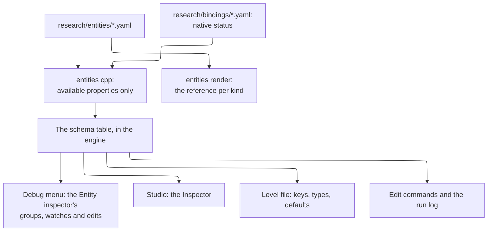

# Coney Studio: entities, kinds and the Inspector

**Status: design.** Nothing on this page is built. How Coney Studio knows what an entity is and what the Inspector shows
for it: the **kinds** of entity a level holds, the **property schema** each kind has, written once as data and drawn by
every front end, how the Inspector shows everything about an entity without bloat, the full list of a **Human**'s
properties, and **attributes**, the named values a project gives any entity for its scripts. What Studio is, and the
other design pages, are on the Studio index of the editor experience design ([#1055](issue:1055)); the Hierarchy and
the Inspector panel are that design's, the level file and its entity tree are the project formats page of
[#1058](issue:1058), and the natives are the [Lua SDK](lua-sdk.md)'s.

The question this page answers, a maintainer's: the Hierarchy holds *entities*, and scripts are never attached to them
(a maintainer decision), so how does the Inspector know what to show? Selecting a Human must let a user set
absolutely everything about him, without bloat. The answer in four lines:

1. **An entity has one kind, and the kinds are Coney's.** A Human, a Primitive, a Spawn point, a Door: one kind per
   thing Coney's engine can make, as Roblox Studio's classes are Roblox's ([Entity kinds](#kinds)).
2. **Each kind has a property schema, as data.** Every property's name, type, range, default, group, Advanced flag,
   whether it is saved and whether it can change while playing, and the native or Coney edit that sets it. The
   Inspector, the debug menu's Entity inspector, the level file and the run log all read the same schema, so a kind
   needs no Inspector code of its own ([The property schema](#schema)).
3. **The Inspector draws the schema** in collapsible groups, with an Advanced part per group, a search box, a
   modified-only filter, pins and remembered state ([The Inspector](#inspector)).
4. **A project adds its own values with attributes**, Roblox's: typed, named values on any entity, saved with the level,
   which the project's scripts read and write through natives. They are how a mod gives an entity its own settings
   without a script component ([Attributes](#attributes)).

## Contents {#contents}

- [What the four editors do](#survey)
- [Entity kinds](#kinds): the list, [inheritance and composition](#inheritance), [presets](#presets)
- [The property schema](#schema): [what a property says](#property-fields), [where it lives](#schema-source),
  [one schema, every reader](#schema-readers), [one edit command](#edit-command)
- [The Inspector](#inspector): [its layout](#inspector-layout), [no bloat](#no-bloat), [Level and Running](#running)
- [Everything about a Human](#human), [a Target](#target) and [a Gang](#gang)
- [Attributes](#attributes)
- [What the level file stores](#level-file)
- [Tests](#tests), [open questions](#open-questions), [proposed build issues](#build-issues), [sources](#sources)

## What the four editors do {#survey}

All four answer "what is this thing, and what does its inspector show" from **metadata the engine reflects**, never
from a panel written per class; they differ in who may add to it.

| | Unity | Godot | Unreal | Roblox Studio |
| --- | --- | --- | --- | --- |
| What a thing is | A GameObject: a name, a transform and a list of **components**; the components make it a light, a body or a character | A **node of a class**, the class from an inheritance chain (`Node`, `Node3D`, `CharacterBody3D`); one script may extend it | An **actor** of a class (`AActor`, `APawn`, `ACharacter`) holding **components** | An **instance of a class** fixed by the engine (`Part`, `Model`, `Humanoid`); a character is a model with a `Humanoid` child |
| What its inspector shows | Each component's serialized fields (public, or `[SerializeField]`), one foldout per component | The class's properties, one section per class of the chain, then the script's `@export` variables | Every `UPROPERTY` with an edit specifier (`EditAnywhere`, `VisibleAnywhere`), by `Category` | The class's properties from the engine's reflection, by category (Appearance, Behavior, Transform, ...) |
| Who adds properties | Any script: a script is a component | The node's one script (`@export`) | C++ and Blueprints, in the class | Nobody: a class's properties are the engine's; a place adds **Attributes** |
| Against bloat | Foldouts per component, remembered; `[Header]`, `[Range]`, `[HideInInspector]`; the Normal and Debug inspector modes | Groups and subgroups (`@export_group`), a property filter, a revert arrow per property | Categories, the **Advanced** part under each (`AdvancedDisplay`), a search box, *show only modified*, `EditCondition` | Collapsible categories whose state carries over to the next object of the class, a property filter |
| Free values on any thing | A script's fields | Node metadata (*Add Metadata*) | Tags, or a Blueprint variable | **Attributes**: typed values in their own section, saved with the place, read and written by `GetAttribute` and `SetAttribute` |
| Tags | One tag per GameObject | Groups | Actor tags | Tags (CollectionService), their own section |

FiveM, the model for the Lua SDK, has the same idea as Roblox's attributes on its entities: **state bags**, values a
script sets on an entity, owned by the server and replicated to clients.

**What Coney takes.** Roblox's model fits Coney exactly, for the same reason Roblox Studio is the model of the whole
editor ([Editor experience](issue:1055)): an editor for one game's content, whose classes are the engine's. Coney's
kinds are fixed by Coney, as Roblox's classes are; a project adds values with attributes, not components, which keeps
the maintainer's decision that scripts are never attached to entities. From Unreal it takes the reflected metadata in
full (category, Advanced, range, an edit condition, read-only) and the bloat tools (Advanced, search, modified only);
from Godot the rule that a property equal to its default is not written to the file; from Unity the Debug view of the
runtime values and the multiple-selection editing with mixed values shown as a dash.

## Entity kinds {#kinds}

**The rule: one kind per thing Coney's engine makes.** A kind exists in Studio when Coney can make that thing in a
level, and its properties are what Coney can set on it, each through a native or a Coney edit that exists. That is
the Studio principle of reflecting Coney ([What Studio is](issue:1055)), applied to the Inspector. The game's own
families of run-time things are listed on [Entities](../../references/entities.md); each Studio kind below names the
family it makes and the level-file statement that stores it (project formats, [#1058](issue:1058)).

| Kind | Level-file statement | What it makes in Coney | Its groups (beyond [Entity](#human-entity)) | State |
| --- | --- | --- | --- | --- |
| **Level** (the tree's root) | `title`, `sky`, `sun`, `ambient`, `fog`, `occlusion`, `shadows`, `base` | The level's settings ([Statements](../sandbox.md#statements)) | Level, Lighting, Base level | ready for sandbox layouts |
| **Group** | `group` | Nothing of its own: a parent its children follow | Transform | waits on level files of version 2 |
| **Prefab instance** | `instance` | Its prefab's entities, expanded at Play | Transform, Prefab (its file, its overrides) | waits on level files of version 2 |
| **Primitive** | `box`, `ramp`, `stairs`, `cylinder`, `capsule`, `sphere` | A solid textured shape ([Shapes](../sandbox.md#shapes)) | Transform, Shape (the shape and its sizes), Surface (texture, tiling, tint), Collision, Repeat | ready |
| **Mesh** | `mesh` | An imported static mesh | Transform, Model, Collision | waits on the import step |
| **Collider** | `collider` | Collision with nothing drawn | Transform, Shape, Collision | waits on level files of version 2 |
| **Spawn point** | `spawn` | A world flag and, at Play, the player made at it | Transform, Spawn (character, player slot) | ready |
| **Human** | `character`; a sandbox layout's `fighter` | A human, `HuCreate` ([Human](../../references/entities.md#human)) | [below](#human) | ready as the layout's fighter; any type waits on level files of version 2 |
| **Target** | `target` | Coney's passive sandbox human (`human::TargetHuman`) | [below](#target) | ready |
| **Gang** | `gang` (proposed in [A Gang](#gang)) | A gang and its relations, `GangCreate` ([Gang](../../references/entities.md#gang)) | [below](#gang) | waits on level files of version 2 |
| **Camera view** | `view` | A viewpoint | Transform (yaw and pitch), View | ready |
| **Flag** | `flag` | A world flag, `AddFlag` ([World flag](../../references/entities.md#flag)) | Transform (heading), Flag | waits on level files of version 2 |
| **Path** | `path` | A path of flags, `AddPath` | Path (its flags, at most eight) | waits on level files of version 2 |
| **Flag link** | `flaglink` | A flag network link, `FlagNetAddLink` | Link | waits on level files of version 2 |
| **Walkable area**, **Nav link** | `navarea`, `navlink` | The path map's areas and links | Area, Link | waits on Coney's path map builder |
| **Volume box** | `volume` | A trigger box, `AddVolumeBox`; a gang's turf | Transform (no rotation), Box, Turf | waits on level files of version 2 |
| **Object** | `object`; a `trigger` on it | A world object, `ObjSpawn`; its trigger sphere, `TriggerSphereCfg` | Transform, Object (type, zone, flags, tint), Trigger | waits on level files of version 2 |
| **Emitter** | `emitter` | A particle system, `SpawnParticle` | Transform, Emitter | waits on level files of version 2 |
| **Door**, **Glass pane** | `door`, `glass` | `SpawnDoor`, `SpawnBreakableGlass` | Transform, Door or Pane | waits on doors and panes built with the level's collision |
| **Car** | `car` | A parked car, `CarSpawn` | Transform, Car | waits on level files of version 2 |
| **Light** | `light` | A dynamic light, `SetLight` | Transform, Light | waits on level files of version 2 |
| **Spawner** | `spawner` | A gang's spawner, `GangAddSpawner` | Transform, Spawner (gang, types, model, total, delay, at once, off screen) | waits on level files of version 2 |

*State* is what Studio can do with the kind; "waits on level files of version 2" means the kind's natives are
implemented and what is missing is Coney making the entity from a level file, which the project formats page's build
issues add ([#1058](issue:1058)). The disc level's own entities, shown read-only under a base level, have the same kinds
and schemas, every property read-only.

A trigger sphere is the Inspector's *Trigger* group on its object, not a kind of its own, because the game ties it to
one object (`TriggerSphereCfg` takes the object's handle); the level file keeps the project formats page's `trigger`
statement for it. A **player** is not a kind either: he is a Human whose *Player slot* is set, or the human a spawn
point makes at Play.

### Inheritance and composition {#inheritance}

- **One base, no deep inheritance.** Every kind has the [Entity](#human-entity) group (id, name, tags, its place in
  the tree, its attributes). Beyond it, Coney's engine has no class tree to mirror: a human, an object and a flag share
  nothing a user would edit. Godot's chain of classes would add headings and no meaning.
- **Shared groups, defined once.** A group several kinds have is written once and named by each: *Transform* (every
  placed kind, with the axes the kind takes), *Collision* (Primitive, Mesh, Collider), *Surface*, *Shape*. A change to
  the group reaches every kind that names it.
- **No composition by the user.** Unity's and Unreal's components are how scripts and behaviours attach to a thing;
  Coney attaches no script, and a Coney entity cannot gain abilities its engine kind lacks (a crate cannot be given a
  brain). A Human's brain, meters and combat are groups of the Human kind, as Roblox's Humanoid properties come with
  the Humanoid. What a project adds is data, as [attributes](#attributes), never behaviour.
- **Conditions instead of sub-kinds.** A property shown only in some cases says so in the schema (Unreal's
  `EditCondition`): a box's `size` only for the box shape, the AI group only for a human with a brain, the gear and
  cuffs only for a player. One Primitive kind with a shape choice is simpler than six kinds with the same groups.

### Presets {#presets}

The Create menu ([#1055](issue:1055)) offers **presets**: a kind with some values set. *AI fighter* is a Human with a
fighter's type, gang and side, as the AI fighters page spawns one; *Target* is its own kind; *Box*, *Ramp* and the
other primitives are the Primitive kind with its shape set. Presets are data beside the schema (a kind, a name, the
values), so a new preset needs no code, and choosing one is the same as creating the kind and setting the values.

## The property schema {#schema}

### What a property says {#property-fields}

| Field | Means | Example (a Human's maximum health) |
| --- | --- | --- |
| `key` | Stable name: the level file's key, the run log's op, the search's match; lower case, words joined by `-`; never changed once released | `max-health` |
| `label`, `help` | What the Inspector shows, and one line of help (the tooltip; searched too) | *Maximum health*; "Its full health; setting it refills the health" |
| `group`, `order` | The group it is drawn in and its place there | Meters, 2 |
| `type` | `bool`, `int`, `float`, `angle`, `vec3`, `text`, `choice` (from a reference list), `flags`, `entity` (a reference to another entity, of given kinds), `asset` (a `project:/` or `game:/` path of a given kind), `colour`, `list` of one of these | `int` |
| `range`, `step`, `units` | The limits a value is clamped to, the slider's step, the units shown | 1 to 32767, 10, HP |
| `default` | A constant, **`from-type`** (the value the engine gives this entity when it is made, read from its character type, object type and so on), or none | `from-type`: the type's health |
| `advanced` | Drawn in the group's Advanced part ([No bloat](#no-bloat)) | no |
| `saved` | Kept in the level file (only when it differs from the default); a value of the running game alone is not saved | yes |
| `live` | What an edit does while playing: `live` (applied to the running entity at the next step), `next-play` (kept in the level; the session is marked stale), `watch` (a running value, read-only), `running-only` (an edit of the running entity that the level does not keep, such as *Frozen*) | `live` |
| `set` | What sets it: a game **native** with the argument it fills (`HuSetMaxHealth`), a **creation** argument (`HuCreate`'s `type`), or a **Coney edit** (the Entity inspector's `scale`) | `{native: HuSetMaxHealth}` |
| `read` | What reads it while playing: a Coney accessor, or a game native | `{accessor: max-health}` |
| `when` | The condition for showing it | (none) |
| `multi` | Whether a multiple selection may set it at once (never for `id` or `name`) | yes |

**Availability follows the natives.** A property set by a game native is in Studio exactly when that native is
*available* in the SDK ([How a native reaches the SDK](lua-sdk.md#availability)): implemented by Coney and allowed for
mods. The day an engineer implements `HuSetVoiceIndex`, the Human's *Voice* appears in the Inspector, the debug menu,
the level file and the reference with no other step, and before that day the property is listed as waiting, with its
native, and drawn nowhere. A property set by a Coney edit is available when the edit is. So the Inspector reflects
Coney by construction, the same way the SDK does.

**No property names a script function.** Several natives take a callback (`HuSetMugCallback`, `HuSetInterrogation`'s
last argument, `GangSetMsgHandler`, a goal's callback). The Inspector never offers them: a callback is the project's
scripts finding the entity by name or tag and calling the native, which keeps the decision that scripts are never
attached to entities. Where a native takes a callback among other values, the Inspector sets the other values and
passes no callback.

### Where the schema lives {#schema-source}

One YAML file per kind, `research/entities/<kind>.yaml`, beside the natives' masterlist that most properties point
into (`research/bindings/`), checked by the same tools:

```yaml
# research/entities/human.yaml (a sketch: two properties)
kind: human
statement: character
groups: [Entity, Identity, Transform, Meters, Carrying, Combat, Being hit, Condition, Movement, AI, Behaviour,
         Speech, Interaction, Animation, Stats, State flags, Physics, Mesh]
properties:
  - key: max-health
    label: Maximum health
    group: Meters
    type: int
    range: {min: 1, max: 32767, step: 10}
    units: HP
    default: from-type
    live: live
    set: {native: HuSetMaxHealth, arg: health}
    help: Its full health; setting it refills the health.
  - key: speed-scale
    label: Speed scale
    group: Movement
    type: float
    range: {min: 0, max: 10, step: 0.05}
    default: 1
    advanced: true
    live: live
    set: {edit: speed-scale}
    help: A multiplier on every gait speed of this human.
```

- **`coney-tools entities cpp`** writes the C++ table every reader uses (keys, types, ranges, defaults, groups,
  flags and which native or edit each names), leaving out the properties that are not available, as `natives cpp`
  writes the debug menu's signature table ([`natives cpp`](../coney-tools-references.md#natives-cpp-usage)); `--check`
  fails when the table is stale, in the local gate and in CI.
- **`coney-tools entities render`** writes a reference page per kind, every property with its state and, for the
  waiting ones, what they wait on: the "what Studio can set" list a modder reads, and the roadmap's per-kind list of
  what is missing.
- **The table lives in the engine, not in the debug tools**, because the level reader reads keys and types from it
  in the release build too; the debug menu and Studio link it.
- **Checks:** every `native` exists in the masterlist and takes the named argument; every `edit` is a Coney edit;
  every key is unique in its kind and never removed once released (a removed property becomes `deprecated` and is
  read, never written); and a C++ test fails when an available property has no handler in the play mode or a handler
  has no property.

### One schema, every reader {#schema-readers}



*Figure: the schema is written once and read by every front end and by the level file.*

- **The debug menu.** Today a human's groups are code (`src/debug/human_watch.cpp` builds watch lines,
  `src/debug/entity_edit.h` lists the edits). With the schema, the Entity inspector builds its items from it, as the
  Tunables page builds its pages from the tunables registry ([Tunables](../debug-menu.md#tunables)): a `bool` is a
  toggle, an `int` or `float` a number item with the property's range and reset to its `from-type` value, a `choice` a
  choice item, a `watch` a watch line. The groups and lines the merged entity panel of [#1053](issue:1053) shows today
  are the first schema, so nothing it shows is lost, and every available native setter becomes an edit item, which
  closes most of the panel's *Not here yet* list ([Entity editor](../debug-menu.md#entity-editor)).
- **Studio's Inspector** is a third front end of the same table ([The Inspector](#inspector)), as Studio's debug panels
  are of the debug model ([#1055](issue:1055)).
- **The level file** reads and writes each kind's statement by the schema's keys and types
  ([What the level file stores](#level-file)).
- **Edit commands and the run log** use the keys ([below](#edit-command)).

### One edit command {#edit-command}

Today an edit is an `EntityCommand` of one of sixteen `EditOp`s with up to three numbers (`src/debug/entity_edit.h`).
It becomes **an entity id, a property key and a value** of the property's type; the actions that are not properties
(drop to ground, move to camera, kill, delete, reset) stay as named actions. The op names the run log writes today
(`health`, `scale-collision`, `model`) are kept as the properties' keys, so a recorded run log still replays
(`appliedEdits()`). The same command is:

- an **Inspector edit of the running game**, queued and applied between two steps, logged, and refused on a network
  client, as the Entity editor's edits are;
- a **level edit** in Studio, the same key and value written to the level document as an undoable command, and also sent
  to the running game when the property is `live` ([Live edits while playing](issue:1055));
- the **edit command** of the technology page's live edits ([Live edits during Play](technology.md#live-edits)): plain,
  serializable data with ids, never pointers ([the networking checklist](../network-architecture.md#checklist)).

The play mode applies a command with the property's handler: for a native-backed property, the same C++ entry point
the native calls, so an Inspector edit and a script's call do the same thing.

## The Inspector {#inspector}

### Its layout {#inspector-layout}

With one entity selected, top to bottom:

1. **The header**: the kind's icon and name, the entity's *Name* and *Tags* (always shown, since scripts find entities
   by them), its id greyed beside, and the prefab it comes from when it is in an instance.
2. **The toolbar**: the search box, the *Modified* filter, *Advanced* (open every Advanced part), and the actions of
   the kind (for a running Human: *Drop to ground*, *Move to camera*, *Teleport player to it*, *Kill*, *Delete*,
   *Reset*, *Log everything*).
3. **Pinned**: the properties the user pinned, from any group, for this kind (the debug menu's Favourites, kept per
   kind).
4. **The groups**, in the schema's order, each a collapsible section with its common properties and an *Advanced*
   part under them (Unreal's arrow).
5. **Attributes**: the project's values ([Attributes](#attributes)), with *Add attribute*.
6. **The preview** of a model, at the foot, as the editor experience design places it ([#1055](issue:1055)).

The Inspector is a generic renderer: one widget per property type, as the debug front ends have one renderer per item
kind ([One model](../debug-menu.md#one-model)); no Inspector code names a kind or a property.

### No bloat {#no-bloat}

A Human has well over a hundred properties ([below](#human)); the Inspector keeps them in reach without a wall of
fields:

- **Groups, collapsed but for the first few.** Each kind's schema says which groups start open (for a Human:
  Identity, Transform, Meters). A group's open state is **remembered per kind and per user** (Roblox and Unity carry it
  to the next object of the class), in the user's settings, never in the project.
- **Advanced parts.** A property marked `advanced` (the attack weights, the damage factor, the hearing ranges, the
  scale-collision switch) sits behind its group's *Advanced* arrow; the toolbar's *Advanced* opens them all.
- **Debug groups only while playing.** The values of the running game alone (`live: watch`: the goal stack, the
  contacts, the mesh's counts, the raw flag word) are shown only for a running entity, in groups marked *Debug* that
  start closed (Unity's Debug inspector, folded in). A level entity being edited shows none of them, because they have
  no value until the game runs.
- **Search.** Typing filters every group at once by label, key and help, opening the groups with a match; `@` searches
  attributes, and a `native:` prefix finds the properties a native sets (`native:HuSetGodMode`).
- **Modified only.** The *Modified* filter shows only what differs from the default, which is exactly what the level
  file stores (Unreal's *Show Only Modified Properties*). Each modified property has a reset arrow back to its
  default, a `from-type` default included (Godot's revert arrow; the debug menu's reset to the configured value).
- **Conditions.** A property whose `when` is false is not drawn: no wheelchair switch on a non-player, no AI group
  without a brain.
- **Prefab overrides** are drawn in bold with a bar in the margin, with *Revert* and *Apply to prefab* (Unity's,
  [#1055](issue:1055)).
- **Multiple selection.** With several entities of one kind, every `multi` property is shown and a value they differ
  in shows as a dash; setting it sets all, as one undo step. With several kinds, only the groups they share (Entity,
  Transform, Attributes they all have).

### Level and Running {#running}

While playing, the Hierarchy has a Level tab and a Running tab ([Play mode](issue:1055)), and the Inspector shows the
same schema for both, with the `live` field deciding what each allows:

| Property's `live` | Selected in the Level tab | Selected in the Running tab |
| --- | --- | --- |
| `live` | Editable; kept in the level; applied to the running entity at the next step | Editable; the running entity only, lost on Stop |
| `next-play` | Editable; kept in the level; the Game view marks the session stale (*applies on the next Play*) | Read-only, its value at creation |
| `running-only` | Not shown | Editable; lost on Stop |
| `watch` | Not shown | Read-only, live |

This is the editor experience design's table of live edits ([Live edits while playing](issue:1055)), made a column of
the schema instead of a list kept by hand.

## Everything about a Human {#human}

Every property of a Human Coney can set or show, grouped as the Inspector groups them. **Set by** names the game native
Coney calls at level entry and on a live edit (its [masterlist](../../references/bindings/index.md) entry holds what
it does and the evidence for it; meanings the masterlist gives as inferred, from a native's name, keep that in their
help), or *creation* (an argument of `HuCreate`), or *Coney edit* (an edit of the Entity inspector, Coney's own).
**Live** is the schema's field ([above](#running)). **Coney** is *ready* when the native or edit exists, or what the
property waits on; every *ready* property set from a level file also waits, with all of its kind, on Coney making
entities from level files ([#1058](issue:1058)). *(A)* marks an Advanced property; a *Debug* group is shown only for a
running human.

### Entity {#human-entity}

Every kind has this group.

| Property | Set by | Live | Coney |
| --- | --- | --- | --- |
| Id `id` | Studio writes it; never edited | read-only | ready |
| Name `name` | creation (`HuCreate`'s name); `HuSetName` while playing. The game keeps 15 characters, and Studio warns at the 16th | live | ready |
| Tags `tags` | the level's lookup table ([#1058](issue:1058)) | next-play | ready |
| Parent, place in the tree | the Hierarchy | next-play | waits on level files of version 2 |
| Attributes | [Attributes](#attributes) | live | waits on the attribute natives |

### Identity

| Property | Set by | Live | Coney |
| --- | --- | --- | --- |
| Character type `type` ([Characters](../../references/characters.md)) | creation | next-play | ready |
| Model `model` (default: the type's) | Coney edit `model` | live | ready with [#1053](issue:1053) |
| Custom character `character` (a project `.character`) | creation | next-play | waits on custom characters |
| Player slot `player` (none, or player 1) | creation (`HuCreate`'s `player`) | next-play | ready; more slots wait on co-op in levels |
| Gang `gang` (a [Gang](#gang) entity) | creation; `GangAddMember` while playing | live | ready |
| Gang leader `leader` | `GangSetLeader` | live | ready |
| War chief `war-chief` | `HuSetWarChief` | live | waits on the native |
| Role, controlled by, player profile, brain handle | Coney accessors | watch | ready |

### Transform

| Property | Set by | Live | Coney |
| --- | --- | --- | --- |
| Position `at` | creation; Coney edit `teleport` | live | ready |
| Heading `heading` (a human turns about z only) | creation; Coney edit `heading` | live | ready |
| Scale `scale` | `HuSetScale`; Coney edit `scale` | live | ready |
| Scale collision with mesh `scale-collision` (A) | Coney edit | live | ready |
| Velocity, speed, lean | Coney accessors | watch | ready |

### Meters

| Property | Set by | Live | Coney |
| --- | --- | --- | --- |
| Health `health` (percent of the maximum) | `HuSetHealthPercent`; Coney edit `health` | live | ready |
| Maximum health `max-health` (default: the type's) | `HuSetMaxHealth` | live | ready |
| Stamina `stamina`, Power `power` (percent) | Coney edits | live | ready |
| Rage `rage` (percent) | `HuSetRageFrac`; Coney edit `rage` | live | ready |
| Rage locked `rage-locked` | `HuSetLockedRage` | live | ready |
| Rage allowed `rage-allowed` | `HuSetPreventRage` (its argument inverted) | live | ready |
| Raging `rage-mode` | `HuSetRageMode` | live | ready |
| Invincible `god` | `HuSetGodMode`; Coney edit `invincible` | live | ready |
| Demi-god `demi-god` and its share (A) | `HuSetDemiGodMode` | live | ready |
| Health now and maximum, hurt | Coney accessors | watch | ready |

### Carrying

| Property | Set by | Live | Coney |
| --- | --- | --- | --- |
| Money `money` (0 to 999; default: rolled from the type) | `HuSetMoney` | live | ready |
| Carried item `carry` (an object type) | `HuSetCarriedItem` | live | ready |
| Handcuffs `cuffs` (a player) | `HuGiveCuffs` | live | ready |
| Fighting gear `gear` (a player) | `HuAttachGear` | live | ready |
| Keeps hat `keep-hat`, keeps weapon `keep-weapon` | `HuSetKeepHat`, `HuSetKeepWeapon` | live | ready |
| Never throws weapon `no-throw-weapon` | `HuSetNoThrowWeapon` | live | ready |
| Weapon `weapon` | `HuGiveWeapon` | live | waits on the native |

### Combat

| Property | Set by | Live | Coney |
| --- | --- | --- | --- |
| Fight stance `combat-mode` | `HuSetCombatMode` | live | ready |
| Auto combat `auto-combat` | `HuSetAutoCombat` | live | ready |
| Double damage `double-damage`, killer `killer` | `HuSetDoubleDamage`, `HuSetKillerMode` | live | ready |
| Damage factor `damage-factor` (A) | `HuApplyDamageModifier` | live | ready |
| Accurate, strong, blocks knock-downs | `HuSetAccurate`, `HuSetStrong`, `HuSetCanBlockKD` | live | wait on the natives |
| Mode, attack, blocking, pair, holding, grabbed, target, strike shapes, hits | Coney accessors | watch | ready |

### Being hit

| Property | Set by | Live | Coney |
| --- | --- | --- | --- |
| Ungrabbable, ungroundable, unstunnable | `HuSetUngrabbable`, `HuSetUngroundable`, `HuSetUnstunnable` | live | ready |
| No reaction, reduced reaction, increased reaction | `HuSetNoReact`, `HuSetReducedReact`, `HuSetIncreasedReact` | live | ready |
| Blocks grabs, blocks rear grabs, blocks tackles | `HuBlockGrab`, `HuBlockRearGrab`, `HuBlockTackle` | live | ready |
| Escapes grabs `auto-escape` | `HuSetAutoEscape` | live | ready |
| Pushable `pushable` | `HuSetPushable` | live | ready |
| Blocks front grabs, cannot escape, manual stun, hard to stun, no reaction from blocks | `HuBlockFrontGrab`, `HuSetNoEscape`, `HuSetManualStun`, `HuSetHardToStun`, `HuSetBlockFromReact` | live | wait on the natives |
| Heavy, fire-proof, on fire | `HuSetMass`, `HuSetFireProof`, `HuSetOnFire` | live | wait on the natives |

### Condition

| Property | Set by | Live | Coney |
| --- | --- | --- | --- |
| Woundable, wounded, revivable | `HuSetWoundable`, `HuSetWounded`, `HuSetRevivable` | live | ready |
| Conscious, arrested | `HuSetConscious`, `HuSetArrested` | live | ready |
| The player can un-arrest him `unarrestable` (the native's name says the opposite of what it does) | `HuSetUnarrestable` | live | ready |
| Stunned, knocked down, beaten up | `HuSetStunned`, `HuMakeGrounded`, `HuMakeBeatUp` | live | wait on the natives |
| *Normal state* (an action: ends grabs, fire, wounds) | `HuSetNormalMode` | running-only | ready |

### Movement

| Property | Set by | Live | Coney |
| --- | --- | --- | --- |
| Speed scale `speed-scale` (A) | Coney edit | live | ready |
| Tireless, fast climber | `HuSetTireless`, `HuSetFastClimber` | live | ready |
| Blocks jumping, blocks looking round | `HuBlockJump`, `HuBlockLook` | live | ready |
| Commands enabled `commands` ([Commands](../../references/commands.md)) | `EnableCommand`, `EnableCommands` | live | ready |
| Wheelchair control (a player) | `HuSetWheelchairControl` | live | ready |
| Frozen `frozen` | Coney edit | running-only | ready |
| Blocks climbing, pad control, button-tap control | `HuBlockClimb`, `HuEnableController`, `HuSetButtonTapControl` | live | wait on the natives |
| Gait, support, traversal, stick, intent, command, buttons, brain move, ground, landings | Coney accessors | watch | ready |

### AI

Shown for a human with a brain. Defaults come from the type's behaviour and attack table ([Stats](#human-stats)).

| Property | Set by | Live | Coney |
| --- | --- | --- | --- |
| Brain type `brain` ([AI types](../../research/ai/index.md#types)) | `BrSetType` | live | ready |
| Brain on `brain-on`, suspended `suspended` | `BrDead` (inverted), `BrSuspend` | live | ready |
| Pedestrian type, pedestrian reaction | `BrSetPedType`, `HuSetPedReaction` | live | ready |
| Threat, damage and investigate responses | `BrSetThreatResponse`, `BrSetDamageResponse`, `BrSetInvestigateResponse` | live | ready |
| Reacts to violence, picks up weapons | `BrSetReactToViolence`, `BrSetThugWantsWeapon` | live | ready |
| Uses world flags, and how likely (A) | `BrCanUseWorldFlags` | live | ready |
| Sight range, field of view, hearing range, help hearing range (A) | `HuSetLOSRange`, `BrSetFOV`, `HuSetHearRange`, `HuSetHelpHearRange` | live | ready |
| Attack weights (A; one per attack kind, [Attacks](../../references/attacks.md)) | `BrSetAttackWeight` | live | ready |
| Picks up hats, answers the player, melee range, attack slots | `BrSetThugWantsHat`, `BrSetPlayerResponse`, `BrSetMeleeRange`, `BrSetNumAttackSlots` | live | wait on the natives |
| Goals (top first), reaction goal, actions, target, enemies, attack slots, melee range, thinks | Coney accessors | watch | ready |

### Behaviour

| Property | Set by | Live | Coney |
| --- | --- | --- | --- |
| Starting goal `goal`: one of the available `Goal*` natives ([AI natives](../../references/bindings/ai.md)), such as guard a flag, travel a path or walk an area, with its arguments by name from the native's signature (the debug menu's argument editors, [Natives](../debug-menu.md#natives)) and no callback | the goal's native, once, after the human is made | next-play | ready |

The starting goal is the one behaviour a level gives a human without a script: what a level script does right after
`HuCreate`. Anything that reacts to events is the project's scripts' work. A gang's tactic is on the [Gang](#gang).

### Speech

| Property | Set by | Live | Coney |
| --- | --- | --- | --- |
| Says commands, comments on tags, cheers tags | `HuEnableSoundCommands`, `HuEnableTagDone`, `HuEnableTagCheer` | live | ready |
| Voice, state-response voice ([Speech](../../references/speech.md)) | `HuSetVoiceIndex`, `HuSetStateRespVoiceIndex` | live | wait on the natives |
| Speaks at all, the on-fire line, idle chatter lines | `HuEnableSpeaking`, `HuEnableOnFire`, `HuSetIdleDialogMaxIter` | live | wait on the natives |

### Interaction

| Property | Set by | Live | Coney |
| --- | --- | --- | --- |
| Muggable `muggable` | `HuSetMug` | live | ready |
| Interrogation: four lines and the icon | `HuSetInterrogation` (no callback: the scripts set it) | live | ready |
| Spinning icon `icon` (an object type) | `HuAttachSpinningIcon` | live | ready |
| Not targetable `no-target`, skipped by auto lock `no-auto-lock` | `HuSetNoTarget`, `HuSetNoAutoLock` | live | ready |
| Icon colour, tint | `HuSetSpinningIconColor`, `HuColor` | live | wait on the natives |

### Animation

| Property | Set by | Live | Coney |
| --- | --- | --- | --- |
| Animation rate `anim-rate` (A) | Coney edit | live | ready |
| Looks at `look-at` (an entity), for how long and how strongly (A) | `HuSetLookTarget` | live | ready |
| Idle clip | `HuSetIdleAnim` | live | waits on the native |
| A clip to play | `Coney.PlayClip` ([Assets by path](lua-sdk.md#assets)) | running-only | waits on the native |
| Clip, state, time, task, held flags, gait value, idle clip, action event | Coney accessors | watch | ready |

### Stats {#human-stats}

What the character type gives the human when he is made, from the four configuration tables
([Characters: Stats](../../research/characters.md#stats)), shown read-only so a user sees where the other groups'
defaults come from: category, behaviour, speed class, power class, Warrior class, health, the stamina and power maxima
and refills, the hurt threshold, the stun and knockdown times, the damage and attack tables, the hat, the voice, the
drop group and chance. Setting one per human waits on the engine keeping per-human stats (the rest of the stats
inventory on [#723](issue:723)); until then a different set of stats is a different character type.

### Debug groups

Shown for a running human only, closed at first: **State flags** (the flag word decoded by name, the scripts'
switches, the disabled commands, the target state), **Physics** (the walking sphere, the capsule, the air sphere, the
contacts, blocked and airborne updates, the climb) and **Mesh** (the model's counts and draw calls,
[The Mesh group](../debug-menu.md#mesh-group)). Each named flag the scripts can set already has its property above, so
the raw word stays a watch.

**Actions** on a running human, in the toolbar: *Drop to ground*, *Move to camera*, *Teleport player to it*, *Kill*
(`HuKill`, or the Coney edit), *Delete* (`HuDelete`, or the Coney edit), *Reset* (every property back to its
configured value) and *Log everything*.

### A Target {#target}

Coney's passive sandbox human has no brain and no body in the physics, so its schema is short: Entity, Identity (its
model, which the model swap of [#1053](issue:1053) changes while playing), Transform (position and heading, `next-play`,
as a layout's `target` keeps them), *Frozen* (`running-only`), and the watches of Identity, Transform, Animation,
Meters and Combat that the Entity inspector shows for it today. The panel takes no other edit of a target, so its
health is a watch until the play mode handles one.

### A Gang {#gang}

A human's relations are his gang's: two gangs are enemies or friends, and a human fights whoever his gang treats as an
enemy. So *gang and relations* are a kind of their own, an entity with no transform (Roblox's teams are instances in
the same way), and a Human's *Gang* points at one. The project formats page stores a human's gang as a number
(`gang=2`); this page proposes a `gang` statement and a reference to it by id ([What the level file
stores](#level-file)).

| Property | Set by | Live | Coney |
| --- | --- | --- | --- |
| Name, gang type ([Gangs](../../references/gangs.md)) | `GangCreate` | next-play | ready |
| Enemies, friends (both ways) | `GangMakeEnemies`, `GangMakeFriends` | live | ready |
| Enemies and neutral by gang type | `GangMakeEnemiesOfType`, `GangMakeNeutralOfType` | live | ready |
| One-way enemy, friend, neutral | `GangSetEnemy`, `GangSetFriend`, `GangSetNeutral` | live | wait on the natives |
| Leader (a Human) | `GangSetLeader` | live | ready |
| Turf (volume boxes) | `GangAddTurfBox` | live | ready |
| Threat, damage and investigate responses; respond percentage | `GangSetThreatResponse`, `GangSetDamageResponse`, `GangSetInvestigateResponse`, `GangSetRespondPercentage` | live | ready |
| Targetable, attackable, always seen, hearing range | `GangSetTargetable`, `GangSetAttackable`, `GangSetAlwaysSeen`, `GangSetHearRange` | live | ready |
| Sight range, money, reacts to violence, spotting line | `GangSetLOS`, `GangSetMoney`, `GangSetReactToViolence`, `GangSetCustomSpotDialog` | live | wait on the natives |
| Starting tactic: one of the available `Tactic*` natives with its arguments, no callback | the tactic's native, once | next-play | ready |

A gang made by a base level's own scripts is shown read-only under the base level, from its set-up trace
([#1058](issue:1058)), and a project's human may join it by that gang's name.

## Attributes {#attributes}

An **attribute** is a named, typed value a project puts on an entity, as Roblox's attributes and FiveM's state bags
are: a crate's `loot`, a fighter's `boss`, a spawn point's `wave`. The project's scripts read and write them through
natives. They are how a mod gives an entity settings of its own without a script component: the script finds the
entity by name or tag and reads its attributes; the designer changes the numbers in the Inspector.

### Types and limits {#attribute-types}

| Type | Holds | In Lua |
| --- | --- | --- |
| `boolean` | true or false | boolean |
| `number` | a finite real number (no NaN or infinity, so files and replays stay exact) | number |
| `string` | UTF-8 text, at most 1024 bytes | string |
| `vector` | x, y, z in metres, the game's axes | a table `{x, y, z}` |
| `colour` | red, green, blue and alpha, 0 to 255 each | a table `{r, g, b, a}` |
| `entity` | another entity of the level, by id | the entity's handle (as `Coney.FindEntity` returns), `nil` when it is gone |
| `asset` | a `project:/` or `game:/` path ([Assets by path](lua-sdk.md#assets)) | the path as a string |

- **Names**: 1 to 64 characters of letters, digits and `_`, starting with a letter; case matters. Names starting with
  `coney` in any case are kept for Coney.
- **At most 64 attributes on an entity.** The limits are checked where a value is set (the Inspector, the level
  reader, the native), each with its message, so a file that breaks one fails to load with the line, never half loads.
- **An attribute has one type.** Setting a value of another type from a script is refused with an error naming both
  types; changing the type is the Inspector's (*Change type*) and resets the value.

### In the Inspector and the file

The Inspector's last section lists the entity's attributes by name, each edited by its type's widget; *Add attribute*
asks for a name and a type, and each has *Rename*, *Change type* and *Delete* (Roblox's gear menu). Attributes are
searched with `@` and filtered by *Modified* like properties, and a multiple selection shows the attributes all its
entities share. An instance of a prefab keeps the prefab's attributes and may override any of them.

In the level file an attribute is written on an `attr` statement after its entity, the type spelled out so a value
reads back as it was written:

```text
character Boss id=h1 tags=bosses type=33 gang=g2 at=18,12,0 heading=180
attr h1 boss:boolean=true loot:number=250 taunt:string="Over here" home:entity=f1
attr p2/c4 loot:number=60
attr p2/c5 loot=nil
```

`attr ID` names the entity by its id, so the same statement sets an instance member's attribute in a level
(`p2/c4`) and is how an instance overrides its prefab's value; `name=nil` removes one there. A level written by Studio
has at most one `attr` line per entity, the names in the order the user added them.

### The natives {#attribute-natives}

Beside the natives that find entities, which the project formats page proposes (`Coney.FindEntity`,
`Coney.FindEntities`, `Coney.GetEntityMembers`, `Coney.GetEntityInfo`, [#1058](issue:1058)), in the same style:

| Proposed native | Does |
| --- | --- |
| `Coney.GetEntityAttribute(handle, name)` | The value, or `nil` when the entity has no such attribute or the handle is no entity |
| `Coney.SetEntityAttribute(handle, name, value)` | Sets it (`nil` removes it); returns false for a handle no entity has; raises an error for a bad name, a type other than the attribute's, or a broken limit |
| `Coney.GetEntityAttributes(handle)` | A table of every attribute, name to value; empty when none |
| `Coney.On("attributeChanged", fn)` | An entry point ([Entry points](lua-sdk.md#events)): `fn(handle, name, value, old)` for each change, delivered in the order made, after the handler that made it returns, in the same step |

- **Any entity has them**: a level entity, and a human or object a script makes while playing, by its handle; an
  attribute on a handle made at run time lasts as long as it does and is never saved.
- **What playing changes is not saved.** A level's attributes are loaded into the session at Play; a script's or the
  Running tab's change lasts until Stop, as in Roblox's playtests. Only the Level tab's edits change the file.
- **The network.** Attributes are game state the host owns: `SetEntityAttribute` is a `server` native and
  `GetEntityAttribute` and `GetEntityAttributes` are `shared` ([Deterministic and network-safe
  calls](lua-sdk.md#determinism)), and the host's changes reach clients as state, as FiveM's server state bags do.
- **Deterministic.** Values change only inside a step or between steps (an Inspector edit is an [edit
  command](#edit-command)), the change events run in a fixed order, and the session's attributes are part of what a
  replay reproduces.

**What attributes are not:** a script attached to the entity (the value does nothing until a script reads it), a way
round the schema (an attribute never changes how Coney's engine treats the entity: a `health` attribute is not the
human's health), or a lookup key (scripts find entities by name and tag; an attribute is read once the entity is found).

## What the level file stores {#level-file}

What this page needs of the level file, to agree with the project formats page of [#1058](issue:1058):

- **A kind is a statement**, as that page has it: `character`, `box`, `spawn`. The schema names each kind's statement,
  and a statement no kind has is refused with its line.
- **A property is a key** of its statement, spelled as the schema's `key`, written as its type writes (`at=1,2,0`,
  `god=on`, `gang=g2`). **Only values that differ from the default are written** (Godot's rule), so a level
  stays short and diffs show what a user changed, and a `from-type` default is never frozen into a file: a human whose
  type's health changes in Coney gets the new health. A key the schema does not know is kept, listed when the level
  opens and ignored at Play, so a level made by a newer Coney opens in an older one without losing it.
- **An entity reference is an id** (`gang=g2`, `look-at=h3`, `home:entity=f1`), never a name, so a rename never breaks
  one; inside a prefab, a reference to a member of the same prefab is its local id.
- **Attributes are `attr` statements** ([above](#attributes)).
- **A gang is a `gang` statement**, `gang Rivals id=g2 type=3 enemies=g1`, and a human's `gang=` names its id; a gang
  of the base level is named `gang=base:<its name>`. This differs from the project formats page's `gang=2` and is to
  be agreed with it.
- **Live values are never stored.** Nothing marked `watch` or `running-only` is in a file.

## Tests {#tests}

What proves the design once built, by the [testing rules](../testing.md): no person clicks through the Inspector, and
every check runs headless where it can.

- **A kind with no Inspector code.** A test schema of a fixture kind with one property of every type, every `live`
  value, an Advanced property and a condition is drawn by the Inspector under the Dear ImGui Test Engine and by the
  debug menu's pad and overlay front ends: every property is found by its path (`Inspector/Meters/Health`) in its group
  and order, the Advanced ones only after the arrow, the conditional one only when its condition holds. No code names
  the fixture kind.
- **One property, every reader.** Adding a property to the fixture's YAML and regenerating makes it appear in the
  Inspector, the debug menu, the level reader and writer, the edit command's parser and the reference page; a Python
  test of the generators and a C++ test of the table check each.
- **Availability.** A property whose native is not available is absent from the generated table and listed as waiting
  on the reference page; marking the native implemented in a fixture masterlist makes it present.
- **Handlers.** Every available property of every kind has a play-mode handler and every handler a property.
- **Same as the native.** For each native-backed Human property, an edit through the queue leaves the human in the
  state the native called by a script leaves him (the same fields read back), one generated test case per property.
- **The run log replays.** A log of property edits, and a log recorded before the change (the old op names), replay
  into a fresh world to the same state.
- **Search, filters and state.** Search finds a property by label, key, help and native; *Modified* shows exactly the
  keys the level file writes; a group's open state comes back for the next entity of the kind and after a restart.
- **Multiple selection.** Two humans with different health show a dash; typing a value sets both and one undo puts both
  back.
- **Level and Running.** A `live` edit in the Level tab during a scripted Play reaches the running human at the next
  step and is in the saved level; a `next-play` edit marks the session stale; a Running-tab edit is gone after Stop.
- **The file.** A level with every kind, property type and attribute type round-trips byte for byte; a default is not
  written; an unknown key is kept and listed; an attribute that breaks a limit fails with its line.
- **Attributes from scripts.** A test project reads and writes each type, removes one with `nil`, is refused a wrong
  type and a bad name, gets `attributeChanged` events in order, and finds the level's values unchanged after Stop; a
  network client's `SetEntityAttribute` is refused.

## Open questions {#open-questions}

- **The gang statement** ([What the level file stores](#level-file)) changes the project formats page's `gang=2`; the
  two designs settle it together ([#1058](issue:1058)).
- **Attributes on a base level's entities.** Whether a project may put attributes on a disc level's entity (an `attr`
  naming its trace id), which depends on how that page settles overrides of a base level's entities.
- **Per-human stats.** Whether the engine should keep the [Stats](#human-stats) per human, so the Inspector can set
  them, or a new stat set stays a new character type; part of the stats inventory on [#723](issue:723).
- **Coney edits that are not natives** (stamina, power, speed scale, animation rate, the model): each is a candidate
  Coney native, so that a script can do what the Inspector does; the Lua SDK's candidates list decides
  ([Names and namespaces](lua-sdk.md#names)).

## Proposed build issues {#build-issues}

In the order they should come. Issues 1 to 3 need nothing of Studio and improve the debug menu at once; 4 and 5 build on
the project formats page's level files of version 2 and level entities made at entry ([#1058](issue:1058)); 6 and 7
build on the editor experience design's Hierarchy and Inspector issue ([#1055](issue:1055)), with which issue 6 is
filed as one.

1. **tools: Add the entity property schema and its generators.** `research/entities/<kind>.yaml` with the fields of
   [What a property says](#property-fields), its schema in the research data guide; `coney-tools entities cpp` writing
   the engine's schema table (available properties only, from the natives' status) and `entities render` writing a
   reference page per kind, both with `--check` in the local gate and CI; the first schemas are what the merged entity
   panel shows today, for the Human, the Target and the three object kinds. Tests: Python tests of both generators
   over fixtures (a property appears, a waiting one is left out and listed, a bad native or duplicate key fails); the
   table matches the YAML.
2. **tools: Rework the Entity inspector to draw from the schema.** The debug menu's entity groups, watch lines and edit
   items built from the schema table instead of `human_watch.cpp`, `object_watch.cpp` and the edit groups; the
   `EntityCommand` of an id, a property key and a value, the old op names kept as keys; nothing the panel shows today
   lost. Tests: the panel's lines and items before and after are the same list; a run log recorded before the rework
   replays to the same state; the pad menu and the overlay draw the same items.
3. **gameplay: Add the Human's native-backed properties to the Entity inspector.** Every *ready* property of
   [Everything about a Human](#human) and [A Gang](#gang) in the schemas, each with its play-mode handler calling the
   entry point its native calls, so the debug panel sets them while playing. Tests: per property, an edit through the
   queue and the native called by a script leave the same state; the handler check passes.
4. **core: Add schema properties, gangs and attributes to level files.** The level reader and writer take each kind's
   keys, types and defaults from the schema: only non-default values written, `from-type` defaults never frozen,
   unknown keys kept and listed, entity references by id; the `gang` statement and `gang=` by id; the `attr`
   statement with its types, limits and `nil`. Tests: a level with every kind, type and attribute type round-trips
   byte for byte; a default is not written; a broken limit fails with its line; a version 1 layout reads unchanged.
5. **core: Add entity attributes and their natives.** The session's attribute table loaded at Play, the run-time
   attributes of handles made while playing, `Coney.GetEntityAttribute`, `Coney.SetEntityAttribute`,
   `Coney.GetEntityAttributes` and the `attributeChanged` entry point in `research/bindings/coney.yaml`, with their
   `apiset`; the host's changes sent as state in a network session. Tests: a test project reads and writes each type,
   removes one, is refused a wrong type and a bad name, gets its events in order; the level is unchanged after Stop; a
   client's set is refused.
6. **tools: Add the schema-drawn Inspector to Coney Studio.** The Inspector of [The Inspector](#inspector): the header
   with name and tags, the generic widgets per type, groups with remembered state, Advanced parts, the Debug groups
   for running entities, search (`@`, `native:`), *Modified*, pins per kind, conditions, prefab overrides, multiple
   selection with mixed values, the Level and Running rules of the `live` field and presets for the Create menu.
   Tests: the fixture kind drawn with no kind code; search, filters, remembered state, multiple selection and the
   Level and Running cases of [Tests](#tests) under the Test Engine.
7. **tools: Add attributes to the Coney Studio Inspector.** The Attributes section: add, rename, change type, delete,
   edit by type, `@` search, *Modified*, shared attributes in a multiple selection, prefab overrides, and the Running
   tab's live values. Tests: an attribute added in the Inspector is in the saved file and read by a test project's
   script at Play; a change made by the script shows in the Running tab and is gone after Stop.

## Sources {#sources}

Ideas only; no code is taken from any of these.

| Idea | Source |
| --- | --- |
| Properties in collapsible sections whose state carries to the next object of the class; the property filter; Attributes added with a name and a type, the types, saved with the place and replicated; the Tags section | Roblox, [Properties window](https://create.roblox.com/docs/studio/properties) |
| `SetAttribute`, `GetAttribute`, `GetAttributes`, `nil` removes, `AttributeChanged` and `GetAttributeChangedSignal` | Roblox, [Attributes](https://create.roblox.com/docs/scripting/attributes) |
| `Category` and its nested categories, `EditAnywhere`, `VisibleAnywhere`, `AdvancedDisplay`, `ClampMin`, `EditCondition` | Unreal Engine, [Properties](https://dev.epicgames.com/documentation/en-us/unreal-engine/unreal-engine-uproperties) |
| *Show Only Modified Properties* and the Details panel's search | Unreal Engine's Details panel *(general knowledge, not re-checked)* |
| `@export`, `@export_range`, `@export_group`, `@export_subgroup`, `@export_category` | Godot, [GDScript exported properties](https://docs.godotengine.org/en/stable/tutorials/scripting/gdscript/gdscript_exports.html) |
| A scene file keeping only properties that differ from their defaults; the revert arrow; node metadata | Godot's editor *(general knowledge, not re-checked)* |
| Components and serialized fields, foldouts, `[Header]`, `[Range]`, `[HideInInspector]`, the Debug inspector, mixed values in a multiple selection | Unity's Inspector *(general knowledge, not re-checked)* |
| State bags: values on an entity, owned by the server, replicated | FiveM's state bags *(general knowledge, not re-checked)* |
