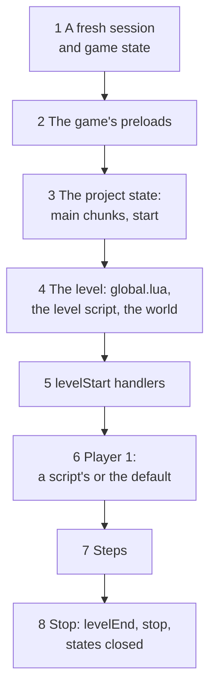
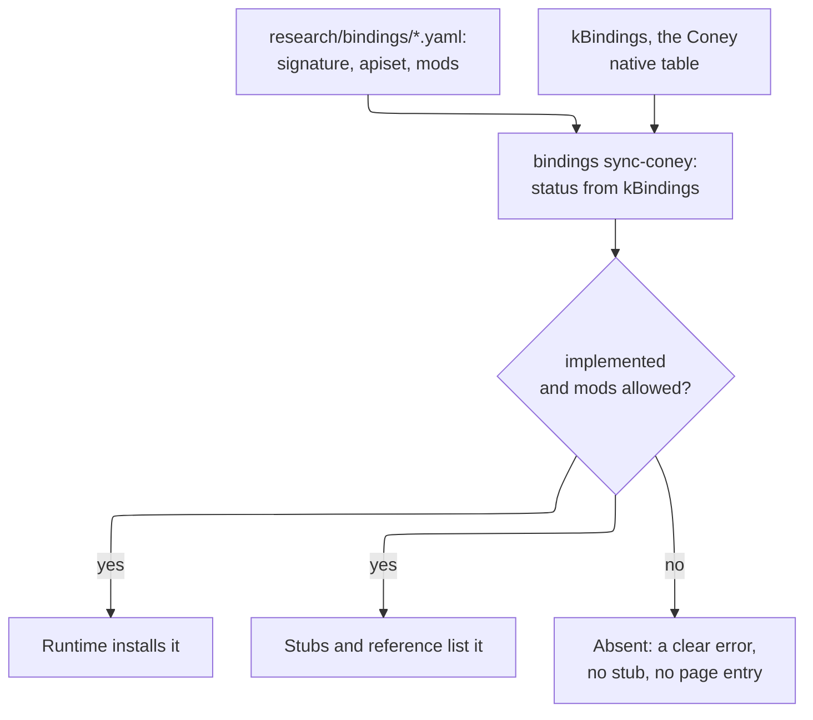

# Coney Studio: the Lua SDK and natives

The design of the Lua SDK that Coney Studio ships and that every mod uses: what its words mean, how scripts find and
call natives, which Lua a project's scripts are written in, how Coney loads a project and runs it when Play is pressed,
what keeps a script inside its project and its calls deterministic, how a native reaches the SDK, the typed stubs that
give the editor its completions, the project restart on save, the resource monitor, the Lua 4.0 compiler and the script
debugger. The stubs, the compiler and the debugger have their own page, [the SDK's tools](lua-tools.md). It ends with
the build issues it proposes, in order. The parent issue is [#1054](issue:1054); this page is [#1057](issue:1057).

**Status: design.** Nothing on this page is built but the Lua 4.0 compiler ([built](lua-tools.md#compiler)). It is a
design in the sense of [Page kinds](../writing-docs.md#page-kinds): what is built moves into a guide. It extends three
pages and does not repeat them: the script split and the Native API of [Asset and script architecture](../asset-and-script-architecture.md#scripts),
the masterlist of [Script bindings](../../references/bindings/index.md), and the resources and sandbox of
[Network architecture](../network-architecture.md#scripting). Where this page decides something those pages left open,
it says so, and [What changes on other pages](#other-pages) lists it.

Two rules from the parent issue shape every section. **The SDK reflects Coney:** a native is in the SDK once Coney
implements it, and not before, so the SDK always shows how far Coney has come. **Mods see natives, never engine
internals:** a script reaches the game only through natives, the same boundary the game's own scripts have.

## Contents {#contents}

1. [Terms](#terms): natives, the SDK, projects, the two runtimes.
2. [What FiveM does, and what Coney copies](#fivem).
3. [Names and namespaces](#names): how a script finds and calls a native.
4. [The runtime](#runtime): Lua 5.4 for projects, Lua 4.0 for the game, and the bridge between them.
5. [Projects and the manifest](#manifest).
6. [The loader and its entry points](#entry-points): start-up, level start, each step, stop; threads and waits.
7. [Play, step by step](#play): what loads in what order, the two states, the step, Stop.
8. [Assets by path](#assets), loaded and released by the script ([Loading and releasing assets](asset-lifetime.md)).
9. [The sandbox](#sandbox), with [the monitor](#monitor) that stands in for budgets.
10. [Deterministic and network-safe calls](#determinism).
11. [How a native reaches the SDK](#availability), and the SDK level.
12. [Project restart on save](#project-restart).
13. The tools, on [their own page](lua-tools.md): [typed stubs for the language server](lua-tools.md#stubs), [the Lua
    4.0 compiler](lua-tools.md#compiler) and [the script debugger](lua-tools.md#debugger).
14. [What changes on other pages](#other-pages), [Maintainer decisions](#decisions), [Open questions](#open-questions)
    (the asset lifetime's are on its page).
15. [Proposed build issues](#build-issues), [Sources](#sources).

## Terms {#terms}

| Term | Meaning |
| --- | --- |
| **Native** | A function a script calls to make the game do something. Coney keeps the word: the Natives page and the masterlist already use it, as does the `Native` struct, and it is the word modders know from FiveM |
| **Game native** | One of the original's 956 script bindings, registered as a Lua global by the game and documented in the [masterlist](../../references/bindings/index.md). A script calls it by the game's own name, with the game's arguments, as the game's scripts do: `HuCreate(name, type, pos, heading, nil, 1, gang)` |
| **Coney native** | A function Coney adds for scripts, reaching a capability of Coney's engine the original lacks (teleport, time scale, loading an imported model). It lives in the `Coney` table (`Coney.TeleportPlayer(...)`), never as a bare global, so it can never clash with a game native |
| **SDK function** | A function of the `Coney` table that belongs to the script runtime, not to the engine: registering handlers, threads and waits, logging, the SDK level. It is always there, whatever Coney's progress |
| **Lua SDK** | What Coney ships for script writers: the available natives and SDK functions, the runtime that runs them, their typed stubs for the editor, the generated reference and the debugger |
| **Available** | A native is available when Coney implements it and the SDK allows it ([How a native reaches the SDK](#availability)). Only available natives exist for a project's scripts, its stubs and its reference |
| **SDK level** | A whole number that grows each time a Coney release makes natives available; a project names the level it needs ([The SDK level](#sdk-level)) |
| **Project** | A folder with a `coney-project.toml` manifest: levels, assets and scripts. Studio creates and edits projects ([The project](editor-experience.md#project-coney)) and exports a finished one as a `.cmod` package that a player puts in the mods folder; a ConeyMP server runs several. A project is what [Network architecture](../network-architecture.md#resources) calls a *resource* and FiveM calls a resource: one folder, one manifest |
| **Mod** | A project exported as one `.cmod` package (working name), installed in the mods folder, where it is on by default ([Mods, packages and loading](mods.md#cmod)). A mod may be scripts only, a level only, or anything between. Studio's Play runs the open project folder the same way, with no packaging step |
| **The game state** | The one Lua 4.0 state per level in which the disc's scripts run, as today ([Scripts](../../research/scripting.md#life-of-the-lua-state)) |
| **A project state** | The Lua 5.4 state of one project, its own environment and globals, which the [sandbox](#sandbox) holds in |
| **Server, client, shared** | Where a script runs, in FiveM's words and the network page's: *server* scripts run where the simulation runs (the host, or the one machine offline), *client* scripts on each player's machine for presentation only, *shared* on both. Offline, every project script is a server script |

## What FiveM does, and what Coney copies {#fivem}

FiveM is a multiplayer platform for *Grand Theft Auto V* whose servers run scripts that call the game's own functions.
It is the model the maintainer named for the SDK. Only its public documentation was read; no code is taken from it
([Network architecture: Prior art](../network-architecture.md#sources) gives its licence).

| FiveM | What it does | Coney |
| --- | --- | --- |
| **Natives** | The game's own script functions (GTA V's, thousands of them) plus Cfx's own, documented on one reference site | The same split: game natives (the masterlist) and Coney natives |
| **Namespaces** | Each native belongs to a namespace (`PED`, `VEHICLE`, `OBJECT`, `CAM`, ...); Cfx's own natives are in the `CFX` namespace and live in FiveM's source, not in the GTA V natives repository | The masterlist's 15 categories are the game natives' namespaces; the `Coney` table is Coney's `CFX` |
| **Names and hashes** | A native's canonical name is upper snake case with a 64-bit hash (`DOOR_SYSTEM_SET_HOLD_OPEN`, `0xD9B71952F78A2640`); the Lua runtime exposes it as a PascalCase global (`DoorSystemSetHoldOpen`) and can call any native by its hash | No hashes and no renaming: the original registers its natives by name as Lua globals, so the name a script calls is the game's own (`HuCreate`). See [Names and namespaces](#names) |
| **API sets** | Each native says where it runs: `client`, `server` or both | Each native gets the same field, `apiset` ([Deterministic and network-safe calls](#determinism)) |
| **The reference site** | One page per native: name, hashes, namespace, API set, game, a C-style signature, each parameter explained, the return value, examples, and a link to improve it; filters by API set and by language | The masterlist pages already follow this form; the SDK reference is the same pages filtered to what is available ([How a native reaches the SDK](#availability)) |
| **Resources and the manifest** | A resource is a folder with `fxmanifest.lua`: `fx_version`, `game`, `client_script`, `server_script`, `shared_script` (with globbing), `file`, `dependency` | A project is a folder with `coney-project.toml` ([Projects and the manifest](#manifest)) |
| **Versioning** | `fx_version` names a cumulative feature level (`adamant`, `bodacious`, `cerulean`): each includes the earlier ones and changes defaults; a dependency can require a minimum server build or game build | The SDK level, a cumulative whole number ([The SDK level](#sdk-level)) |
| **Lua** | CfxLua, a modified Lua 5.4 (Lua 5.3 was retired in 2025): vectors and quaternions as real types, compile-time hashes in backticks, `json`, `promise` and `msgpack` bundled | Lua 5.4 for projects, unmodified ([The runtime](#runtime)) |
| **Threads and waits** | `Citizen.CreateThread(fn)` runs a function as a coroutine; `Wait(ms)` gives control back to the game for that long; without a wait, a loop freezes the game | `Coney.CreateThread` and `Coney.Wait`, counted in game time ([Threads and waits](#threads)) |
| **Streaming a model** | `REQUEST_MODEL` asks for a model for the current script, `HAS_MODEL_LOADED` says whether it has arrived, a spawn such as `CREATE_PED` expects it loaded, and `SET_MODEL_AS_NO_LONGER_NEEDED` releases the script's ownership; the Lua pattern is `RequestModel`, `while not HasModelLoaded(m) do Wait(0) end`, the spawn, `SetModelAsNoLongerNeeded(m)` | `Coney.LoadAsset`, `Coney.IsAssetLoaded`, the spawn, `Coney.ReleaseAsset`: the script owns what it loads ([Loading and releasing assets](asset-lifetime.md)) |
| **Events** | Named events with handlers (`AddEventHandler`), between resources and between client and server; `onResourceStart`, `onResourceStop` | `Coney.On(event, fn)` for the loader's entry points ([The loader](#entry-points)); network events are the network page's (P4) |
| **Restart** | `refresh` rereads the manifests, `restart <name>` reloads a resource without restarting the game | [Project restart on save](#project-restart); the console's `restart` is [Console commands](mods.md#console) |
| **Limits and the monitor** | No instruction budget and no memory cap: a loop without a `Wait` freezes the game. The `resmon` monitor shows each resource's time and memory | The same: no budget and no cap for now; a [monitor](#monitor) shows each project's time per step and its memory |
| **Editor support** | Community packages give lua-language-server FiveM's natives and CfxLua's syntax, generated from the natives' documentation; JavaScript has official type packages | Coney generates the stubs itself from the masterlist and ships them ([Typed stubs](lua-tools.md#stubs)) |

What Coney does **not** copy: hashes (the original has none), CfxLua's language changes (they would break every stock
Lua tool, which is the reason to choose 5.4 at all), a C# or JavaScript runtime (one language is enough, and it is the
game's) and client-writable state (the network page already refuses it). Exports between resources are copied, inside
the sandbox ([Dependencies and exports](mods.md#dependencies)).

## Names and namespaces {#names}

**Game natives keep the game's names, as bare globals.** A script calls `HuCreate`, `CameraReset`, `GetFlagPos` or
`random` exactly as the game's scripts do: the same name, the same arguments in the same order, the same defaults for
arguments left off. The original's natives are registered by name with tolua and found by name, and the 956 names are
already the masterlist's anchors (`character.md#hucreate`), so there is nothing to convert. The game's own prefixes
(`Hu` for humans, `Br` for brains, `Cam`, `Gang`, `Snd`, `HUD`, `Cfg`) read as the namespaces they are; the
masterlist's categories group them on the reference pages and in the stubs, but a category is never part of a name
(FiveM's namespaces work the same way: the Lua global is flat).

**Coney natives and SDK functions are PascalCase fields of one table, `Coney`.** `Coney.TeleportPlayer(x, y, z,
heading)`, `Coney.On("levelStart", fn)`. One flat table, no sub-tables: a modder types `Coney.` and the editor lists
everything Coney adds. Their categories (Player, Camera, Time, Assets, Debug, Runtime) are for the reference only, as
for the game's. The proposed names are the ones on the [candidates table](../asset-and-script-architecture.md#coney-native-candidates);
they may change until the first release that makes one available, and never after. The agents name the Coney natives,
without a maintainer's approval ([Maintainer decisions](#decisions)).

**A name is never reused or changed once released.** Game natives cannot change: they are the original's. A Coney
native that needs a different signature becomes a new native, and the old one stays, marked deprecated in the stubs
(FiveM keeps old names as aliases for the same reason).

**How a script finds a native:** it calls the global or the `Coney` field. A name that is not available is not there:
calling it fails with an error that says why ("`HuSetOnFire` is a game native Coney does not implement in SDK level 4";
"`Coney.Foo` is no Coney native"), raised by the project environment's lookup ([The sandbox](#sandbox)). The editor
says the same before the script runs, because the stubs list only what is available ([Typed stubs](lua-tools.md#stubs)).

## The runtime {#runtime}

### Lua 5.4 for projects, Lua 4.0 for the game {#runtime-choice}

The architecture page advises one runtime until mods need what Lua 4.0 lacks
([Three parts](../asset-and-script-architecture.md#script-parts)). The SDK is that need. A maintainer decided:

- **Lua 4.0 stays the runtime of the game**: the disc's scripts, Coney's own rewrites of the level scripts (compared
  call for call with the originals), disc scripts a mod patches, and the debug console in the game state. Nothing about
  it changes.
- **Lua 5.4 is the runtime of projects**: every script a user writes runs in a project state of stock Lua 5.4, behind
  the same Native API as the game state.

The line is **who wrote the script**: the game (or Coney, standing in for the game) writes 4.0; a user writes 5.4. The
reasons:

| | Lua 4.0 for projects | Lua 5.4 for projects |
| --- | --- | --- |
| The editor | lua-language-server's runtimes are Lua 5.1 to 5.4 and LuaJIT; it cannot parse 4.0 (`%` upvalues, `for k, v in t do`), so completions, errors and go-to-definition would need a language server of Coney's own | lua-language-server works as it is, with Coney's stubs |
| What modders know | Lua 4.0 is from 2000: no booleans (`true = 1`, `false = nil`), no `#`, no metatables (tag methods), no `string.` table, no coroutines; no tutorial, book or library of the last twenty years runs on it | FiveM's scripts, Roblox's Luau and most game Lua today are 5.x; 5.4's manual, books and libraries apply |
| Threads and waits | Lua 4.0 has no coroutines; a wait would need a VM that can suspend (an M item on the architecture page, deferred) | Coroutines are built in, so `Coney.Wait` is a small SDK function |
| The sandbox | Coney's 4.0 VM has an instruction budget for every run of the game's scripts; environments per script and library control would be Coney's to add | `_ENV` gives environments and library control, and `lua_sethook` and the allocator are there if budgets are ever needed ([The sandbox](#sandbox), [Network architecture: Sandboxing](../network-architecture.md#sandbox)) |
| A debugger | Coney's VM would need hooks, line information and frame inspection added | `lua_sethook` and `lua_getinfo`, `lua_getlocal` exist ([The script debugger](lua-tools.md#debugger)) |
| ConeyMP (P4) | The network page plans 5.4 for resources anyway, so 4.0 for projects would mean two languages for users | One language for users, offline and on servers |
| Cost | No second runtime | A second runtime: stock Lua 5.4 as a pinned dependency (MIT licence), a value bridge, deterministic build settings ([below](#lua-build)) |
| Sharing the game's state | A project could run in the game state, hook its functions and set its globals | A project state is separate; it shares the world, not the game state's globals ([The two states](#two-states)) |

The last row is the only one in 4.0's favour, and it is also a reason against: a script that patches the game state can
break the faithful scripts in ways nobody can debug, and a separate state is what the sandbox and the network model need
anyway. A user who wants to change a level script itself ships a patch (only the differences, applied to the player's
own copy; [Mission mods](mission-mods.md)), which the [compiler](lua-tools.md#compiler) builds and the script catalog
runs in place of the disc's chunk ([Three parts](../asset-and-script-architecture.md#script-parts)).

That decision is recorded under [Maintainer decisions](#decisions); the network page lists the same choice for
resources.

### How Lua 5.4 is built {#lua-build}

Stock Lua 5.4 (5.4.9, the last 5.4 release; [Keeping the runtime current](security.md#runtime-updates)), pinned in
`cmake/deps.cmake` like the other dependencies, compiled as C into its own library, with the settings that make it
deterministic ([Deterministic and network-safe calls](#determinism) says why each matters):

- **A fixed string-hash seed** (`luai_makeseed` defined as a constant): stock 5.4 seeds the hash of strings from an
  address and the time, so the order `pairs` visits a table's string keys would change from run to run.
- **A fixed sort pivot** (`l_randomizePivot` defined as 0): stock `table.sort` mixes the clock into its pivot for large
  arrays, so elements a comparator calls equal could end in a different order.
- **No `os`, `io`, `package` or `debug` library opened**, and `math.random` replaced ([The sandbox](#sandbox)).
- **Coney's allocator** (`lua_newstate` with Coney's `lua_Alloc`): it counts each state's bytes for the
  [monitor](#monitor) (no cap), and gives an arena whose addresses repeat from run to run, so a table keyed by tables
  is visited in the same order in a replay.
- **Integer and float semantics as stock**, no `LUA_COMPAT` flags, compiled without fast-math so floating point is the
  same on every compiler Coney supports.

### The value bridge {#bridge}

A native takes a list of values and returns a list ([Three parts](../asset-and-script-architecture.md#script-parts):
`NativeFunction`), whichever runtime calls it. Each runtime converts its own values to Coney's `script::Value` and back,
so a native's body is written once. The 5.4 side follows the masterlist's [conventions](../../references/bindings/index.md#conventions)
so that a native behaves as the game's scripts see it:

| 5.4 value | To a native | From a native |
| --- | --- | --- |
| `nil` | nil (the argument's default, as a missing argument) | nil |
| integer, float | a number; `ctype: int` and `unsigned` truncate toward zero as the game's wrappers do | a number: an integer when the masterlist's result type is a whole number or a handle, else a float |
| `true`, `false` | true, false | a boolean result is `true` or `false` in 5.4, where the game state sees 1 or nil; `if x then` reads the same in both |
| string | a string | a string, nil for none |
| table | `{x, y, z}` and `{a, b, c, d}` read by index, as the game's natives read them; every table argument is written back after the call, as in the game | an `M_Vector4` result is a table with fields `x y z w` |
| function | allowed where a native takes a callback name ([below](#bridge)) | never |
| userdata, thread | refused with an error naming the argument | never: natives return no pointers ([Ids, not pointers](#determinism)) |

**Callbacks.** Game natives that take a function's name (`ScheduleFunc`, `SetMsgHandler`, `PadSetHandler`,
`AddAnimCallback`, ...) keep the name and look it up when they fire ([Scripts](../../research/scripting.md#calling-lua-from-c)).
Called from a project state they accept a name, looked up in that project's environment, or a function value. Either
way the native keeps a callback id (the state it came from and a reference into that state), never a pointer, so the
callback fires in the state that asked for it. A slot that holds one callback (an object's handler for a message)
keeps the last one set, from whichever state, as the original's one slot does.

## Projects and the manifest {#manifest}

A project folder is the one Studio creates ([The project](editor-experience.md#project-coney) owns its layout:
`levels/`, `textures/`, `scripts/` and the `.studio/` cache). This page owns the manifest's name and its script fields,
and proposes TOML (as `coney.local.toml`), not FiveM's Lua manifest: a manifest that is code would have to run before
the sandbox exists.

```toml
# coney-project.toml
[project]
name = "yard-brawl"            # lower case, digits and '-'; one enabled mod per name; the events' prefix
title = "Yard Brawl"           # what menus show
version = "0.3.0"              # the project's own version, major.minor.patch
sdk = 4                        # the lowest SDK level it needs; Coney refuses a project above its own level

[load]
autostart = false              # true (the default): starts with every session; false: when its level is played
conflicts = []                 # mods that cannot run with this one

[play]
level = "project:/levels/yard.layout"   # where Play and `play <mod>` start it; a game:/ level is allowed
spawn = "start"                          # the default player's spawn point when no script makes player 1

[scripts]
server = ["scripts/main.lua", "scripts/fighters/*.lua"]   # run where the simulation runs; globs, in this order
client = []                                               # presentation only (ConeyMP, P4)
shared = ["scripts/util.lua"]                             # loaded first, on both sides

[dependencies]                 # other mods, by name, with a version range; each loaded first
"crate-pack" = ">=1.2, <2"

[permissions]                  # what reaches beyond the sandbox, approved by the player (Script security)
game-scripts = []
```

- **Paths in the manifest** are relative to the project folder; inside scripts and levels they are written
  `project:/...` and `game:/...` ([Assets by path](#assets)). A path that leaves the folder is refused at load.
- **Order is the manifest's**: `shared` files first, then `server` files in the order listed, a glob's matches sorted
  by path in byte order, so the order never depends on the file system.
- **A project with no `[scripts]`** is a level and its assets; it plays with no script, the default player at the spawn
  point.
- **`[load]`, dependencies and permissions** are designed on [Mods, packages and loading](mods.md#starting)
  and [Script security](security.md#declared): when a mod starts, version ranges, exports, load order and clashes,
  and what the player approves.
- **The packaged manifest.** Export writes the manifest into the `.cmod` with one more section, `[files]`: every file's
  path, size and SHA-256. Its hash is the mod's **package hash**, which approvals, saves, replays and co-op checks name
  ([The `.cmod` package](mods.md#cmod)). A file the packaged manifest does not list is not read.
- **Projects find entities by name or tag.** No script is attached to an entity: a project's scripts find what they need
  when a level starts and handle what is missing, so a level file holds no code ([Principles](security.md#principles),
  [Names and tags](project-formats.md#names-tags)).
- The fields beyond these (client files to download, declared events) are the network page's when P4 comes
  ([Coney resources](../network-architecture.md#resources)).

## The loader and its entry points {#entry-points}

### The mods folder {#mods-folder}

`<install>/mods/` is the one mods folder. A player installs a mod by putting its `.cmod` there; Coney reads it where it
lies, read-only, without extracting it, and checks every file against its packaged manifest ([The `.cmod`
package](mods.md#cmod)). `mods/enabled.toml` lists the mods that start with every session, in order, with each one's
name, version, package hash, approved permissions and signer ([Installed mods](mods.md#installed)); a new package is
added on, since scripts are on by default, and only the mods menu or the player editing the file changes it afterwards.
An enabled mod starts with every session, and a content mod with `autostart = false` starts when its level is played
([Starting and stopping](mods.md#starting)). Console commands start and stop mods for the running session only ([Console
commands](mods.md#console)). Studio's Play runs the open folder, without packaging it, as a started content mod with the
enabled mods beside it ([Starting and stopping](mods.md#starting)), and `coney --project <folder>` does the same outside
Studio. With no mod enabled, Coney runs exactly as it does without the SDK: no project state is made, no entry point
runs, and the game is the faithful one ([Roadmap: Script mods](../../roadmap.md#script-mods), whose Done line this
keeps). A session with any project loaded is a **modded session**, said in the run log and in every replay and save it
writes, with each mod's package hash; its saves are kept apart from the faithful profile ([Modded saves and
replays](mods.md#saves-replays), [Asset layers](../asset-and-script-architecture.md#asset-layers)).

### Entry points {#events}

A project's scripts run their main chunks once, when the project loads, and then only when Coney calls them. They
register handlers with `Coney.On(event, fn)` (and remove them with `Coney.Off`); several handlers for one event run in
the order they were registered, projects in load order. The events, at the points the game already has
([Scheduler](../asset-and-script-architecture.md#script-parts)):

| Event | When | Arguments | Typical use |
| --- | --- | --- | --- |
| `start` | Once per session, after the game's preloads and before the first level, in load order | none | Configuration: `Cfg*` natives, data the project keeps for the session |
| `levelStart` | Each time a level starts, after the game state has run `global.lua` and the level's script (when the level has one) and the world is loaded, before the first step | level name, checkpoint | Spawning the player and the cast, cameras, objectives |
| `update` | Every simulation step (1/30 s), after the game state's script frame | step length in ms (33) | Per-step logic that is not a thread |
| `levelEnd` | Before a level unloads (a level change, a restart of the level, the end of Play) | level name, reason (`change`, `restart`, `stop`) | Cleaning up what the project made |
| `stop` | When the project stops: the session ends, Play stops, or a [project restart](#project-restart) replaces it | reason (`quit`, `stop`, `restart`) | Saving the project's own data |

A project may also add console commands with `Coney.RegisterCommand(name, handler, spec)`, an SDK function whose handler
is an entry point like these, run in the project's state at a step boundary ([The Coney console: Mod
commands](console.md#mod-commands); [Script security](security.md#console)).

Everything else a script reacts to comes through the game natives' own callbacks, as for the game's scripts: message
handlers on objects (`SetMsgHandler`), trigger boxes, animation callbacks, pad handlers, scheduled calls. Network
events between projects and machines are the network page's (P4).

### Threads and waits {#threads}

`Coney.CreateThread(fn)` runs `fn` as a coroutine; `Coney.Wait(ms)` inside it gives control back until that much game
time has passed (a whole number of steps, rounded up, at least one), as FiveM's `Wait` does. Threads are resumed once
per step, after the `update` handlers, in the order they were created; a thread that waits zero steps is resumed at the
next step, never twice in one. A wait outside a thread is an error. Waits count steps, never the clock, so a thread
lasts the same number of steps at any frame rate and in a replay. `ScheduleFunc` called from a project runs in the
project's own schedule, beside its threads, with the game's rules (due calls in the order scheduled).

The game state needs no threads: the original's scripts wait only through the schedule and callbacks
([Three parts](../asset-and-script-architecture.md#script-parts)). Threads are coroutines on the simulation thread,
never parallel, as FiveM's are; why, and the engine-side jobs that may later take heavy work off that thread, is
[One thread, cooperative](security.md#one-thread).

## Play, step by step {#play}

What Coney does when Studio's Play is pressed or a mod starts a level. Studio's side (the Game view, live edits, what
Stop keeps and throws away) is the editor page's ([Play mode](editor-experience.md#play-mode)); how the engine runs
beside the editor is the [technology](technology.md#play) page's. The engine's side is the same whichever program hosts
it.



*Figure: the order in which Play brings a project up and down.*

1. **A fresh session.** A new game mode with its own game state, as `--play-level` makes today; nothing from an
   earlier Play survives. The session's seed is fixed (Studio uses the project's, a test its own), so two Plays with
   the same input are the same run.
2. **The game's preloads.** The game state runs `enum_preload.lua` and the three `config_preload*.lua`, as the legal
   screen does ([Life of the Lua state](../../research/scripting.md#life-of-the-lua-state)). They configure the
   characters, gangs, objects and sounds every game native relies on, so a project's `HuCreate(..., 32, ...)` finds
   Rembrandt's type. The game state's errors are logged as today.
3. **The project state.** A Lua 5.4 state is made for the project and sandboxed ([The sandbox](#sandbox)); its available
   natives and the `Coney` table are installed; its `shared` and `server` files run in the manifest's order (their main
   chunks: defining functions, registering handlers). Then the `start` handlers run. An error in a main chunk stops
   that file and is shown in Studio's Console with its file and line; the project goes on with the files that loaded.
4. **The level.** The level named by `[play]` loads. For a project level (a sandbox layout today, Coney's own format
   later, [Project formats](project-formats.md#level-file)) the world and its entities are built from the file, its
   spawn points are registered as
   **world flags** of the same names, and the game state runs `global.lua`, so the game's helpers exist, but no level
   script: a project level has none. For a `game:/` level the game state runs `global.lua` and the level's own script
   exactly as the game does, at the checkpoint asked for.
5. **`levelStart`.** The project's handlers run with the level's name and checkpoint, once the world is in place and
   before the first step. This is where a project makes its cast. Because spawn points are flags, the game natives
   work on them unchanged: `TeleportToFlag(human, FindFlag("start"))`, or `HuCreate("hero", 32,
   GetFlagPos(FindFlag("start")), 0, nil, 1, gang)`, the way the level scripts place player 1.
6. **Player 1.** If no script made player 1 (a `HuCreate` with player 1), Coney makes the default one at the
   manifest's `spawn` (or the level's first spawn point): Rembrandt, as Play does with no script. The camera is put
   behind him as `CameraReset` would.
7. **Steps.** Each 1/30 s step, inside the game mode's `update()` and in this order: the pad records are filled;
   gameplay steps the humans, AI, physics and objects; the trigger boxes and spheres deliver their messages (to
   handlers in either state); the **game state's script frame** runs its due scheduled calls and its update function,
   as today ([Scheduled calls](../../research/scripting.md#scheduled-calls)); then the **project's frame** runs its due
   scheduled calls, its `update` handlers and its threads. A call into a project state runs to its end, as FiveM's do
   (a loop with no wait freezes the game, [The sandbox](#sandbox)); the [monitor](#monitor) times each project's frame.
   Rendering reads the result and calls no script.
8. **Stop.** At the next step boundary: the `levelEnd` handlers (reason `stop`), then `stop`; the project state is
   closed; the game state is destroyed as a level unload destroys it; the session ends. Closing Studio, switching to
   another project and Stop all end the session the same way and **discard everything**: every handle either state
   held dies with the session, so nothing a project made outlives Play. Studio then shows the edited level with the
   level edits made while playing and nothing of the running game
   ([Live edits while playing](editor-experience.md#live-edits)).

A save of a project's script during Play can restart the project or the level, as the Studio setting *On script save*
says ([Project restart on save](#project-restart)); by default it does nothing.

A level change during Play (a project calling `Coney.StartLevel`, or a `game:/` level's own `runNextMission`) runs
`levelEnd` (reason `change`), unloads and remakes the game state as the game does (without the preloads, as the
original), loads the next level and runs `levelStart` again. The project state lives on across levels: a project's
globals and threads are the session's, the game state's are the level's.

### The two states {#two-states}

The game state and the project state never share globals. They share **the world**: a human, object, camera or gang made
by either is the same thing to both, named by the same handle. That needs one rule, which the code keeps since issue
1118: **handles come from the session, not from a Lua state** (one counter per session, `script::ScriptHandles` in the
game mode's state), so a handle the level script made means the same human in the project's calls ([Network
architecture: Scripts](../network-architecture.md#sub-scripts)). The project reads the game state's
world through natives (`HuFind`, `FindFlag`, `GetPosition`), as a level script reads what another script made; it cannot
set the game state's globals or call its functions. It may **read** (never write) a global of the game state through one
Coney native, `Coney.GetGameGlobal(name)`, to follow a level script's progress (a stage counter) ([Maintainer
decisions](#decisions)). The native is documented as **unstable**: a rewrite of a level script may rename its globals,
so a project that reads one depends on the script's internals, and its flaws are to be found in use. It returns a
number, a string or a boolean as it is, and nil for a name the game state does not hold or one that holds a table or a
function, since a project never reaches into the game state's tables or code.

## Assets by path {#assets}

A project's script loads, plays or spawns an asset by its path, as engines do (`Resources.Load` in Unity, `load()` in
Godot). The paths are the editor page's two roots ([The project](editor-experience.md#project-coney)) and the mods
page's third; the formats behind them and how an import becomes a project file are the [content
page](content-and-formats.md#paths)'s, which lists all three, and the pages use the same scheme:

| Root | Means | Example |
| --- | --- | --- |
| `project:/` | The project folder; nothing above it | `project:/models/crate.glb` |
| `game:/` | The player's installed game files, read-only, by the extract tool's names, so a project refers to a game asset and never carries it ([LEGAL.md](repo:LEGAL.md#no-game-data)) | `game:/sounds/...` |
| `mod:/` | Another mod this project depends on, read-only, by its name ([Dependencies and exports](mods.md#dependencies)) | `mod:/crate-pack/models/crate.glb` |

A sub-asset (one clip of a file that holds several, one mesh of a model file) follows a `#`:
`project:/anims/dance.glb#Spin`. The calls are Coney natives, available once Coney can load that kind from outside
the disc:

| Proposed native | Does | Waits on |
| --- | --- | --- |
| `Coney.LoadAsset(path)` | Starts loading an asset and returns its asset id at once; the load completes at a step boundary. The project now **holds** the asset. A prefab path loads its assets ([Spawning a prefab](entities.md#spawn-prefab)) | Coney loading assets from a project ([Custom content](../../roadmap.md#custom-content)) |
| `Coney.IsAssetLoaded(id)` | Whether the project holds the asset and it has arrived; a thread waits on it with `Coney.Wait` (FiveM's `HasModelLoaded`) | the same |
| `Coney.GetAssetState(id)` | `"loading"`, `"loaded"`, `"failed"` (with the reason as a second value) or `"none"` (not held), so a wait can end on a load that failed | the same |
| `Coney.ReleaseAsset(id)` | The project no longer needs it: drops one hold; the memory is freed once nothing holds or uses it (FiveM's `SetModelAsNoLongerNeeded`) | the same |
| `Coney.GetPrefabAssets(path)` | The asset paths a prefab needs, so a script can load some of them or show progress ([Spawning a prefab](entities.md#spawn-prefab)) | prefabs in level files |
| `Coney.SpawnModel(path, pos, heading)` | Places an imported model as a world object and returns its handle; game natives (`GetPosition`, `ObjShow`, `ObjDestroy`) then work on it. The model must be loaded | glTF models in Coney |
| `Coney.SetHumanModel(human, path)` | Changes a human's model in place, keeping everything else about him ([#1053](issue:1053) does this for disc models). The model must be loaded | imported character models |
| `Coney.PlayClip(human, path, loop, speed)` | Plays an imported or disc clip on a human, as the Animation player does. The clip must be loaded | imported animations |
| `Coney.PlaySound(path, pos, volume)` | Plays a sound at a place, as a sound event. The sound must be loaded | sounds from outside the disc |

A **load is owned by the script that asks for it**, as in FiveM: `Coney.LoadAsset` takes a hold, `Coney.ReleaseAsset`
drops one, and the memory is freed once nothing holds or uses the asset. A spawn of an asset that is not loaded raises
an error naming it and loads nothing; what a project never releases is released when the level ends and the project
stops. A load completes at a step boundary, in request order ([determinism](#determinism)). A path that does not
exist, leaves its root or names a kind Coney cannot load returns an error the script can test, never a crash. Assets
are found through the asset store's sources, never by a native opening a file ([Asset
layers](../asset-and-script-architecture.md#asset-layers)). The rules, FiveM's natives, the game's own `game:/` models,
the tests and a [worked example](asset-lifetime.md#wave-example) are [Loading and releasing
assets](asset-lifetime.md); a prefab's assets are [Spawning a prefab](entities.md#spawn-prefab).

## The sandbox {#sandbox}

What a project's scripts may and may not do, item by item with the reason for each, is
[Coney Studio: script security](security.md#line), which owns it; this section is its summary. A project state follows
the network page's [sandbox](../network-architecture.md#sandbox) and adds what keeps a script inside its project:

- **Libraries:** base (without `dofile` and `loadfile`, with `load` taking text only, never bytecode, `collectgarbage`
  answering `"count"` only, and `setmetatable` refusing a metatable with `__gc`), `string` (without `dump`), `table`,
  `math`, `utf8` and `coroutine`. No `io`, `os`, `package` or `debug`. `math.random` and `math.randomseed` draw from the
  project's own stream ([Determinism](#determinism)). `print` writes to the run log and Studio's Console, tagged with
  the project, within a limit per step.
- **`require` inside the project only:** `require("fighters.waves")` finds `scripts/fighters/waves.lua` in the
  project. The name is a module path, never a file path: `..`, absolute paths and drive letters are refused, and the
  file is found through the project file layer, which refuses links ([Files and paths](security.md#paths)). Text only.
- **Files:** a script reads no file directly and writes none. Its data comes through natives that take a `project:/`
  path ([Assets by path](#assets)) and `Coney.ReadData(path)`, which reads a project's JSON or TOML data file; what it
  keeps between sessions goes in its own store (`Coney.SaveData`, `Coney.LoadData`), with a quota.
- **One environment per project** over a read-only table of the natives: a script can set its own globals, never a
  native's name (`HuCreate = nil` raises an error; `rawset` can only shadow it in its own environment), and never
  another project's state.
- **No budgets, for now (a maintainer decision), as FiveM:** no instruction budget, no memory cap and no watchdog. A
  loop with no `Coney.Wait` freezes the game until it ends, and a script that allocates without end uses the machine's
  memory; Lua's own limits (the C stack, the string and table sizes) stay. A project that misbehaves is found with the
  [monitor](#monitor) below. The caps return only if downloaded mods or co-op need them: the count hook
  (`lua_sethook`) and the allocator are where they would go, and the allocator already counts for the monitor. The
  caps on what a project makes (its share of the game's pools, Coney's own kinds) and the log and store limits are
  not budgets and stay ([Limits](security.md#limits)).
- **No engine internals:** the state holds natives and SDK functions only. There is no `Coney.Engine`, no access to
  C++ objects, no pointer in any value.
- **Errors** are Lua errors with the file and line; they stop the call that raised them, never the game. Studio shows
  each in the Console and the editor's margin; the run log keeps them.

### The monitor {#monitor}

In place of budgets, Studio gets a monitor like FiveM's `resmon`: a panel with one row per running project, showing
its **time per step** (how long its part of the step took: its `update` handlers, threads, scheduled calls and the
other entry points that ran; the last step, the mean and the worst of the last 30), its **memory** (the bytes its
state holds, counted by the allocator) and its **assets** (the assets it has loaded and not released, with their
bytes, listed when the row is opened: [The monitor lists what a project
holds](asset-lifetime.md#monitor)). A project that is slow or leaking shows at once, which is what a budget would
have stopped, and the modder decides. The monitor only reads: it never stops, slows or changes a project.

- **The clock.** Time per step is measured outside the simulation with the real clock the frame pacer already reads
  ([Conventions](../conventions.md#update-and-render)); no script reads it and no run changes with it. Memory is a
  plain count and is repeatable, as the assets column's bytes are. In test mode the time column is off and the memory
  and assets columns stay, so a test can pin a project's memory and loaded assets.
- **Where it shows.** Studio's Monitor panel ([Coney Studio's panels](editor-experience.md#panel-list)), and the Coney
  console's Resources panel in its F8 bar ([Resources](console-bar.md#resources)); both read the same numbers, which the
  SDK owns, so there is one count and two front ends.
- **A frozen game.** With no watchdog, a script that never returns cannot be stopped from inside: in Studio the
  interface goes on drawing (Play has its own thread, [Play](technology.md#play-process)) and the monitor shows the
  step still running, but the user closes Studio, whose autosave before Play keeps the work. Outside Studio the player
  ends the program.

## Deterministic and network-safe calls {#determinism}

Every rule of the [networking checklist](../network-architecture.md#checklist) applies to the SDK. What it means for a
project's scripts:

- **Scripts run only inside a step.** Every entry point, callback and thread runs on the simulation thread inside the
  game mode's `update()`, at the places [Play, step by step](#play) lists. Nothing calls a script from the renderer, the
  audio thread, a file watcher or the editor's interface; Studio's console line and the debugger's evaluations are
  queued and run between two steps, as the Entity editor's edits are ([Entity editor](../debug-menu.md#entity-editor)).
- **No real clock.** Time is `Coney.GetGameTime()` (steps since the level started, and milliseconds of game time);
  `os.time` and `os.clock` do not exist.
- **Randomness from `GameRandom` streams.** A project's `math.random` draws from a stream of its own, seeded from the
  session's seed and the project's name, so a project's draws never shift the game's own draws, and a replay draws the
  same. A project's call of the game native `random` draws from that same stream, with the native's arguments and
  result range, and never from the game's table and index; so a project cannot shift the game's draws either. The game
  state's own calls of `random` keep the game's table and index, shared with the game's code, as in the original.
- **Stable order.** Handlers, projects, files and threads run in fixed orders (above); the Lua build fixes the string
  hash and the sort pivot ([How Lua 5.4 is built](#lua-build)), so `pairs` and `table.sort` give the same order in
  every run of the same build.
- **Ids, not pointers.** Natives take and return handles and asset ids, never userdata; a handle is the
  session's, so it means the same thing in every state and can be named in a replay.
- **Player slots.** A native that reads a player takes his slot (`Coney.GetPlayer(slot)` returns player *n*'s human);
  nothing in the SDK means "the player" without a slot.
- **Effects as events.** A Coney native that shows or plays something (a notice, a sound, a screen effect) goes through
  the HUD state or the sound events, so a client could be told of it.
- **Where a native runs.** Each native gets an `apiset` in the masterlist, FiveM's field: `server` (changes the game's
  state; offline the one machine is the server), `client` (presentation only: draws, local sounds, reads replicated
  state) or `shared`. Every game native is `server`, because the game's scripts are simulation and run on the server
  only ([The original's scripts](../network-architecture.md#original-scripts)). A server script calls `server` and
  `shared` natives, a client script `client` and `shared` ones; offline both kinds run and the rule is checked all the
  same, so a project that works offline does not break online.
- **Server authority, not lockstep.** A project's server scripts run on the host only and their effects reach clients
  as state and events, so what must be repeatable is one machine's run (tests, replays), never two machines agreeing
  step by step. That is why the rules above ask for same-build repeatability and nothing stronger.
- **A project restart and the debugger mark a run.** A run in which a project was restarted, or a breakpoint changed a
  value, is no longer a replay of its inputs; the run log says so.

## How a native reaches the SDK {#availability}

The SDK reflects Coney by construction: one source says whether a native exists in the SDK, and every view of the SDK
(the runtime, the stubs, the reference, Studio's Natives browser) reads it.



*Figure: one status decides whether a native is in the runtime, the stubs and the reference.*

1. **Documented.** Every game native has its masterlist entry already (all 956). A Coney native gets one too, in
   `research/bindings/coney.yaml` with `origin: coney`, which the masterlist's schema already allows
   ([The research data](../research-data.md#bindings)): its signature, description, `apiset`, the C++ entry point it
   calls and, from its first release, `since`.
2. **Implemented.** Coney's binding table says the native is real: `kBindings` in `src/scripting/script_bindings.cpp`
   for game natives, the Coney native list for Coney's. `coney-tools bindings sync-coney` writes the masterlist's
   `coney` status from it and CI fails when they disagree, as it does today
   ([Coney status](../../references/bindings/index.md#coney-status)).
3. **Allowed.** A few game natives make no sense from a project and carry `mods: false` with a reason; the rest are
   allowed. The first list: `doFile`, `doInclude` and `preLoadFile` (they run a disc script into the calling state;
   a project uses `require`), `gc` (the project state collects its own garbage), `RegisterUpdate`, and the game's
   one-slot flow callbacks (`SetStartGameCallback`, `SetCheatCallback`, `SetMultiplayerCallback`,
   `SetArmiesMultiplayerCallback`, `SetAllClearCallBack`, `SetHatCallBack`), which belong to the game's own scripts.
4. **Available** = implemented and allowed. At run time the native list (`buildNatives`) carries each native's status
   and its `mods` flag; the project state installs exactly the available ones. *Partial* (routed to a logging
   stand-in) and *stub* natives are not available: a stub that returns a default would make a project quietly do
   nothing, the opposite of what the SDK promises.

So the day an engineer turns a game native from `stub` to `real`, it appears in the runtime, the stubs, the reference
and Studio with no other step, and the SDK's count grows with Coney's progress (636 of the 956 game natives are
implemented today, by `coney-tools bindings stats`).

### The SDK level {#sdk-level}

A whole number, cumulative like FiveM's `fx_version`: level *n* has every native of level *n − 1* and more. The release
tool raises it when a release makes at least one native available that the last release did not, and writes `since:
<level>` on those natives' entries. A project's `sdk` names the lowest level it needs: Coney refuses to load a project
that asks for more than it has, with the message "needs SDK level 7, this Coney has 6", and Studio offers its own
level for a new project. Natives are never removed and their signatures never change, so a project made for level *n*
runs at every later level. A Coney native that is replaced stays, `deprecated` in its entry and in the stubs.

### The reference {#sdk-reference}

`bindings render` grows a view for script writers: the same pages, with each entry's availability and `since`, a filter
for available natives, and a Coney natives page from `coney.yaml`, as FiveM's reference filters by API set. Studio's
Natives browser reads the same data; the debug menus' [Natives](../debug-menu.md#natives) page keeps showing every
native with its status, as a tool for engineers.

## Project restart on save {#project-restart}

Changing a script while the game runs, as FiveM's `restart <resource>`. It is **optional**: Studio's setting *On script
save* has three choices, and the same actions are buttons on the Play bar.

| Choice | What a save does | Note |
| --- | --- | --- |
| **Do nothing** (the default) | Nothing; the next Play, or a button, uses the new script | A restart while the user is watching something in the game would be annoying |
| **Restart project** | The smallest restart the saved file needs: the project restarts, as below, for a project script; the level restarts for a game script, whose patch only a new level start reaches ([Mission mods](mission-mods.md#which-kind)) | The level, the game state and the game's player go on after a project restart |
| **Restart level** | A new Play from the checkpoint: the session ends as Stop ends it and a new one starts, whatever was saved | The Play bar's *Restart* ([Live edits](editor-experience.md#live-edits)) |

The two buttons, *Restart project* and *Restart level*, restart the project and the level on demand, whatever the
setting; only the setting's *Restart project* choice picks the level for a saved game script. Stop, closing
Studio and switching to another project are not restarts: they end the session and discard everything ([Play, step
8](#play)).

**A project restart**, applied at the next step boundary:

1. **Seen.** Studio (or, outside Studio, a file watcher Coney runs only with `--watch-mods`, which has no setting and
   always restarts the project) sees a project file change on disk and, with the setting on *Restart project*,
   queues a request. The watcher is outside the simulation.
2. **Checked first.** A file that fails to compile stops the restart before step 3: the running project stays as it
   was and the error is shown, so a typo never kills a running project.
3. **Stopped, and everything it made removed.** The `stop` handlers run with reason `restart`; then the project's state,
   handlers, threads, scheduled calls and callbacks are removed (every callback id the state owned is dropped, so a game
   slot it held is left empty), the state is closed, and everything the project made in the world is removed: the
   humans and objects it created, and player 1 when the project made him. This is what FiveM does with a resource's
   entities, and it leaves a clean world for the new run.
4. **Started again.** A new project state is made, the files load in order and `start` runs; if a level is running,
   `levelStart` runs too, with the current level and checkpoint, so the project makes its cast again. If no script
   made player 1 after that and none stands (the project's own was removed), Coney makes the default one at the
   spawn point, as Play does ([Play, step 6](#play)).

**What goes on:** the level, the game state (its globals, schedule and what its scripts made) and the game's player,
that is player 1 when the game or Coney's default made him ([Play, step 6](#play)). Only a player 1 the project made is
removed, with the rest, and the new `levelStart` makes him again.

The restart is for Studio and a mod writer's machine: it is **off in test mode**, where a test restarts by ending the
session and starting another, and in a networked session only the host restarts its own server scripts. A run with a
restart is marked in the run log ([Determinism](#determinism)). Reloading a script of the game state (a Coney rewrite,
a patched disc script) is not a project restart: it is the console's *Reload* of the architecture page ([Debug console
needs](../asset-and-script-architecture.md#console-needs)), or, for a patch, *Restart level*.

**Hot reload** is a different, later thing and keeps its name: swapping the code of a running project while **keeping
its state** (its globals, its threads' places). It is not designed here; the project restart is what the SDK has.

## The stubs, the compiler and the debugger {#tools}

These three have [their own page](lua-tools.md).

### Typed stubs for the language server {#stubs}

The declarations that give the editor its completions: [the stubs](lua-tools.md#stubs).

### The Lua 4.0 compiler {#compiler}

Source text for the game state, built: [the compiler](lua-tools.md#compiler).

### The script debugger {#debugger}

Breakpoints, stepping and watches over the Debug Adapter Protocol: [the debugger](lua-tools.md#debugger).

## What changes on other pages {#other-pages}

When this design is accepted, these lines change on the pages that own them:

- [Asset and script architecture](../asset-and-script-architecture.md#script-parts): the modern runtime is no longer
  deferred as "if mods need it": projects need it (this page), and the `Coney` natives move from a table on that page
  to `research/bindings/coney.yaml` with `origin: coney`.
- [Network architecture](../network-architecture.md#resources): a resource is a project, with `coney-project.toml` as
  its manifest; the second runtime of its maintainer decision 3 is this page's.
- [The research data](../research-data.md#bindings): the `apiset`, `mods`, `handle`, `reads` and `since` keys.
- [Network architecture: Scripts](../network-architecture.md#sub-scripts): handles come from one counter per session,
  not one per Lua state ([The two states](#two-states)).
- [Asset and script architecture: Deferred, in order](../asset-and-script-architecture.md#later): the native list, the
  scheduler, the compiler and the `Coney` table move ahead of the whole game, as Studio's first build work
  ([Proposed build issues](#build-issues)), in the order the parent issue gives ([#1054](issue:1054)).
- [Roadmap: Script mods](../../roadmap.md#script-mods): the loader's points are this page's entry points.
- [F8 bar: Resources](console-bar.md#resources), Studio's [Monitor panel](editor-experience.md#panel-list) and
  [Script security: Limits](security.md#limits): the monitor also lists the assets a project holds
  ([Loading and releasing assets](asset-lifetime.md#monitor)).
- [Content and formats: Paths](content-and-formats.md#paths) and [Script editor: Dragging](script-editor.md#drag): a
  script uses a path only after `Coney.LoadAsset` has loaded it.
- [Network architecture: Sandboxing](../network-architecture.md#sandbox) and [Script security](security.md#limits): no
  instruction budget, memory cap or watchdog for now, and the [monitor](#monitor) instead.

## Maintainer decisions {#decisions}

1. **A second Lua runtime: Lua 5.4 for projects** ([The runtime](#runtime-choice)). Decided by a maintainer, with its new
   dependency, stock Lua 5.4 (MIT licence). The network page lists the same choice for
   resources.
2. **Projects and faithful first: decided, no exception needed** ([Studio's decisions](index.md#decisions)). Running a
   project is still a modded session.
3. **The SDK's names are a public promise** ([Names and namespaces](#names)): once a release makes a Coney native
   available, its name and signature never change. The agents name the Coney natives, without a maintainer's approval.
4. **Game globals, read-only.** A project may read (never write) a global of the game state through
   `Coney.GetGameGlobal(name)`, in the `Coney` namespace, documented as unstable: a rewrite of a level script may rename
   its globals. Its flaws are found in use ([The two states](#two-states)).
5. **`random` from the project's stream.** A project's call of the game native `random` draws from the project's own
   `GameRandom` stream, never the game's table and index, so a project cannot shift the game's draws
   ([Determinism](#determinism)).
6. **Stop, and project restart on save.** Closing Studio, switching projects and Stop end the session and discard
   everything. What was called hot reload is renamed *project restart on save*: the project's state, handlers, threads,
   timers and everything it made in the world (humans, objects, and player 1 when the project made him) are removed and
   its `start` runs again, while the level, the game state and the game's player go on. It is optional: the Studio
   setting *On script save* is *Do nothing* (the default, because a restart while the user watches something in the
   game would be annoying), *Restart project* or *Restart level* (a new Play from the checkpoint), and the same actions
   are buttons. It is off in test mode. "Hot reload" is kept for a later code swap that keeps the state
   ([Project restart on save](#project-restart)).
7. **No budgets for now, as FiveM.** No instruction budget, no memory cap and no watchdog: a loop with no wait freezes
   the game. Studio gets a monitor like FiveM's `resmon` instead, with each project's time per step and its memory
   ([The monitor](#monitor)). Caps return only if downloaded mods or co-op need them.
8. **Scripts own asset memory, as in FiveM**: load, wait, spawn, release; a spawn of an asset that is
   not loaded fails with an error naming it; what is never released is released at `levelEnd` and `stop`; the monitor
   lists what a project holds ([Loading and releasing assets](asset-lifetime.md)).

## Open questions {#open-questions}

The four questions this page asked (the game state's globals, the game native `random`, what a restart leaves, and the
budgets' sizes) are answered under [Maintainer decisions](#decisions). The asset lifetime's three choices for the user
and its research question are on [its page](asset-lifetime.md#open-questions).

## Proposed build issues {#build-issues}

In the order they should come. The script runtime for mods comes first of all Studio's build work, because Play means
running a project's scripts. Issues 2 to 6 build on the [decision](#decisions) for Lua 5.4.

1. **core: Add the native list and the script scheduler.** The two seams of the architecture page, built now:
   `buildNatives` turns `kBindings` and the binding registrations into a list of `Native` records (name, origin, status,
   the `mods` flag, the call), which the game state installs as today and the debug menus read; and
   `ScriptScheduler::run(entry)` becomes the one way any script runs (level entry, update, schedule, messages, anim
   callbacks, triggers), with its order. It has no instruction budget (a project state has none, [The
   sandbox](#sandbox); the 4.0 VM keeps its own `LuaVmOptions::maxInstructions`), and it records each project's time per
   step for the [monitor](#monitor). Handles move from one counter per Lua state to one per session. No behaviour
   changes: the disc checks of the scripts give the same counts. Tests: every registered binding is in the list with its
   status; the scheduler runs entries in the documented order; a handle made in one state resolves in another of the
   same session. **Built** (`scripting/natives.h`, `script_scheduler.h`, `script_handles.h`; [what was
   built](../asset-and-script-architecture.md#script-parts)).
2. **core: Add the Lua 5.4 project runtime and its sandbox.** Stock Lua 5.4 pinned in `cmake/deps.cmake` with the
   deterministic build settings; a project state with its environment, the allowed libraries, `require` inside the
   project, the allocator's count of each state's memory (for the monitor, no cap) and the project's random stream (for
   `math.random` and for the game native `random`, which never touch the game's table and index), exactly as [Script
   security](security.md#line) draws the line (its build issues 1 and 2 come with this one); the value bridge to the
   native list (numbers, booleans, strings, tables written back, callbacks by name or function, as callback ids); only
   available natives installed, with the error that names a missing one. Tests: a script cannot open a file, load
   bytecode, require outside its folder or set a native's name; `pairs` and `table.sort` give the same order in two
   runs; a native called from 5.4 and from 4.0 gets the same arguments; a project's calls of `random` leave the game's
   table index where it was and give the same numbers in two runs.
3. **core: Add the mods loader with projects and entry points.** `coney-project.toml` read and checked (name, SDK level,
   script lists, globs in byte order); the mods folder of `.cmod` packages and `mods/enabled.toml`, with [Script
   security](security.md#build-issues)'s limits, packages, starting and dependencies, exports, the mods' console
   commands, permissions, store and modded saves (its build issues 3 to 11); `Coney.On` and `Coney.Off` with `start`,
   `levelStart`, `update`, `levelEnd` and `stop`; `Coney.CreateThread` and `Coney.Wait` in steps; the project's frame
   after the game state's; a project level's spawn points as world flags; the default player; Stop at a step boundary;
   the modded-session mark. Tests: a test project from a fixture folder runs at a level start, makes a human with
   `HuCreate` at a flag and moves the camera; a thread's waits land on the expected steps; with the folder empty the
   game's scripted runs are unchanged (the roadmap's Done line).
4. **core: Add the first Coney natives.** `research/bindings/coney.yaml` with `origin: coney` and the schema keys
   `apiset`, `mods`, `handle`, `reads`, `since`; `bindings sync-coney` and `bindings render` reading it; the first
   natives from the candidates table that have a C++ entry point today (`Coney.TeleportPlayer`, `Coney.SetPlayerFrozen`,
   `Coney.ChangeCharacter`, `Coney.ResetCamera`, `Coney.SpawnFighter`, `Coney.SetTimeScale`, `Coney.Log`,
   `Coney.StartLevel`), each calling the entry point the debug menus call, and the three this page adds,
   `Coney.GetGameTime`, `Coney.GetPlayer` and `Coney.GetGameGlobal` (read-only, unstable, documented as such in its
   entry). Tests: `GetGameGlobal` reads a global a fixture level script set, returns nil for a name that is not there
   and cannot write; each
   native through the bridge does what its debug-menu page does; CI fails when `coney.yaml` and the Coney native list
   disagree.
5. **tools: Add the SDK stubs, the SDK level and the scripting reference.** `coney-tools bindings stubs` writes the
   LuaCATS files of the available natives into the build folder for packaging; `coney-tools sdk init` writes a
   project's `.luarc.json`; the release tool raises the SDK level and writes `since`; `bindings render` adds the
   availability view and the Coney natives page; Coney refuses a project above its level. Tests: the stubs list every
   available native and no other; lua-language-server reports no error on a sample project and an undefined-global
   error for a missing native (run where it is installed); a project asking for a higher level is refused with the
   message.
6. **core: Add project restart on save.** The restart request (from Studio's buttons and setting, or `--watch-mods`),
   applied at a step boundary: `stop` with `restart`, the project's state, handlers, threads, scheduled calls and
   callbacks removed together with the humans and objects it made (and player 1 when it made him), a new state, `start`
   and `levelStart` again, the level, the game state and the game's player left alone; a file that fails to compile
   leaves the running project alone; off in test mode; the run marked. *Restart level* is a Stop and a new Play from the
   checkpoint. The setting *On script save* and the two buttons are Studio's, built with its reload on save
   ([Technology](technology.md#build-issues), issue 9). Tests: a
   script edited between two steps changes behaviour at the next restart; a syntax error keeps the old script running;
   no callback of the old state fires after the restart; what the project made is gone and what the game made is not;
   with *Do nothing* a save changes nothing.
7. **core: Add the Lua 4.0 source compiler and the full console.** A lexer and parser written from the Lua 4.0 manual,
   emitting Coney's `LuaProto` with line information; the console on it (statements, `local`, loops, functions, errors
   with lines); `dostring` compiling text (patched disc scripts through the script catalog moved to [Mission
   mods](mission-mods.md#build-issues), issue 5). Tests: synthetic programs
   compile and give their expected results, every instruction kind covered; the console runs a loop; a disc check
   compares the natives called by the disc's bytecode and by the recompiled decompiles, counts and hashes only.
8. **core: Add the script debugger over the Debug Adapter Protocol.** A DAP server in the engine over a loopback socket:
   breakpoints (conditions, hit counts, logpoints), pause, the three steps, the call stack with native frames, scopes,
   read-only watches, break on error, threads as DAP threads, for project states; then line and instruction hooks in
   Coney's 4.0 VM for the game state. Tests: a scripted DAP client sets a breakpoint, stops on the expected line, reads
   a local, steps over and continues, with the run's result unchanged; a watch that calls a server native is refused.
9. **core: Add asset natives by project path.** `Coney.LoadAsset`, `Coney.IsAssetLoaded`, `Coney.GetAssetState`,
   `Coney.ReleaseAsset`, `Coney.GetPrefabAssets`, `Coney.SpawnModel`, `Coney.SetHumanModel`, `Coney.PlayClip` and
   `Coney.PlaySound` over the asset store's `project:/` and `game:/` sources: asset ids in request order, a hold per
   `LoadAsset` and a use per living thing, memory freed when both are gone, loads applied at step boundaries in
   request order (the replay recording the step each completed at), and a spawn of an asset that is not loaded raising
   an error that names it; the safety net at `levelEnd` and `stop`. Each native is filed when Coney can load its kind
   from a project ([Custom content](../../roadmap.md#custom-content)), so the SDK gains them as Coney does; the
   prefab pair waits on [Spawning a prefab](entities.md#build-issues). Tests: the cases of [Loading and releasing
   assets: Tests](asset-lifetime.md#tests); a path outside the project is refused; a synthetic model fixture loads by
   path and spawns.
10. **tools: Add the project monitor to Coney Studio.** The allocator's count and the per-project timing of the
    project's frame that the scheduler records (the clock only the frame pacer reads, outside the simulation), shown in
    a Monitor panel with one row per project: time per step (last, mean and worst of 30), memory, and the assets it
    holds with their bytes (the asset store's count, listed when the row is opened; needs issue 9); the time off in
    test mode. Tests: a project that allocates a known table shows its growth; a project that loads an asset and never
    releases it lists it, a shared asset is counted once in the total; two projects show separate rows; the time
    column is empty in test mode and no run changes with the monitor open.

## Sources {#sources}

Ideas only; no code is taken from any of these.

| Idea | Source |
| --- | --- |
| The natives reference: namespaces, hashes, API sets, the entry's form, filters by API set and language | FiveM, [Native Reference](https://docs.fivem.net/natives/) |
| Native API sets (client, server, both); Cfx's own natives | FiveM, [Understanding and Using Native Functions](https://docs.fivem.net/docs/scripting-manual/introduction/about-native-functions/) |
| The GTA V natives repository by namespace; Cfx natives kept in FiveM's source | [citizenfx/natives](https://github.com/citizenfx/natives) |
| The manifest: `fx_version` levels, `game`, client, server and shared scripts, files, dependencies; Lua 5.3 retired for 5.4 | FiveM, [Resource manifest](https://docs.fivem.net/docs/scripting-reference/resource-manifest/) |
| CfxLua: Lua 5.4 with vectors and backtick hashes; bundled libraries; exports | FiveM, [Lua runtime](https://docs.fivem.net/docs/scripting-manual/runtimes/lua/) |
| `restart` and `refresh`; `Wait` giving control back to the game | FiveM, [Creating your first script](https://docs.fivem.net/docs/scripting-manual/introduction/creating-your-first-script/) |
| The `resmon` resource monitor: each resource's time and memory; no instruction budget or memory cap | FiveM's tools *(general knowledge, not re-checked)* |
| The PascalCase Lua names of natives; calling a native by hash; `Citizen.CreateThread` | FiveM's Lua runtime *(general knowledge, not re-checked)* |
| Hooks, `_ENV`, the allocator, coroutines | [Lua 5.4 reference manual](https://www.lua.org/manual/5.4/manual.html) |
