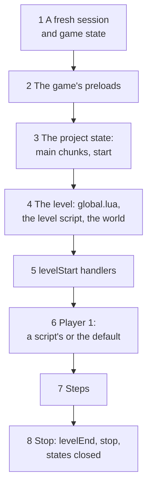
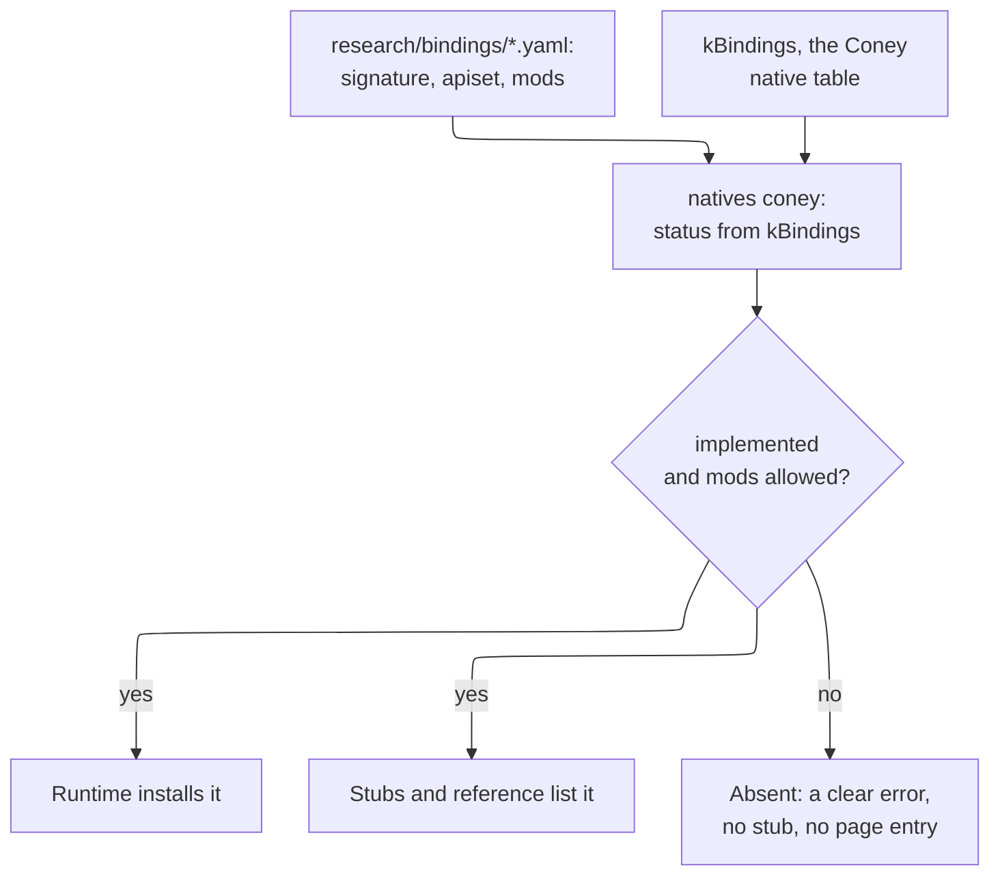

# Coney Studio: the Lua SDK and natives

The design of the Lua SDK that Coney Studio ships and that every mod uses: what its words mean, how scripts find and
call natives, which Lua a project's scripts are written in, how Coney loads a project and runs it when Play is pressed,
what keeps a script inside its project and its calls deterministic, how a native reaches the SDK, the typed stubs that
give the editor its completions, hot reload, the Lua 4.0 compiler and the script debugger. It ends with the build
issues it proposes, in order. The parent issue is [#1054](issue:1054); this page is [#1057](issue:1057).

**Status: design.** Nothing on this page is built. It is a design in the sense of
[Page kinds](../writing-docs.md#page-kinds): what is built moves into a guide. It extends three pages and does not
repeat them: the script split and the Native API of [Asset and script architecture](../asset-and-script-architecture.md#scripts),
the masterlist of [Script bindings](../../references/bindings/index.md), and the resources and sandbox of
[Network architecture](../network-architecture.md#scripting). Where this page decides something those pages left open,
it says so, and [What changes on other pages](#other-pages) lists it.

Two rules from the parent issue shape every section. **The SDK reflects Coney:** a native is in the SDK once Coney
implements it, and not before, so the SDK always shows how far Coney has come. **Mods see natives, never engine
internals:** a script reaches the game only through natives, the same boundary the game's own scripts have.

## Contents {#contents}

1. [Terms](#terms): natives, the SDK, projects, the two runtimes.
2. [What FiveM does, and what Coney copies](#fivem).
3. [Names and namespaces](#names): how a script finds and calls a native.
4. [The runtime](#runtime): Lua 5.4 for projects, Lua 4.0 for the game, and the bridge between them.
5. [Projects and the manifest](#manifest).
6. [The loader and its entry points](#entry-points): start-up, level start, each step, stop; threads and waits.
7. [Play, step by step](#play): what loads in what order, the two states, the step, Stop.
8. [Assets by path](#assets).
9. [The sandbox](#sandbox).
10. [Deterministic and network-safe calls](#determinism).
11. [How a native reaches the SDK](#availability), and the SDK level.
12. [Typed stubs for the language server](#stubs).
13. [Hot reload](#hot-reload).
14. [The Lua 4.0 compiler](#compiler).
15. [The script debugger](#debugger).
16. [What changes on other pages](#other-pages), [Maintainer decisions](#decisions), [Open questions](#open-questions).
17. [Proposed build issues](#build-issues), [Sources](#sources).

## Terms {#terms}

| Term | Meaning |
| --- | --- |
| **Native** | A function a script calls to make the game do something. Coney keeps the word: the Natives page and the masterlist already use it, as does the planned `Native` struct, and it is the word modders know from FiveM |
| **Game native** | One of the original's 956 script bindings, registered as a Lua global by the game and documented in the [masterlist](../../references/bindings/index.md). A script calls it by the game's own name, with the game's arguments, as the game's scripts do: `HuCreate(name, type, pos, heading, nil, 1, gang)` |
| **Coney native** | A function Coney adds for scripts, reaching a capability of Coney's engine the original lacks (teleport, time scale, loading an imported model). It lives in the `Coney` table (`Coney.TeleportPlayer(...)`), never as a bare global, so it can never clash with a game native |
| **SDK function** | A function of the `Coney` table that belongs to the script runtime, not to the engine: registering handlers, threads and waits, logging, the SDK level. It is always there, whatever Coney's progress |
| **Lua SDK** | What Coney ships for script writers: the available natives and SDK functions, the runtime that runs them, their typed stubs for the editor, the generated reference and the debugger |
| **Available** | A native is available when Coney implements it and the SDK allows it ([How a native reaches the SDK](#availability)). Only available natives exist for a project's scripts, its stubs and its reference |
| **SDK level** | A whole number that grows each time a Coney release makes natives available; a project names the level it needs ([The SDK level](#sdk-level)) |
| **Project** | A folder with a `coney-project.toml` manifest: levels, assets and scripts. Studio creates and edits projects ([#1055](issue:1055)); a player installs one into the mods folder; a ConeyMP server runs several. A project is what [Network architecture](../network-architecture.md#resources) calls a *resource* and FiveM calls a resource: one folder, one manifest |
| **Mod** | A project installed in the mods folder and switched on. Studio's Play runs the open project the same way |
| **The game state** | The one Lua 4.0 state per level in which the disc's scripts run, as today ([Scripts](../../research/scripting.md#life-of-the-lua-state)) |
| **A project state** | The Lua 5.4 state of one project, its own environment and globals, which the [sandbox](#sandbox) holds in |
| **Server, client, shared** | Where a script runs, in FiveM's words and the network page's: *server* scripts run where the simulation runs (the host, or the one machine offline), *client* scripts on each player's machine for presentation only, *shared* on both. Offline, every project script is a server script |

## What FiveM does, and what Coney copies {#fivem}

FiveM is a multiplayer platform for *Grand Theft Auto V* whose servers run scripts that call the game's own functions.
It is the model the maintainer named for the SDK. Only its public documentation was read; no code is taken from it
([Network architecture: Prior art](../network-architecture.md#sources) gives its licence).

| FiveM | What it does | Coney |
| --- | --- | --- |
| **Natives** | The game's own script functions (GTA V's, thousands of them) plus Cfx's own, documented on one reference site | The same split: game natives (the masterlist) and Coney natives |
| **Namespaces** | Each native belongs to a namespace (`PED`, `VEHICLE`, `OBJECT`, `CAM`, ...); Cfx's own natives are in the `CFX` namespace and live in FiveM's source, not in the GTA V natives repository | The masterlist's 15 categories are the game natives' namespaces; the `Coney` table is Coney's `CFX` |
| **Names and hashes** | A native's canonical name is upper snake case with a 64-bit hash (`DOOR_SYSTEM_SET_HOLD_OPEN`, `0xD9B71952F78A2640`); the Lua runtime exposes it as a PascalCase global (`DoorSystemSetHoldOpen`) and can call any native by its hash | No hashes and no renaming: the original registers its natives by name as Lua globals, so the name a script calls is the game's own (`HuCreate`). See [Names and namespaces](#names) |
| **API sets** | Each native says where it runs: `client`, `server` or both | Each native gets the same field, `apiset` ([Deterministic and network-safe calls](#determinism)) |
| **The reference site** | One page per native: name, hashes, namespace, API set, game, a C-style signature, each parameter explained, the return value, examples, and a link to improve it; filters by API set and by language | The masterlist pages already follow this form; the SDK reference is the same pages filtered to what is available ([How a native reaches the SDK](#availability)) |
| **Resources and the manifest** | A resource is a folder with `fxmanifest.lua`: `fx_version`, `game`, `client_script`, `server_script`, `shared_script` (with globbing), `file`, `dependency` | A project is a folder with `coney-project.toml` ([Projects and the manifest](#manifest)) |
| **Versioning** | `fx_version` names a cumulative feature level (`adamant`, `bodacious`, `cerulean`): each includes the earlier ones and changes defaults; a dependency can require a minimum server build or game build | The SDK level, a cumulative whole number ([The SDK level](#sdk-level)) |
| **Lua** | CfxLua, a modified Lua 5.4 (Lua 5.3 was retired in 2025): vectors and quaternions as real types, compile-time hashes in backticks, `json`, `promise` and `msgpack` bundled | Lua 5.4 for projects, unmodified ([The runtime](#runtime)) |
| **Threads and waits** | `Citizen.CreateThread(fn)` runs a function as a coroutine; `Wait(ms)` gives control back to the game for that long; without a wait, a loop freezes the game | `Coney.CreateThread` and `Coney.Wait`, counted in game time ([Threads and waits](#threads)) |
| **Events** | Named events with handlers (`AddEventHandler`), between resources and between client and server; `onResourceStart`, `onResourceStop` | `Coney.On(event, fn)` for the loader's entry points ([The loader](#entry-points)); network events are the network page's (P4) |
| **Restart** | `refresh` rereads the manifests, `restart <name>` reloads a resource without restarting the game | [Hot reload](#hot-reload) |
| **Editor support** | Community packages give lua-language-server FiveM's natives and CfxLua's syntax, generated from the natives' documentation; JavaScript has official type packages | Coney generates the stubs itself from the masterlist and ships them ([Typed stubs](#stubs)) |

What Coney does **not** copy: hashes (the original has none), CfxLua's language changes (they would break every stock
Lua tool, which is the reason to choose 5.4 at all), a C# or JavaScript runtime (one language is enough, and it is the
game's), exports between resources (later, with several projects in one session, if users ask), and client-writable
state (the network page already refuses it).

## Names and namespaces {#names}

**Game natives keep the game's names, as bare globals.** A script calls `HuCreate`, `CameraReset`, `GetFlagPos` or
`random` exactly as the game's scripts do: the same name, the same arguments in the same order, the same defaults for
arguments left off. The original's natives are registered by name with tolua and found by name, and the 956 names are
already the masterlist's anchors (`character.md#hucreate`), so there is nothing to convert. The game's own prefixes
(`Hu` for humans, `Br` for brains, `Cam`, `Gang`, `Snd`, `HUD`, `Cfg`) read as the namespaces they are; the
masterlist's categories group them on the reference pages and in the stubs, but a category is never part of a name
(FiveM's namespaces work the same way: the Lua global is flat).

**Coney natives and SDK functions are PascalCase fields of one table, `Coney`.** `Coney.TeleportPlayer(x, y, z,
heading)`, `Coney.On("levelStart", fn)`. One flat table, no sub-tables: a modder types `Coney.` and the editor lists
everything Coney adds. Their categories (Player, Camera, Time, Assets, Debug, Runtime) are for the reference only, as
for the game's. The proposed names are the ones on the [candidates table](../asset-and-script-architecture.md#coney-native-candidates);
they may change until the first release that makes one available, and never after.

**A name is never reused or changed once released.** Game natives cannot change: they are the original's. A Coney
native that needs a different signature becomes a new native, and the old one stays, marked deprecated in the stubs
(FiveM keeps old names as aliases for the same reason).

**How a script finds a native:** it calls the global or the `Coney` field. A name that is not available is not there:
calling it fails with an error that says why ("`HuSetOnFire` is a game native Coney does not implement in SDK level 4";
"`Coney.Foo` is no Coney native"), raised by the project environment's lookup ([The sandbox](#sandbox)). The editor
says the same before the script runs, because the stubs list only what is available ([Typed stubs](#stubs)).

## The runtime {#runtime}

### Lua 5.4 for projects, Lua 4.0 for the game {#runtime-choice}

The architecture page advises one runtime until mods need what Lua 4.0 lacks
([Three parts](../asset-and-script-architecture.md#script-parts)). The SDK is that need. A maintainer decided
(2026-10-28):

- **Lua 4.0 stays the runtime of the game**: the disc's scripts, Coney's own rewrites of the level scripts (compared
  call for call with the originals), script overrides that replace a disc script, and the debug console in the game
  state. Nothing about it changes.
- **Lua 5.4 is the runtime of projects**: every script a user writes runs in a project state of stock Lua 5.4, behind
  the same Native API as the game state.

The line is **who wrote the script**: the game (or Coney, standing in for the game) writes 4.0; a user writes 5.4. The
reasons:

| | Lua 4.0 for projects | Lua 5.4 for projects |
| --- | --- | --- |
| The editor | lua-language-server's runtimes are Lua 5.1 to 5.4 and LuaJIT; it cannot parse 4.0 (`%` upvalues, `for k, v in t do`), so completions, errors and go-to-definition would need a language server of Coney's own | lua-language-server works as it is, with Coney's stubs |
| What modders know | Lua 4.0 is from 2000: no booleans (`true = 1`, `false = nil`), no `#`, no metatables (tag methods), no `string.` table, no coroutines; no tutorial, book or library of the last twenty years runs on it | FiveM's scripts, Roblox's Luau and most game Lua today are 5.x; 5.4's manual, books and libraries apply |
| Threads and waits | Lua 4.0 has no coroutines; a wait would need a VM that can suspend (an M item on the architecture page, deferred) | Coroutines are built in, so `Coney.Wait` is a small SDK function |
| The sandbox | Coney's 4.0 VM has an instruction budget; environments per script, a memory cap and library control would be Coney's to add | `_ENV`, `lua_sethook` and the allocator give all three ([Network architecture: Sandboxing](../network-architecture.md#sandbox)) |
| A debugger | Coney's VM would need hooks, line information and frame inspection added | `lua_sethook` and `lua_getinfo`, `lua_getlocal` exist ([The script debugger](#debugger)) |
| ConeyMP (P4) | The network page plans 5.4 for resources anyway, so 4.0 for projects would mean two languages for users | One language for users, offline and on servers |
| Cost | No second runtime | A second runtime: stock Lua 5.4 as a pinned dependency (MIT licence), a value bridge, deterministic build settings ([below](#lua-build)) |
| Sharing the game's state | A project could run in the game state, hook its functions and set its globals | A project state is separate; it shares the world, not the game state's globals ([The two states](#two-states)) |

The last row is the only one in 4.0's favour, and it is also a reason against: a script that patches the game state
can break the faithful scripts in ways nobody can debug, and a separate state is what the sandbox and the network
model need anyway. A user who wants to change a level script itself writes a script override in Lua 4.0, which the
[compiler](#compiler) builds and the script catalog runs in place of the disc's chunk
([Three parts](../asset-and-script-architecture.md#script-parts)).

That decision is recorded under [Maintainer decisions](#decisions); the network page lists the same choice for
resources.

### How Lua 5.4 is built {#lua-build}

Stock Lua 5.4, pinned in `cmake/deps.cmake` like the other dependencies, compiled as C into its own library, with the
settings that make it deterministic ([Deterministic and network-safe calls](#determinism) says why each matters):

- **A fixed string-hash seed** (`luai_makeseed` defined as a constant): stock 5.4 seeds the hash of strings from an
  address and the time, so the order `pairs` visits a table's string keys would change from run to run.
- **A fixed sort pivot** (`l_randomizePivot` defined as 0): stock `table.sort` mixes the clock into its pivot for large
  arrays, so elements a comparator calls equal could end in a different order.
- **No `os`, `io`, `package` or `debug` library opened**, and `math.random` replaced ([The sandbox](#sandbox)).
- **Coney's allocator** (`lua_newstate` with Coney's `lua_Alloc`): the memory cap, and an arena whose addresses repeat
  from run to run, so a table keyed by tables is visited in the same order in a replay.
- **Integer and float semantics as stock**, no `LUA_COMPAT` flags, compiled without fast-math so floating point is the
  same on every compiler Coney supports.

### The value bridge {#bridge}

A native takes a list of values and returns a list ([Three parts](../asset-and-script-architecture.md#script-parts):
`NativeFunction`), whichever runtime calls it. Each runtime converts its own values to Coney's `script::Value` and back,
so a native's body is written once. The 5.4 side follows the masterlist's [conventions](../../references/bindings/index.md#conventions)
so that a native behaves as the game's scripts see it:

| 5.4 value | To a native | From a native |
| --- | --- | --- |
| `nil` | nil (the argument's default, as a missing argument) | nil |
| integer, float | a number; `ctype: int` and `unsigned` truncate toward zero as the game's wrappers do | a number: an integer when the masterlist's result type is a whole number or a handle, else a float |
| `true`, `false` | true, false | a boolean result is `true` or `false` in 5.4, where the game state sees 1 or nil; `if x then` reads the same in both |
| string | a string | a string, nil for none |
| table | `{x, y, z}` and `{a, b, c, d}` read by index, as the game's natives read them; every table argument is written back after the call, as in the game | an `M_Vector4` result is a table with fields `x y z w` |
| function | allowed where a native takes a callback name ([below](#bridge)) | never |
| userdata, thread | refused with an error naming the argument | never: natives return no pointers ([Ids, not pointers](#determinism)) |

**Callbacks.** Game natives that take a function's name (`ScheduleFunc`, `SetMsgHandler`, `PadSetHandler`,
`AddAnimCallback`, ...) keep the name and look it up when they fire ([Scripts](../../research/scripting.md#calling-lua-from-c)).
Called from a project state they accept a name, looked up in that project's environment, or a function value. Either
way the native keeps a callback id (the state it came from and a reference into that state), never a pointer, so the
callback fires in the state that asked for it. A slot that holds one callback (an object's handler for a message)
keeps the last one set, from whichever state, as the original's one slot does.

## Projects and the manifest {#manifest}

A project folder is the one Studio creates ([#1055](issue:1055) owns its layout: `levels/`, `textures/`, `scripts/`
and the `.studio/` cache). This page owns the manifest's name and its script fields, and proposes TOML (as
`coney.local.toml`), not FiveM's Lua manifest: a manifest that is code would have to run before the sandbox exists.

```toml
# coney-project.toml
[project]
name = "yard-brawl"            # lower case, digits and '-'; unique among installed mods; the events' prefix
title = "Yard Brawl"           # what menus show
version = "0.3.0"              # the project's own version
sdk = 4                        # the lowest SDK level it needs; Coney refuses a project above its own level

[play]
level = "project:/levels/yard.layout"   # where Play and the mods menu start it; a game:/ level is allowed
spawn = "start"                          # the default player's spawn point when no script makes player 1

[scripts]
server = ["scripts/main.lua", "scripts/fighters/*.lua"]   # run where the simulation runs; globs, in this order
client = []                                               # presentation only (ConeyMP, P4)
shared = ["scripts/util.lua"]                             # loaded first, on both sides

[dependencies]
projects = []                  # other projects that must be loaded first (later: several projects per session)
```

- **Paths in the manifest** are relative to the project folder; inside scripts and levels they are written
  `project:/...` and `game:/...` ([Assets by path](#assets)). A path that leaves the folder is refused at load.
- **Order is the manifest's**: `shared` files first, then `server` files in the order listed, a glob's matches sorted
  by path in byte order, so the order never depends on the file system.
- **A project with no `[scripts]`** is a level and its assets; it plays with no script, the default player at the spawn
  point.
- The fields beyond these (version ranges for dependencies, client files to download, declared events) are the network
  page's when P4 comes ([Coney resources](../network-architecture.md#resources)).

## The loader and its entry points {#entry-points}

### The mods folder {#mods-folder}

A player installs a project by putting its folder in `<install>/mods/`. `mods/enabled.toml` lists the projects switched
on and their order; the mods menu (and Studio's Play, which runs exactly one project, the open one) writes it. With the
file empty or the folder absent, Coney runs exactly as it does without the SDK: no project state is made, no entry
point runs, and the game is the faithful one ([Roadmap: Script mods](../../roadmap.md#script-mods), whose Done line
this keeps). A session with any project loaded is a **modded session**, said in the run log and in every replay and
save it writes ([Asset layers](../asset-and-script-architecture.md#asset-layers)).

### Entry points {#events}

A project's scripts run their main chunks once, when the project loads, and then only when Coney calls them. They
register handlers with `Coney.On(event, fn)` (and remove them with `Coney.Off`); several handlers for one event run in
the order they were registered, projects in load order. The events, at the points the game already has
([Scheduler](../asset-and-script-architecture.md#script-parts)):

| Event | When | Arguments | Typical use |
| --- | --- | --- | --- |
| `start` | Once per session, after the game's preloads and before the first level, in load order | none | Configuration: `Cfg*` natives, data the project keeps for the session |
| `levelStart` | Each time a level starts, after the game state has run `global.lua` and the level's script (when the level has one) and the world is loaded, before the first step | level name, checkpoint | Spawning the player and the cast, cameras, objectives |
| `update` | Every simulation step (1/30 s), after the game state's script frame | step length in ms (33) | Per-step logic that is not a thread |
| `levelEnd` | Before a level unloads (a level change, a restart, the end of Play) | level name, reason (`change`, `restart`, `stop`) | Cleaning up what the project made |
| `stop` | When the project stops: the session ends, Play stops, or a hot reload replaces it | reason (`quit`, `stop`, `reload`) | Saving the project's own data |

Everything else a script reacts to comes through the game natives' own callbacks, as for the game's scripts: message
handlers on objects (`SetMsgHandler`), trigger boxes, animation callbacks, pad handlers, scheduled calls. Network
events between projects and machines are the network page's (P4).

### Threads and waits {#threads}

`Coney.CreateThread(fn)` runs `fn` as a coroutine; `Coney.Wait(ms)` inside it gives control back until that much game
time has passed (a whole number of steps, rounded up, at least one), as FiveM's `Wait` does. Threads are resumed once
per step, after the `update` handlers, in the order they were created; a thread that waits zero steps is resumed at the
next step, never twice in one. A wait outside a thread is an error. Waits count steps, never the clock, so a thread
lasts the same number of steps at any frame rate and in a replay. `ScheduleFunc` called from a project runs in the
project's own schedule, beside its threads, with the game's rules (due calls in the order scheduled).

The game state needs no threads: the original's scripts wait only through the schedule and callbacks
([Three parts](../asset-and-script-architecture.md#script-parts)).

## Play, step by step {#play}

What Coney does when Studio's Play is pressed or a mod starts a level. Studio's side (the Game view, live edits, what
Stop keeps and throws away) is the editor page's ([Play mode](editor-experience.md#play-mode)); how the engine runs
beside the editor is the [technology](technology.md#play) page's. The engine's side is the same whichever program hosts
it.



*Figure: the order in which Play brings a project up and down.*

1. **A fresh session.** A new game mode with its own game state, as `--play-level` makes today; nothing from an
   earlier Play survives. The session's seed is fixed (Studio uses the project's, a test its own), so two Plays with
   the same input are the same run.
2. **The game's preloads.** The game state runs `enum_preload.lua` and the three `config_preload*.lua`, as the legal
   screen does ([Life of the Lua state](../../research/scripting.md#life-of-the-lua-state)). They configure the
   characters, gangs, objects and sounds every game native relies on, so a project's `HuCreate(..., 32, ...)` finds
   Rembrandt's type. The game state's errors are logged as today.
3. **The project state.** A Lua 5.4 state is made for the project and sandboxed ([The sandbox](#sandbox)); its available
   natives and the `Coney` table are installed; its `shared` and `server` files run in the manifest's order (their main
   chunks: defining functions, registering handlers). Then the `start` handlers run. An error in a main chunk stops
   that file and is shown in Studio's Console with its file and line; the project goes on with the files that loaded.
4. **The level.** The level named by `[play]` loads. For a project level (a sandbox layout today, Coney's own format
   later, [Project formats](project-formats.md#level-file)) the world and its entities are built from the file, its
   spawn points are registered as
   **world flags** of the same names, and the game state runs `global.lua`, so the game's helpers exist, but no level
   script: a project level has none. For a `game:/` level the game state runs `global.lua` and the level's own script
   exactly as the game does, at the checkpoint asked for.
5. **`levelStart`.** The project's handlers run with the level's name and checkpoint, once the world is in place and
   before the first step. This is where a project makes its cast. Because spawn points are flags, the game natives
   work on them unchanged: `TeleportToFlag(human, FindFlag("start"))`, or `HuCreate("hero", 32,
   GetFlagPos(FindFlag("start")), 0, nil, 1, gang)`, the way the level scripts place player 1.
6. **Player 1.** If no script made player 1 (a `HuCreate` with player 1), Coney makes the default one at the
   manifest's `spawn` (or the level's first spawn point): Rembrandt, as Play does with no script. The camera is put
   behind him as `CameraReset` would.
7. **Steps.** Each 1/30 s step, inside the game mode's `update()` and in this order: the pad records are filled;
   gameplay steps the humans, AI, physics and objects; the trigger boxes and spheres deliver their messages (to
   handlers in either state); the **game state's script frame** runs its due scheduled calls and its update function,
   as today ([Scheduled calls](../../research/scripting.md#scheduled-calls)); then the **project's frame** runs its due
   scheduled calls, its `update` handlers and its threads. Every call into a project state has an instruction budget
   ([The sandbox](#sandbox)). Rendering reads the result and calls no script.
8. **Stop.** At the next step boundary: the `levelEnd` handlers (reason `stop`), then `stop`; the project state is
   closed; the game state is destroyed as a level unload destroys it; the session ends. Every handle either state
   held dies with the session, so nothing a project made outlives Play. Studio then shows the edit state it kept,
   unchanged ([#1055](issue:1055): Play never changes the edited level).

A level change during Play (a project calling `Coney.StartLevel`, or a `game:/` level's own `runNextMission`) runs
`levelEnd` (reason `change`), unloads and remakes the game state as the game does (without the preloads, as the
original), loads the next level and runs `levelStart` again. The project state lives on across levels: a project's
globals and threads are the session's, the game state's are the level's.

### The two states {#two-states}

The game state and the project state never share globals. They share **the world**: a human, object, camera or gang
made by either is the same thing to both, named by the same handle. That needs one rule the code does not keep today:
**handles come from the session, not from a Lua state** (one counter per session, in the game mode's state), so a
handle the level script made means the same human in the project's calls ([Network architecture: Scripts](../network-architecture.md#sub-scripts)
counts handles per state today). The project reads the game state's world through natives (`HuFind`, `FindFlag`,
`GetPosition`), as a level script reads what another script made; it cannot read or set the game state's globals or
call its functions. Whether it may read a game-state global through a Coney native is an
[open question](#open-questions).

## Assets by path {#assets}

A project's script loads, plays or spawns an asset by its path, as engines do (`Resources.Load` in Unity, `load()` in
Godot). The paths are the editor page's two roots ([#1055](issue:1055)); the formats behind them and how an import
becomes a project file are the [content page](content-and-formats.md#paths)'s, and the two pages use the same scheme:

| Root | Means | Example |
| --- | --- | --- |
| `project:/` | The project folder; nothing above it | `project:/models/crate.glb` |
| `game:/` | The player's installed game files, read-only, by the extract tool's names, so a project refers to a game asset and never carries it ([LEGAL.md](repo:LEGAL.md#no-game-data)) | `game:/sounds/...` |

A sub-asset (one clip of a file that holds several, one mesh of a model file) follows a `#`:
`project:/anims/dance.glb#Spin`. The calls are Coney natives, available once Coney can load that kind from outside
the disc:

| Proposed native | Does | Waits on |
| --- | --- | --- |
| `Coney.LoadAsset(path)` | Starts loading an asset and returns its asset id at once; the load completes at a step boundary | Coney loading assets from a project ([Custom content](../../roadmap.md#custom-content)) |
| `Coney.IsAssetLoaded(id)` | Whether it has arrived; a thread waits on it with `Coney.Wait` | the same |
| `Coney.SpawnModel(path, pos, heading)` | Places an imported model as a world object and returns its handle; game natives (`GetPosition`, `ObjShow`, `ObjDestroy`) then work on it | glTF models in Coney |
| `Coney.SetHumanModel(human, path)` | Changes a human's model in place, keeping everything else about him ([#1053](issue:1053) does this for disc models) | imported character models |
| `Coney.PlayClip(human, path, loop, speed)` | Plays an imported or disc clip on a human, as the Animation player does | imported animations |
| `Coney.PlaySound(path, pos, volume)` | Plays a sound at a place, as a sound event | sounds from outside the disc |

Loading follows the [determinism rules](#determinism): a load is requested during a step and completes at a step
boundary, in request order; in test mode it completes at once, so a test needs no waiting. A path that does not exist,
leaves its root or names a kind Coney cannot load returns an error the script can test, never a crash. Assets are
found through the asset store's sources, never by a native opening a file
([Asset layers](../asset-and-script-architecture.md#asset-layers)).

## The sandbox {#sandbox}

A project state follows the network page's [sandbox](../network-architecture.md#sandbox), and adds what keeps a
script inside its project:

- **Libraries:** base (without `dofile`, `loadfile`, `collectgarbage`, and with `load` taking text only, never
  bytecode), `string`, `table`, `math`, `utf8` and `coroutine`. No `io`, `os`, `package` or `debug`. `math.random` and
  `math.randomseed` draw from the project's own stream ([Determinism](#determinism)). `print` writes to the run log
  and Studio's Console, tagged with the project.
- **`require` inside the project only:** `require("fighters.waves")` finds `scripts/fighters/waves.lua` in the
  project folder. The name is a module path, never a file path: `..`, absolute paths and drive letters are refused,
  and the resolved file must lie inside the folder after links are followed. Text only.
- **Files:** a script reads no file directly. Its data comes through natives that take a `project:/` path
  ([Assets by path](#assets)); a later `Coney.ReadData(path)` may read a project's JSON or TOML data file, inside the
  folder only.
- **One environment per project** over a read-only table of the natives: a script can set its own globals, never a
  native's name (`HuCreate = nil` raises an error), and never another project's state.
- **An instruction budget per call into the state** (an entry, a handler, a callback, one resume of a thread), by
  `lua_sethook`'s count hook; a call past it stops with an error and the project goes on. A thread that loops without
  waiting is stopped the same way.
- **A memory cap per project**, by the allocator; past it the allocation fails as an out-of-memory error in the call.
- **No engine internals:** the state holds natives and SDK functions only. There is no `Coney.Engine`, no access to
  C++ objects, no pointer in any value.
- **Errors** are Lua errors with the file and line; they stop the call that raised them, never the game. Studio shows
  each in the Console and the editor's margin; the run log keeps them.

## Deterministic and network-safe calls {#determinism}

Every rule of the [networking checklist](../network-architecture.md#checklist) applies to the SDK. What it means for a
project's scripts:

- **Scripts run only inside a step.** Every entry point, callback and thread runs on the simulation thread inside the
  game mode's `update()`, at the places [Play, step by step](#play) lists. Nothing calls a script from the renderer, the
  audio thread, a file watcher or the editor's interface; Studio's console line and the debugger's evaluations are
  queued and run between two steps, as the Entity editor's edits are ([Entity editor](../debug-menu.md#entity-editor)).
- **No real clock.** Time is `Coney.GetGameTime()` (steps since the level started, and milliseconds of game time);
  `os.time` and `os.clock` do not exist.
- **Randomness from `GameRandom` streams.** A project's `math.random` draws from a stream of its own, seeded from the
  session's seed and the project's name, so a project's draws never shift the game's own draws, and a replay draws the
  same. The game native `random` keeps the game's table, shared with the game's code, as in the original.
- **Stable order.** Handlers, projects, files and threads run in fixed orders (above); the Lua build fixes the string
  hash and the sort pivot ([How Lua 5.4 is built](#lua-build)), so `pairs` and `table.sort` give the same order in
  every run of the same build.
- **Ids, not pointers.** Natives take and return handles and asset ids, never userdata; a handle is the
  session's, so it means the same thing in every state and can be named in a replay.
- **Player slots.** A native that reads a player takes his slot (`Coney.GetPlayer(slot)` returns player *n*'s human);
  nothing in the SDK means "the player" without a slot.
- **Effects as events.** A Coney native that shows or plays something (a notice, a sound, a screen effect) goes through
  the HUD state or the sound events, so a client could be told of it.
- **Where a native runs.** Each native gets an `apiset` in the masterlist, FiveM's field: `server` (changes the game's
  state; offline the one machine is the server), `client` (presentation only: draws, local sounds, reads replicated
  state) or `shared`. Every game native is `server`, because the game's scripts are simulation and run on the server
  only ([The original's scripts](../network-architecture.md#original-scripts)). A server script calls `server` and
  `shared` natives, a client script `client` and `shared` ones; offline both kinds run and the rule is checked all the
  same, so a project that works offline does not break online.
- **Server authority, not lockstep.** A project's server scripts run on the host only and their effects reach clients
  as state and events, so what must be repeatable is one machine's run (tests, replays), never two machines agreeing
  step by step. That is why the rules above ask for same-build repeatability and nothing stronger.
- **Hot reload and the debugger mark a run.** A run in which a script was reloaded, or a breakpoint changed a value, is
  no longer a replay of its inputs; the run log says so.

## How a native reaches the SDK {#availability}

The SDK reflects Coney by construction: one source says whether a native exists in the SDK, and every view of the SDK
(the runtime, the stubs, the reference, Studio's Natives browser) reads it.



*Figure: one status decides whether a native is in the runtime, the stubs and the reference.*

1. **Documented.** Every game native has its masterlist entry already (all 956). A Coney native gets one too, in
   `research/bindings/coney.yaml` with `origin: coney`, which the masterlist's schema already allows
   ([The research data](../research-data.md#bindings)): its signature, description, `apiset`, the C++ entry point it
   calls and, from its first release, `since`.
2. **Implemented.** Coney's binding table says the native is real: `kBindings` in `src/scripting/script_bindings.cpp`
   for game natives, the Coney native list for Coney's. `coney-tools natives coney` writes the masterlist's `coney`
   status from it and CI fails when they disagree, as it does today
   ([Coney status](../../references/bindings/index.md#coney-status)).
3. **Allowed.** A few game natives make no sense from a project and carry `mods: false` with a reason; the rest are
   allowed. The first list: `doFile`, `doInclude` and `preLoadFile` (they run a disc script into the calling state;
   a project uses `require`), `gc` (the project state collects its own garbage), `RegisterUpdate`, and the game's
   one-slot flow callbacks (`SetStartGameCallback`, `SetCheatCallback`, `SetMultiplayerCallback`,
   `SetArmiesMultiplayerCallback`, `SetAllClearCallBack`, `SetHatCallBack`), which belong to the game's own scripts.
4. **Available** = implemented and allowed. At run time the native list (`buildNatives`) carries each native's status
   and its `mods` flag; the project state installs exactly the available ones. *Partial* (routed to a logging
   stand-in) and *stub* natives are not available: a stub that returns a default would make a project quietly do
   nothing, the opposite of what the SDK promises.

So the day an engineer turns a game native from `stub` to `real`, it appears in the runtime, the stubs, the reference
and Studio with no other step, and the SDK's count grows with Coney's progress (636 of the 956 game natives are
implemented today, by `coney-tools natives stats`).

### The SDK level {#sdk-level}

A whole number, cumulative like FiveM's `fx_version`: level *n* has every native of level *n − 1* and more. The release
tool raises it when a release makes at least one native available that the last release did not, and writes `since:
<level>` on those natives' entries. A project's `sdk` names the lowest level it needs: Coney refuses to load a project
that asks for more than it has, with the message "needs SDK level 7, this Coney has 6", and Studio offers its own
level for a new project. Natives are never removed and their signatures never change, so a project made for level *n*
runs at every later level. A Coney native that is replaced stays, `deprecated` in its entry and in the stubs.

### The reference {#sdk-reference}

`natives render` grows a view for script writers: the same pages, with each entry's availability and `since`, a filter
for available natives, and a Coney natives page from `coney.yaml`, as FiveM's reference filters by API set. Studio's
Natives browser reads the same data; the debug menus' [Natives](../debug-menu.md#natives) page keeps showing every
native with its status, as a tool for engineers.

## Typed stubs for the language server {#stubs}

Studio's script editor gets completions, signatures, hover text and errors from lua-language-server; the technology page
decides how the editor hosts it ([Language tooling](technology.md#language-tooling)). The language server learns the SDK
from **stubs**: Lua files of declarations with LuaCATS annotations, the format lua-language-server reads (`---@meta`,
`---@param`, `---@return`, `---@class`, `---@alias`). `coney-tools natives stubs` generates them from the masterlist,
available natives only:

```lua
---@meta
-- Generated by coney-tools natives stubs from research/bindings/; SDK level 4. Do not edit.

---@alias HumanHandle integer A human's handle, as HuCreate or HuFind returns it.
---@alias GangHandle integer A gang's handle, as GangCreate returns it.

---Creates a human (character) in the world, snaps it to the ground and, for a player index of 1, makes it
---player 1's character.
---[Script bindings: HuCreate](character.md#hucreate) · Characters · server · since SDK level 1
---@param name string The human's name (15 characters kept); HuFind and scripts use it.
---@param type integer Character type id, the CfgChar record (32 Rembrandt, 40 Ash).
---@param pos number[] Position {x, y, z} in metres, z up; written back with the ground-snapped position.
---@param heading number Facing in degrees.
---@param unused? string Not read.
---@param player? integer 1 makes the human player 1 when no player 1 exists; 0 makes an AI human.
---@param gang? GangHandle The gang the human belongs to.
---@param flag? boolean Meaning not traced.
---@return HumanHandle human The new human, or NilHandle (0) when no slot is free (60 humans at most).
function HuCreate(name, type, pos, heading, unused, player, gang, flag) end
```

- **One file per category** (`natives/character.lua`, ...), one `coney.lua` for the `Coney` table, and `runtime.lua`
  for the SDK functions, with the level in each file's header.
- **Types from the masterlist:** `lua` and `ctype` give `number`, `integer`, `boolean`, `string`, `number[]`; a handle
  gets its alias from a new `handle` key on the argument (`handle: human`), which replaces the guess `natives cpp`
  makes today from the description's wording; an argument with a default, or one the game's scripts leave off, is
  optional (`?`). Descriptions are the masterlist's own text, our words, never the game's
  ([LEGAL.md](repo:LEGAL.md#no-game-data)).
- **A project's `.luarc.json`**, written by Studio for a new project (and by `coney-tools sdk init` for anyone using
  another editor), sets `runtime.version` to `Lua 5.4`, points `workspace.library` at the installed stubs, and turns
  the sandbox into diagnostics: the missing libraries are disabled (`runtime.builtin`), so `io.open` is an undefined
  global in the editor as in the game.
- **Shipped, not committed.** The stubs are generated at build time into the build folder and packaged with Coney and
  Studio, as the progress tables are generated by the docs build, so no pull request changes them by hand and they
  can never fall behind the masterlist. A test checks that every available native has a stub and no other native
  does.
- **The same data serves VS Code users**: a modder who prefers VS Code with the Lua extension gets the same completions
  from the same files.

## Hot reload {#hot-reload}

Changing a script while the game runs, as FiveM's `restart`:

1. **Seen.** Studio (or, outside Studio, a file watcher Coney runs only with `--watch-mods`) sees a project file
   change on disk. The watcher is outside the simulation and only queues a request.
2. **At the next step boundary** the project is stopped. The level goes on, so `levelEnd` is not called; the `stop`
   handlers run with reason `reload`; the project's handlers, threads, scheduled calls and callbacks are removed (every
   callback id the state owned is dropped, so a game slot it held is left empty); its state is closed.
3. **Started again.** A new project state is made, the files load in order and `start` runs; if a level is running,
   `levelStart` runs too, with the current level and checkpoint, so the project can find the cast it made before
   (handles of humans it made are still valid: the world was not touched) or make it again.
4. **A file that fails to compile** stops the reload before step 2: the running state stays as it was and the error is
   shown, so a typo never kills a running project.

What a project made in the world (humans, objects) stays across a reload; a project that wants a clean world deletes
its cast in `stop`. Hot reload is for Studio and a mod writer's machine: it is off in test mode, and in a networked
session only the host reloads its own server scripts. A run with a reload is marked in the run log
([Determinism](#determinism)). Reloading a script of the game state (a Coney rewrite, a script override) is the
console's *Reload* of the architecture page ([Debug console needs](../asset-and-script-architecture.md#console-needs)),
not the SDK's.

## The Lua 4.0 compiler {#compiler}

The game state runs compiled Lua 4.0 bytecode, and Coney's VM reads only that: it has no compiler, which is why the
console understands only expressions and assignments ([The Lua console](../debug-menu.md#lua-console)). A compiler from
Lua 4.0 source to the `LuaProto` Coney's VM runs is needed whichever runtime projects get, because the game state has
four uses for source text:

- **The console** with full statements (`if`, loops, `local`, `function`), errors with line numbers, in the game state
  ([Debug console needs](../asset-and-script-architecture.md#console-needs)).
- **Coney's level rewrites**, written as Lua 4.0 source and compared call for call with the disc's chunks
  ([Three parts](../asset-and-script-architecture.md#script-parts)).
- **Script overrides**, a user's replacement of a disc script, which must run in the game state.
- **The debugger's** watch expressions while paused in the game state ([The script debugger](#debugger)).

The original carries the same ability: its Lua 4.0 library includes the source parser. The chunk loader
`Lua4_ParseOrUndumpChunk` (`0x00328d98`) sends a chunk to the bytecode loader (`0x00333588`, which calls
`Lua4_LoadChunk` `0x00333548`) or to the parser `Lua4_ParseSourceChunk` (`0x0032d828`) by a flag of the input
(confirmed (code)); the parser's code raises Lua 4.0's own errors ("`<eof> expected`" at `0x00575d08`, "`'%.20s'
expected (to close '%.20s' at line %d)`" from `0x0032cd60`; confirmed (code)). That the flag is Lua 4.0's test of a
buffer's first byte, so that `dostring` and the run-a-string slot `+0x2c` compile text, is inferred from Lua 4.0's
public source; the shipped scripts are all bytecode. So a compiler gives Coney's game state what the original's had,
and `dostring` in Coney's base library gains its text path with it.

**How:** a lexer and a recursive-descent parser written anew from the Lua 4.0 reference manual's grammar, emitting the
instructions Coney's VM already executes, with line information kept for Coney's chunks (the disc's chunks have none).
It is the size the architecture page gives (M to L, [Risks](../asset-and-script-architecture.md#risks)). **Tested** with
synthetic sources compiled and run against expected results, every instruction kind covered, and a disc check that
runs the game's scripts as the original's bytecode and as Coney's recompilation of their decompiles (where the
decompile compiles) and compares the natives each calls, printing counts and hashes only.

## The script debugger {#debugger}

Breakpoints, stepping, watches and the call stack, for project scripts first and the game state second.

**The protocol.** Coney implements a **Debug Adapter Protocol** (DAP) server, the protocol VS Code, Neovim and most
editors speak: JSON messages over a local socket (a loopback port the run log names) or a pipe. Studio's script editor
is a DAP client; because the protocol is standard, a modder can also attach VS Code to a running Coney. The server
lives in the engine, beside the runtimes; how Studio's process reaches it is the technology page's
([The script debugger](technology.md#debugger)).

| DAP feature | How |
| --- | --- |
| Breakpoints by file and line, conditional breakpoints, hit counts, logpoints | 5.4's line hook (`lua_sethook` with `LUA_MASKLINE`) checks the breakpoint set for the running chunk; a condition is evaluated in the paused frame |
| Pause, continue, step in, step over, step out | The line and call/return hooks, with a target depth for over and out |
| The call stack | `lua_getstack` and `lua_getinfo`: each frame's file, line and function; a native in the middle shows as a native frame |
| Scopes and variables | Locals (`lua_getlocal`), upvalues, the project's globals; tables expand lazily |
| Watches and the debug console | An expression compiled and run in the paused frame with a small budget, read-only: a watch may call only natives the masterlist marks `reads: true` (getters such as `GetPosition`, `HuGetHealthPercent`), and any other native is refused, so looking at a value never changes the game |
| Exceptions | Break on any error, or only on errors no handler catches |
| Threads | Each `Coney.CreateThread` coroutine is a DAP thread, so a modder sees which thread stopped |

**Pausing the game.** A breakpoint stops the simulation inside the step that hit it: the step is suspended in the
script call, no further step runs, and the window keeps showing the last frame and stays responsive (the debugger
waits on the simulation thread; the presentation side keeps drawing). Continue finishes the step. Because time is
steps, a pause changes nothing in the run: the next step is the one that would have come. Setting a variable from the
debugger does change it, and marks the run ([Determinism](#determinism)). In Studio, Play runs in Studio's process
on its own simulation thread, so the Game view and the panels keep drawing while a breakpoint holds
([The script debugger](technology.md#debugger)).

**The game state.** Coney's own Lua 4.0 VM gets the same hooks (a line hook for chunks with line information, an
instruction hook for those without), so Coney's level rewrites and script overrides debug by line, and a disc chunk by
function prototype and instruction (the locator form of a mission page, `level99.lua:f31`), for engineers comparing a
rewrite with the original. A watch in the game state needs the [compiler](#compiler).

**Limits.** The debugger runs offline and in Studio's Play; in a networked session only the host may attach, to its own
server scripts, and a paused host pauses the session for everyone.

## What changes on other pages {#other-pages}

When this design is accepted, these lines change on the pages that own them:

- [Asset and script architecture](../asset-and-script-architecture.md#script-parts): the modern runtime is no longer
  deferred as "if mods need it": projects need it (this page), and the `Coney` natives move from a table on that page
  to `research/bindings/coney.yaml` with `origin: coney`.
- [Network architecture](../network-architecture.md#resources): a resource is a project, with `coney-project.toml` as
  its manifest; the second runtime of its maintainer decision 3 is this page's.
- [The research data](../research-data.md#bindings): the `apiset`, `mods`, `handle`, `reads` and `since` keys.
- [Network architecture: Scripts](../network-architecture.md#sub-scripts): handles come from one counter per session,
  not one per Lua state ([The two states](#two-states)).
- [Asset and script architecture: Deferred, in order](../asset-and-script-architecture.md#later): the native list, the
  scheduler, the compiler and the `Coney` table move ahead of the whole game, as Studio's first build work
  ([Proposed build issues](#build-issues)), as the maintainer's decision on Studio and faithful first allows
  ([Maintainer decisions](#decisions)).
- [Roadmap: Script mods](../../roadmap.md#script-mods): the loader's points are this page's entry points.

## Maintainer decisions {#decisions}

1. **A second Lua runtime: Lua 5.4 for projects** ([The runtime](#runtime-choice)). Decided by a maintainer
   (2026-10-28), with its new dependency, stock Lua 5.4 (MIT licence). The network page lists the same choice for
   resources.
2. **Projects and faithful first: decided, no exception needed.** Studio is a reflection of Coney's progress: it offers
   only what Coney has, an enhancement or native appears in Studio once Coney has it, and nothing in Studio changes how
   the story plays ([Studio's decisions](index.md#decisions)). Running a project is still a modded session.
3. **The SDK's names are a public promise** ([Names and namespaces](#names)): once a release makes a Coney native
   available, its name and signature never change. Who approves a Coney native's name before its first release (a
   maintainer, or the review alone) is to decide.

## Open questions {#open-questions}

- **Reading the game state's globals**: may a project read (never write) a global of the game state
  through a Coney native, `Coney.GetGameGlobal(name)`, to follow a level script's progress (a stage counter)? It is
  useful and read-only, but it ties a project to the game scripts' internals, which change with every rewrite.
- **The game native `random`** shares the game's table and its index with the game's code: should a project's call of
  it draw from the project's stream instead, so that a mod cannot shift the game's draws? Faithful for the game state
  either way.
- **Exports between projects** (FiveM's `exports`): wanted once several projects run in one session, or never?
- **What a reload leaves**: should Coney delete the humans and objects a project made when it stops, as FiveM deletes a
  resource's server entities, or leave them to the project (this page's choice)?
- **The budgets' sizes**: the instruction budget per call and the memory cap per project, measured on real projects
  before the first release.

## Proposed build issues {#build-issues}

In the order they should come. The script runtime for mods comes first of all Studio's build work, because Play means
running a project's scripts. Issues 2 to 6 build on the [decision](#decisions) for Lua 5.4.

1. **core: Add the native list and the script scheduler.** The two seams of the architecture page, built now:
   `buildNatives` turns `kBindings` and the binding registrations into a list of `Native` records (name, origin,
   status, the `mods` flag, the call), which the game state installs as today and the debug menus read; and
   `ScriptScheduler::run(entry)` becomes the one way any script runs (level entry, update, schedule, messages, anim
   callbacks, triggers), with its order and budget. Handles move from one counter per Lua state to one per session.
   No behaviour changes: the disc checks of the scripts give the same counts. Tests: every registered binding is in
   the list with its status; the scheduler runs entries in the documented order; a handle made in one state resolves
   in another of the same session.
2. **core: Add the Lua 5.4 project runtime and its sandbox.** Stock Lua 5.4 pinned in `cmake/deps.cmake` with the
   deterministic build settings; a project state with its environment, the allowed libraries, `require` inside the
   project, the instruction budget, the memory cap and the project's random stream; the value bridge to the native
   list (numbers, booleans, strings, tables written back, callbacks by name or function, as callback ids); only
   available natives installed, with the error that names a missing one. Tests: a script cannot open a file, load
   bytecode, require outside its folder or set a native's name; a runaway loop and a memory bomb stop with an error;
   `pairs` and `table.sort` give the same order in two runs; a native called from 5.4 and from 4.0 gets the same
   arguments.
3. **core: Add the mods loader with projects and entry points.** `coney-project.toml` read and checked (name, SDK
   level, script lists, globs in byte order); the mods folder and `mods/enabled.toml`; `Coney.On` and `Coney.Off` with
   `start`, `levelStart`, `update`, `levelEnd` and `stop`; `Coney.CreateThread` and `Coney.Wait` in steps; the
   project's frame after the game state's; a project level's spawn points as world flags; the default player; Stop
   at a step boundary; the modded-session mark. Tests: a test project from a fixture folder runs at a level start,
   makes a human with `HuCreate` at a flag and moves the camera; a thread's waits land on the expected steps; with the
   folder empty the game's scripted runs are unchanged (the roadmap's Done line).
4. **core: Add the first Coney natives.** `research/bindings/coney.yaml` with `origin: coney` and the schema keys
   `apiset`, `mods`, `handle`, `reads`, `since`; `natives coney` and `natives render` reading it; the first natives from
   the candidates table that have a C++ entry point today (`Coney.TeleportPlayer`, `Coney.SetPlayerFrozen`,
   `Coney.ChangeCharacter`, `Coney.ResetCamera`, `Coney.SpawnFighter`, `Coney.SetTimeScale`, `Coney.Log`,
   `Coney.StartLevel`), each calling the entry point the debug menus call, and the two this page adds,
   `Coney.GetGameTime` and `Coney.GetPlayer`. Tests: each
   native through the bridge does what its debug-menu page does; CI fails when `coney.yaml` and the Coney native list
   disagree.
5. **tools: Add the SDK stubs, the SDK level and the scripting reference.** `coney-tools natives stubs` writes the
   LuaCATS files of the available natives into the build folder for packaging; `coney-tools sdk init` writes a
   project's `.luarc.json`; the release tool raises the SDK level and writes `since`; `natives render` adds the
   availability view and the Coney natives page; Coney refuses a project above its level. Tests: the stubs list every
   available native and no other; lua-language-server reports no error on a sample project and an undefined-global
   error for a missing native (run where it is installed); a project asking for a higher level is refused with the
   message.
6. **core: Add hot reload of a project's scripts.** The reload request (from Studio or `--watch-mods`), applied at a
   step boundary: `stop` with `reload`, the state's callbacks dropped, a new state, `start` and `levelStart` again; a
   file that fails to compile leaves the running state alone; off in test mode; the run marked. Tests: a script edited
   between two steps changes behaviour at the next; a syntax error keeps the old script running; no callback of the
   old state fires after the reload.
7. **core: Add the Lua 4.0 source compiler and the full console.** A lexer and parser written from the Lua 4.0 manual,
   emitting Coney's `LuaProto` with line information; the console on it (statements, `local`, loops, functions, errors
   with lines); `dostring` compiling text; script overrides through the script catalog. Tests: synthetic programs
   compile and give their expected results, every instruction kind covered; the console runs a loop; a disc check
   compares the natives called by the disc's bytecode and by the recompiled decompiles, counts and hashes only.
8. **core: Add the script debugger over the Debug Adapter Protocol.** A DAP server in the engine over a loopback socket:
   breakpoints (conditions, hit counts, logpoints), pause, the three steps, the call stack with native frames, scopes,
   read-only watches, break on error, threads as DAP threads, for project states; then line and instruction hooks in
   Coney's 4.0 VM for the game state. Tests: a scripted DAP client sets a breakpoint, stops on the expected line, reads
   a local, steps over and continues, with the run's result unchanged; a watch that calls a server native is refused.
9. **core: Add asset natives by project path.** `Coney.LoadAsset`, `Coney.IsAssetLoaded`, `Coney.SpawnModel`,
   `Coney.SetHumanModel`, `Coney.PlayClip` and `Coney.PlaySound` over the asset store's `project:/` and `game:/`
   sources, loads applied at step boundaries in request order and at once in test mode. Each native is filed when
   Coney can load its kind from a project ([Custom content](../../roadmap.md#custom-content)), so the SDK gains them
   as Coney does. Tests: a synthetic model fixture loads by path and spawns; a path outside the project is refused; a
   test-mode load completes in the same step.

## Sources {#sources}

Ideas only; no code is taken from any of these.

| Idea | Source |
| --- | --- |
| The natives reference: namespaces, hashes, API sets, the entry's form, filters by API set and language | FiveM, [Native Reference](https://docs.fivem.net/natives/) |
| Native API sets (client, server, both); Cfx's own natives | FiveM, [Understanding and Using Native Functions](https://docs.fivem.net/docs/scripting-manual/introduction/about-native-functions/) |
| The GTA V natives repository by namespace; Cfx natives kept in FiveM's source | [citizenfx/natives](https://github.com/citizenfx/natives) |
| The manifest: `fx_version` levels, `game`, client, server and shared scripts, files, dependencies; Lua 5.3 retired for 5.4 | FiveM, [Resource manifest](https://docs.fivem.net/docs/scripting-reference/resource-manifest/) |
| CfxLua: Lua 5.4 with vectors and backtick hashes; bundled libraries; exports | FiveM, [Lua runtime](https://docs.fivem.net/docs/scripting-manual/runtimes/lua/) |
| `restart` and `refresh`; `Wait` giving control back to the game | FiveM, [Creating your first script](https://docs.fivem.net/docs/scripting-manual/introduction/creating-your-first-script/) |
| The PascalCase Lua names of natives; calling a native by hash; `Citizen.CreateThread` | FiveM's Lua runtime *(general knowledge, not re-checked)* |
| Community lua-language-server packages for FiveM's natives | [CfxLua VS Code extension](https://forum.cfx.re/t/cfxlua-vscode-extension/5196516), [Overextended: Lua types](https://overextended.dev/resources/guides/lua-types) |
| LuaCATS annotations, `.luarc.json`, `runtime.version` and `runtime.builtin` | [lua-language-server](https://luals.github.io/wiki/annotations/) *(not re-checked)* |
| Hooks, `_ENV`, the allocator, coroutines | [Lua 5.4 reference manual](https://www.lua.org/manual/5.4/manual.html) |
| The Debug Adapter Protocol | [Debug Adapter Protocol](https://microsoft.github.io/debug-adapter-protocol/) *(not re-checked)* |
