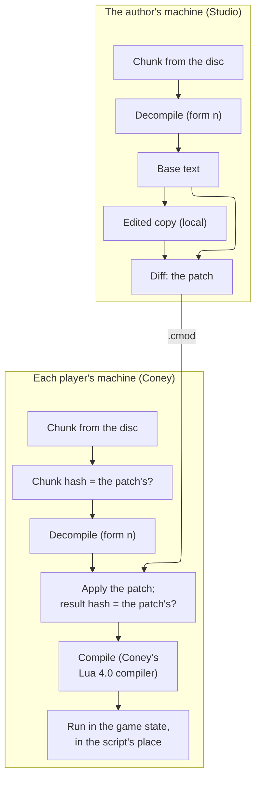

# Coney Studio: mission mods

The design of how a mod changes one of the game's own scripts, a mission's or any other: Studio decompiles the
script on the user's machine, the user edits it like any script, and the mod carries only the differences, which each
player's Coney applies to the script from their own disc, compiles and runs in the original's place. It covers how
well the decompiler does today, the patch format and the hash it is pinned to, two mods patching one script, the
compiler, the translator from Lua 4.0 to Lua 5.4 with an evidence-based verdict on it, the proof by trace equality,
Studio's flow and the order of the work, and the story graph through which a mod adds missions to the main story
without a patch. It ends with the build issues it proposes, in order. The parent issue is [#1054](issue:1054); this
page is [#1074](issue:1074), and its story graph [#1178](issue:1178).

**Status: design, two build issues built.** The first [build issue](#build-issues), the frozen decompile form, is
built, and so is build issue 4: the `.cpatch` format, applying, making and merging patches and the
`coney --script-patch` command line, described in [Script patches](../script-patches.md). The rest of this page is a
design in the sense of [Page kinds](../writing-docs.md#page-kinds): what is built moves into a guide. It builds on
[Coney Studio: the Lua SDK](lua-sdk.md) (the two runtimes, the [compiler](lua-sdk.md#compiler)), on [Lua 4.0
bytecode](../../research/formats/lua-bytecode.md) (the decompiler) and on the script security and mods design of
[#1062](issue:1062) ([Script security](security.md) and [Mods, packages and loading](mods.md)), whose `game-scripts`
permission this page's patches run under.

A maintainer decided the frame:

- **Decompile and edit directly.** Studio decompiles a script's Lua 4.0 bytecode on the user's machine, never hosted
  upstream, and the user edits it like any script.
- **Share only the differences**, as a ROM hack does. Each player's Coney applies them to the script from their own
  disc, compiles it and runs it in the script's place. No game script ever ships in a `.cmod`.
- **Pin to the script, not to a disc.** Coney installs from the PS2 and the Xbox discs, and a mission mod is tied to
  neither ([Which scripts a patch fits](#which-scripts)).
- **Lua 5.4 everywhere is preferred**, so that a user does not write new scripts in 5.4 and edit missions in 4.0; if a
  translator from 4.0 to 5.4 is too much trouble, 4.0 stays. **4.0 patching comes first**, and this page gives the
  verdict on 5.4 that the maintainer decides from ([The verdict](#verdict)).

## Contents {#contents}

1. [Terms](#terms).
2. [The decompiler today](#decompiler-today): the round trip on every script, and what is missing for mods.
3. [The pipeline](#pipeline): from the disc's chunk to the script that runs.
4. [Patches](#patches): the format, the hashes, which scripts a patch fits, refusals, two mods on one script.
5. [Compiling and running a patched script](#compiling).
6. [Lua 5.4: the translator](#translator): the syntax, the numbers and the other semantics, where a translated
   script runs, how it is proved, and [the verdict](#verdict).
7. [Studio's flow](#studio-flow).
8. [The story graph](#story-graph): the graph, the `[story]` section, anchors, merging, the Mods screen's story view,
   progress and saves, the test, and the questions for the user.
9. [The order of the work](#order), [What changes on other pages](#other-pages),
   [Maintainer decisions](#decisions), [Open questions](#open-questions).
10. [Proposed build issues](#build-issues), [How the numbers were found](#how-checked).

## Terms {#terms}

| Term | Meaning |
| --- | --- |
| **Game script** | One of the compiled Lua 4.0 chunks of the game's WAD: 467 on the PS2 disc, 503 on the Xbox ([Compiled Lua chunks](../../research/formats/lua-chunks.md)). Mission and level scripts, `global.lua`, the preloads, the menus and the language files are all game scripts |
| **Chunk hash** | The SHA-256 of a game script's bytes as the WAD stores them. It names the script's content, whichever disc it came from |
| **Base text** | The text a patch applies to: the decompile of a chunk in a fixed **form** (for 4.0), or that decompile translated to 5.4 in a fixed form (for 5.4). It is made on the user's machine and never leaves it |
| **Form** | A numbered version of the decompiler's output (or of the translator's). The same chunk in the same form always gives the same text, byte for byte ([Forms](#forms)) |
| **Edited copy** | The user's edited base text, kept in Studio's local cache (`.studio/`), never in the project's shared files and never in a package ([What is never in a project](project-formats.md#never)) |
| **Patch** | A `.cpatch` file (working name): the differences between a base text and an edited copy, holding only the author's own text and references to the base ([The format](#format)) |
| **Game state** | The Lua 4.0 state in which a level's game scripts run ([The two states](lua-sdk.md#two-states)) |
| **Trace** | The native calls a level's scripts make, step by step, with their arguments and results, and the engine's calls into the scripts by name ([Proof by trace equality](#proof)) |

## The decompiler today {#decompiler-today}

`coney-tools lua decompile --all --roundtrip` on the NTSC-U disc, run for this design (counts only; the command and its
output: [`lua`](../coney-tools-fidelity.md#lua)):

| Measure | Result |
| --- | --- |
| Chunks decompiled | 467 of 467 |
| Functions | 11,448, of which 0 could not be read |
| Round trip: compiled again with a stock Lua 4.0.1 `luac -s` and compared function by function (instructions, constants, parameters, vararg flag, stack size, nested functions) | 467 of 467 give the same code; 0 refused by `luac`, 0 compile to other code |
| Distinctive lines fingerprinted for the guard | 79,217 |
| Time | about 3 minutes |

So every game script on the PS2 disc decompiles to Lua that compiles back to exactly the original's code, as
[Lua 4.0 bytecode: round-trip results](../../research/formats/lua-bytecode.md#round-trip) also records. Studio can offer
every one of them for editing; it still checks each script on the user's machine before offering it
([Studio's flow](#studio-flow)), so a script from another disc that does not round-trip is never offered.

What is missing before a mod can patch a script:

- **A decompiler on the player's machine.** The decompiler is the `lua4` Python package under `python/`, a research
  tool. Coney and Studio are C++ programs that run without Python, and every player's Coney must make the same base
  text the author's Studio made. So the decompiler needs a C++ port that gives byte-identical output, and its output
  must be frozen ([Forms](#forms)).
- **Coney's compiler on edited code.** Coney compiles with its own Lua 4.0 compiler
  ([Coney's compiler](../../research/formats/lua-bytecode.md#compiler)), and on every unedited decompile it gives
  `luac`'s code: the round trip with `coney_luac` matches all 467 chunks
  ([Round-trip results](../../research/formats/lua-bytecode.md#round-trip)). Code a user writes is checked only as far
  as the fixtures and tests reach, so a construct that neither a disc script nor a fixture uses may still compile
  differently from `luac`; comparing such code against a stock `luac` is open.
- **What stripping removed.** Every chunk is stripped: local names are made up (`p1`, `l1`), there are no comments,
  and only function statements keep their lines
  ([What cannot come back](../../research/formats/lua-bytecode.md#what-cannot-come-back)). A user edits that text as it
  is; a rename the user makes is part of the edit and of the patch.
- **111 unnamed scripts.** Their WAD names are not recovered, so Studio shows them by the entry's hash
  ([Which scripts the unnamed chunks are](../../research/formats/lua-bytecode.md#q-unnamed-chunks)). A patch names its
  script by the entry's hash and its content by the chunk hash, so a missing name only makes it harder to find.

## The pipeline {#pipeline}



*Figure: a mission mod from the author's edit to the player's game; only the patch travels.*

## Patches {#patches}

### Why not a plain diff {#why-not-diff}

A unified diff (`diff -u`, `git diff`) carries the lines it removes and three lines of context around each change.
Those are lines of the game's script: a package holding them would ship game script text, which
[LEGAL.md](repo:LEGAL.md#no-game-data) and the maintainer's decision forbid. ROM hack formats solve the same problem:
BPS, for one, writes commands that copy from the source file the player already has and carries only the bytes the
author wrote. A Coney patch does the same for lines of text.

### The format {#format}

The format is built, with apply, make and merge: [Script patches](../script-patches.md) is its description and its
command line. A `.cpatch` is UTF-8 text, a header naming the chunk, the form and the hashes of the base text and the
result, then operations in base-line order that keep, drop, copy and rebuild base lines by number and add the author's
own lines. It keeps to four rules:

- **Only the author's text** appears in it. Everything taken from the base is a line range or a column range, so the
  patch reads as nothing without the player's own script.
- **Hashes, never text, for checking.** A dropped range carries its hash, so a patch checks every line it removes, and
  the whole result is checked against `result`.
- **Studio writes the smallest patch that keeps to that rule** ([Making a patch](../script-patches.md#make)): a line
  diff, in which an added line equal to a base line becomes a copy and a changed line that keeps most of a base line is
  rebuilt from it, so moving a function or changing one number carries none of the game's text. Before Export, Studio
  runs the guard's fingerprint check ([`lua`: the guard](../coney-tools-fidelity.md#lua)) on every file of the package,
  the patches included, and refuses to export one that holds three of five distinctive lines of a game script.
- **Line numbers are exact, never fuzzy.** The base text is the same byte for byte on every machine ([Forms](#forms)),
  so no operation needs context to find its place, and a patch that does not fit is refused, never applied
  approximately.

### Forms {#forms}

The base text must come out the same on the author's machine and on every player's, years apart. So the decompiler's
output is frozen in numbered forms:

- **Form 1 is today's output, and it is frozen** (built: [The frozen form](../coney-tools-fidelity.md#lua-form)).
  `coney-tools lua decompile --all` writes the SHA-256 of every script's decompile, and the list of 467 hashes (36 more
  from an Xbox disc, later) is committed in `research/lua-decompile-hashes.toml`: hashes of game text are allowed, the
  text is not ([LEGAL.md](repo:LEGAL.md#no-game-data)). The C++ decompiler must give the same hash for every script,
  checked by a disc test. The Python decompiler's check runs where the disc is (CI has none), so a change to its output
  is caught by the author's `lua decompile --all`, which fails naming the scripts.
- **A change to the output is a new form.** A decompiler fix that changes the text of any disc script makes form 2;
  Coney keeps producing every form a released patch names. With 0 unread functions and a full round trip today, there is
  little reason to change the output once patches ship.
- **The translator's output is frozen the same way** ([Translation is deterministic](#deterministic)).

### Which scripts a patch fits {#which-scripts}

A patch is pinned to the **chunk hash**, the content of the script, never to a disc.

- **PS2 and Xbox.** All 467 scripts of the PS2 disc are byte-identical on the Xbox disc, by SHA-1
  ([Xbox assets: Kinds of entry](../../research/xbox-assets.md#kinds-of-entry)). So a patch made from either disc
  applies to the other, unchanged: the chunk hash, the base text and the result are the same.
- **The Xbox's 36 scripts of its own.** A patch of one of them fits only an install that has it. On a PS2 install that
  script does not exist and nothing runs it, so the patch is **skipped** with a notice in the mod's details ("patch for
  an Xbox script; not used with this disc"), and the rest of the mod starts.
- **Other regions** (PAL and the rest) have not been compared. Each script is decided by its own hash: one that is
  byte-identical takes the patch, one that differs refuses it ([Refusals](#refusals)). A one-line disc check (the form
  hash list from that disc) will tell which scripts a region shares; it is an [open question](#open-questions) until
  someone runs it.
- **A patch for several bases.** An author who has two versions of a script (a region whose script differs) can put one
  section per base in the same `.cpatch`; Coney uses the section whose chunk hash matches.

### Refusals {#refusals}

Each check happens when a mod starts, before any of its scripts runs, so a mod never runs half-patched:

| Case | What the player sees |
| --- | --- |
| The script exists, with another chunk hash | The mod does not start: "*mod* changes `level99.lua` as it is on the PS2 and Xbox discs; the `level99.lua` of your disc is different, so this mod cannot run." The other mods start |
| The script does not exist on this install | The patch is skipped with a notice; the mod starts (above) |
| The patch names a form this Coney cannot produce | The mod does not start: "*mod* needs a newer Coney" |
| A dropped range's hash or the result hash differs | The mod does not start: the patch is damaged |
| The patched script does not compile | The mod does not start, with the compiler's message and line (only possible after a merge, [below](#two-mods)) |

### Two mods patching one script {#two-mods}

They are merged when their changes do not overlap, as `git merge` does, and the player is asked only when they really
overlap. All patches of one script share one base text (a 4.0 patch meeting a 5.4 one is lifted first,
[Translation is deterministic](#deterministic)), so their operations are compared on the same base lines:

- **No overlap: merged, without a question.** Changes to different base lines are applied together; two ranges that
  touch but share no line also merge, since exact line numbers leave no doubt where each goes. An identical change made
  by both is applied once.
- **A real overlap: the player chooses.** Two changes to the same base line, or two different insertions at the same
  place, are a conflict. The [Mods screen](ui.md#mods-screen) shows the two mods and the script, and the player keeps one
  mod's change for that place or disables one mod. The choice is recorded in `mods/enabled.toml` with both package
  hashes, so it is asked once, and again only when either mod changes.
- **Three or more** merge one at a time, in load order.

- **The merged script must compile.** Two changes that merge as text can still break each other (both define the same
  function); the result is compiled at once and, if it fails, the two mods cannot run together, and the message names
  both. Two changes that compile together but disagree in what they do cannot be detected, as for any two mods'
  scripts.

The merge itself is built ([Merging patches](../script-patches.md#merge)): it reports each conflict and keeps the side
a chooser picks. The Mods screen's question, the recorded choice and the compile of the merged script are build issue 5.

This replaces the mods page's earlier rule that two mods overriding one game script cannot both be enabled
([What changes on other pages](#other-pages)).

## Compiling and running a patched script {#compiling}

- **Compiled by Coney's Lua 4.0 compiler** ([Coney's compiler](../../research/formats/lua-bytecode.md#compiler), the one
  the [Lua SDK](lua-sdk.md#compiler) uses). This page adds one gate to it: **for every unedited decompile, Coney's
  compiler must produce the same functions as the disc's chunk**, compared as `--roundtrip` compares them (instructions,
  constants, parameters, vararg flag, stack size, nested functions). Lua 4.0's code generator is a fixed set of patterns
  ([The code generator's patterns](../../research/formats/lua-bytecode.md#patterns)), so a compiler written from them
  can match it. With that gate, a patched script differs from the original in exactly the lines the patch changed, and
  nowhere else. Coney's compiler keeps line information, so an error in a patched script names the line of the edited
  copy.
- **Run in the script's place.** The game state asks the script catalog for every script by name
  ([Three parts](../asset-and-script-architecture.md#script-parts)): the level entry (`global.lua`, then the level's
  script), `doFile` and `preLoadFile`. A patched script is a catalog provider that returns the compiled program instead
  of the disc's chunk, so it runs at the same moment, in the same state, with the same natives, schedule and handlers
  as the original would ([Life of the Lua state](../../research/scripting.md#life-of-the-lua-state)). Nothing else in
  the level changes.
- **Prepared once, when the mods start**: every patch applied, merged and compiled before the first level, so a broken
  patch is reported at start, never in the middle of a mission. The compiled programs are kept for the session.
- **A modded session.** A session with any patched script is modded: saves go to the modded folder and the run log
  says so, as for any mod ([Modded saves and replays](mods.md#saves-replays)). Patching game scripts is the
  `game-scripts` permission of [Script security](security.md#declared), which the player approves; Studio writes it into
  the manifest from the patches the project holds.
- **No bytecode from a mod.** A patch is applied to the player's own chunk and compiled from source by Coney; no mod
  ever supplies bytecode, which keeps [Script security](security.md#surface)'s rule that the game state runs only the
  player's own chunks and Coney's compiler's output.

## Lua 5.4: the translator {#translator}

A maintainer prefers Lua 5.4 everywhere: projects are written in 5.4 ([The runtime](lua-sdk.md#runtime-choice)), and
editing missions in 4.0 beside them is inconsistent. A translator would turn a game script's 4.0 base text into 5.4,
and the mission would be edited and run in 5.4. This section says what that takes, from the disc's own numbers.

### What the game's scripts use {#what-scripts-use}

The disc makes the translator smaller than a general 4.0-to-5.4 translator would be (disc checks, counts only:
[How the numbers were found](#how-checked)):

| Feature | On the disc | Meaning for the translator |
| --- | --- | --- |
| Upvalues (`%name`) | 0 uses | Nothing to translate; 4.0's copied upvalues never meet 5.4's shared ones ([Lua 4.0 bytecode](../../research/formats/lua-bytecode.md#the-instruction-set)) |
| Vararg functions (`...`, `arg`) | 0 | Nothing to translate |
| Lua library functions | 12 names: `strsub` 21 reads, `type` 13, `tinsert` 12, `strlen` 12, `max` 9, `min` 6, `getn` 5, `strfind` 4, `abs` 2, `tremove` 1, `mod` 1, `tonumber` 1 | A short table of mappings; no `format`, `tostring`, trigonometry, tag methods or `dostring` at all (`random`, read 343 times, is a game native) |
| `true` and `false` | read 8,669 and 6,006 times; set once each, in `global.lua`, to 1 and nil | 5.4 makes both reserved words with other values ([Booleans](#booleans)) |
| Table loops `for k, v in t do` | 2,504 | 5.4 spells them `for k, v in next, t do`; their order is the open risk ([Iteration order](#order-risk)) |
| Numeric `for` loops | 826, about 9 of which assign their own control variable | In 4.0 that changes the loop; in 5.4 it does not ([Syntax](#syntax)) |
| Concatenations | 7,175 | Numbers turned into text must read as 4.0 writes them ([Numbers](#numbers)) |
| Divisions | 219 | Same results in both: `/` is float division in each |
| 5.4 reserved words used as names | `goto` appears once, as a string constant | Written `t["goto"]` if it is a field name |

### Syntax {#syntax}

The translator reads the 4.0 base text with Coney's Lua 4.0 parser (the compiler's front end) and writes 5.4,
**line for line**: each 4.0 line becomes one 5.4 line, so a 4.0 patch's line numbers hold on the 5.4 base.

| Lua 4.0 | Lua 5.4 |
| --- | --- |
| `for k, v in t do` | `for k, v in next, t do` (raw traversal, as 4.0's; `pairs` would honour a `__pairs`) |
| `for i = a, b, c do` whose body assigns `i` | a `while` loop on the same line (4.0's loop steps the variable the body changed; 5.4's control variable is a copy) |
| `%name` upvalue, `...` and `arg` | not on the disc; translated to a local captured by the closure and to `...` with `local arg = table.pack(...)` for scripts users write |
| `strsub`, `strlen`, `strfind`, `type`, `max`, `min`, `abs`, `tonumber` | `string.sub`, `string.len`, `string.find`, `type`, `math.max`, `math.min`, `math.abs`, `tonumber` (the same results for the arguments the disc passes) |
| `getn`, `tinsert`, `tremove`, `mod` | `lua40.getn`, `lua40.tinsert`, `lua40.tremove`, `lua40.mod`: a small helper table of the game state that keeps 4.0's rules (as Lua 4.0.1's `lbaselib.c` defines the first three: `getn` reads a table's `n` field first; `tinsert` and `tremove` keep `n` up to date; and its `lmathlib.c` the last: `mod` is C's `fmod`, NaN for a zero divisor where 5.4's `math.fmod` raises an error on integers) |
| `true`, `false` (globals) | `1`, `nil` ([Booleans](#booleans)) |
| a field named by a 5.4 reserved word | `t["goto"]` |

### Numbers {#numbers}

Lua 4.0 has one number type, a double. Lua 5.4 has integers and floats. Where that shows:

| Operation | Lua 4.0 | Lua 5.4 | Risk and answer |
| --- | --- | --- | --- |
| Division `a / b` | double | always a float | none |
| `+ - *` on whole numbers | double, exact to 2^53 | integer, wraps at 2^63 | none for the values scripts hold (counts, handles, ids, milliseconds) |
| A number made text (`..`, `tostring`) | `%.16g`: `3`, `0.3333333333333333` | an integral float shows `3.0`; `%.14g`: `0.33333333333333` | **real**: a name built as `"vMark0" .. n` or a message with a number differs as soon as `n` is a float. Answer: the translator wraps each concatenation operand that is not a string literal in `lua40.str`, which writes a number as 4.0 does; the trace catches any miss, since strings passed to natives are compared byte for byte |
| Comparison of numbers | doubles | integers and floats compared by value | none |
| Table keys | `t[2]` and `t[2.0]` are one key | 5.4 turns a float key with an integral value into the integer key | none |
| `string.format("%d", 2.5)` | truncates | raises an error | not on the disc (no `format` call) |
| Numbers from natives | doubles | the game-state bridge hands a whole number as an integer, anything else as a float | none for arithmetic; text is covered by `lua40.str` |

### Booleans {#booleans}

Lua 4.0 has no booleans: `global.lua` sets the globals `true` to 1 and `false` to nil, scripts pass them to natives and
test them, and a comparison used as a value gives 1 or nil. In 5.4, `true` and `false` are reserved words with boolean
values, and `1 == true` is false. So the translator writes `1` and `nil` where the base reads `true` and `false`, drops
`global.lua`'s two assignments, and writes a comparison or `not` used as a value (rare on the disc: 2 comparison values,
3 `and`/`or` values) as `(... and 1 or nil)`. Natives in the 5.4 game state take and return 1 and nil as in 4.0, never
booleans. A translated mission therefore reads `HuSetSomething(h, 1)` where a project would write `true`: honest about
the game's own values, and the one visible difference from a project's 5.4.

### Iteration order {#order-risk}

The one difference that is not mechanical. A loop over a table visits its keys in an order the language does not
specify, and the order can decide which native is called first (which human spawns first, and so which handle it
gets):

- the **original** game uses Lua 4.0's hash order;
- **Coney's 4.0 VM** visits keys in the order they were first set, its own choice
  ([Front end: Coney's implementation](../../research/frontend.md#coneys-implementation));
- **Lua 5.4** visits a table's array part in index order and its hash part in its own hash order.

For a list built in order (`{a, b, c}`, or filled 1, 2, 3, ...), all three agree. They can differ for a table with
string keys, and for a list that `tinsert` gave an `n` field. How many of the 2,504 loops iterate such tables with an
effect that depends on the order is not known; [the probe](#probe) measures it. For each loop that differs, the
translator has two answers: when the order is a function of the keys (a list, ascending), an ordered traversal
(`lua40.inorder`); otherwise the order of the constructor that built the table, which the translator can read when the
table is made from a literal and never grown. A loop that needs neither cannot be translated faithfully, and its level
is not offered in 5.4.

### Where a translated mission runs {#where-it-runs}

Lua 5.4 cannot run in the 4.0 game state, and the level's scripts share one state: the level script calls
`global.lua`'s helpers, reads the preloads' tables and the language file's strings. So a mission in 5.4 means its
**whole game state** is in 5.4:

- **A 5.4 game state, per level.** When a level has a 5.4 patch from an enabled mod, Coney makes its game state as a Lua
  5.4 state (the [build settings](lua-sdk.md#lua-build) of the SDK: fixed hash seed, fixed sort pivot, Coney's
  allocator) instead of the 4.0 one, and runs in it the translation of every script the level loads: `global.lua`, the
  level's script, what `doFile` and `preLoadFile` ask for, each from its own disc chunk through the frozen decompile and
  translation forms, or from a mod's patch. Every other level runs in 4.0 as always, since a level unload destroys the
  game state anyway ([Life of the Lua state](../../research/scripting.md#life-of-the-lua-state)).
- **Patched 4.0 scripts in a 5.4 level** are translated after patching, so a mod with a 4.0 patch of `global.lua` and
  another with a 5.4 patch of a mission run together.
- **The natives through a game-state bridge.** The same native list as the 4.0 state, with 4.0's conventions: numbers,
  strings, nil, tables written back after the call, callbacks by name, 1 and nil for truth. It is the
  [value bridge](lua-sdk.md#bridge) of projects with the boolean row changed, so one bridge serves both.
- **The same scheduler.** Level entry, the update function, scheduled calls, message handlers, animation callbacks and
  triggers reach the 5.4 game state at the same points as the 4.0 one, through the one `ScriptScheduler`
  ([Three parts](../asset-and-script-architecture.md#script-parts)).
- **Still apart from projects.** A translated mission runs in the game state, not in a project state: the
  [two states](lua-sdk.md#two-states) rule holds, and a project's scripts still reach a mission only through natives.

### Translation is deterministic {#deterministic}

The translator is a pure function of the 4.0 text and its own form number; the decompile is a pure function of the
chunk and its form. So the 5.4 base text of a script is fixed by its chunk hash and the two form numbers, the same on
every machine, and a patch against it applies everywhere, as a 4.0 patch does. Its forms are frozen as the decompiler's
are ([Forms](#forms)): the hash of every script's translation is committed, and a change is a new form.

Because the translation is line for line, a 4.0 patch can be **lifted** to 5.4: translate the base and the patched text
and take their difference. Studio does that when a user converts a mission to 5.4, and Coney does it when a 4.0 patch
must meet a 5.4 one ([Two mods](#two-mods)).

### Proof by trace equality {#proof}

A script reaches the game only through natives and the engine reaches a script only by calling it by name
([Calling Lua from C++](../../research/scripting.md#calling-lua-from-c)). So two runs whose traces are equal (the same
native calls, in the same order, with the same arguments and results, step by step, and the same calls into the scripts)
did the same thing to the game. That is the parity test the architecture page sets for Coney's own level rewrites
([Three parts](../asset-and-script-architecture.md#script-parts)), and the translator uses the same one:

- **The trace.** Recorded by a call tracer that wraps every native in the native list (the list is the
  [Lua SDK's first build issue](lua-sdk.md#build-issues); the tracer is step 4 of the architecture page's
  [deferred order](../asset-and-script-architecture.md#later), built here as issue 10): the step, what started the
  script (level entry, update, scheduled call, message, callback, trigger), each native's name, arguments and results
  as `script::Value`s, tables in full (today's `--script-trace` shows a table as `{table}`,
  [Event logs](../running-play-level.md#event-log)), and each call into the scripts. Values are compared as the natives
  see them, so 5.4's integer and float subtypes do not show, and strings are compared byte for byte.
- **Playthrough runs.** Every [playthrough test](../testing.md#playthrough-tests) of a level runs twice, with the disc's
  scripts in the 4.0 game state and with their translations in the 5.4 one, the same input script and seed, and the two
  traces must be equal at every step. The front end's scripted run is compared the same way.
- **Differential runs on every script.** A fake native host answers every native from a seeded generator, by the result
  type the masterlist gives; each function of each script is called with seeded arguments in both runtimes, many seeds
  each, and the traces compared. It needs no playable mission, so it covers all 467 scripts (503 with an Xbox disc) and
  branches no playthrough reaches, and it reports which functions and jumps it reached.
- **The gate.** Studio offers a level's 5.4 form only when its differential runs agree on every function and, where
  Coney plays the mission, every playthrough test's traces are equal. Shared scripts (`global.lua`, the preloads, the
  language files) run in every level, so their 5.4 forms are offered last, once every level that runs them passes.
  Studio thus reflects Coney: a level gains its 5.4 form when Coney proves it, and the playthrough runs reach only as
  far as Coney plays each mission ([Missions](../../missions/index.md) has their status).

What the traces **prove**: on the runs made, the translated scripts behave exactly as the 4.0 scripts do in Coney.
What they **do not prove**: paths no run reached (the differential runs' coverage says how much is left); anything about
the original game, since the reference is Coney's 4.0 VM running the disc chunk, whose own fidelity is checked by the
[runtime comparison](../testing.md#runtime-comparison); and a mod's own 5.4 code, which needs no proof, being the
author's 5.4 by intent.

### The probe {#probe}

The verdict below rests on numbers the bytecode alone cannot give: how many loops differ in order, how many
concatenations need `lua40.str`, whether any construct escapes the mapping. A probe finds them cheaply, before any
engine work, with tools that exist: the `lua4` package's syntax tree written out as 5.4 by a second renderer, every
translation checked by a stock `luac` 5.4, and differential runs of all 467 scripts under a stock Lua 4.0.1
interpreter (built from the same pinned source as the `luac` of `workspace init --fetch lua`) and a stock Lua 5.4,
each with the same fake natives written in Lua. It prints counts only: scripts that translate and parse, functions
whose traces agree, loops whose order differs between 4.0's hash order, first-set order and 5.4's order. For string
and number keys the stock 4.0 interpreter's order is the original's (the game links the same table code, and those
keys hash by value), so the probe also shows how often Coney's first-set order departs from the original's. That holds
only for an interpreter built with a 32-bit `long`, as the PS2's is: Lua 4.0 hashes strings in an `unsigned long`,
which a 64-bit Linux or macOS build widens, sending long string keys to other slots.

### The verdict {#verdict}

**Feasible, and worth doing after 4.0 patching, if the probe confirms the iteration order is contained.**

| Part | Effort | Risk | Evidence |
| --- | --- | --- | --- |
| The syntax mapping | S | Low | No upvalues, no varargs, 12 library names, one reserved word ([What the game's scripts use](#what-scripts-use)); built on the compiler's parser and a 5.4 renderer |
| Numbers and booleans | S to M | Low to medium | Mechanical rules and the `lua40` helpers; every miss shows as an unequal string or value in a trace |
| Iteration order | unknown: S if few loops differ, L if many | **The real risk** | Not measurable from the bytecode alone; [the probe](#probe) measures it |
| The 5.4 game state and its bridge | M to L | Medium | Shares the project runtime's build and bridge ([Lua SDK build issue 2](lua-sdk.md#build-issues)); the scheduler and callbacks are the existing entry points, reached through one `ScriptScheduler` |
| The proof (traces, the fake host, both runs) | M | Low | The same parity test Coney's own level rewrites need; nothing is built only for the translator |
| Keeping it | ongoing | Low | Two forms to freeze and two game-state runtimes to keep; the faithful game stays on 4.0, so a bug in the 5.4 state touches only levels a mod put there |

Taken together, about the size of the Lua 4.0 compiler (M to L, [Risks](../asset-and-script-architecture.md#risks)),
and most of it is shared with work already planned. The cost the maintainer would accept with 5.4: a second game-state
runtime kept for the life of the project, and translated missions that read slightly unlike a project's 5.4 (1 and nil
for truth, `lua40.str` in concatenations). What 5.4 buys: one language for every script a user touches, and Studio's
completions, errors and debugger on missions as on projects, since lua-language-server cannot read 4.0
([Language tooling](technology.md#language-tooling)).

**The decision rule**, from the probe's counts: go to 5.4 when the differential runs agree on every function once the
mechanical rules are in, and the order-dependent loops are few enough to translate by the two answers above. Keep 4.0
when the order-dependent loops are many or need history the translator cannot see. Either way 4.0 patching is built
first and stays: it is what a 5.4 patch falls back to for a level not yet proved, and its pieces (the decompiler in C++,
the compiler, the patch format, the catalog provider) are the translator's foundation.

A third way was weighed and set aside: **5.4 syntax over the 4.0 runtime**, a 5.4-looking text compiled back to 4.0 and
run in the 4.0 game state. It avoids the order and number risks and gives the language server something to read, but
it is a dialect: `true` would be 1, `//` and integers would not exist, and a user would meet a language that looks like
5.4 and behaves like 4.0, which is the inconsistency the maintainer wants to remove.

## Studio's flow {#studio-flow}

Studio's panels and editor are the [editor experience](editor-experience.md#panel-list) and [technology](technology.md)
pages', and the project folder and the `.cmod` are [Project formats](project-formats.md)'; this is what they do with
game scripts.

1. **Open.** The File system panel shows the install's game scripts under `game:/scripts/`
   ([Paths](content-and-formats.md#paths)), by name (the 111 unnamed by hash), with the mission each belongs to. The
   first time a script is opened, Studio checks it on this machine: decompile in the current form, compile with Coney's
   compiler, compare with the chunk. A script that does not round-trip is shown greyed with the reason and cannot be
   edited. The result is kept by chunk hash in Studio's local cache. This is the edit that [Missions and
   scripts](content-and-formats.md#missions) leaves to this page: there a disc script is shown as its functions and the
   natives they call; here it opens as source.
2. **Edit.** Opening a script for editing makes the edited copy in the project's local cache (`.studio/`, [The project
   folder](project-formats.md#formats): never exported, and listed in the `.gitignore` Studio writes, so a project
   shared through git carries no game text) and opens it in the script editor: in 4.0, or in 5.4 when the level's 5.4
   form is offered and the user chose it. A *Compare with original* view shows the edited copy beside the base text.
3. **Save.** Studio writes the edited copy, compiles it (errors in the Problems panel with their lines) and writes the
   patch into the project's shared files (`patches/<name>.cpatch`), adding the script to the manifest's `game-scripts`
   permission. Only the patch is the project's; a project opened on another machine rebuilds the edited copy from that
   machine's disc and the patch.
4. **Play.** Play applies the project's patches to the install's chunks exactly as a player's Coney does, so what the
   author tests is what players get. Play with other mods enabled shows any merge conflict as the mods menu would. A
   saved game script **restarts the level, not the project**: the game state is made per level, so a patch reaches it
   only when the level starts again ([the table below](#which-kind), [Project restart on
   save](lua-sdk.md#project-restart)).
5. **Convert to Lua 5.4.** For a level whose 5.4 form is offered: the patch is lifted ([Translation is
   deterministic](#deterministic)) and the edited copy reopens in 5.4.
6. **Export.** The `.cmod` ([The `.cmod` package](project-formats.md#cmod)) holds the patches and the manifest, as
   it holds the project's other files; Export refuses a package that holds a decompiled script,
   the guard's marker or three of five fingerprinted lines in any file ([The format](#format)).

### Which kind of script a file is {#which-kind}

The editor decides by the file's root, so there is no mode to choose:

| | A `project:/` script | A `game:/scripts/...` script |
| --- | --- | --- |
| What it is | The project's own Lua 5.4 file | A game script, Lua 4.0 (or its 5.4 form where offered), opened read-only |
| Saved as | Itself, in the project | A patch, `patches/<name>.cpatch`, from the local copy in `.studio/` that editing makes |
| Natives | The SDK's: available game natives and the `Coney` table ([How a native reaches the SDK](lua-sdk.md#availability)) | The game state's natives, as the original's scripts have them |
| Runs | In the project's state ([The two states](lua-sdk.md#two-states)) | In the game state, in place of the original ([Compiling and running](#compiling)) |
| A save, with *On script save* on *Restart project* | Restarts the project | Restarts the level, the smallest restart it needs |
| A save, with *On script save* on *Restart level* | Restarts the level | Restarts the level |
| In the editor | Nothing extra | A *Compare with original* view and a banner, "Game script, saved as a patch" |

Patches are project files and go in the `.cmod` with the project's other files; what never does is the decompiled text
of a game script ([Export, step 6](#studio-flow)). Opening a `game:/` script and not editing it changes nothing.

## The story graph {#story-graph}

How a mod puts a mission into the main story without patching a game script: the story's order becomes Coney's own
data, seeded with exactly the original's, and a mod places its missions in it from its manifest, as a Minecraft
advancement names its parent and a Factorio technology its prerequisites. The user approved the frame
([#1178](issue:1178)). Without mods the graph is the original's order and the story plays as the PS2's.

**Why a patch is not enough.** The original keeps its order in two `global.lua` tables, `runNextMission`'s 20 rows and
`findLastMission`'s 19 levels, in the hub's `fRunMission` (one mission per chapter) and in fixed comparisons with the
hub's chapter number; progress is the profile's per-level completion bits, and the best records and the menus are
sized for the original's missions ([Story progress](../../research/story-progress.md#readers) lists every reader). A
mission added by patches would need a patch of `global.lua` and of the hub, a completion bit it does not have, and two
story mods would meet as overlapping text in the same three tables.

### The graph {#graph}

The story is a **chain of steps**, each either a **mission** (a level entered at checkpoint 1) or a **hub chapter**
(`level95` at a checkpoint). The original's chain, from [Story progress: the order](../../research/story-progress.md#order):

`level99`, `level80`, `level87`, `hub:1`, `level34`, `hub:2`, `level2`, `hub:3`, `level3`, `hub:4`, `level5`, `hub:5`,
`level81`, `hub:6`, `level86`, `level93`, `hub:7`, `level31`, `hub:8`, `level14`, `hub:9`, `level9`, `hub:10`,
`level51`, `level52`, `level54`, `level55`, `level84`, `hub:11`, `level64`, `hub:12`.

- **Ids.** An original mission's id is its level name (`level80`); a hub chapter's is `hub:<n>`; a mod's mission is
  `<mod>.<id>` (`yard-brawl.alley`), so two mods never share an id.
- **How a step is entered.** A mission after a mission is loaded by `runNextMission`; a mission after a hub chapter is
  the chapter's offer (its last action loads it); a hub chapter after a mission is loaded by `runNextMission` at its
  checkpoint. `level64` is a **side step**: it is reached through the Armies stages, never from `hub:11`, but it sits in
  the chain so that it counts as later than `level84`, as `findLastMission` has it.
- **What the chain gives.** The three tables the scripts read are views of it: `runNextMission`'s rows (each mission to
  the step after it, plus 0 to the first), `findLastMission`'s list (the missions, last first) and `fRunMission` (each
  chapter to the mission after it). The seed is a table of level numbers and chapter numbers in Coney's code, our own
  data ([LEGAL.md](repo:LEGAL.md#no-game-data)).
- **Who owns it.** The graph is session state of the story game mode, built once when the session's mods start and
  fixed until they stop; every machine of a co-op session builds it from the same mods in the same order, and its hash
  joins the mod list a session checks ([Coney's model](mods.md#mp-model)).

### The natives that read it {#graph-natives}

Two natives take the names of the two `global.lua` functions, and Coney sets them over the script's own after
`global.lua`'s main chunk runs at each level load. Each is `@coney-only` and names the Lua function it replaces
([Coney-only code](../conventions.md#coney-only)); the two Lua callers, `UnlockAndLoad` and
`MissionCompleteUnlocks`, stay the game's and reach them by name, as do the front end, the Rumble arenas and the four
native menus ([Who calls them](../../research/story-progress.md#callers)).

- **`findLastMission()`** walks the chain's missions from the end and returns the first that is complete: an original
  mission by its completion record, as the original asks, a mod's by its id ([Progress](#graph-progress)). It returns a
  level number, as the original does, since `LastLevel` holds it.
- **`runNextMission(arg)`** looks up the step after `LastLevel` (setting it from `findLastMission()` when it is 0 or nil)
  and does what the original's row does: `SetCheckPoint`, stop the music, `MenuLoadLevel`, and the mission-complete
  launch when `arg` is 1. With no step after it (the original's missing row) it loads nothing, as the original's call
  of a name no binding has does.
- **The hub's offer.** When the hub loads, Coney writes the chain's offer for the chapter into `fRunMission[checkpoint]`
  after `level95.lua`'s main chunk, so `story.RunMissionAction` loads it unchanged; for the original chapters the row
  written is the one already there.
- **Mod levels get numbers.** The scripts pass levels as numbers (`Level`, `LastLevel`, `MenuLoadLevel("level" ..
  n)`, `UM_IsLevelComplete(n)`), so each mod mission gets a level number for the session, from 1000 up in chain
  order, and a level record under the name `level<n>` that loads the mod's level. The number is never saved: saves,
  replays and messages use the id.

### The manifest's `[story]` section {#story-manifest}

```toml
[[story.missions]]
id     = "alley"                   # becomes "yard-brawl.alley"
title  = "Alley Cats"              # what the menus show
level  = "levels/alley.clevel"
script = "missions/alley.mission"  # optional: a level may carry its own scripts
after  = "level80"                 # the anchor: an original mission, a hub chapter or another mod's mission
before = "level87"                 # optional guard: refused if the step after the anchor is not this one
area   = "Coney"                   # optional: the mission menu's area; the anchor's area when left out
label  = 2                         # optional: the number shown and sorted on; the anchor's when left out

[[story.missions]]
id      = "docks"
level   = "levels/docks.clevel"
after   = "hub:6"                  # chapter 6 offers it, and a new chapter follows it
chapter = "hub/docks-return.lua"   # optional: the new chapter's own actions

[[story.missions]]
id      = "payin"
level   = "levels/payin.clevel"
replace = "level86"                # takes level86's place in the chain
```

A mission names exactly one of `after` and `replace`. A project with a `[story]` section is a story mod: while it is
enabled every story game is a modded session ([Modded saves and replays](mods.md#saves-replays)), whatever its
`autostart`, and its scripts run when its missions' levels do.

### Anchors {#anchors}

| Anchor | Where the mission goes | What follows it |
| --- | --- | --- |
| `after = "<mission>"` | Right after that mission: `runNextMission` loads it where it loaded the next step | The step that followed the anchor |
| `after = "hub:<n>"` | Chapter *n*'s offer: the chapter's last action loads it | A **new hub chapter**, `hub:<n>.<mod>.<id>`, which offers what chapter *n* offered |
| `replace = "<mission>"` | In that mission's place, entered the same way | The same step as before; the original mission no longer plays in the story |

- **A new hub chapter** loads the hub at chapter *n*'s checkpoint, so the hub's own scripts see the story's time they
  expect: the chapter number is also the clubhouse's state, the chatter, the streets' collectables, spawners and cops
  ([The hub](../../research/story-progress.md#hub)), and a new chapter is a point in that time, not a thirteenth one.
  It runs the mod's `chapter` script when the mod has one; without one, Coney's default chapter sets chapter *n*'s
  crew and environment and puts a red circle at the next mission's giver, whose action loads it, with no cut-scene.
- **Anchoring on a replaced mission** places the mission after its replacement, since the anchor names a place in the
  story.
- **Hub chapters 11 and 12** offer nothing in the original; a mission after either is a mission after the story's end.

### Merging and refusals {#graph-merge}

The graph is built when the mods start, before any script runs, from the seed and each story mod's missions, mods in
load order ([Load order](mods.md#load-order)) and each mod's missions in manifest order:

- **Two missions on one anchor** go in load order: the first placed nearest the anchor, the next after it. The Mods
  screen can swap them, and the swap is kept in `enabled.toml` with both package hashes, as a script merge choice is
  ([Two mods patching one script](#two-mods)).
- **A missing anchor** (an id no step has, a hub chapter outside 1-12, a mission of a mod that is off or refused)
  refuses that mission with a message naming the mod, the mission and the anchor ("yard-brawl.alley: no story step
  'level70'"); the rest of the story plays. A mission anchored on a refused one is refused the same way.
- **A `before` guard** refuses the mission when, at its turn in the merge, the step after its anchor is not the one
  named: another mod has moved in, and the author asked to be told.
- **A cycle** (`a` after `b`, `b` after `a`) refuses every mission in it, with one message naming the cycle, as a
  dependency cycle does ([Dependencies](mods.md#dependencies)).
- **Two replacements of one mission**: the first in load order takes the place and the other is refused, until the
  player chooses on the Mods screen ([For the user](#graph-questions)).
- **A mission whose level or script is missing** from the package is refused at the mod's check, before the merge.

Without story mods the merge is the seed and nothing else: no question is asked and nothing is written.

### The Mods screen's story view {#graph-mods-screen}

The [Mods screen](ui.md#mods-screen) gains a **Story** list when any enabled mod has a `[story]` section: the merged
chain in order, original steps in the game's colours and each mod's missions under its title, with three marks:

- **Shared anchor**: two or more missions placed at one anchor, with *Swap* to change their order.
- **Replaced**: an original mission another mission stands in for, and, for two replacements, the choice between them.
- **Refused**: each refused mission with its message, so a player sees why a mission is missing without a log.

### Progress, records and saves {#graph-progress}

- **Original missions keep the original's records.** Their completion is the `(level, 0, 0)` record and their rank
  records follow `MissionCompleteUnlocks`, as without mods; their best records keep their 30 slots.
- **A mod mission's progress is keyed by its id.** `MissionCompleteUnlocks` runs for it as for any level; Coney maps
  `UM_Unlock` and `UM_IsLevelComplete` on a mod level's number to the save's **story section** of the new save format
  ([#1179](issue:1179)), which keeps, per id: complete or not, the rank records, and a best record with the original's
  fields (score, total time, grade, percentage). Nothing of a mod mission goes into the 640 unlock bits or the 30 slots.
- **What the original forgets stays forgotten.** No checkpoint within a mission is saved, so a mod mission that was
  quit starts again at checkpoint 1 through the chain, as an original one does. A mod that wants to resume at a
  checkpoint saves it itself with `Coney.SaveData` and reads it when its level starts.
- **Where it is saved.** A story with mod missions is a modded session, so its saves go to `modded/` with the mod list
  ([Modded saves and replays](mods.md#saves-replays)). A save loaded without one of its story mods keeps that mod's
  section (#1179 keeps a section a session does not know), and `findLastMission` skips ids the chain lacks, so the story
  goes on from the latest mission present; the warning names the missing mod.

### The other readers {#graph-readers}

Each reader in [Story progress: every reader](../../research/story-progress.md#readers) is met:

| Reader | With the graph |
| --- | --- |
| `runNextMission`, `findLastMission` | The natives above |
| `fRunMission`, read by the chapter's last action and the "new" camera | The offer written into the row at hub load; a mod mission's giver is the flag of the chapter's own offer |
| The chapter number's fixed comparisons | A new chapter keeps chapter *n*'s number |
| The mission menu: completed levels by area, sorted by label | A completed mod mission is listed in its `area`, sorted by its `label`; it needs the ported screen ([#1071](issue:1071)) |
| The statistics list, by mission byte | Mod missions follow the original's, in chain order |
| The 30 best records, by mission byte | Mod missions' records are the story section's |
| `UM_IsLevelComplete(84)` (the menu music, the trophy zone) and the flashback requirement | Unchanged: they name original missions |

### The test that the unmodded graph is the original's {#graph-test}

Written first, before the natives:

- **The views.** The seeded graph's `runNextMission` rows equal the 20 of `global.lua:f61`, its `findLastMission` list
  the 19 of `global.lua:f62`, and its offers the 12 rows of `fRunMission`, each expected value cited from
  [Story progress](../../research/story-progress.md#global-functions).
- **The walk.** From an empty profile, the natives choose a level, the test marks it complete (a hub chapter "plays" by
  loading its offer), and the 29 steps it loads up to `hub:11` equal the chain above; with `level64` then complete,
  every later completion leads to `hub:12`.
- **Against the disc.** A disc test runs the disc's own `global.lua` in a game state with a fake profile and, for every
  prefix of the story complete (and nothing, and `level64` alone), compares the level and checkpoint the Lua
  `runNextMission` asks for with the native's; it prints the count of equal cases only.
- **Merging.** Synthetic manifests: an `after` on a mission and on a hub chapter, a replacement, two mods on one anchor
  in both load orders, a missing anchor, a failed `before`, a cycle and two replacements of one mission each give the
  chain and the messages expected; with no story mod the graph's hash equals the seed's.

### For the user {#graph-questions}

- **For the user: the natives without mods.** The design sets the two natives in every session, so there is one path,
  proved equal to the original by the disc test. The other choice is to leave the game's own Lua functions in place
  when no story mod is enabled, so an unmodded game runs the original's tables exactly, at the cost of two paths.
  Which does the user want?
- **For the user: two replacements of one mission.** The design lets the first in load order win and the Mods screen
  offer the choice. Should both be refused instead until the player chooses?
- **For the user: a new hub chapter without a script.** The design's default chapter is chapter *n*'s environment and a
  red circle at the next giver, with no cut-scene. Is that enough, or should a mod that anchors on a hub chapter have to
  bring its own chapter script?
- **For the user: mod missions on the original's screens.** The design lists completed mod missions on the mission menu
  (by `area` and `label`) and the statistics screen (after the original's). The other choice keeps those screens to the
  original's missions and lists mod missions only at the Mods screen's `missions` point. Which does the user want?

## The order of the work {#order}

1. **4.0 patching**: the frozen form and the C++ decompiler, the compiler with its round-trip gate, the patch format with
   apply and merge, patched scripts in the game state, then Studio's flow. Useful on its own, and the foundation of the
   rest.
2. **The probe**, which needs no engine work and may run as early as a maintainer wants its numbers. With its counts
   the maintainer decides between 5.4 and staying on 4.0 ([The verdict](#verdict)).
3. **If 5.4**: the translator, the 5.4 game state, the trace proof, and Studio offering each level's 5.4 form as it
   passes.

## What changes on other pages {#other-pages}

When this design is accepted:

- [The Lua SDK: the Lua 4.0 compiler](lua-sdk.md#compiler): "script overrides, a user's replacement of a disc script"
  become patches of the disc script; the compiler gains the gate that it reproduces `luac`'s code for every decompile,
  and its parser serves the translator. [The runtime](lua-sdk.md#runtime-choice): the game state may be a 5.4 state for
  a level a mod translated, if the maintainer chooses 5.4.
- [Asset and script architecture: Three parts](../asset-and-script-architecture.md#script-parts): the *mod* provider of
  the script catalog is a patched script (and, with 5.4, a translated one), not a file from `overrides/scripts/`.
- [Mods: Load order](mods.md#load-order) (done there): two mods' patches of one script merge, and the
  player chooses only on a real overlap ([Two mods](#two-mods)), instead of being refused.
- [Script security](security.md#build-issues) (done there): its build issue 12 keeps only the safety rules around this
  page's issue 5; the `.cpatch` parser joins the parsers it fuzzes.
- [UI and menus: the Mods screen](ui.md#mods-screen): the choice the player makes on a real overlap between two
  mods' patches of one script, recorded with both package hashes ([Two mods](#two-mods)).
- [Editor experience: the panels](editor-experience.md#panel-list): the File system panel lists the install's game
  scripts under `game:/scripts/`, with each script's round-trip result, for editing ([Studio's flow](#studio-flow)).
- [Project formats](project-formats.md#formats): the project folder gains `patches/` (the `.cpatch` files), which the
  [`.cmod`](project-formats.md#cmod) holds as they are.
- [Content and formats: Paths](content-and-formats.md#paths): a project names the disc it was made against, but its
  patches are pinned to each script's chunk hash, so a patch fits any install whose script matches
  ([Which scripts a patch fits](#which-scripts)). [Missions and scripts](content-and-formats.md#missions): a disc script
  can also be opened as source for a patch ([Studio's flow](#studio-flow)).
- [Lua 4.0 bytecode](../../research/formats/lua-bytecode.md#round-trip) and [`lua`](../coney-tools-fidelity.md#lua):
  the form hash list and the C++ decompiler, once built.

## Maintainer decisions {#decisions}

1. **Decided: the frame at the top of this page**: decompile and edit, share only differences, pin to the script and
   not the disc, merge two mods' patches and ask only on a real overlap, 5.4 preferred, 4.0 first.
2. **To decide after [the probe](#probe): Lua 5.4 for missions or Lua 4.0**, from [the verdict](#verdict) and the
   probe's counts.
3. **Faithful first: decided, no exception needed** ([Studio's decisions](index.md#decisions)). Studio offers a script
   for editing, and a level's 5.4 form, only once Coney has what it needs (the round trip, the compiler, the proof), and
   a patched script makes a modded session; the story without mods plays as the original.
4. **Decided: the story graph's frame** ([#1178](issue:1178)): the order as data seeded with the original's rows, read
   by two `@coney-only` natives, progress by mission id, missions placed by anchor in the manifest, load order on a
   shared anchor with a swap on the Mods screen, the original's forgetting kept, a story with mod missions a modded
   session. Its open choices are [For the user](#graph-questions).

## Open questions {#open-questions}

- **Other regions.** Which scripts a PAL disc (and the other regions) shares with the NTSC-U disc. Found by running
  `coney-tools lua decompile --all` on that disc and comparing the chunk hashes with the committed list.
- **One decompiler or two.** Once the C++ decompiler matches form 1, should `coney-tools lua decompile` call it and the
  Python package retire, so there is one source, or should both stay, held together by the form hash list?
- **Coney's iteration order.** If the probe shows Coney's first-set order departing from the original's hash order in
  loops that matter, Coney's 4.0 VM itself is unfaithful there; that is a fidelity question for the VM, beyond this
  page.
- **A patch of a script no level loads.** Some of the 467 may never run in the PS2 build; a patch of one changes
  nothing, and Studio could say so once the scripts each level loads are traced.

## Proposed build issues {#build-issues}

In order. Issues 1 to 6 are 4.0 patching; issue 7 is the probe; issues 8 to 11 follow only if the maintainer chooses
5.4.

1. **tools: Add the frozen decompile form and its hash list** ([#1115](issue:1115), built). `coney-tools lua decompile
   --all` writes the SHA-256 of every script's decompile beside the fingerprints and checks it against a committed list
   (`research/`, hashes only: 467 from the PS2 disc, the 36 Xbox-only ones added from an Xbox disc); a mismatch fails
   with the names of the scripts whose text changed. Tests: a fixture chunk's hash is checked; a changed renderer fails
   the check; the list holds no text.
2. **core: Add the Lua 4.0 decompiler in C++.** A port of the `lua4` package's logic into the engine (no Python at run
   time), giving byte-identical output in form 1. Tests: the committed synthetic fixtures (`python/tests/lua4/fixtures/`)
   decompile to their expected files; a disc test decompiles every chunk and compares each hash with the list, printing
   counts only.
3. **core: Add the compiler's round-trip gate.** Extends the Lua SDK's compiler issue (its issue 7): Coney's compiler
   reproduces `luac`'s code generation for the patterns the disc uses. Tests: the synthetic fixtures compile to the same
   functions as their `luac` chunks; a disc test compiles every decompile and compares it with the chunk as
   `--roundtrip` does, 467 of 467, counts only.
4. **core: Add script patches: make, apply and merge.** Built: [Script patches](../script-patches.md). The `.cpatch`
   reader and writer with its limits, apply with every hash checked, the smallest patch that carries no base text
   (copies and rebuilds), the merge of several patches of one base with conflicts reported, and the lift from 4.0 to 5.4
   left for issue 8. A `coney --script-patch make|apply` command line for modders who use another editor. Tests on
   synthetic text: apply gives the result hash; a wrong base, a damaged range and a damaged result are refused with
   their messages; a made patch holds no line of the base; two disjoint patches merge; two overlapping ones report one
   conflict; touching ranges merge.
5. **core: Run patched game scripts in the game state.** Beside [Script security](security.md#build-issues)' issue 12:
   the catalog's patched provider, patches applied, merged and compiled when the mods start; the refusals of
   [Refusals](#refusals), the Xbox-only skip, the player's recorded merge choices, the `game-scripts` permission, the
   modded session. Tests with a synthetic chunk: a patched script runs in the original's place at the level entry, by
   `doFile` and by `preLoadFile`; a mismatching chunk stops only that mod; a missing script skips the patch; a merge
   conflict without a recorded choice holds both mods.
6. **tools: Add game-script editing to Studio.** After Studio's shell and script editor: the `game:/scripts/` listing
   with the round-trip check, the edited copy in `.studio/` and the `.gitignore`, save writing the patch and the
   permission, compile errors in Problems, the compare view, Play through the player's path, and Export's guard. Tests
   with the Dear ImGui Test Engine ([Testing Studio](technology.md#testing)) on a synthetic chunk: open, edit, save
   writes a patch with none of the base's lines, Play runs the edit, Export refuses a package holding the base text.
7. **tools: Add the Lua 5.4 translation probe.** The `lua4` syntax tree written out as 5.4 with the mapping of
   [Syntax](#syntax), checked by a stock `luac` 5.4; differential runs of every script under stock Lua 4.0.1 and 5.4 with
   the same fake natives in Lua (the 4.0 interpreter built with a 32-bit `long`, as on the PS2, so its string hash and
   order are the original's); counts only: translated, parsed, functions with equal traces, loops whose order differs
   (4.0 hash, first set, 5.4), concatenations needing `lua40.str`. Its report goes to the maintainer for the decision.
   Tests: synthetic sources covering each mapping row translate and give equal traces; an order-dependent loop in a
   fixture is reported.
8. **core: Add the Lua 4.0 to 5.4 translator.** On the compiler's parser, line for line, with the `lua40` helpers, the
   boolean and number rules, the two order answers, frozen forms with their hash list, and the lift of a 4.0 patch.
   Tests: each row of the mapping on synthetic sources; the hash list on the disc; a lifted patch applies to the 5.4
   base.
9. **core: Add the Lua 5.4 game state.** A level whose scripts a mod put in 5.4 gets a 5.4 game state with the SDK's
   build settings, the game-state bridge (4.0's conventions) and the `lua40` helpers, reached by the scheduler's entries;
   every other level stays on 4.0. Tests: a synthetic level runs the same in both states; a 5.4 patch and a 4.0 patch
   of the same level run together; levels without a 5.4 patch never make a 5.4 state.
10. **tests: Add trace equality between the 4.0 and 5.4 game states.** The call tracer (a full-value trace at the native
    list), its diff, the fake host's differential runs over every script with coverage, and every playthrough test run
    in both states; the list of proved levels that Studio reads. Tests: a deliberately wrong translation (a
    concatenation without `lua40.str`) fails with the first unequal step; the differential runs report coverage.
11. **tools: Offer each proved level's Lua 5.4 form in Studio.** *Convert to Lua 5.4* for proved levels, shared scripts
    last, and 5.4 editing with the language server and debugger of projects. Tests with the Test Engine: an unproved
    level offers no conversion; a converted patch applies and plays.

### The story graph's build issues {#graph-build-issues}

Under [#1054](issue:1054), in order; the save format is [#1179](issue:1179)'s.

1. **core: Add the story graph seeded with the original's order**: the chain, its views and the walk and disc tests.
2. **core: Add native runNextMission and findLastMission over the graph**: the two natives, the hub's
   offer written into `fRunMission`, level numbers for mod missions.
3. **core: Add the manifest's story section and the story graph merge**: `[story]`, anchors, the merge and its
   refusals.
4. **core: Add hub chapters that mod missions open**: a new chapter at chapter *n*'s time, the mod's chapter script
   or Coney's default chapter.
5. **core: Add story progress by mission id to the save**: mod missions' completion, ranks and best records in the
   story section, after #1179.
6. **gameplay: Add the story view to the Mods screen**: shared anchors with *Swap*, replacements, refusals.

## How the numbers were found {#how-checked}

The round trip is the output of `coney-tools lua decompile --all --roundtrip` on the NTSC-U disc with the stock Lua
4.0.1 `luac` that `workspace init --fetch lua` builds. The feature counts of [What the game's scripts
use](#what-scripts-use) come from a short script, not in the repository, over the same chunks: it loads each with
`lua4.load`, walks its functions with `Proto.walk()`, decodes every instruction with `lua4.opcodes.decode`, and counts
the `GETGLOBAL` and `SETGLOBAL` instructions that name a Lua 4.0 library function or `true` and `false`, the string
constants equal to a 5.4 reserved word, and the numeric `for` loops with a `SETLOCAL` to their control variable's slot
inside the loop (that slot found by replaying the stack depth in a straight line, so the 9 is approximate; the
translator finds them exactly). The values `global.lua` gives `true` and `false` were read in its decompile. The other
counts (upvalues, varargs, loops, concatenations, divisions, value comparisons) are from
[Lua 4.0 bytecode](../../research/formats/lua-bytecode.md#the-instruction-set). Every output was counts only.
