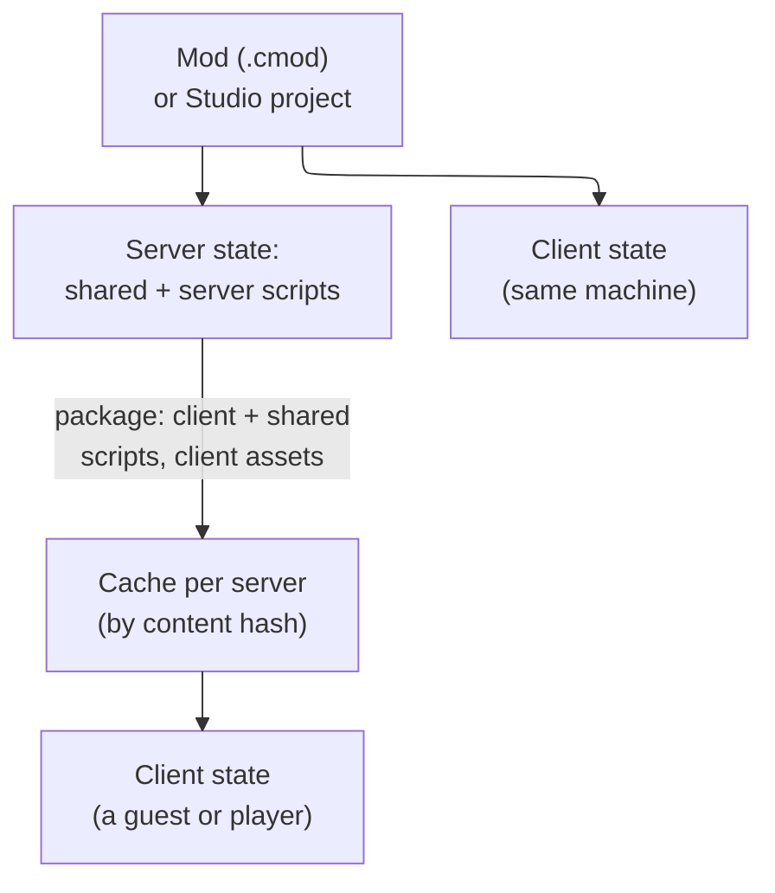

# Coney Studio: mods, packages and loading

How a finished project becomes a mod and how Coney loads it: the install folder, the `.cmod` package, installed mods,
starting and stopping, dependencies and exports, load order and clashes, console commands for mods, modded saves and
replays, and how scripts load offline and online, with what other platforms do. It is the loading half of [Coney Studio:
script security](security.md), whose threat model and rules it follows, and it extends the manifest and mods folder of
[Coney Studio: the Lua SDK](lua-sdk.md#manifest). The parent issue is [#1054](issue:1054); this page comes from
[#1062](issue:1062). Its build issues are on [Script security's list](security.md#build-issues) (4 to 8, 11 and 15).

**Status: design.** Nothing on this page is built. It is a design in the sense of
[Page kinds](../writing-docs.md#page-kinds).

## Contents {#contents}

1. [The install folder](#install-layout).
2. [The `.cmod` package](#cmod): one file, its manifest, its hash and signature, mounted read-only.
3. [Installed mods](#installed), [Starting and stopping](#starting), [Dependencies and exports](#dependencies),
   [Load order](#load-order) and its clashes, [Console commands](#console) and [the player console](#player-console),
   [Modded saves and replays](#saves-replays).
4. [How other platforms load scripts offline and online](#mp-prior-art) and
   [Coney's model: single player first, multiplayer designed in](#mp-model).

## The install folder {#install-layout}

The [install folder](../asset-and-script-architecture.md#install-folder) is portable and holds everything but save
data. What mods add to it:

```text
<install>/
  mods/                         the one mods folder: one .cmod file per mod, read where it lies
    yard-brawl-0.3.0.cmod       a package: the project folder zipped, its manifest listing every file
    enabled.toml                which mods are on, their order, and what the player approved for each
  overrides/                    asset replacements (texture packs, sounds, game files): data, never scripts
  cache/servers/<server key>/   files a server or co-op host sent, one folder per server, by content hash
  cache/mods/                   what Coney remembers about each package it verified (hashes checked, by size and time)
<per-user save location>/       save data only
  profiles/                     the faithful story
  modded/                       saves of modded sessions
  mod-data/<project>/           each project's store (Coney.SaveData), with its quota
```

- **`mods/` holds packages; `overrides/` holds data.** Scripts load only from a package in `mods/`, from Studio's open
  project, or from a folder named on the command line (`coney --project <folder>`, for modders who use another editor
  and for tests); nothing in `overrides/` is ever run as a script. A replacement for one of the game's own scripts is
  the `game-scripts` permission of a project, not a file dropped into `overrides/files/` ([Attack surface](security.md#surface)).
  A folder found in `mods/` is not loaded; the mods menu says so and points at `--project` and Studio's Export.
- **A project's store** lives with the saves, because it is save data (the install-folder decision keeps only save data
  in the per-user location); it is named by the project's name and, for a signed project, its signer, so a project of
  the same name by someone else does not read it.
- **The caches** are Coney's to write and evict; nothing in `cache/servers/` runs except as that server's client
  scripts while connected to it.

## The `.cmod` package {#cmod}

A finished project is exported as one file, a **`.cmod`** (working name), by Studio's **Export** or
`coney-tools mod pack`. It is a zip of the project folder whose packaged manifest, `coney-project.toml` at its root, is
the project's own manifest ([Projects and the manifest](lua-sdk.md#manifest)) with one section the export adds,
`[files]`: every file's path, size and SHA-256. A mod may be scripts only, a level only, or anything between; whatever
it holds, the manifest lists it, and a file not listed is not read.

- **Its identity** is the SHA-256 of the packaged manifest, the **package hash**. Because the manifest holds every
  file's hash, the package hash names every byte the mod can load: the mods menu, approvals, saves, replays and co-op
  checks all name a mod by its name, version and package hash.
- **Its signature** (optional) is `coney-project.sig` beside the manifest in the zip: an Ed25519 signature of the
  packaged manifest by the author's key, which Export makes when the user has a key ([Trust](security.md#trust)).
- **Mounted read-only, never extracted.** Coney reads the package where it lies, entry by entry, through the
  [file layer](security.md#paths) and a strict zip reader: one central directory whose entries match their local
  headers, unique names that pass the name rules (no zip-slip `../`, no absolute names, no two names differing only by
  case), only the stored and deflate methods, no encryption, no entry marked as a link, and declared sizes enforced
  while inflating (no zip bomb). Nothing is written to disk, so a package cannot plant a file anywhere, and removing a
  mod is deleting one file.
- **Checked before it runs.** When a package is enabled, and again when its size or time changes, Coney checks every
  listed file's size and hash and the signature, and remembers the result in `cache/mods/`. A file whose bytes differ
  from the manifest fails the check and the mod does not load; each read is bounded by the size the manifest declares.
- **Studio's Play runs the project folder directly**, with no packaging step; Export is only for sharing. Play and
  `--project` read the folder through the same file layer, so what works in Studio works from the package.

## Installed mods {#installed}

`mods/enabled.toml` plays the part of a FiveM server's `server.cfg` and its `ensure` lines: it lists the mods that start
with every session, in the order they start, and records for each its name, version, package hash, the permissions the
player approved and the signer. **Only two things change it**: the player editing the file, and the mods menu, which
writes it (proposed here; its screens are the mods UI unit's, [#1063](issue:1063)). The console never does
([Console commands](#console)): every start loads exactly what the file says, as a FiveM server loads `server.cfg`.

1. **Installing** is putting a `.cmod` in `mods/`. At the next start Coney finds it, checks it
   ([The `.cmod` package](#cmod)) and adds it to the end of `enabled.toml`, **on**, the one write Coney makes itself: a
   mod changes the game through natives, and scripts are on by default (a maintainer decision). Two cases wait instead:
   a mod that declares a permission is held until the player approves it ([Declared permissions](security.md#declared)),
   and a mod whose manifest says `autostart = false` is listed but starts only when asked ([Starting and
   stopping](#starting)).
2. **Every session** starts the enabled mods in the [load order](#load-order). The loader
   ([The loader](lua-sdk.md#entry-points)) reads each manifest, checks its SDK level, its dependencies, its clashes and
   its permissions against what was approved (a mod whose permissions grew or whose signer changed is held, as Chrome
   holds an extension), and makes its sandboxed states. With no mod enabled, Coney is the faithful game
   ([The mods folder](lua-sdk.md#mods-folder)).
3. **Offline**, a mod's `shared`, `server` and `client` scripts all run on the one machine ([Terms](lua-sdk.md#terms)):
   the server and client states, each with its own `apiset` rules, so a mod that works offline keeps working on a
   server.

## Starting and stopping {#starting}

FiveM's resources are always running once started, and a server starts them from `server.cfg`; Coney's mods follow
the same model, with one switch in the manifest for content a player starts by hand:

```toml
[load]
autostart = true       # default: start with every session while enabled; false: start only when asked
```

| Kind of mod | `autostart` | When its scripts run |
| --- | --- | --- |
| Gameplay change (a move set, a HUD, a difficulty, a camera) | `true` (the default) | Every session while enabled, story included, which makes the story a modded session |
| Content (a custom level, a mission, a challenge) | `false` | When the player starts it (its level from a menu, or `play` at the console), or `start`s it; its `[play]` section names the level and spawn ([Projects and the manifest](lua-sdk.md#manifest)) |
| Library (shared functions, models, sounds or data) | either | Whenever a running mod depends on it: a dependency is started before the mod that needs it, as FiveM starts a resource's dependencies first |

- **A level-only mod** has no `[scripts]`: playing it starts its level with the default player and runs no code.
- **Running and stopping.** A started mod's handlers and threads run until it is stopped (by `stop`, by being disabled,
  or at the end of the session); stopping runs its `stop` handlers ([Entry points](lua-sdk.md#events)) and closes its
  states, and a mod that depends on it is stopped first, as FiveM stops dependants with their dependency.
- **One content mod plays at a time**: starting another's level ends the first's, as a level change does.
- **Studio's Play** runs the open project folder as if it were a started content mod, whatever its `autostart`, with
  the user's chosen enabled mods beside it, so a modder can test a mod against the ones players combine it with.

## Dependencies and exports {#dependencies}

```toml
[project]
version = "0.3.0"                      # semantic version: major.minor.patch

[dependencies]
"crate-pack" = ">=1.2, <2"             # another mod, by name and version range
conflicts = ["old-hud"]                # mods that cannot run with this one
```

- **Versions.** A mod's version is a semantic version; a range uses `>=`, `<`, `=`, `^` (same major) and `~` (same
  minor). The SDK level ([The SDK level](lua-sdk.md#sdk-level)) is a dependency on Coney itself, checked the same way.
- **Refused, with the reason.** A dependency that is not installed, whose version is outside the range, that is
  disabled or held, or a cycle in the graph (`a` needs `b` needs `a`), stops the mods it concerns before any of their
  code runs, with one message each ("yard-brawl needs crate-pack 1.2 or later; crate-pack 1.1.0 is installed",
  "dependency cycle: a, b, a"). The other mods still start. Coney fetches nothing: Coney runs no services
  ([Transport](../network-architecture.md#transport)).
- **Assets.** A mod reads its dependencies' files by path under a third root, `mod:/crate-pack/models/crate.glb`,
  read-only, beside `project:/` and `game:/` ([Assets by path](lua-sdk.md#assets)). Only declared dependencies are
  reachable.
- **Exports, as FiveM's.** A library offers functions to other mods with `Coney.Export(name, fn)` in its main chunk;
  a mod that depends on it calls one with `Coney.CallExport("crate-pack", "SpawnCrate", pos)`, or keeps a caller from
  `Coney.GetExport("crate-pack", "SpawnCrate")` (FiveM's `exports.crate-pack:SpawnCrate(pos)` in Coney's flat
  `Coney` table, [Names and namespaces](lua-sdk.md#names)). Inside the sandbox:
    - **The call runs in the library's own state**, with the library's natives and under the library's budget, and is
      charged to the caller's step budget too, so a library cannot be used to run past either.
    - **Values are copied, never shared**: nil, booleans, numbers, strings and tables of those, copied deep within size
      and depth limits, without metatables. A function passed either way becomes a callback that runs in the state it
      came from, as the natives' callbacks do ([The value bridge](lua-sdk.md#bridge)). No table, upvalue or global of
      one state ever becomes reachable from another.
    - **Only declared dependencies** may be called, so the graph that orders the start is also the graph of who calls
      whom; a call into a mod that is not running, or a name it never exported, is an error naming both.
    - **Depth is limited**: a chain of export calls and the callbacks they fire is cut at a small depth with an error,
      so two mods cannot recurse into each other without end.
    - **Same side only**: a server script calls server exports, a client script client exports; between machines,
      mods talk through the network page's events ([Coney resources](../network-architecture.md#resources)).
    - **A library's permissions stay its own.** A call runs the library's code, which decides what it does with them;
      approving a library that holds a permission is approving what any mod that depends on it may ask it to do, and the
      details say so.

## Load order {#load-order}

The order of `enabled.toml`, rearranged by the player, decides the order in which mods start; the dependency graph
comes first: a mod starts after everything it depends on, and among mods with no order between them the earlier
line in `enabled.toml` goes first, so the order never depends on the file system. A content mod the player starts
comes after the mods already running. That order is the order of main chunks, `start` and `levelStart` handlers,
`update` handlers and threads, and of file replacements, and it is written in every modded save and replay.

| Clash | Found | What happens |
| --- | --- | --- |
| Two mods with the same name | At install and at `refresh` | Only one can be enabled; the other is listed as a second version |
| Two mods replace the same game file or asset | From their manifests, before anything starts | Allowed; the later mod in the load order wins, as in Minecraft's data packs, and the clash is listed with the winner |
| Two mods' `game-scripts` override the same game script | From their manifests | Refused: only one can be enabled at a time, and the message names both |
| A mod names another under `conflicts` | From the manifest | The two cannot run together; the later one is not started |
| Two mods' scripts disagree at run time (both set the time scale) | Not detectable | Handlers run in load order and a one-slot native keeps the last value set ([The value bridge](lua-sdk.md#bridge)); authors declare `conflicts` once they know |

## Console commands {#console}

The Coney console itself (the F8 terminal, its command catalog, access levels, the menu bar, profilers and log viewer,
the code boundary and mod-registered commands) is the console design planned on [#1064](issue:1064) (`console.md` in
this folder once it merges), which links here for what its commands do to mods. They are FiveM's resource commands, plus
`enable`, `disable`, `play` and the listing commands. All of them act on the **running session only** (a maintainer
decision): none writes `enabled.toml`, so the next start loads exactly what the file says, as FiveM's `start` and `stop`
leave `server.cfg` alone.

| Command | Does, in this session |
| --- | --- |
| `mods` | Lists every installed mod: running, stopped, disabled, held or refused, with its version, `autostart` and the reason it is held or refused |
| `mod <name>` | One mod's details ([What the player sees](security.md#player-view)) |
| `levels <mod>` | The levels a content mod offers |
| `start <mod>` | Starts a stopped mod, its dependencies first |
| `stop <mod>` | Stops a running mod, the mods that depend on it first |
| `restart <mod>` | Stops and starts a running mod: a [hot reload](lua-sdk.md#hot-reload) from its package |
| `ensure <mod>` | Restarts the mod if it runs, starts it if not |
| `refresh` | Rescans `mods/`: checks new and changed packages and their manifests, so a new mod can be started in this session (it joins `enabled.toml` at the next start, as any new package does) |
| `disable <mod>` | Stops the mod and keeps it off for the rest of the session: no dependant, `ensure` or level start brings it back |
| `enable <mod>` | Lifts `disable` and starts the mod |
| `play <mod>[/<level>]` | Starts a content mod's level (its `[play]` level when none is named) |

- **They take effect at a step boundary** like every outside request ([Determinism](lua-sdk.md#determinism)); a run in
  which a mod was started, stopped or restarted after the session began is marked in the run log and recorded in its
  replay ([Modded saves and replays](#saves-replays)).
- **They never approve a permission** (a held mod stays held until the player approves it in its details), never load
  a file outside `mods/`, never run Lua and never call a native.
- **Online**, the commands that change the session are the host's or the server operator's; a guest's console lists the
  session's mods and nothing more.

### The player console {#player-console}

A maintainer decision: the release build **includes a player console**, limited in what it can reach, with its code
kept cleanly apart from the developer debug tools, which stay out of the release build. The console design
(its section Release) owns how: the console's model, UI-free, in `src/console/` in the game library; its
screen a Dear ImGui front end in a release target of its own, `coney_console_ui`, so that only that target and
`coney_devtools` link Dear ImGui; the separation kept by target and model, not by library. That changes the release
checks' marker list (the `imgui.ini` marker goes, since Dear ImGui's default file name is then in the release game, and
markers only the debug tools carry come in) and the rule's wording in [AGENTS.md](repo:AGENTS.md), the conventions and
[The debug tools and the game](../building.md#debug-tools), a build issue this page and the console design share
([7](security.md#build-issues)). What a mod's own commands and the release console may reach is
[Script security](security.md#console).

## Modded saves and replays {#saves-replays}

- **Saves.** A save written while any mod is running records every running mod's name, version and package hash, and
  goes into the per-user `modded/` folder, never over the faithful profile ([Limits](security.md#limits)). A story save
  made with no mod running is written exactly as without the SDK: unmarked, in `profiles/`. Loading a modded save with
  a mod missing, stopped or of another package hash warns and names each difference; the player may go on. A content
  mod's own progress (a custom mission's best time) is the mod's store, not a save.
- **Replays.** A replay records the session's seed, its inputs, the same list in load order, and any `start`, `stop`
  or `restart` during the run with its step. Playing it back needs exactly the same packages, by hash, in the same
  order; with any difference Coney refuses to replay it and names the mod.
- **Bug reports** carry the list too, so "it broke with these mods" names exact bytes.

## How other platforms load scripts offline and online {#mp-prior-art}

| Platform | Offline | Online: what the server sends, and how clients keep it |
| --- | --- | --- |
| FiveM | The client console's `localGame` loads one local resource into a single-player game; FxDK, its development tool, treats a project "like a complete runnable server" | `client_script`, `shared_script` and `file` entries go into the resource's packfile, downloaded by clients when the resource loads and cached per server; `server_script` never leaves the server; `server_only` sends nothing; on the client a script reads only files listed in the manifest |
| Garry's Mod | A local server | Files marked with `AddCSLuaFile` (and a few folders) are sent at join, within file-count and size limits; a client runs its own Lua only if the server allows it |
| Roblox | Studio's Play runs a server and a client in one process | The game's client scripts come from Roblox with the place; nothing is installed |
| Factorio | The same game, one player | Clients must have the server's mods; the scenario scripts inside the map arrive with it, which is how CVE-2024-39840 reached clients |
| Minecraft Bedrock | Packs on the world | Resource packs (presentation) are sent to clients; behaviour-pack scripts run where the world runs |

The pattern is the same everywhere it works: offline is a server and a client on one machine, server code never
leaves the server, the client part is downloaded per server within limits and cached, and the server's operator
decides what clients may add.

## Coney's model: single player first, multiplayer designed in {#mp-model}



*Figure: one project, run offline as a server and a client on one machine, and online sent to other clients as a
package.*

- **Offline (first).** The one machine runs the server state and the client state of each enabled project, from
  `mods/` or Studio, with no package and no cache. The `apiset` rules are checked as if online
  ([Determinism](lua-sdk.md#determinism)).
- **What leaves the server.** Only the `client` and `shared` scripts and the files a client needs to draw and play (the
  project's models, textures, sounds, its client data), listed by the manifest's client fields, which the network page
  adds in P4 ([Coney resources](../network-architecture.md#resources)). Server scripts, server data and the project's
  store never leave it. Every client file is public: whatever a client receives, its player can read.
- **Checked by hash.** Over the authenticated, encrypted connection ([Encryption](../network-architecture.md#crypto))
  the host or server announces its load order: each mod's name, version, [package hash](#cmod) and packaged manifest.
  A guest whose `mods/` holds a `.cmod` with the same package hash reads that mod's client part from its own copy and
  downloads nothing for it. Otherwise it fetches the client files it lacks on the rate-capped reliable stream (the
  network page's large data), checks each against the announced manifest's size and hash, and writes it into
  `cache/servers/<server key>/`. The manifest shows the names and hashes of the server's files, never their content.
  What is sent is text scripts and data, never native code or bytecode, within limits on file count, file size and
  total size that the client sets and the server cannot raise.
- **Cache and versions.** Files are kept by content hash, so a mod's unchanged files are not fetched again after an
  update; a client refuses a mod whose SDK level is above its own, with the same message as a local mod. Each server
  has its own cache folder, and a client never tells one server which files it holds from another (the package-hash
  check asks only about the guest's installed mods, which it reads from `mods/`), so the cache cannot reveal where a
  player has been. Old folders are evicted by age and total size.
- **Joining is the consent.** Before downloading, the guest sees the host's or server's projects with their sizes ("This
  game is modded: Yard Brawl 0.3.0, 2.1 MB") and chooses to join. Client scripts need no permission: a client state has
  only client natives, the same sandbox and no store beyond a small one per server and project.
- **The client's own mods are off while connected**, except the presentation packs in `overrides/` (textures, sounds),
  which change only what that player sees. A server may allow players' own client-only projects (Garry's Mod's
  `sv_allowcslua`); they still have client natives only.
- **Nothing a server sent is installed.** Its scripts run only while connected to it, from the cache; leaving ends
  them, and none of them appears in `mods/` or `enabled.toml`.
- **Co-op with mods** (a P1 to P3 host who runs mods) uses the same package for the guest. Without mods, co-op sends
  nothing: the original's scripts run on the host only ([The original's scripts](../network-architecture.md#original-scripts)).
- **Hot reload and the debugger online** stay the host's or server's, on its own server scripts
  ([Hot reload](lua-sdk.md#hot-reload)); a client is sent the new client files as a new package version.
