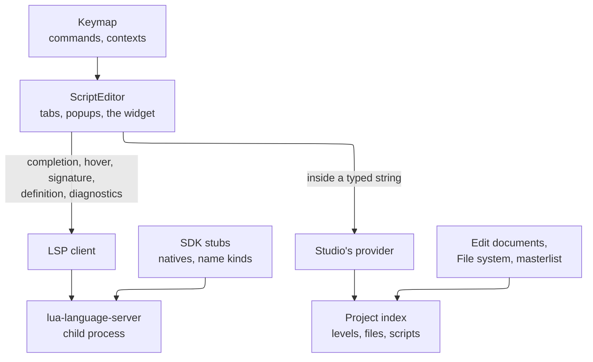

# Coney Studio: the script editor

This page is a **design**: nothing on it is built. It decides how Coney Studio's script editor knows the project it
edits: completion inside a string that offers the levels' entities, tags, spawn points and the project's files, as
Godot's editor offers its scene's nodes; the language features (completions, signature help, hover tooltips,
diagnostics as you type, go to definition); the event fields that connect an entity to a script function, with their
Connect dialog; the keymap, VS Code's by default and every key rebindable; what the text widget already does and what
Studio adds to it; and how all of it is tested. It ends with the [build
issues](#build-issues) it proposes, in order, which replace the technology page's script editor issue.

It builds on two pages and does not repeat them: the [technology](technology.md) page chose the widget ([The code
editor](technology.md#code-editor)), lua-language-server ([Language tooling](technology.md#language-tooling)) and the
debugger's protocol ([The script debugger](technology.md#debugger)); the [Lua SDK](lua-sdk.md) page owns the natives,
the stubs the language server reads ([Typed stubs](lua-sdk.md#stubs)) and the `project:/` and `game:/` paths ([Assets by
path](lua-sdk.md#assets)). It meets four more: the [editor experience](editor-experience.md) (the panels, Play mode,
previews), [the Level view](level-view.md) (its keymap), [content and formats](content-and-formats.md) (the kinds of
content) and [entities and the Inspector](entities.md) (entities' names, tags, attributes and events). One page still
open is named in plain text: the script security design ([#1062](issue:1062): the language server's settings).

## Contents {#contents}

1. [The choices at a glance](#summary)
2. [What Godot and VS Code do](#survey)
3. [What the widget has, and what Studio adds](#widget)
4. [How the parts fit](#architecture)
5. [Studio-aware strings](#strings): no prefix, name kinds, completion, paths, hover, go to, checks, dragging
6. [Event fields and the Connect dialog](#events): the dialog, the stub, names, markers and checks
7. [Language features](#language)
8. [Go to definition](#definition)
9. [The keymap](#keymap): commands, contexts, rebinding, the defaults, Ctrl+Enter
10. [Tests](#tests), and the [proof](#proof) that settled how the editor learns a parameter's kind
11. [What changes on other pages](#other-pages), [Questions for a maintainer](#questions),
    [Build issues](#build-issues), [Sources](#sources)

## The choices at a glance {#summary}

| Question | Choice | Main reason |
| --- | --- | --- |
| [How Studio-aware completions reach the editor](#plugin) | Both, split by job: the stubs give lua-language-server the **kind** of a string parameter as a type (`FlagName`), and Studio's own provider supplies the **values** from the open project | The language server knows which parameter the caret is in, through the user's own functions too; only Studio knows the project's unsaved levels and files. A server plugin cannot add completions ([Why not a plugin](#plugin)) |
| [A prefix for entity names](#no-prefix) | None: completion works inside the quotes of any parameter typed with a name kind | Lua has no `$` syntax, and adding one would break stock Lua tools, the reason the SDK chose stock Lua 5.4 |
| [Where kinds come from](#name-kinds) | A `names:` key on string arguments in the masterlist, emitted into the stubs as `---@class FlagName: string` | One source for the runtime, the stubs and the reference; the [proof](#proof) showed a class keeps its name in signature help where an alias does not |
| [Event fields](#events) | A Connect dialog as Godot's: the name prefilled `On<Entity><Event>` or an existing function by completion, fitting ones first; a new function's stub appended to the level's script and opened; names global, a duplicate an error, a missing one a warning; margin markers listing the entities that call a function | A maintainer decision; one project state makes names global, and the original connects its triggers by name |
| [Completion, hover and signature popups](#language) | Drawn by Studio | The widget's completion list holds plain strings and waits on the real clock; Studio needs icons, a documentation pane and fixed time |
| [Go to definition](#definition) | F12 and Ctrl+Click; a project symbol opens its source, a native opens its reference page, an entity name selects the entity, a path opens the file | VS Code's keys and Godot's targets |
| [The keymap](#keymap) | One command registry with contexts (VS Code's *when*, simplified), two-key chords, a per-user `keymap.toml` that stores only changes; VS Code's keys in the script editor, Unity's in the Level view | One mechanism for every panel; a key means one thing in each panel |
| [The widget's own keys](#widget) | Studio takes over the widget's key table through a small change offered upstream and carried as a patch until merged | The widget's keys are hard-coded, and several differ from VS Code's (Ctrl+X on an empty selection copies but does not delete) |
| [Tests](#tests) | The Dear ImGui Test Engine drives the real editor; a scripted language server replays recorded conversations; one test runs real lua-language-server where installed | Every key and every popup tested as a user meets it, with fixed time |

## What Godot and VS Code do {#survey}

### Godot's script editor {#godot}

Read from Godot 4.6's source ([Sources](#sources)):

- **Node paths in code.** `$Path/To/Node` is GDScript's short form of `get_node("Path/To/Node")`, and `%Name` finds a
  node the scene marks as unique by name. After `$` or `%`, completion lists the edited scene's nodes: the editor finds
  the node the script is attached to in the open scene and asks it for the options of `get_node`'s first argument
  (`COMPLETION_GET_NODE` in `gdscript_editor.cpp`). The prefix exists because `$` is syntax: the parser knows a node
  path follows. A script attached to no node in the open scene gets no node paths.
- **Strings as arguments.** Inside the quotes of a call, completion asks the object the call is made on for that
  argument's options (`Object::get_argument_options`): `Node` lists node paths for `get_node` and the project's global
  groups for `is_in_group` and `add_to_group`, `Input` lists the input actions for `is_action_pressed` and its
  relatives, an animation player lists its animations for `get_animation`. Each class writes this by hand for its own
  methods.
- **Paths.** Inside `load("...")` and `preload("...")` completion lists the project's files under `res://`
  (`COMPLETION_RESOURCE_PATH`), when the *Complete File Paths* setting is on (it is by default).
- **Dragging.** A node dragged from the Scene dock into a script inserts `$Path`; with Ctrl held, a whole
  `@onready var name = $Path` line. A file dragged from the FileSystem dock inserts its quoted path.
- **Hover and lookup.** Hovering a symbol shows its documentation (the *Enable Tooltips* setting, on by default).
  Ctrl+Click on a symbol (*Lookup Symbol*, which has no default key) jumps to a script's definition, or opens the
  built-in class reference in the script editor for an engine class or method; on a quoted resource path it opens the
  resource.
- **The keys** (`script_text_editor.cpp`, `input_map.cpp`): Alt+Up and Alt+Down move lines, Ctrl+Alt+Down duplicates
  lines, Ctrl+Shift+D duplicates the selection, Ctrl+K (and Ctrl+/) toggles comments, Ctrl+Shift+K deletes the line,
  Ctrl+Enter makes a blank line below and Ctrl+Shift+Enter one above, Ctrl+D adds the next occurrence, Ctrl+Shift+Up and
  Down add a caret, Alt+F folds, Ctrl+G goes to a line, Ctrl+Alt+F to a function, Ctrl+B and Ctrl+Alt+B walk and toggle
  bookmarks, F9 toggles a breakpoint, Ctrl+Shift+F and Ctrl+Shift+R find and replace in files, Ctrl+I auto-indents and
  Alt+F1 opens contextual help.
- **Delays.** Completion waits 0.3 s after typing; the script is parsed again after 1.5 s idle (0.5 s while it has
  errors).

### VS Code {#vscode}

VS Code's language features come from a language server over the Language Server Protocol, the same protocol Studio's
client speaks to lua-language-server. Its everyday keys on Windows and Linux, from its default keybindings
([Sources](#sources)):

| Group | Keys |
| --- | --- |
| Lines | Ctrl+X and Ctrl+C with no selection cut or copy the whole line; Shift+Alt+Down and Up copy the line below or above; Alt+Down and Up move it; Ctrl+Shift+K deletes it; Ctrl+Enter and Ctrl+Shift+Enter insert a line below or above; Ctrl+L selects the line |
| Multiple cursors | Alt+Click adds a cursor; Ctrl+Alt+Down and Up add one below or above; Ctrl+D selects the word, then adds the next occurrence; Ctrl+K Ctrl+D skips it; Ctrl+Shift+L and Ctrl+F2 select every occurrence; Shift+Alt+I puts a cursor at the end of each selected line; Ctrl+U undoes the last cursor change; Shift+Alt and a drag selects a box; Shift+Alt+Left and Right shrink and grow the selection |
| Comments and indent | Ctrl+/ toggles a line comment, Shift+Alt+A a block comment; Ctrl+K Ctrl+C and Ctrl+K Ctrl+U add and remove one; Ctrl+] and Ctrl+[ indent and outdent |
| Find | Ctrl+F find, Ctrl+H replace, F3 and Shift+F3 next and previous, Alt+L in the selection, Ctrl+Shift+F and Ctrl+Shift+H in files |
| Navigate | Ctrl+P a file by name, Ctrl+G a line, Ctrl+Shift+O a symbol in the file, Ctrl+T in the workspace, Ctrl+Shift+\ the matching bracket, Alt+Left and Right back and forward, F8 and Shift+F8 the next and previous problem, Ctrl+Shift+M the Problems panel |
| Language | Ctrl+Space completions, Ctrl+Shift+Space signature help, Ctrl+K Ctrl+I hover, F12 and Ctrl+Click the definition, Alt+F12 a peek, Shift+F12 references, F2 rename, Ctrl+. quick fixes, Shift+Alt+F format, Ctrl+K Ctrl+F format the selection |
| Folding | Ctrl+Shift+[ and ] fold and unfold, Ctrl+K Ctrl+0 and Ctrl+K Ctrl+J fold and unfold all |
| Editor | Ctrl+Shift+P or F1 the command palette, Ctrl+K Ctrl+S the keyboard shortcuts, Ctrl+Tab the recent files, Ctrl+W or Ctrl+F4 close, Ctrl+= and Ctrl+- zoom |
| Debug | F5 start or continue, Shift+F5 stop, Ctrl+Shift+F5 restart, F6 pause, F9 breakpoint, F10 step over, F11 step into, Shift+F11 step out |

**Rebinding.** VS Code's keys are rules of a key, a command and a *when* clause over context keys
(`editorTextFocus && !editorReadonly`). A user's rules live in `keybindings.json`, are added after the defaults and win
over them; a rule whose command starts with `-` removes a default. Its Keyboard Shortcuts editor searches by command or
by a pressed key and shows the other commands on the same key. `editor.multiCursorModifier` swaps Alt+Click and
Ctrl+Click between *add a cursor* and *go to definition*.

### What Studio takes {#survey-coney}

- **From Godot, the awareness:** completion of the open project's things inside strings, driven by what each function's
  argument means; path completion; dragging entities and files into a script; hover documentation; Ctrl+Click into the
  built-in reference for an engine function.
- **From VS Code, the keys and the language server:** every key in the table above where Coney has the feature; rules
  with contexts and a user file of changes; F12 and Ctrl+Click for definitions; the debug keys.
- **Not taken:** Godot's `$` and `%` syntax ([No prefix](#no-prefix)), its per-class hand-written option lists (Studio
  reads kinds from the masterlist instead), and its scripts attached to nodes (Studio has none, a maintainer decision:
  scripts are the project's, never an entity's).

## What the widget has, and what Studio adds {#widget}

The widget is goossens' ImGuiColorTextEdit, the technology page's choice, read at commit `12a5a01`, the commit its
proof built (`TextEditor.cpp` and `TextEditor.h`, MIT). What it gives, and what Studio does with it:

| Feature | In the widget | Studio |
| --- | --- | --- |
| Lua colouring, undo and redo, bracket matching and colouring, paired glyphs, auto indent, line numbers, current line, whitespace marks, word wrap, minimap | Yes | Uses them; minimap and word wrap are settings |
| Multiple cursors and selections | Yes: Ctrl+Click (Alt+Click on macOS) adds a cursor, Ctrl+D adds the next occurrence of a selection, Ctrl+Shift+D all of them, Esc clears the extra cursors | Moves *add a cursor* to Alt+Click (Ctrl+Click is go to definition); makes Ctrl+D select the word when nothing is selected (the widget does nothing then); adds the rest of VS Code's set (below) |
| Line commands | Move lines (Alt+Up and Down), delete lines (Ctrl+Shift+K), indent and outdent, insert a line below (Ctrl+Enter) and above (Shift+Enter), toggle comments (Ctrl+/ and Ctrl+L), grow and shrink the selection | Adds duplicate lines (Shift+Alt+Down and Up), select line, block comments; moves *insert above* to Ctrl+Shift+Enter and Ctrl+L to *select line* |
| Cut and copy with no selection | Copies the whole line; **Ctrl+X does not delete it**: `cut` copies, then deletes only the cursors' selections, of which there are none (`TextEditor::cut`, `deleteTextFromAllCursors`), although the widget's readme says it cuts the line | Cuts the line as VS Code does, and pastes a whole-line copy as a line above the caret's line, not at the caret |
| Find and replace | A find and replace window with case and whole-word options; Ctrl+G finds the next match; Ctrl+Shift+F turns every match into a cursor | Keeps the window for one file, on VS Code's keys (Ctrl+F, Ctrl+H, F3); Ctrl+G becomes go to line and Ctrl+Shift+F find in files |
| Folding | Optional, on brackets and on indentation | Turned on |
| Completion | A framework: the application fills a list of plain strings; off inside strings by default; it waits 200 ms of the real clock before opening and never runs with several cursors | Not used: Studio draws its own popup ([Language features](#language)) |
| Hover | A callback that opens a popup as soon as the mouse is over a word | Used, with Studio's own delay counted on the interface's clock |
| Squiggles and markers | Squiggles with a type, a colour, a style and a tooltip, cleared by type; line markers with tooltips; a line decorator for the gutter | Diagnostics by severity, Studio's own string checks as a second type, breakpoints and the debugger's current line |
| Changes | A per-transaction callback with every insert and delete; a delayed change callback | Feeds the language server's incremental sync; the delayed callback is not used (its delay reads the real clock) |
| Keys | Hard-coded in one function (`handleKeyboardInputs`) with `ImGui::Shortcut`; no keymap | Taken over by Studio's keymap (below) |

**Missing, and added by Studio:** duplicate lines, add a cursor above or below, a cursor at each selected line's end,
cursor undo, box selection, go to line, and a public way to add a cursor or to edit several ranges at once (the public
`ReplaceSectionText` drops the extra cursors, and *insert line* and *delete lines* are private).

**How Studio adds them.** One change to the widget, in four parts, offered upstream as pull requests (the widget is
maintained and merges outside contributors' pull requests) and carried until then as one patch that
`cmake/deps.cmake` applies to the pinned commit (the pin's hash already covers a `PATCH_COMMAND` line):

1. The built-in key table can be switched off, leaving text input, the input method and the mouse to the widget, so
   every key goes through Studio's keymap.
2. Public functions for the line commands it keeps private, and the missing ones above.
3. The add-a-cursor click modifier as an option.
4. Its delays measured on Dear ImGui's clock (`ImGui::GetTime`, which the Test Engine fixes) instead of
   `std::chrono::system_clock`, so a delay is the same in every run ([Tests](#tests)).

Everything else Studio needs (popups, the language server, the keymap, the project index) is Studio's own code around
the widget, in the `ScriptEditor` the technology page names.

## How the parts fit {#architecture}



*Figure: the language server knows the code; Studio's provider knows the project; the editor merges both.*

- **The language server** reads the project's scripts and the SDK's stubs and answers everything about the code:
  completions, signatures, hover, types, definitions, references, rename, formatting, diagnostics.
- **The project index** is Studio's: every level's entities (names, tags, kinds, positions) from the edit documents in
  memory, saved or not; the files of `project:/` and `game:/` by kind, from the File system panel; the names the
  project's scripts declare; the masterlist's kinds. It is rebuilt in part on every edit, never by reading files the
  editor has open.
- **Studio's provider** answers the questions about strings that only the project can answer, and the editor merges its
  answers with the language server's ([Studio-aware strings](#strings)).

## Studio-aware strings {#strings}

### No prefix {#no-prefix}

Godot's `$` works because `$` is GDScript syntax: the parser sees a node path coming. Lua has no such syntax, and adding
one (`$"start"` turned into a lookup before Lua sees it) would need a preprocessor in Coney's runtime, the language
server and every other Lua tool, the kind of language change the SDK rejected when it chose stock Lua 5.4
([The runtime](lua-sdk.md#runtime-choice)). The SDK's natives already find things by name: `FindFlag("start")`,
`GangStartSpawner(gang, "north", ...)`, and the entity lookups by name and tag the entity kinds design adds. So Studio
completes **inside the quotes of any parameter whose kind is known**, with nothing typed first. A string whose
parameter has no kind gets no Studio items, so ordinary strings (messages, keys of a table) never fill with entity
names.

### Name kinds {#name-kinds}

Of the masterlist's 956 natives, 312 arguments are strings, and most name something: 83 are named `callback` (a Lua
function's name, called later), and the others name flags, spawners, cameras, sounds, music tracks, animations and
object types (a count over `research/bindings/`). Each such argument gets a **`names:`** key in the masterlist saying
what it names, beside the `handle:` key the SDK page adds for handles. `coney-tools bindings stubs` turns each kind into
a class derived from `string` and types the parameter with it:

```lua
---@class FlagName: string A world flag's name: a level start, or a project level's spawn point.

---Finds a world flag by its name.
---@param name FlagName The flag name given to AddFlag, compared case-sensitively.
---@return integer flag
function FindFlag(name) end
```

The class, not an alias, is what makes it work: lua-language-server shows a class's name in signature help, so the
editor learns the parameter's kind there, and the server accepts any string for it without a warning
([Proof](#proof)). A user's own function gets the same completions by naming the kind in its annotation, which
Godot's hand-written lists cannot do:

```lua
---@param flag FlagName
local function moveTo(flag) TeleportToFlag(Coney.GetPlayer(1), FindFlag(flag)) end
moveTo("st")   -- completion offers the project's spawn points here too
```

The first kinds:

| `names:` | Class | Studio offers | From | Arguments that take it |
| --- | --- | --- | --- | --- |
| `flag` | `FlagName` | Flags: a project level's spawn points (registered as flags of the same names, [Play](lua-sdk.md#play)) and flags the project's scripts add | The levels, the scripts | `FindFlag`'s name, `ObjSpawn`'s flag name |
| `human` | `HumanName` | Names the project's scripts give humans and the names of a level's fighters | The scripts, the levels | `HuFind`'s name |
| `spawner` | `SpawnerName` | Names given to `GangAddSpawner` | The scripts | `GangStartSpawner` and the other spawner natives |
| `callback` | `CallbackName` | The project's global functions, dotted names included, as the natives look them up ([Conventions](../../references/bindings/index.md#conventions)) | The language server's workspace symbols | `ScheduleFunc`, `SetMsgHandler`, `SoundPlayMusicTrack`'s end callback, the rest of the 83 |
| `entity`, `tag` | `EntityName`, `EntityTag` | Every level's entity names and tags | The levels | The lookups by name and tag the entity kinds design adds |
| `object-type` | `ObjectTypeName` | The object types of the game's object configuration | Coney's tables, read from the player's disc | `ObjSpawn`, `ObjIsA` |
| `music`, `dyn-anim`, `sound` | `MusicTrack`, `DynAnimName`, `SoundName` | The names Coney's tables hold for the player's game files | The player's disc, on the player's machine | `SoundPlayMusicTrack`'s track, `HuPlayDynAnim`'s animation, the sound natives |
| `path` with kinds | `ModelPath`, `ClipPath`, `SoundPath`, `TexturePath`, `LevelPath`, `AssetPath` | `project:/` and `game:/` files of those kinds ([Paths](#paths)) | The File system panel | `Coney.SpawnModel`, `Coney.PlayClip`, `Coney.PlaySound`, `Coney.LoadAsset` ([Assets by path](lua-sdk.md#assets)) |

**Names declared in scripts.** The masterlist also marks the arguments that *declare* a name (`HuCreate`'s name,
`GangAddSpawner`'s, `AddFlag`'s), and Studio finds them by a lexical scan of the project's scripts: a call of a
declaring native with a string literal in the declaring place. A name built at run time (`"wave" .. n`) is not found,
which is why an unknown name is only ever information ([Checks](#string-checks)).

Names from the player's game files are read on the player's machine and never written into a project, the stubs or the
repository ([LEGAL.md](repo:LEGAL.md#no-game-data)). Kinds join the masterlist as natives become available; a kind
that waits on another design (entity names and tags on the entity kinds design, the asset kinds' file types on the
content and formats design) is added with it.

### A completion inside a string {#string-completion}

1. The caret is inside a string literal, the user types or presses Ctrl+Space.
2. Studio asks the language server for signature help at the caret: the function being called (a native, a `Coney`
   function or the project's own), the active parameter and its label, `name: FlagName`.
3. When the type is a name kind, Studio's provider answers from the project index, matched against what is typed the
   way the language server matches (fuzzy, by word starts), and the language server's own items for that place are
   dropped: inside a string they are words from the file ([Proof](#proof)).
4. Each item shows the kind's icon and where it was found (the level `yard`, `scripts/main.lua:12`, `game:/`), the open
   level's first, then the other project levels', then the scripts', then the game's.
5. Accepting replaces the text between the quotes and leaves the quotes alone.

The provider answers from memory in the same frame; the signature help arrives a frame or two later (1 to 11 ms in the
proof). An entity added in the Hierarchy a moment ago, not yet saved, is offered at once.

### Paths {#paths}

Inside a parameter typed with a path kind, typing the opening quote offers the two roots, `project:/` and `game:/`.
After a root, the list holds every file of the kinds the parameter takes, matched against the whole path as Godot
matches `res://` paths, and a `/` typed after a folder narrows the list to that folder, as a file picker does. A model
parameter lists models, a sound parameter sounds; `AssetPath` (`Coney.LoadAsset`) lists every kind Coney can load from
a project. After a file that holds several assets, a `#` offers its parts (`project:/anims/dance.glb#Spin`), the
sub-asset form of [Assets by path](lua-sdk.md#assets). Which extensions make each kind is the content and formats
design's; Studio reads it from the same table the File system panel's filters use.

### Hover, go to and checks on strings {#string-features}

| On a string of a kind | Hover shows | Go to definition (F12, Ctrl+Click) |
| --- | --- | --- |
| An entity name, a tag, a flag, a human's name | A card: the kind, the level, the position, the tags; every match when there are several | Selects the entity in the Hierarchy and frames it in the Level view, opening its level if another is open; a list to choose from when several match; a name declared in a script opens that line |
| A path | The file's kind and size, its import settings in brief and its preview thumbnail ([previews](editor-experience.md#previews-coney)) | Shows the file in the File system panel and opens it in its viewer, as Godot opens a quoted resource |
| A callback name | The function's signature and its comment, from the language server's hover at its definition | The function's definition |
| A game name (music, animation, object type) | What Coney's tables know of it | The File system panel at the game file, when there is one |

#### Checks {#string-checks}

Studio checks string literals of a kind as the user types, and shows what it finds as squiggles of its own type beside
the language server's, in the margin and in the Problems panel:

| Finding | Severity | Why that severity |
| --- | --- | --- |
| A name found in no level and no script ("no flag named `strat` in the project; did you mean `start`?") | Information | A script can make a name at run time from text Studio cannot see |
| A `project:/` file that does not exist, or a `game:/` name the player's disc does not hold | Warning | Paths are fixed text; the load would fail |
| A file of the wrong kind (a texture where a model is wanted) | Warning | The native would refuse it |
| A path that leaves its root (`project:/../x`) | Error | The loader refuses it ([Assets by path](lua-sdk.md#assets)) |
| A callback name with no global function of that name in the project | Warning | The native looks it up when it fires and finds nothing |

A literal joined from pieces (`"wave" .. n`) is not checked.

### Dragging from the Hierarchy and the File system {#drag}

As in Godot: an entity dragged from the Hierarchy into a script inserts its quoted name (only the name, when dropped
inside a string); with Ctrl held, a whole line that looks it up through the entity kinds design's lookup native. A file
dragged from the File system inserts its quoted `project:/` or `game:/` path; with Ctrl, a `Coney.LoadAsset` line.

**Uses in scripts.** Because the index knows every literal that names an entity or a file, the Hierarchy's and the File
system's right-click menus get *Find uses in scripts*, which lists them in the References panel. Renaming an entity in
the Inspector, or moving a file in the File system (which [the project's rules](editor-experience.md#project-coney)
already make fix the levels' references), offers to change the matching literals in the scripts, shown as a list the
user accepts or not.

### Why the provider, not a language server plugin {#plugin}

| | A lua-language-server plugin | Studio's provider beside the server, kinds in the stubs (chosen) |
| --- | --- | --- |
| Adds completions | No: a plugin can rewrite a file's text or syntax tree, type a function's parameters and resolve `require`, and the server's plugin page says it cannot report diagnostics ([Sources](#sources)) | Yes, from the index |
| Sees unsaved level edits | No: it runs in the server's process and sees files | Yes: the edit documents are in Studio's memory |
| Through the user's own functions | Only by a plugin that types parameters by a naming rule | Yes: the kind is a type the user can write ([Name kinds](#name-kinds)) |
| Safety | A plugin is Lua the server runs with its own rights; the script security design has Studio never take `runtime.plugin` from a project | Nothing runs in the server but the server |
| Generated files per project | A file of names for the server to read, rewritten on every level edit | None: the stubs are the SDK's, the same for every project |

The third way, writing each project's names into the stubs as string enums (`---@alias SpawnName "start" | "rooftop"`),
was tried in the proof: the server then completes them, but warns on any other string, including a name a script builds
at run time. It is left out.

So the answer to *a plugin, Studio's provider, or both* is both, divided by job: the language server knows the code and
the kind of each parameter, through the stubs; Studio knows the values.

**Outside Studio.** A modder using VS Code with the Lua extension gets the kinds in hover and signature help from the
same stubs, without the values. `coney-tools sdk init` could later write a project's names as an enum file for such
users; it is not proposed here.

## Event fields and the Connect dialog {#events}

A maintainer decision, Godot-like: each entity kind comes with its own events, and an event connects an entity to a
function of the project's scripts **by name**. The entity kinds design defines the events and their arguments (a
volume box's *On Enter* passes `(box, human)`) and the `event` property that holds the name; at Play, Coney calls
`SetMsgHandler(handle, message, name)` for each field that is set, as a level script would. This section is the
editor's side: filling the field, writing the function, and keeping the two in step.

### What Godot does {#events-godot}

Read from Godot 4.6's source (`editor/scene/connections_dialog.cpp`, `editor/script/script_text_editor.cpp`):

- **The Connect dialog** opens from a signal in the Node dock. It names the receiving node, and the method's name is
  prefilled from a project setting's pattern (`editor/naming/default_signal_callback_name`, which fills in the node's
  and the signal's names). A tree lists the existing methods to pick from, with two filters, *script methods only* and
  *compatible methods only* (the methods whose arguments fit the signal's). An *Advanced* part adds extra arguments,
  drops some of the signal's, and sets deferred and one-shot calls.
- **A new method** is added to the receiving node's script with the signal's arguments, and the script opens.
- **In the script editor** a method that a signal connects to gets an icon in the gutter; clicking it lists the
  connections. A connection whose method is missing is listed as a warning under the script.

Studio takes the dialog, the prefilled name, the fitting filter, the appended stub, the gutter icon and the warning.
It does not take the receiver (Studio's functions belong to no entity: a project's scripts share one state) or the
*Advanced* part (an event passes the original's arguments, unchanged).

### The Connect dialog {#connect-dialog}

The *Connect...* button beside an event field in the Inspector's *Events* group (or a double-click on the event) opens
it:

| Part | What it does |
| --- | --- |
| **Function** | Prefilled `On<Entity><Event>`: *On* and the entity's name and the event's, each word capitalised and anything that is not a letter or a digit dropped, so the volume box *Alley gate*'s *On Enter* gives `OnAlleyGateEnter`. Never a name already taken: a taken one gets the next number (`OnAlleyGateEnter2`) |
| **Completion** | Typing in the field offers every global function of the project's scripts, from all of them, the ones that fit the event listed first; *fitting functions only* (on by default, as Godot's filter) hides the others. A function fits when it takes no more parameters than the event passes and, where its parameters are typed, the types match (`---@param human HumanHandle`). Dotted names (`F.CivFlagNet`) are offered, as `SetMsgHandler` accepts them |
| **Script** | Shown only when the name is a new function: the script the stub goes in. The default is the level's script (the project script named after the open level, `scripts/yard.lua` for the level `yard`), else the script last used in this project (remembered in `.studio/`), never simply the first in the list. *New script...* makes `scripts/<level>.lua` and adds it to the manifest's `server` list |
| **Connect** | Sets the field (a level edit, undone with the level's undo) and, for a new function, writes the stub |

**The stub.** Studio appends it at the end of the chosen script, typed with the event's arguments from the entity kinds
design's table, opens the script and puts the caret inside the body:

```lua
---Called when a human enters the volume box Alley gate (On Enter).
---@param box integer The volume box.
---@param human HumanHandle The human who came inside.
function OnAlleyGateEnter(box, human)

end
```

Appending is one undo step in the script. The comment names the entity and the event, so the function says where it is
called from even outside Studio.

### Names, markers and checks {#event-checks}

- **Names are global.** A project's scripts run in one state ([The sandbox](lua-sdk.md#sandbox): one environment per
  project), so a function name means one function wherever it is defined, and the field stores only the name.
- **A duplicate is an error.** Two scripts (or one twice) defining the same global function: the later file's replaces
  the earlier at load, so the editor marks both definitions as errors, naming the other place, and the Inspector marks
  every event field that names it. The Connect dialog never suggests such a name.
- **A missing function is a warning.** A field naming a function no script defines gets a warning badge in the
  Inspector, a line in the Problems panel and, when the level opens, the list the entity kinds design asks for; at
  Play the event does nothing and the run log says so once.
- **Margin markers.** Beside each function that an event field names, in any of the project's levels, the editor shows
  a marker in the gutter (the widget's line decorator). Hovering it lists the entities and events that call it (*Alley
  gate · On Enter · yard*); clicking an entry selects that entity in the Hierarchy and frames it in the Level view,
  opening its level if another is open.
- **Go to definition from a field.** F12, Ctrl+Click or the field's arrow button opens the script at the function.
- **Renames.** F2 on a function that event fields name offers to change those fields too, in the same list as the
  scripts' uses ([Uses in scripts](#drag)). Clearing a field (*Disconnect*) leaves the function alone.

The fields' completion and checks are the same index and the same `callback` kind that complete
`SetMsgHandler(obj, 3, "...")` in a script ([Name kinds](#name-kinds)), so a connection made in code and one made in
the Inspector are checked alike.

## Language features {#language}

| Feature | From | When | Studio's part |
| --- | --- | --- | --- |
| Completions | The language server; Studio's provider inside a string of a kind | Typing, `.` and `:`, Ctrl+Space | Its own popup: the kind's icon, the label, a detail pane with the item's documentation; Tab or Enter accepts, Esc closes. One cursor at a time, as in the widget |
| Signature help | The language server | `(` and `,`, Ctrl+Shift+Space | A popup above the caret, the active parameter in bold with its description |
| Hover | The language server; Studio for strings | The mouse rests on a word for a moment (a setting on the interface's clock, as VS Code's 300 ms), or Ctrl+K Ctrl+I | Renders the stubs' Markdown (code, bold, lists, links); a link to a native's page opens it in the Natives panel |
| Diagnostics | The language server (syntax, types, argument counts, undefined globals, the sandbox's missing libraries); Studio's [string checks](#string-checks); the Lua 4.0 compiler for a 4.0 file ([Language tooling](technology.md#language-tooling)); errors raised while playing ([The sandbox](lua-sdk.md#sandbox)) | As you type; after each Play | Squiggles by severity, gutter marks, the Problems panel (Ctrl+Shift+M), F8 and Shift+F8 |
| Go to definition | The language server; Studio redirects natives and strings | F12, Ctrl+Click | [Go to definition](#definition) |
| References | The language server | Shift+F12 | The References panel, each use with its line |
| Rename | The language server | F2 | One undo step in each open file; files not open are written and reloaded once by hot reload |
| Formatting | The language server's formatter | Shift+Alt+F, Ctrl+K Ctrl+F | Off on save unless the user turns it on |
| Quick fixes | The language server | Ctrl+. | A menu at the caret |
| Symbols | The language server | Ctrl+Shift+O in the file, Ctrl+T in the project | A quick pick, as Ctrl+P is for files |
| Folding, colouring, brackets | The widget | Ctrl+Shift+[ and ] | Turned on |

- **The popups are Studio's** because the widget's completion holds plain strings (no kind, no documentation) and its
  delay reads the real clock ([What the widget has](#widget)). Studio places them with the widget's public
  `DocPos2ScreenPos` and inserts with its public replace functions.
- **Sync.** The widget's transaction callback reports every insert and delete; Studio sends them as incremental
  changes, converting the widget's glyph positions into the protocol's positions. Diagnostics follow each change as the
  server publishes them.
- **Errors from playing.** A runtime error raised during Play ([The sandbox](lua-sdk.md#sandbox)) shows as a marker on
  its line, with the message as the tooltip, until the next Play.

## Go to definition {#definition}

| Under the caret | F12 or Ctrl+Click goes to |
| --- | --- |
| A local, a function or a field of the project's code | Its definition, in its file and line (the language server) |
| `require("fighters.waves")` | The module's file |
| A game native or a `Coney` function | Its **reference page** in the Natives panel: the masterlist's entry, as Godot opens its class reference. The language server's answer is the native's line in the stubs ([Proof](#proof)), which Studio turns into the native's name |
| A string of a kind | The entity, file or function it names ([Hover, go to and checks](#string-features)) |

Alt+Left and Alt+Right go back and forward through the places visited, across files and panels. The Natives panel's
page links to the online reference, the same pages `bindings render` writes ([The reference](lua-sdk.md#sdk-reference)).

The maintainer asked for Ctrl+Enter; the defaults are VS Code's, F12 and Ctrl+Click, for the reasons in
[Ctrl+Enter](#ctrl-enter).

## The keymap {#keymap}

### Commands, contexts and rebinding {#rebinding}

- **Commands.** Everything a key can do is a command with an id, a title and the context it acts in
  (`editor.copyLinesDown`, `levelView.duplicate`). The menus, the command palette and the keys all run commands, so a
  command added once is in all three, with its key shown beside its menu item.
- **Contexts.** A binding is a key, a command and a context: `global`, a panel's (`levelView`, `gameView`,
  `hierarchy`, `fileSystem`, `scriptEditor`) or a passing state's (`completion`, `findWidget`, `debugPaused`). A key
  goes to the binding of the innermost context that is active: the completion popup's Enter before the editor's, the
  editor's Ctrl+D before the global one. It is VS Code's *when* clause cut down to named contexts, enough for an editor
  of a few panels.
- **Chords.** Two-key sequences (`Ctrl+K Ctrl+C`), held by Studio between the two presses with a note in the status bar,
  as VS Code does; Dear ImGui's shortcuts know single keys only.
- **The user's file.** `keymap.toml`, per user, beside the saved layouts (where [the Level view's
  keymap](level-view.md#keymap) is kept), holds only the changes from the defaults, so a new default reaches users who
  never touched that key:

```toml
[[bind]]
key = "Ctrl+Enter"
command = "editor.goToDefinition"
context = "scriptEditor"

[[unbind]]
key = "Ctrl+Enter"
command = "editor.insertLineBelow"
```

- **The Keyboard Shortcuts panel** (Ctrl+K Ctrl+S) lists every command with its keys and context, searches by name or
  by a key pressed while it listens, shows every other binding of the same key and whether it clashes in the same
  context, and resets a key to its default. A user binding that clashes with another in the same context is refused
  with the name of the other.
- **One keymap**, not a preset per editor: VS Code's keys in the script editor and Unity's in the Level view, the two
  each kind of user knows. On macOS, Ctrl reads Cmd, as Dear ImGui swaps them.

### The script editor's default keys {#default-keys}

VS Code's, where Coney has the feature. *Widget* says what the widget does at its pinned commit; *Studio* what Studio
changes or adds.

| Key | Command | Widget | Studio |
| --- | --- | --- | --- |
| Ctrl+X, Ctrl+C with no selection | Cut, copy the line | Copies; does not delete on cut | Cuts the line |
| Ctrl+V of a line copy | Paste it as a line above | Pastes at the caret | Line paste |
| Shift+Alt+Down, Shift+Alt+Up | Duplicate the line or selected lines below, above | None | Adds |
| Alt+Down, Alt+Up | Move the lines | Yes | |
| Ctrl+Shift+K | Delete the lines | Yes | |
| Ctrl+Enter, Ctrl+Shift+Enter | Insert a line below, above | Ctrl+Enter, Shift+Enter | Moves *above* |
| Ctrl+L | Select the line, again to extend | Toggles comments | Rebinds |
| Ctrl+], Ctrl+[ ; Tab, Shift+Tab on a selection | Indent, outdent | Yes | |
| Ctrl+/ | Toggle line comments (`--`) | Yes | |
| Shift+Alt+A | Toggle a block comment (`--[[ ]]`) | None | Adds |
| Alt+Click | Add a cursor | Ctrl+Click | Moves it |
| Ctrl+Alt+Down, Ctrl+Alt+Up | Add a cursor below, above | None | Adds |
| Ctrl+D | Select the word, then add the next occurrence | Only with a selection | Selects the word first |
| Ctrl+K Ctrl+D | Skip this occurrence | None | Adds |
| Ctrl+Shift+L, Ctrl+F2 | Select every occurrence | Ctrl+Shift+D | Rebinds |
| Shift+Alt+I | A cursor at each selected line's end | None | Adds |
| Ctrl+U | Undo the last cursor change | None | Adds |
| Shift+Alt+drag | Box selection | None | Adds |
| Shift+Alt+Right, Shift+Alt+Left | Grow, shrink the selection | Yes | |
| Esc | Clear the extra cursors, close a popup | Yes | |
| Ctrl+F, Ctrl+H | Find, replace in the file | Ctrl+F opens both | Adds Ctrl+H |
| F3, Shift+F3 | Next, previous match | Ctrl+G | Rebinds |
| Ctrl+Shift+F, Ctrl+Shift+H | Find, replace in the project's files | Ctrl+Shift+F selects every match | Adds, as a panel |
| Ctrl+G | Go to line | Find next | Rebinds |
| Ctrl+P | Open a project file by name | None | Adds |
| Ctrl+Shift+O, Ctrl+T | Go to a symbol in the file, in the project | None | Adds |
| Ctrl+Shift+\ | Go to the matching bracket | None | Adds |
| Alt+Left, Alt+Right | Back, forward | None | Adds |
| Ctrl+Space | Completions | Yes, its own popup | Studio's popup |
| Ctrl+Shift+Space | Signature help | None | Adds |
| Ctrl+K Ctrl+I | Show the hover | None | Adds |
| F12, Ctrl+Click | Go to definition | Ctrl+Click adds a cursor | Adds |
| Shift+F12 | Find references | None | Adds |
| F2 | Rename the symbol | None | Adds |
| Ctrl+. | Quick fixes | None | Adds |
| Shift+Alt+F, Ctrl+K Ctrl+F | Format the file, the selection | None | Adds |
| F8, Shift+F8 | Next, previous problem | None | Adds |
| Ctrl+Shift+[, Ctrl+Shift+] ; Ctrl+K Ctrl+0, Ctrl+K Ctrl+J | Fold, unfold; all | API only | Adds |
| Ctrl+S, Ctrl+K S | Save the file, save all | None | Adds |
| Ctrl+W, Ctrl+F4 ; Ctrl+Shift+T ; Ctrl+Tab | Close the file; reopen the last closed; switch to a recent file | None | Adds |
| Ctrl+=, Ctrl+-, Ctrl+Numpad0 | Zoom the editor's font in, out, back | API | Adds |
| Ctrl+Shift+P, F1 | The command palette | None | Adds |
| Ctrl+K Ctrl+S | The Keyboard Shortcuts panel | None | Adds |
| Insert | Overwrite mode | Yes | |
| F5 ; Shift+F5 ; Ctrl+Shift+F5 ; F6 | Play, or continue at a breakpoint; Stop; Restart; Pause | None | Adds ([Play mode](editor-experience.md#play-coney)) |
| F9 ; F10 ; F11 ; Shift+F11 | Breakpoint; step over; step into; step out | None | With the debugger ([The script debugger](technology.md#debugger)) |

The widget binds a few keys VS Code uses otherwise or not at all, which Studio's keymap drops: Ctrl+Delete (the widget
cuts; VS Code deletes the word to the right), Ctrl+Up and Ctrl+Down (the widget jumps to the file's top or bottom;
VS Code scrolls a line, as Studio does) and Ctrl+Alt+D (the next whole-word occurrence).

### Where the editor's keys meet the Level view's {#key-conflicts}

[The Level view's keymap](level-view.md#keymap) is Unity's. Where the same key means something else in the script
editor, the focused panel's context decides, and Play stays one key away from the editor:

| Key | Level view (Unity) | Script editor (VS Code) | How it works out |
| --- | --- | --- | --- |
| Ctrl+P | Play and Stop | Open a file by name | The editor plays with F5 and stops with Shift+F5, VS Code's debug keys, which are Play in Studio |
| Ctrl+Shift+P | Pause | The command palette | F6 pauses from the editor; F1 opens the palette everywhere |
| Ctrl+Alt+P | Step | Nothing | The global binding works in the editor too |
| Ctrl+D | Duplicate the selection | Add the next occurrence | By context |
| Ctrl+Shift+F | Move the selection to the camera | Find in files | By context |
| F2 | Rename the entity | Rename the symbol | The same idea in each |
| F8 | Eject, while playing | Next problem | Eject belongs to the Level and Game views |
| Ctrl+S | Save the level | Save the file | By context; Ctrl+K S saves all |
| Ctrl+Z, Ctrl+Y | The level's undo | The file's text undo | Separate histories, as in Unity and VS Code |

### Ctrl+Enter {#ctrl-enter}

The maintainer asked for Ctrl+Enter to go to a symbol's source. VS Code (*insert line below*), Godot (*new blank
line*) and the widget all put *insert a line below* on Ctrl+Enter, and none of the editors surveyed uses it for
definitions: VS Code and Visual Studio use F12 and Ctrl+Click, Godot Ctrl+Click. So the defaults keep VS Code's meaning,
which a VS Code user's hands expect, and go to definition is F12 and Ctrl+Click. Either way it is one line of the
defaults and one rebinding for a user who wants the other ([the example above](#rebinding) is exactly that); which way
the default goes is the first [question for a maintainer](#questions).

## Tests {#tests}

Nobody types into Studio to check it ([Testing Studio](technology.md#testing)): the Test Engine drives the real
script editor panel, through the keys and clicks a user makes, and checks the text, the cursors, the popups and
Studio's selection.

- **The language server in tests.** The LSP client talks through a transport that tests replace with a **scripted
  server**: it replays a conversation recorded once from lua-language-server against a fixture project (the requests
  checked, the answers given), so a test needs no server installed and runs the same on every machine. The fixtures
  are Coney's own Lua and synthetic levels, never game data. One test runs the real server where it is installed (as
  the SDK's stub test does) and checks the facts this design rests on, the [proof](#proof)'s list, so an update of the
  server that changes how it labels a parameter fails a test instead of quietly breaking completions.
- **Fixed time.** Studio's popup and hover delays count on the interface's clock, which the Test Engine fixes, and the
  widget's delays read the same clock after Studio's change ([What the widget has](#widget)); tests set them to zero or
  step frames. A test waits for a popup by its condition (the item exists), never for a time.
- **The keymap.** Every default binding is unique in its context; every command in a menu shows its key; a user binding
  overrides a default and an unbinding removes it, round-tripped through `keymap.toml`; a chord fires on its second key
  and is dropped by any other; the same key in the Level view and in the editor runs each panel's command by focus.
- **One test per editing command**, in a fixture file: Ctrl+X on a line with no selection leaves the line on the
  clipboard and out of the file; pasting it puts it above the caret's line; Shift+Alt+Down duplicates below with the
  caret on the copy; Alt+Up moves; Ctrl+Shift+K deletes; Ctrl+D selects the word then the next one; Ctrl+Alt+Down and
  Alt+Click add cursors and typing writes at each; Shift+Alt+I, Ctrl+U and the box selection; comments; each command is
  one undo step.
- **Studio-aware strings**, on a fixture project with a synthetic level holding the spawn points `start` and `rooftop`
  and a tagged entity: typing `FindFlag("st` offers `start` first, labelled with its level, and the server's word items
  are gone; accepting leaves `FindFlag("start")`; a spawn point added in the Hierarchy, unsaved, is offered next time;
  a user function typed `FlagName` gets the same list; `Coney.SpawnModel("` offers the roots and then models only; `#`
  offers a fixture file's clips; `FindFlag("strat")` gets the information with the suggestion; a missing path a
  warning; hover on `"start"` shows its card; F12 on it selects the spawn point in the Hierarchy; F12 on a native opens
  its Natives page; dragging an entity in inserts its quoted name.
- **Event fields**, on the fixture level's volume box *Alley gate*: *Connect...* prefills `OnAlleyGateEnter`, and
  `OnAlleyGateEnter2` when that is taken; the script choice shows only for a new name and defaults to the level's
  script; Connect appends the typed stub at the end and opens it with the caret in the body; completion lists a
  two-parameter function before a three-parameter one and hides the latter with the filter on; a second definition of
  the name marks both definitions and the field as errors; a field naming no function gets its warning; the marker
  beside the function lists the box on hover; F12 in the field opens the script at the function.
- **Language features**, each against the scripted server: diagnostics appear as squiggles and Problems lines and F8
  walks them; signature help opens on `(`; rename changes two files; a runtime error from a Play shows on its line.
- **Captures.** The completion popup, the hover card and the Keyboard Shortcuts panel are captured from Studio's frame
  for the pull request's Screenshots section, under the [clip rules](../testing.md#clips).

## Proof: how the editor learns a parameter's kind {#proof}

A small proof, run on one machine and not kept in the repository: lua-language-server 3.19.2 (the technology page's
copy), a stub with `FindFlag` typed three ways, a project function typed with the same kind, and a client that opened a
script and asked what the editor would ask. Three runs of each stub gave the answers below; the planned test against the
real server ([Tests](#tests)) checks the same facts on every machine where the server is installed, so the table does
not rest on this run alone:

| Asked | Answer |
| --- | --- |
| Signature help in `FindFlag("st")`, the kind written `---@alias FlagName string` | `function FindFlag(name: string)`: an alias is replaced by what it stands for, so the kind is lost |
| The same, written `---@class FlagName: string` | `function FindFlag(name: FlagName)`, active parameter 0 |
| Signature help in the project's own `goTo("st", 1)`, its parameter typed `FlagName` | `function goTo(flag: FlagName, who: integer)` |
| Diagnostics for a string literal, a joined string and a `string` variable passed as `FlagName` | None |
| Diagnostics for a number passed as `FlagName` | `param-type-mismatch` |
| Completion in a parameter typed with an enum alias of two names | The two names, and a warning on any other string (an empty one included) |
| Completion inside `FindFlag("st")` | 21 plain words from the files (`string`, `step`, `stop` and others) |
| Hover inside the string | Its length (`2 bytes`) |
| Go to definition on `FindFlag` | The native's line in the stub file |
| Time, over the runs | Signature help 1 to 11 ms; completion 3 to 4 ms |

What it settled: kinds are classes derived from `string` ([Name kinds](#name-kinds)); signature help carries them,
through a user's own function too; inside a string Studio's items replace the server's, and its hover and definition
replace the server's answers there; a native's definition is turned into its reference page.

## What changes on other pages {#other-pages}

When this design is accepted:

- [Technology: Build issues](technology.md#build-issues): its issue 7 (the script editor) is replaced by this page's
  issues, which split it (2 to 5) and add the keymap (1), the Studio-aware strings (6 and 7) and the event fields (8);
  its issue 8 (the debugger) follows them as it is. Its code editor section points here for the editor's keys, and says
  that Studio draws its own completion popup rather than the widget's and that some of the widget's keys differ from VS
  Code's. These lines are changed with this page.
- [Coney Studio](index.md#pages) lists this page, and the [editor experience](editor-experience.md#panel-list)'s
  Script editor panel points here. Both are changed with this page.
- [Lua SDK: Typed stubs](lua-sdk.md#stubs): the stubs gain the name kinds as `---@class <Kind>: string` and type the
  string parameters with them, from the masterlist's `names:` key.
- [The research data: bindings](../research-data.md#bindings): the `names:` key on string arguments (what the string
  names) and the mark on arguments that declare a name.
- [Entities: Events](entities.md#events): its Events section leaves the Connect dialog, the completion of names and the
  markers to this page, and this page reads that design's table of events and arguments for the stubs and the fitting
  check.
- [The Level view: The keymap](level-view.md#keymap): its keymap becomes the Level view's context of this page's keymap,
  and its keymap file this page's `keymap.toml`.
- The script security design: its issue that makes Studio pass the language server's settings itself comes with issue 4
  here, as it already says it comes with the code editor's issue.

## Questions for a maintainer {#questions}

1. **Ctrl+Enter** ([Ctrl+Enter](#ctrl-enter)): go to definition by default, as asked, or VS Code's *insert line below*
   with go to definition on F12 and Ctrl+Click (this page's proposal)? Either way every key can be changed.

## Build issues {#build-issues}

In the order they should come. They replace the technology page's issue 7 and come where it came: after Play (its
issue 5) and the Lua SDK's stubs ([its issue 5](lua-sdk.md#build-issues)), before the debugger (its issue 8).

1. **tools: Add the Coney Studio command registry and keymap with contexts.** Commands with ids, titles and contexts,
   run by the menus, the command palette (Ctrl+Shift+P, F1) and the keys; contexts with the innermost active one
   winning; two-key chords with a status bar note; `keymap.toml` per user holding only changes, with `bind` and
   `unbind`; the Keyboard Shortcuts panel (search by name or by a pressed key, other bindings of the key, clashes,
   reset); the Level view's Unity keys and the script editor's VS Code keys as the default tables. If the Level view's
   issue ([the editor experience design's](editor-experience.md#build-issues) issue 3) lands first, this grows its
   keymap instead of starting another. Tests: every default unique in its context; a user binding and an unbinding
   round-trip; a chord; one key, two panels, two commands by focus.
2. **build: Add ImGuiColorTextEdit to Coney Studio with Studio's editing hooks.** The widget pinned in
   `cmake/deps.cmake` and built with Studio only, with one patch, also offered upstream: its built-in key table
   switchable off, public functions for its private line commands and for the missing ones (duplicate lines, add a
   cursor at a place, above and below, at the selected lines' ends, cursor undo, box selection, edits of several ranges
   that keep the cursors), the add-a-cursor click modifier as an option, and its delays on Dear ImGui's clock. Tests,
   over a bare Dear ImGui context: each new function edits as described and undoes in one step; with the key table off,
   a key reaches the widget only through a command.
3. **tools: Add the script editor panel with VS Code's editing keys.** Tabs over the project's scripts (open, save, save
   all, close, reopen, unsaved marks), Ctrl+P, every command of the [default keys](#default-keys) that needs no
   language server (lines, cursors, clipboard with line cut and line paste, comments, find and replace in the file, find
   and replace in files as a panel, go to line, the matching bracket, folding, zoom), folding and the settings (word
   wrap, minimap, whitespace). Tests: one Test Engine test per command, as [Tests](#tests) lists.
4. **tools: Add lua-language-server to the script editor.** The LSP client (a JSON writer beside Coney's reader),
   lua-language-server started per project and shipped per platform, the `.luarc.json` of a new project and the
   settings Studio passes itself (never `runtime.plugin` or a program from a project: the script security design's
   issue, which comes with this one), incremental sync from the widget's transaction callback, diagnostics as squiggles,
   gutter marks, the Problems panel and F8, Studio's completion popup, signature help, hover tooltips rendering the
   stubs' Markdown, and Play's runtime errors as markers. Tests against the scripted server; one test against the real
   server where installed.
5. **tools: Add go to definition, references, rename, symbols and formatting to the script editor.** F12 and Ctrl+Click
   to a project symbol's source and a native's reference page in the Natives panel, back and forward with Alt+Left and
   Alt+Right, Shift+F12 into a References panel, F2 across files as one undo step per open file, Ctrl+Shift+O and
   Ctrl+T, Shift+Alt+F and Ctrl+K Ctrl+F, Ctrl+. quick fixes. Tests: each against the scripted server; F12 on a native
   opens its page.
6. **tools: Add name kinds to the masterlist and the SDK stubs.** The `names:` key on string arguments and the
   declaring mark, in the schema of `research/bindings/` with a closed list of kinds, filled for the natives above;
   `bindings stubs` writes each kind as `---@class <Kind>: string` and types the parameters; `bindings render` shows an
   argument's kind on the reference pages. Tests (pytest): the stubs hold the classes and the typed parameters; an
   unknown kind fails the schema check; a declaring mark on a non-string argument fails.
7. **tools: Add Studio-aware strings to the script editor.** The project index (the levels' entities, names, tags and
   spawn points from the edit documents; names declared in scripts by a lexical scan; callbacks from the server's
   workspace symbols; files by kind from the File system panel, `game:/` included), completion inside strings of a kind
   with paths, roots and `#` parts, hover cards, go to on strings, the string checks, dragging from the Hierarchy and
   the File system, *Find uses in scripts*, and offering to change literals when an entity is renamed or a file moved.
   The `entity` and `tag` kinds wait on the entity kinds design's lookup natives, and the path kinds' file types on the
   content and formats design. Tests: the [Studio-aware strings](#tests) list.
8. **tools: Add event fields' Connect dialog and markers to Coney Studio.** The Connect dialog on the Inspector's event
   fields (the prefilled `On<Entity><Event>` never taken, completion of the project's functions with the fitting filter,
   the script choice for a new function defaulting to the level's script or the last used one, *New script...*), the
   typed stub appended and opened, completion and go to definition in the field, duplicate global functions as errors
   in the editor and the Inspector, missing functions as warnings, the margin markers with their hover list, and fields
   renamed with their function. Needs the entity kinds design's Inspector and events, and issue 7's index. Tests: the
   [event fields](#tests) list.

## Sources {#sources}

Ideas only; no code is taken from any of these.

| What | Source |
| --- | --- |
| The widget's features, keys, completion, hover, squiggle and transaction APIs, and the findings in [What the widget has](#widget) | [goossens/ImGuiColorTextEdit](https://github.com/goossens/ImGuiColorTextEdit) at commit `12a5a01`: `README.md`, `docs/autocomplete.md`, `docs/hover.md`, `docs/lsp.md`, `TextEditor.h`, `TextEditor.cpp` (`handleKeyboardInputs`, `cut`, `copy`, `deleteTextFromAllCursors`, `replaceSectionText`, the click handling) |
| Godot's `$` and `%` completion, argument options, `res://` completion, Ctrl+Click lookup, drops into a script, its script editor's keys and settings | Godot 4.6-stable source: `modules/gdscript/gdscript_editor.cpp`, `modules/gdscript/gdscript_parser.cpp`, `scene/main/node.cpp`, `core/input/input.cpp`, `scene/animation/animation_mixer.cpp`, `editor/script/script_text_editor.cpp`, `editor/script/script_editor_plugin.cpp`, `core/input/input_map.cpp`, `editor/settings/editor_settings.cpp` |
| VS Code's default keys | [Default keyboard shortcuts](https://code.visualstudio.com/docs/reference/default-keybindings), [Basic editing](https://code.visualstudio.com/docs/editing/codebasics) (multiple cursors, `editor.multiCursorModifier`, folding), [Code navigation](https://code.visualstudio.com/docs/editing/editingevolved) |
| Rules, *when* clauses and `keybindings.json` | [Keyboard shortcuts](https://code.visualstudio.com/docs/configure/keybindings) |
| What a lua-language-server plugin can do | [lua-language-server: Plugins](https://luals.github.io/wiki/plugins/) |
| `@class`, `@alias` and enum aliases | [lua-language-server: Annotations](https://luals.github.io/wiki/annotations/), and the [proof](#proof) for how the server shows them |
| Signature help, incremental sync and the protocol's positions | [Language Server Protocol](https://microsoft.github.io/language-server-protocol/) *(not re-checked)* |
