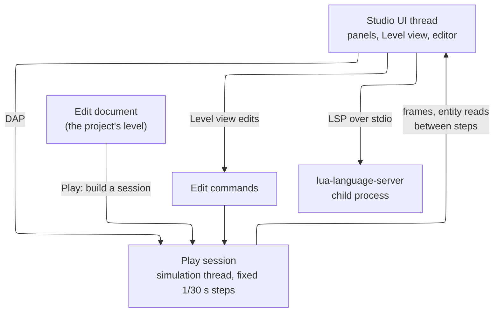

# Coney Studio: technology

This page is a **design**: nothing on it is built. It decides what Coney Studio is made with: the GUI library, whether
Studio is a program of its own, how Play runs the engine and how edits reach it, the code editor and its language
tooling, the script debugger, hot reload, the libraries that import assets and the harness that tests Studio. Each
question lists the alternatives weighed and the choice, and the page ends with the [build issues](#build-issues) it
proposes, in order. Three small proofs settled what reading could not ([Proofs](#proofs)).

What Studio is, its panels, Play's controls and the keymap are the editor experience design; what a script can call,
the runtime projects run on (Lua 5.4), how Play loads a project, the stubs, hot reload of a project and the debugger's
server are the [Lua SDK and natives](lua-sdk.md) design; what Studio can read and write from the game's files is the
content and formats design. This page links or names them and does not repeat them.

## The choices at a glance {#summary}

| Question | Choice | Main reason |
| --- | --- | --- |
| [GUI library](#gui) | Dear ImGui, its docking release, with a designed theme | Coney's overlay and launcher already use it; the engine's frame shows in a panel with one call; MIT; one stack on three platforms |
| [Testing Studio](#testing) | The Dear ImGui Test Engine drives the real Studio: clicks, keys, drags, drops, docking, captures and video | One harness for every panel, the Level view and the Game view included; fixed frame time, byte-identical captures |
| [The program](#program) | A separate `coney-studio` executable that links the same engine libraries as `coney` | The game a player runs carries no editor code; Studio is its own entity that realizes the engine's functions |
| [Play](#play) | In the Studio process: a play session on its own simulation thread, drawn into the Game view | The Level view and the Game view share one world, so live edits are a queue of edit commands; a breakpoint stops only the simulation |
| [Live edits](#live-edits) | Edit commands applied to the running session between steps | Serializable, so the same commands can later go to a child process or a networked peer |
| [Code editor](#code-editor) | goossens' ImGuiColorTextEdit, pinned, wrapped by Studio | Completions, squiggles, hover, multiple cursors, VS Code-like keys, inside the same ImGui frame |
| [Language tooling](#language-tooling) | lua-language-server as a child process, reading the SDK's generated stubs | Completions, hover, type and argument checks for the projects' Lua 5.4 as it is; MIT; about 4.5 MB to download per platform |
| [Script debugger](#debugger) | Studio is a Debug Adapter Protocol client of the engine's server | One protocol for Studio and for VS Code; pausing blocks the simulation thread, not the editor |
| [Hot reload](#hot-reload) | Studio polls the project folder and asks the session to reload; presentation assets swap live, simulation assets ask for Play again | Follows the asset layers' split of presentation and simulation kinds |
| [Importers](#importers) | cgltf (glTF), ufbx (FBX), stb_image (images), dr_libs and stb_vorbis (audio) | Small, permissive, single-file C libraries; no SDK and no new build system |

## What Studio starts from {#starting-point}

| Piece | Where | What it gives Studio |
| --- | --- | --- |
| Dear ImGui v1.92.9b, MIT | `cmake/deps.cmake`, built with the debug tools only | The developer overlay's windows over SDL3 and OpenGL 3 ([The developer overlay](../debug-menu.md#the-developer-overlay)); the pin is the plain release, without docking |
| The launcher's design | [The launcher](../launcher.md#decided) | A second Coney program on SDL3 and Dear ImGui over SDL's GPU API: a precedent for a separate executable |
| The renderer design | [#883](issue:883), in work | SDL3's GPU API behind a backend-neutral seam, Dear ImGui through its `sdlgpu3` backend, and the simulation and drawing on two threads |
| Coney's Lua 4.0 VM and 956 original natives | `src/scripting/`, [Script bindings](../../references/bindings/index.md) | The runtime and the masterlist the editor's completions come from |
| The asset layers and the script split | [Asset and script architecture](../asset-and-script-architecture.md) | Presentation and simulation kinds, the `Native` list, the planned Lua 4.0 compiler |
| A JSON reader | `src/core/json.cpp` | Half of what a Language Server Protocol and Debug Adapter Protocol client needs |

## The GUI library {#gui}

### The alternatives {#gui-alternatives}

| | Dear ImGui (docking) | Qt 6 (Widgets) | Slint | A web UI (Electron, Tauri, or a web view) |
| --- | --- | --- | --- | --- |
| Looks | As good as its theme: flat panels, one accent, real fonts ([Proofs](#proof-shell)). No native look | Native look, mature styling | Modern, declarative styling | Anything CSS can do |
| Docking | Built in (docking release): tabs, splits, saved layouts, `DockBuilder` for a default layout | Through Qt-Advanced-Docking-System (LGPL-2.1) or KDDockWidgets (GPL or commercial) | None built in | A library in JavaScript (golden-layout, dockview) |
| Text editing | ImGuiColorTextEdit forks ([Code editor](#code-editor)) | QScintilla (GPL or commercial) or KSyntaxHighlighting | A plain text box | Monaco, the VS Code editor |
| Showing the engine's frame | `ImGui::Image` of the frame's texture, same device | A `QRhiWidget` or a window container round an SDL window; two event loops | A texture import per backend | Not in-process: frames copied across, or a native window stacked over the page |
| Licence (Coney is GPL-3.0-or-later) | MIT | LGPL-3.0 or GPL or commercial | GPL-3.0, royalty-free or commercial | MIT (Electron, Monaco), MIT or Apache-2.0 (Tauri) |
| Size | A few hundred KB in the executable | 20 to 40 MB of Qt libraries to ship | A few MB, plus a Rust toolchain to build from source | Electron about 100 MB (Chromium); a system web view small, but WebKitGTK on Linux |
| Fit with Coney's build | Already fetched and built by `cmake/deps.cmake` | A prebuilt Qt per platform in CI: a new kind of dependency | Rust in the build | A second language and toolchain |
| Driving it in tests | The Dear ImGui Test Engine: items found by path, simulated mouse and keys, captures, video, fixed frame time ([Testing Studio](#testing)) | Qt Test (`QTest` clicks and keys, the `offscreen` platform, `QWidget::grab`); Squish (commercial) | A testing backend that finds elements by their accessible properties, mainly from Rust | Playwright (Apache-2.0) drives the page; the engine's views inside it stay opaque |
| Accessibility | Poor: no screen reader support | Good | Good | Good |
| Effort for Studio | Most widgets written by us (gizmos, property grids, trees), as every ImGui editor does | Widgets given; the engine view and the input routing are the hard part | Docking and the editor written by us | Two worlds: the UI in JavaScript, the engine in C++, a bridge between |

### Choice: Dear ImGui with docking {#gui-choice}

Dear ImGui, on its docking release (`v1.92.9b-docking`, the same version Coney pins today, so the overlay keeps
working unchanged). The reasons, in the order they weigh:

- **The engine's frame is one call away.** The Level view and the Game view are the engine drawing into a texture
  that a panel shows. With Dear ImGui the panel and the engine share one graphics device, OpenGL now and SDL's GPU API
  after the renderer change; with every other library the frame crosses a toolkit boundary or a process.
- **One stack.** The overlay, the launcher and Studio share one library, one theme and one set of widgets; a panel
  written for one (the Inspector grows from the merged entity panel) runs in the others.
- **One harness tests everything.** With the Test Engine every panel, the Level view and the Game view are items one
  test can find and drive ([Testing Studio](#testing)); the other options test their widgets well but reach the
  engine's views through a second mechanism, and Monaco in a web view would need a second harness.
- **The licence and size** are no question, and the build already knows how to make it.
- **What it lacks we accept:** native look (Studio is themed instead), accessibility (an open question for a maintainer,
  [below](#questions)), and widgets we write ourselves.

Multi-viewport (panels torn out into their own windows) stays off at first: it is the part of the docking release
that varies most by platform, and a docked layout covers the brief.

**The theme.** One file of design tokens (colours, rounding, spacing, the accent), shared by the launcher and Studio,
applied at the [UI scale](../debug-menu.md#ui-scale) the overlay already computes. Fonts are shipped, never taken
from the system: Inter for the interface and JetBrains Mono for code (both SIL OFL-1.1), and an icon font (Lucide,
ISC, is recommended: [Icons](icons.md#recommendation)). The proof's theme took about 50 lines ([Proofs](#proof-shell)).

## Testing Studio {#testing}

Nobody plays Studio to check it, as nobody plays the game ([Testing](../testing.md)): agents write tests that do
what a user does, through the same Studio a user runs, and see the same pictures. The harness is part of the GUI
choice.

### The harness: the Dear ImGui Test Engine {#test-engine}

The Test Engine is Dear ImGui's own automation library, by the same author. It runs a test as a coroutine beside the
application's frames and drives the real UI through Dear ImGui's input queue, so a test goes through the code a click
goes through:

- **Finding things.** An item by its path (`"Hierarchy/**/Vermin"`, `"Inspector/Health"`), a window by its name; the
  item's rectangle, state and label are queried, never guessed from pixels.
- **Doing things.** Mouse moves, clicks, double clicks and drags; keys, chords and typed text; values typed into a
  field; drag and drop between items; docking one window into another; menus and popups opened by their path.
- **Checking things.** `IM_CHECK` on any state Studio exposes, with the failing test's log.
- **Capturing.** A window, a region or the whole frame as a PNG, and a video, both read back from Studio's own frame,
  never from the screen.
- **Running.** In *fast* mode, frames as fast as the machine allows, each with a fixed frame time
  (`ConfigFixedDeltaTime`), with results exported as JUnit XML.

What the operating system sends (a file dropped from the desktop, a window resized or moved to another display, focus
lost) is not a Dear ImGui event, so a test pushes the matching SDL event (`SDL_EVENT_DROP_FILE` and the rest) and Studio
handles it through the one path a real one takes. Drag-and-drop import into the File system panel is tested that way
([Proofs](#proof-test-engine)).

**The licence.** The Test Engine is not MIT: its licence (v1.04) is free for a natural person, a not-for-profit, for
education, for software "released publicly and under an Open Source license" (an OSI one), or for a company under 2
million USD of turnover, and paid otherwise; copies keep its notice. Coney, public under GPL-3.0-or-later, falls in the
free terms, but the licence is not GPL-compatible. A maintainer decided how Coney uses it: **in test
builds only**. `cmake/deps.cmake` fetches it from upstream at a pinned commit for those builds; it is never vendored
into the repository, and never built into a release or a play-test build.

### How it fits Coney's testing rules {#testing-rules}

| Rule ([Testing](../testing.md)) | In Studio |
| --- | --- |
| Fixed time, no real clock | Every UI frame has the same fixed frame time; a play session in a test runs in test mode, one 1/30 s step per frame, with seeded randomness. A third-party widget that reads the real clock is set not to in tests (the code editor's completion delay is 0 ms there) |
| Scripted input | Mouse and keyboard through the Test Engine; the gamepad in the Game view through the same input scripts `coney --input-script` reads |
| [No run waits for a click](../testing.md#no-dialogs) | Studio opens no operating-system dialog in a test: file pickers and message boxes go through one interface the tests replace |
| [Test through the player's path](../testing.md#test-through-the-players-path) | Tests drive the real panels, never test-only widgets; Play in a test is the same play session a user's Play starts |
| No display in CI | Tests that need no picture run over a bare Dear ImGui context with no renderer, as the overlay's tests do, on all three platforms. Tests that capture need a graphics device: a hidden window drawing into an offscreen framebuffer, as the proof does, on the agents' machine, and on CI runners once they have a software renderer |
| Captures of Coney only | A capture is read from Studio's own framebuffer, never a screen or window grab; video frames go to FFmpeg's standard input as `coney --record` sends them, under [the clip rules](../testing.md#clips) |

**How agents write and run them.** A Studio test is C++ in `tests/studio/`, registered with the Test Engine and run by
`coney-studio --test <filter>` with a hidden window; `ctest` runs them under the label `studio`, and `coney-tools build
--test -L studio` picks them. Each run writes its captures and results to the agent's scratch folder, for the pull
request's Screenshots section.

## The program {#program}

| | A separate `coney-studio` | An editor mode of `coney` (`coney --studio`) |
| --- | --- | --- |
| What a player's `coney` holds | No editor code, no Dear ImGui in the release build (as today) | The editor in every build, or a second build of `coney` |
| Studio's own dependencies (text editor, importers, the language server's client) | Linked into Studio only | Linked into the game |
| Shared code | The same engine libraries (`src/` minus `src/platform/main.cpp`), linked by both | The same, in one executable |
| Release and launcher | One more program file in the release manifest | None |
| Debug tools | Studio is a debug-tools build of its own target | Tied to `CONEY_DEBUG_TOOLS` |

**Choice: a separate executable, `coney-studio`,** beside `coney` in the install folder and in the release manifest.
Its code lives in `src/studio/` (the panels, the project, the editor; Coney-only, no `@orig`) and its entry point in
`src/platform/`. It links the same engine libraries as `coney`, so it is never a copy of the engine: a Coney feature
reaches Studio by being in those libraries. This keeps the brief's line between the two: Studio realizes the engine's
functions in editor form, and the game a player runs stays the game.

## Play {#play}

### In the process or a child process {#play-process}

| | In the Studio process | A child process (`coney` started by Studio) |
| --- | --- | --- |
| The Game view | The session draws into a texture the panel shows | A separate window, or a window embedded by platform tricks (Godot's approach: Windows and X11; macOS needed another approach) |
| Live edits from the Level view | Commands applied to the shared world between steps | Commands sent over a pipe, and the child's world streamed back for the Level view to show it |
| Inspecting the running world | Read directly, between steps | A snapshot protocol |
| A crash in the engine | Takes Studio down: an autosave before Play keeps the work | Studio survives |
| Start time | A new session; assets already loaded stay | A process start and a full load |
| Process-wide state | Must become per session (below) | Fresh every time |

**Choice: in the process.** The brief asks for a Level view and a Game view side by side, with edits reaching the
running game in real time; in one process both views look at the same world, and the edit is a command queued for the
next step. In a child process the same thing needs the child's whole world mirrored back into Studio. The cost of the
choice is crash isolation, which an autosave before Play and the recovery file pay for, and a few prerequisites:

1. **Per-session state.** The eight tuning singletons and the tunable registry are process-wide today
   ([Where Coney stands](../asset-and-script-architecture.md#where-coney-stands)); a session must own them, so
   that Stop and Play again start from the same values.
2. **The simulation out of `src/platform/`** (step 6 of
   [Deferred, in order](../asset-and-script-architecture.md#later)): Studio drives the session's update itself,
   without the game's main loop.
3. **Drawing into a target**, which the renderer design's seam gives: a frame drawn into a texture is what both views
   show.

### How Play runs and comes back {#play-session}

*Figure: one Studio process; the session is created from the document on Play and thrown away on Stop.*

- **Play** (the editor experience design's Play mode has its keys and what the player sees) saves the project (and
  a recovery copy), builds a play session from the saved document, and starts it on its own simulation thread at the
  fixed 1/30 s step, with the game's seeded randomness. How the session loads the project's scripts, the map and the
  player (its game mode and load order) is the Lua SDK design's ([Play, step by step](lua-sdk.md#play)); Studio only
  hosts it: it creates the session, feeds it input from the Game view while that has focus, steps it and shows its
  frames.
- **Pause and Step** stop the step clock or run one step, as the debug menu's time control does.
- **Stop** destroys the session. The edit document holds the level edits made while playing and nothing of the running
  game ([Live edits while playing](editor-experience.md#live-edits)); presentation assets loaded for the session stay
  cached.
- **A breakpoint** blocks the simulation thread only: the UI keeps drawing, the Game view shows the last frame, and
  the debugger reads the paused state ([Script debugger](#debugger)).
- **Run in Coney** (a later command) starts `coney` as a child process on the saved project, for a full-window test and
  for testing co-op with two clients over ENet. It is the child-process path kept for what it is good at.

### Live edits during Play {#live-edits}

While a session runs, the Level view shows the session's world beside the Game view, and a gizmo drag, an Inspector
change or a placed object becomes an **edit command**: an id, the entity's id and the new value, never a pointer. The UI
thread queues it and the simulation thread applies the queue at the start of the next step, so a step never sees half
an edit; it is the Entity editor's queue ([Entity editor](../debug-menu.md#entity-editor)) grown to every editable
thing. A level edit made while playing is also kept in the edit document, and an edit of the running game alone is
lost on Stop ([Live edits while playing](editor-experience.md#live-edits)).

Sharing one world in one process is what makes this cheap: the Level view reads the session between steps and draws it
with the same renderer, and an edit is one queued command. With a child process, the same edit would be a message over
a pipe, and the Level view would need the child's whole world streamed back to draw it, a snapshot protocol Coney does
not need for anything else. Edit commands are plain, serializable data all the same, as
[the network checklist](../network-architecture.md#checklist) asks of simulated effects, so they can later go to a child
process (Run in Coney) or to a co-op peer without a second design. What an edit may not do live (replace collision, a
level's streaming data) follows the asset kinds ([Hot reload](#hot-reload)): it asks for Play again. Early bugs here
are accepted; the queue keeps each one inside a step.

## The code editor {#code-editor}

| | Our own, from scratch | goossens/ImGuiColorTextEdit | Zep | Monaco in a web view |
| --- | --- | --- | --- | --- |
| What it has | What we write | Syntax colouring (Lua included), undo, find and replace, multiple cursors, folding, word wrap, minimap, bracket matching, an autocomplete framework, squiggles with tooltips, line markers, hover callbacks | Vim and standard modes, syntax colouring, splits | Everything VS Code's editor has |
| Licence, state | Ours | MIT; maintained, works with Dear ImGui 1.92.9b; C++17; one `.cpp` and one `.h` | MIT; little activity | MIT; needs a web view: WebView2 on Windows, WKWebView on macOS, WebKitGTK on Linux |
| Fit | Months of work before it matches the others | Renders inside the ImGui frame, docks like any panel | Renders inside ImGui | A native child window over an ImGui dock: popups go under it, focus and keys cross two toolkits, and on Linux it needs GTK beside SDL |

**Choice: goossens' ImGuiColorTextEdit**, pinned to a commit in `cmake/deps.cmake` and built with Studio only, wrapped
by a `ScriptEditor` of Studio's own that owns the tabs, the files, the keymap and the connection to the language server.
The widget takes squiggles and hover text from the application, so the language server stays outside the widget
([Proofs](#proof-shell)). The proof used the widget's own completion popup; the script editor design has Studio draw
its own instead, with kinds, documentation and fixed time ([Language features](script-editor.md#language)).

**VS Code keys.** Many of the widget's own keys are VS Code's (Alt+Up and Down move lines, Ctrl+/ comment, Ctrl+F find,
Ctrl+Shift+K delete line), but not all: Ctrl+X on an empty selection copies the line without cutting it, and Ctrl+D,
Ctrl+L and Ctrl+G do other things. So Studio's keymap takes every key over; the keymap, its defaults and each key where
the widget differs are the [script editor](script-editor.md#keymap) design's.

## Language tooling {#language-tooling}

| | lua-language-server (LuaLS) | Our own analysis |
| --- | --- | --- |
| Gives | Completions, hover, signature help, go to definition, references, rename, type and argument checks, undefined globals, from `---@meta` stub files | What we write; syntax errors with lines from the planned Lua 4.0 compiler |
| Lua versions | 5.1 to 5.4 and LuaJIT; no Lua 4.0 mode | Any |
| Licence, size | MIT; 4.5 MB download, 27 MB unpacked (Windows x64) | Ours |
| How Studio runs it | A child process speaking the Language Server Protocol over stdio | In process |

**Choice: LuaLS.** Studio starts LuaLS per project and talks to it with a small LSP client of its own (on Coney's JSON
reader, plus a writer); the widget's experimental LSP bridge covers only completion and hover and brings another
framework. What LuaLS reads (the stubs `coney-tools bindings stubs` generates from the masterlist and the project's
`.luarc.json`) is the Lua SDK design's ([Typed stubs for the language server](lua-sdk.md#stubs)); Studio writes the
`.luarc.json` of a new project and ships the stubs with itself.

Projects run on Lua 5.4, a maintainer's decision ([Lua 5.4 for projects](lua-sdk.md#runtime-choice)), and LuaLS reads
5.4 as it is. The proof ([Proofs](#proof-lsp)) shows why that matters: LuaLS has no Lua 4.0 mode and reports 4.0's
upvalue syntax (`%name`) as a syntax error. So Lua 4.0 sources in the game state (Coney's level rewrites, script
overrides) get their syntax errors from Coney's Lua 4.0 compiler ([The Lua 4.0 compiler](lua-sdk.md#compiler)), not
from LuaLS.

## The script debugger {#debugger}

**Choice: the Debug Adapter Protocol (DAP).** The server lives in the engine beside the runtimes, with the features
the Lua SDK design lists ([The script debugger](lua-sdk.md#debugger)). Studio's script editor is a DAP client: it sets
breakpoints from the gutter, shows the current line with the widget's line markers, and the call stack, variables and
watches in a Debug panel. Because DAP is the standard, VS Code can attach the same way to a `coney` built with the debug
tools.

- **How Studio reaches it.** The server runs in Studio's process with the play session, so Studio's client talks to it
  in process; the loopback socket the SDK design names is for an editor outside Studio.
- **Pausing.** A breakpoint blocks the simulation thread inside the step; Studio's UI thread goes on drawing, the Game
  view shows the last frame and the panels stay live ([Play](#play-session)). This answers the SDK design's open
  question on the pause: with Play in Studio's process on its own thread, the Game view keeps drawing.

## Hot reload {#hot-reload}

- **Watching.** Studio owns the project folder, so it watches it: a background thread compares the files' sizes and
  times once a second. That works on every platform with no dependency; if large projects make it slow, efsw (MIT) or
  dmon (BSD-2-Clause) replaces the poll behind the same interface.
- **Scripts.** A changed script is a reload request to the running session; the project restarts at the next step
  boundary, and a file that fails to compile leaves the running state alone, as the Lua SDK design's
  [Hot reload](lua-sdk.md#hot-reload) says. Studio shows the compile error in the Problems panel.
- **Assets.** The [asset layers](../asset-and-script-architecture.md#asset-layers) already split the kinds:
  presentation kinds (textures, sounds, models' looks) are swapped in the running session; simulation kinds
  (collision, levels, animation clips, character data) mark the session stale and the Play bar asks for Play again.

## Importers {#importers}

Studio imports what Blender and audio tools export, into the project's own formats (which the content and formats
design defines). Studio does not model or animate.

| What | Choice | Licence | Alternatives weighed |
| --- | --- | --- | --- |
| glTF 2.0 (`.gltf`, `.glb`): meshes, materials, skins, animations | cgltf | MIT; one C header | tinygltf (MIT; pulls in a JSON library and stb_image), fastgltf (MIT; fastest, needs simdjson) |
| FBX (binary and ASCII): meshes, skins, animations, blend shapes | ufbx | MIT or public domain; one C file | Autodesk FBX SDK: a proprietary licence that cannot be combined with GPL-3.0 code we ship |
| Images (PNG, JPEG, TGA) | stb_image | Public domain or MIT | librw's PNG reader, which is a renderer detail the asset layers keep out of loaders |
| Audio (WAV, FLAC, MP3, Ogg Vorbis) | dr_wav, dr_flac, dr_mp3 and stb_vorbis | Public domain or MIT-0 / MIT | Widening Coney's FFmpeg, trimmed to Bink on purpose (`cmake/ffmpeg/`) |

A Blender user exports glTF or FBX, as Blender does natively; `.blend` files are not read. All four are fetched and
built with Studio only, never with the game.

## Proofs {#proofs}

Three proofs, kept in the unit's scratch folder and not in `src/`: they answered their questions and Studio's real code
starts from the issues below.

### A docked shell with an editor {#proof-shell}

A program of about 300 lines on SDL3, OpenGL 3 and Dear ImGui `v1.92.9b-docking`: a menu bar with Play, Pause and Step,
a default layout made with `DockBuilder` (Hierarchy and File system on the left, Level, Game and a script tab in the
middle, Inspector on the right, Console and Problems below), a Game view showing a texture drawn by a stand-in for the
engine, the designed theme, and goossens' editor (commit `12a5a01d`) with Lua colouring. Typing `HuSetAcc` opened the
completion popup with `HuSetAccurate`, from the natives stub; LuaLS's diagnostics for the file showed as squiggles with
tooltips and as lines in Problems. It built through `coney-tools build` with the editor's one source file and Dear
ImGui's. What it settled: the docking release, the widget's completion and squiggle APIs
and a texture in a docked panel work together as this page assumes. The pull request shows its screenshot.

### The Test Engine driving the shell {#proof-test-engine}

The same shell, built with the Test Engine (commit `044a7799`) and a hidden window, ran five tests: select Vermin in the
Hierarchy, type 42 into the Inspector's Health, drop a file `hero.glb` onto the window (an `SDL_EVENT_DROP_FILE` pushed
by the test) and find it in the File system panel, dock the Inspector into the Hierarchy, and type `HuSetAcc` in the
editor and accept the completion with Tab. In each of three runs all five passed in about 6 s (the JUnit file's 5.9 to
6.5 s, most of it encoding the video), writing a PNG of the File system window, a PNG of the whole frame, a 3 s video of
91 frames piped to FFmpeg and a JUnit XML file. The three runs gave byte-identical PNGs and MP4s. One finding: the
editor's completion popup waits 200 ms of real time, so a test sets that delay to 0.

### lua-language-server with the natives {#proof-lsp}

LuaLS 3.19.2 on Windows x64, a stub of all 956 natives generated from the masterlist (543 KB), a mod in Lua 4.0 style
and one in Lua 5.x style, read once with `--check` and three times over LSP by a small client (the first run cold):

| Measured | Result |
| --- | --- |
| Start and initialize | 0.11 to 0.81 s |
| First diagnostics for an opened file | 0.96 to 1.41 s |
| Completion of `HuSetAcc` | 25 to 228 ms, `HuSetAccurate(human, accurate)` among 18 fuzzy matches |
| Hover on `HuGetPosition` | 2 to 17 ms, the signature and the masterlist's description |
| A string passed for a handle, a second argument too many, an unknown native | each reported, in both styles |
| Lua 4.0's `%count` and `getn` | a syntax error and an undefined global |
| The stub as one 543 KB file | ignored until `workspace.preloadFileSize` was raised past its 500 KB default; the SDK's one file per category keeps each under it |

## Build issues {#build-issues}

In the order they should come. Each assumes the ones above it. The [Lua SDK design's issues](lua-sdk.md#build-issues)
interleave with them: its runtime and loader (its issues 1 to 3) come before Play (5 here), its stubs (its 5) before
the script editor (7 here), its DAP server (its 8) before the debugger (8 here), and its hot reload (its 6) before hot
reload here (9).

1. **`build: Update Dear ImGui to its docking release`.** Move the pin in `cmake/deps.cmake` from `v1.92.9b` to
   `v1.92.9b-docking` (the same version with docking), with docking turned on in the developer overlay so its windows
   dock. Nothing else in the overlay changes; its tests and the `--dev-overlay` screenshot check prove it.
2. **`tools: Add the coney-studio program with a docked shell`.** A new executable from `src/studio/` and an entry point
   in `src/platform/`, linking the engine libraries: open or create a project folder, the theme tokens and fonts (Inter,
   JetBrains Mono, an icon font), the default layout from the editor experience design, layouts saved per user, and the
   File system panel rooted at the project. Tests run the shell over a bare Dear ImGui context, as the overlay's do.
3. **`tests: Add the Dear ImGui Test Engine harness for Coney Studio`.** The Test Engine pinned and built into Studio's
   test builds only, `coney-studio --test`, the `studio` ctest label, captures and video from Studio's own frame
   through the clip rules, an interface over file dialogs, and the first tests: the default layout, a docked panel
   moved, a file dropped into the File system panel.
4. **`core: Rework the tuning state to belong to a session`.** The eight tuning singletons and the tunable registry move
   into a session object that the game mode owns, so two sessions in one process never share values. No behaviour
   changes; the existing tests and a new two-session test prove it.
5. **`tools: Add Play to Coney Studio`.** A play session built from the saved project on its own simulation thread,
   drawn into the Game view, with Play, Pause, Step and Stop, input from the Game view, an autosave and recovery file
   before Play, and the edit document untouched by the running game. Needs the simulation out of `src/platform/` and
   the Lua SDK design's game mode. A scripted test plays, stops and plays again and compares the two sessions' traces.
6. **`tools: Add live edits from the Level view during Play`.** Edit commands (ids and values) queued by the UI and
   applied between steps, the Entity editor's queue grown to every editable thing; level edits kept after Stop, as the
   editor experience design asks. Tests apply commands to a headless session.
7. **The script editor: replaced** by the [script editor design's build issues](script-editor.md#build-issues), which
   split this one (the widget, the editor panel, the language server, go to definition and the rest) and add the
   keymap with contexts, the Studio-aware strings and the event fields. They come here in the order, after Play and
   before the debugger.
8. **`tools: Add the debugger to the Coney Studio script editor`.** The DAP client: gutter breakpoints, the current
   line, the Debug panel and the F5 to F11 keys; pausing keeps the UI running.
9. **`tools: Add hot reload of scripts and assets to Coney Studio`.** The project poller, reload requests for changed
   scripts sent to the session, presentation assets swapped live, and simulation assets marking Play stale.
10. **`tools: Add glTF, FBX, image and audio import to Coney Studio`.** cgltf, ufbx, stb_image, dr_libs and stb_vorbis
    pinned and built with Studio only, behind drag and drop into the File system panel and the Import button, writing
    the content design's formats. Tests import synthetic files made by the tests themselves.
11. **`tools: Add Run in Coney to Coney Studio`.** Starts `coney` as a child process on the saved project, and a second
    client for a co-op test over ENet.

## Questions for a maintainer {#questions}

- **Shipping Studio.** `coney-studio`, Dear ImGui, the importers and LuaLS (27 MB unpacked) in every release, or as an
  optional download the launcher fetches? This page assumes the release manifest lists them all.
- **Accessibility.** Dear ImGui has no screen reader support. Is that acceptable for Studio?
