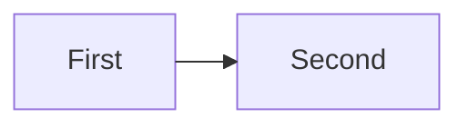

# Writing these docs

The docs are plain Markdown in `docs/`, built into a website with
[MkDocs Material](https://squidfunk.github.io/mkdocs-material/). Navigation is set in `mkdocs.yml`.

## Setup (once)

In a virtual environment at the repository root:

```powershell
py -m venv .venv
.venv/Scripts/pip install -r requirements-docs.txt
```

On Linux and macOS use `python3 -m venv .venv` and `.venv/bin/` in place of `.venv/Scripts/`.

## Preview and build

```powershell
.venv/Scripts/python -m mkdocs serve --dev-addr 127.0.0.1:8000   # live preview, reloads as you edit
.venv/Scripts/python -m mkdocs build --strict                    # static site into site/, as CI builds it
```

`--strict` turns broken links and pages missing from the navigation into errors, so run it before every commit that
touches `docs/` or `mkdocs.yml` ([The local gate](testing.md#local-gate)). The Changelog page is generated from
`git log` at build time, so it needs the full history (no shallow clone) and is never committed. This section is the
one home of these commands; the README, [Building and testing](building.md#documentation) and CONTRIBUTING link here.

## Publishing

The site is published on GitHub Pages; its address is in the README (the only file that names it). The `docs`
workflow builds it on every push and pull
request, and a push to `main` also deploys that build to GitHub Pages (the `deploy` job), so the published docs are
always those of `main`. There is nothing to run by hand; a page appears online a minute or two after its commit
reaches `main`. Pull requests and other branches build the site as a check but never publish it.

The site opens in the dark palette (`slate`) whatever the reader's system setting; the toggle in the header switches
to light, and Material keeps that choice for the next visit. The order of `theme.palette` in `mkdocs.yml` decides it.

## Diagrams {#diagrams}

A diagram is a Mermaid fence, drawn in the reader's browser with the ELK layout engine. Start it with the front matter
below, so that ELK lays it out, and give it a one-sentence caption under the fence. A diagram illustrates a rule that
the text states; it never replaces the text. Keep one to about fifteen nodes, with short labels (`<br/>` breaks a
line), and put a long label in the text instead.

````markdown

````

- **Why a script.** Material for MkDocs draws a diagram with its own copy of Mermaid, which has no ELK.
  `docs/javascripts/mermaid-elk.js` (listed under `extra_javascript` in `mkdocs.yml`) puts a small stand-in where
  Material looks for Mermaid. The stand-in loads a pinned Mermaid and `@mermaid-js/layout-elk` from jsDelivr when
  the first diagram of a page is drawn, so a page without a diagram loads nothing extra. To upgrade, change the two
  pinned versions in that file to releases at least two weeks old and look at every diagram again.
- **Size.** A diagram is drawn at its own width, centred, and never wider than the column. On a narrow screen it
  stops shrinking at 640 pixels (or its own width, if smaller) and scrolls sideways, so its text stays readable. A
  tall chain therefore reads better than a wide one: `flowchart TB` keeps its text full size, while a long
  `flowchart LR` row shrinks to fit.
- **Light and dark.** Material colours the diagram from the palette (its `--md-mermaid-*` variables), so the palette
  toggle changes it at once. Do not set colours in the diagram (`classDef`, `style`): they would stay the same in both.
- **Layout.** Nodes in one chain with `flowchart LR` wrap into rows by themselves. Avoid a `subgraph` that arrows enter
  and leave from several sides, and long arrows back to an early node: ELK then reverses the flow or draws long
  detours. Preview with `mkdocs serve` in both palettes before committing.
- **Needs a network.** The diagrams are drawn from the CDN, so a reader who is offline sees the fence's text instead.

## The home page {#home-page}

`docs/index.md` is the site's landing page: a full-height hero over a painting, then the page's own content. The hero's
bottom blurs and fades into the page background, and as you scroll the art drifts at a slower pace than the page, the
fade grows upwards and the text lifts and fades out, while the header takes its colour. The design follows the home page
of Material for MkDocs; the files are Coney's own:

| File | What it holds |
| --- | --- |
| `docs/index.md` | The page's text, and in its front matter (`template: home.html`, `hero:`) the hero's heading, tagline, buttons, art path, crop and credit |
| `overrides/home.html` | The template (`theme.custom_dir` in `mkdocs.yml`): the hero's markup around the page content |
| `docs/stylesheets/home.css` | The look and the effect, every rule scoped to a page that has a hero |
| `docs/javascripts/home.js` | One scroll listener that writes how far the hero has scrolled (0 to 1) into `--coney-p`; the stylesheet does the rest |
| `<!-- progress:home -->` in `docs/index.md` | Where the docs build puts the picture of every function, one square each, with the progress page's tooltips ([progress](coney-tools-references.md#progress)); it is never committed |
| `assets/art/hero.webp`, `hero.jpg` | The artwork, shared with the launcher ([LEGAL.md](repo:LEGAL.md#site-and-launcher-artwork)) |

- **The art.** Replace `assets/art/hero.webp` and its fallback `assets/art/hero.jpg` with the new picture, same names,
  16:9, about 1920 x 1080 and under 512 KB each (the large-file check, which is never excluded). The art is
  `object-fit: cover`, so a phone shows its middle: set `hero.position` in the front matter (`50% 30%` is x and y) to
  keep the faces in view. A different file name is the `hero.image` front matter line, without the extension.
  `mkdocs_hooks.py` serves the two files from `assets/art/` (the build fails if one is missing), so there is one copy.
- **The buttons.** Each `hero.actions` entry is `page:` (a page's path under `docs/`; a page that is not in the
  navigation fails the build) or `repo: true` (the repository's address, which the build works out, so no file writes
  it). `primary: true` fills the button.
- **The text.** It sits above the fade, in light type, whatever the palette: the art is dark and a scrim darkens the
  top and left of it. The artist's credit in `hero.credit` links to the licence note.
- **Reduced motion.** With `prefers-reduced-motion` nothing moves: the hero is still and keeps the fade at its bottom.
  Only the header's colour still follows the scroll, so that its text stays readable.
- **Not Material's own parallax.** Material's page scrolls inside a 3D-transformed container; this one scrolls the
  page, so the header, search, the back-to-top button, instant navigation and anchors behave as on every other page.

## Page kinds

Each kind of document has one place and one set of rules. Every page on this site is a living document, one per
subject, updated in place, so a reader never has to work out which of two pages is current.

| Kind | Where | Rules |
| --- | --- | --- |
| Research | `docs/research/` | Living; one page per subject, of one of six kinds with front matter and the sections of its kind; evidence levels; a map from each described behaviour to the original function that implements it ([Research pages](#research-pages)) |
| Source map tables | `docs/research/source-map.md`, at its marker | Generated by the docs build from `research/source-files.toml` ([the source files](research-source-files.md)), never committed; edit the TOML instead |
| Find pages | `docs/research/find/addresses.md`, `words.md` | Generated by the docs build from the pages' `owns`, the Ghidra listing and `research/glossary.yaml` ([finding where a behaviour lives](research-where.md#find-pages)), never committed; edit the front matter or the glossary instead |
| Function lists | `docs/research/<system>/functions.md` | Generated by the docs build from `research/functions/<system>.toml` ([the function database](research-function-database.md)), never committed; edit the TOML instead |
| Progress | `docs/progress/` | The tables at the `progress:generated` marker are produced by the docs build, never committed; edit the data files beside the page instead |
| Game references: lists | `docs/references/` | Generated from `research/references/` by `coney-tools refs render`; edit the YAML instead. `entities.md` is written by hand |
| Game references: script bindings | `docs/references/bindings/` | Generated from `research/bindings/` by `coney-tools bindings render`; edit the YAML instead |
| Engine | `docs/engine/` | Living; how Coney works: its own internals and port notes, never what the original does ([Engine pages](#engine-pages)) |
| Guides | `docs/guides/` | Living; how to build, contribute, research and review |
| Designs | `docs/guides/` | A plan for work that is not allowed or not started yet, with the questions only a maintainer can answer ([enhancements](enhancements.md), [realtime lighting](realtime-lighting.md), [asset and script architecture](asset-and-script-architecture.md)). Not a how-to: say at the top that it is a design, and move what is built into a guide or research page. The design of an engine part's next steps may instead sit on that part's engine page ([Engine pages](#engine-pages)) |
| Missions | `docs/missions/` | Generated from `research/missions.yaml` by `coney-tools missions render`; edit the YAML instead |

## Touch a page, fix the page {#touch-it}

Whoever changes a page brings **what it changed** up to this standard in the same pull request: every section of the
page the change touches (a `##` or `###` heading and what is under it, up to the next such heading; the title's part
above the first is one, with the front matter and the Verified line) meets its kind's rules ([Page kinds](#page-kinds)),
the [Style](#style) rules and, for a research page, the [research page](#research-pages) rules and the [evidence
levels](research-evidence.md#evidence-levels). A **new page** meets all of it. The rest of an old page does not fail the
change, a maintainer decision of 2026-10-30: a fix of three lines does not owe a rewrite of the page around them. A
program holds the line ([Checking a page](#checking)): it checks every page a change touches, fails on any rule a
touched section breaks however old the line that breaks it, and lists what the rest of the page breaks as information.

Fixing a section means the section, not the lines you wrote: complete it, grade its claims, reword what the Style rules
refuse; touching the title's part owes the front matter, the sections the kind needs (a section with nothing
known says so in one line) and the Verified line. The page's length is owed whenever the page is touched: a page that
has grown past its limit is split along a sub-subject that has its own page, in the same pull request or in one that
follows at once. What the check lists outside the change is cleanup work of its own: the coordinator files it as
issues from `coney-tools docs check --cleanup`, which prints each such finding, and nobody fixes it on the side of an
unrelated change. A research page that is below the standard is [legacy](#legacy-pages): its entry excuses what it
lists outside the sections a change touches.

The same rule holds for the other things a change touches: each function and type of a source file the change touches
meets the comment and tag rules of [the conventions](conventions.md#comments-and-orig), each test case it touches cites
the source of its expected values ([testing](testing.md#citations)), a new file meets them throughout, and a ported
function whose lines it touches is compared with the original. A move is judged by what it changed: a source file
renamed with git is read from the diff of the renamed pair, and a function the change only moved, to another file,
folder or class with its code, tags and standing as they were, keeps the standing it had ([Any
function](orig-body-hash.md#any-function)). What is below the standard today is listed, and
`coney-tools standards` holds the touched parts to it ([the standards](coney-tools-standards.md#standards)). How far
the rule reaches, the section's heading level and the rules owed page-wide, is `standards.touch` in
[.github/conventions.yml](repo:.github/conventions.yml).

## Adding a page

1. Put it where its kind says (above). Before creating a research page, check that no existing page covers the
   subject; if one does, extend it.
2. Add it to `nav:` in `mkdocs.yml`. The strict build fails on a page that is missing from the navigation
   (`mkdocs.yml` sets `validation: nav: omitted_files: warn`, and `--strict` turns that warning into a failure).
3. Link files outside `docs/` (such as `LEGAL.md`) as `repo:<file>`, e.g. `[LEGAL.md](repo:LEGAL.md#no-game-data)`:
   the strict build rejects relative links that leave `docs/`, and `mkdocs_hooks.py` turns these into links to the
   file on GitHub. Link an issue or pull request as `issue:<number>`, e.g. `[#123](issue:123)`: the same hook turns it
   into the issue's page, from the same repository address (neither scheme is rewritten inside code, so a code span or a
   fenced block shows the form as written). Never write the repository's or the site's address into a
   file, code comment or commit message; the README is the one exception. Name roles, not people or accounts: "a
   maintainer decision", not who made it.
4. On a research page, start with the front matter of its kind and keep the sections of that kind
   ([Research pages](#research-pages)), and give every behaviour an address and an evidence level: confirmed (code),
   confirmed (runtime), inferred or speculative. The levels and their spellings are in
   [Evidence levels](research-evidence.md#evidence-levels). A new page is never legacy. Run [the check](#checking)
   before you commit.

## Style

- **One subject per page, said once.** Before writing a rule or a figure, search the docs for it; if a page already
  owns it, link to that page (a heading anchor) and do not restate it. Two copies drift apart.
- **Pages say what and how; code comments say why.** A guide says how to do the thing and links the reasons; do not
  paste a command or a list that another page owns.
- **Generated text is never edited.** A block between `<!-- conventions:begin ... -->` markers, the parameters of the
  coney-tools commands (between `<!-- command-reference:begin ... -->` markers), and the pages under
  `docs/references/`, `docs/missions/` and the progress tables, are rebuilt from their source; change the source
  ([Repository conventions](repo-conventions.md#generated-blocks),
  [the parameter reference](coney-tools.md#parameter-reference)).
- **Links.** A file outside `docs/` is `repo:<path>` and an issue or pull request is `issue:<number>` (step 3 above;
  the `repo-link` rule accepts both). Link a heading, not just a page, when the point is in one section.
- **Name roles, not people.** Write "the user" for the person who tests, reports or directs and "a maintainer" for the
  one who decides; never "the owner" (the `repo.wording` key of `.github/conventions.yml`). Do not give dates or
  names to say who decided something.
- **No machine paths.** Write `<workspace>`, `scratch/` or a relative path, not a drive letter or a home folder.
- **Say what is true now.** No "still small", "once it exists" or "not yet" for something that already exists; a
  thing that is planned says "planned" in the one place that owns it.
- **Review checklist:** [Docs review](review/docs.md) lists what a reviewer looks for.

## Research pages {#research-pages}

A research page is a **map** from what the game does to the original code that does it. Engineers port from the
original function: they read it in Ghidra, so the page does not replace the code and does not try to be implementable
without it. What the page holds is what the code does not say: which function does what and where its logic lives, the
layouts, constants and units, what was observed running, how sure we are, and what is still open.

Each behaviour the page describes **names the original function that implements it**: its address and its name (the
name from Ghidra, or the name the page gives it when the original has none) and, where the logic is spread over several
functions, the one where it lives. A behaviour with no function named is a finding for the reviewer.

### Kinds and front matter {#front-matter}

A page is split by subject, never by length or by where the code sits in the binary, and it is one of six kinds. It
starts with YAML front matter, which MkDocs reads as page metadata and the reader never sees:

```yaml
---
kind: topic                                  # system | topic | format | mission | feature | survey
system: combat                               # system and topic pages: the system they belong to
owns:                                        # the addresses the page describes
  files: ["Human/cnsplayertag.cpp"]          # source files, as the source map names them
  ranges: ["0x00284920-0x00288000"]          # [start, end), for code no file name covers
  functions: ["0x00225830"]                  # single functions taken from another owner
---
```

The kinds, their sections and the limits `docs check` holds a page to (read from `research` in
[.github/conventions.yml](repo:.github/conventions.yml), the one source):

<!-- conventions:begin research-pages -->
| Kind | Sections, in order | Lines | `system` | `owns` |
| --- | --- | --- | --- | --- |
| `system` | Summary, Map, Data, Behaviour, In Coney, Open questions, *How this was checked* (optional) | 1,500 | required | required |
| `topic` | Summary, Map, Data, Behaviour, In Coney, Open questions, *How this was checked* (optional) | 1,500 | required | required |
| `format` | Summary, Map, Layout, *Behaviour* (optional), In Coney, Open questions, *How this was checked* (optional) | 1,000 | none | optional |
| `mission` | Summary, Flow, Cast and objects, Scripted events, Open questions, *How this was checked* (optional) | 1,000 | none | none |
| `feature` | Summary, Rules, Map, Behaviour, In Coney, Open questions, *How this was checked* (optional) | 1,000 | none | optional |
| `survey` | Summary, Method, Findings, Open questions, *How this was checked* (optional) | 1,000 | none | optional |

- Old section names are accepted as the new ones: `Purpose` for Summary, `Original structure` for Map,
  `Coney's implementation` for In Coney, `Runtime checks` for How this was checked and `Disc counts` for How this was
  checked.
- And `Data` for Layout on a `format` page.
- The `Verified against:` line is one line of at most 200 characters. A paragraph of 200 characters or more written on
  two research pages is a copy.
- An address needs no level in Summary, In Coney, Open questions and How this was checked.
- A date or an issue number may stand only in In Coney and How this was checked.
- A page with no front matter is read as `system`, or `format` under `docs/research/formats/`.
<!-- conventions:end -->

- **system**: one subsystem of the original, a source directory or a group of its files. It owns its files, less what
  its topic pages own.
- **topic**: one group of behaviours inside a system that has its own entry functions and that a reader would come for
  alone. It owns those functions, the system's Map has one row per behaviour moved to it, and nothing is written twice.
- **format**: a file or data format on the disc. It owns its reader functions only when no system does.
- **mission**: one level's flow: checkpoints, triggers, cast and scripted events. It owns nothing and cites system
  pages; a claim about a script cites a locator, `` `level99.lua:f31` `` for function prototype 31 of that chunk.
- **feature**: a mode or player-facing feature that spans systems.
- **survey**: a study of the whole executable or disc (the source map, the compiler, the name hash).

**One owner per address.** A file, a range or a function is in the `owns` of one page. A page may take a single
function, or a smaller range, out of what another owns (the most specific entry wins); two pages that own the same
thing, or two ranges that cross, are refused. Another page may cite an address to make its own point, but the
function's role, its branches and its constants are written once, on the page that owns it, and others link to that
section: a paragraph of 200 characters or more on two research pages is refused. A system has one page and a topic
names a system that has one.

### Sections {#sections}

After the front matter come a `# Title`, one `Verified against:` line and then the kind's sections, **in order and no
others** (what does not fit goes into a `###` subsection of one of them). A section with nothing known says so in one
line. The headings of a system or topic page:

| Section | What it holds |
| --- | --- |
| Summary | What the player sees, then how it works in a paragraph; what it is not and where its neighbours are |
| Map | The source files and ranges, each with its level; a table from behaviour to function; the entry points, with their levels |
| Data | Structs with offsets, types, meanings and who writes them; constants with units; byte order; how each is found |
| Behaviour | One `###` per behaviour, each opening with the function where its logic lives; order, conditions, edge cases, constants |
| In Coney | Where the port lives (file and function), its stand-ins and deliberate differences, each linked to an open question; the only place for an issue number or a date besides How this was checked |
| Open questions | Each anchored `{#q-...}`: what is unknown, what depends on it, how to find out |
| How this was checked | Optional: the method of an old runtime claim, a disc check's procedure |

A format page has Layout where a system has Data and Behaviour (optional) before In Coney; a mission page has Flow, Cast
and objects and Scripted events; a feature page has Rules; a survey has Method and Findings. The old names are accepted
for the new ones until a page is renamed (the generated list above): Purpose for Summary, Original structure for Map,
Coney's implementation for In Coney.

The `Verified against:` line says what was read, not how, in one line: the executable (`SLUS_212.15`, NTSC-U) or the
document or pinned library after the colon. Dates, emulator versions, save-state slots and methods do
not belong on it; a runtime claim cites its run record and an old one keeps its method in How this was checked.

Here is a topic page, shortened:

````markdown
---
kind: topic
system: combat
owns: {functions: ["0x00284920", "0x0026c548"]}
---
# Combat: grabs, the hold and the mount

Verified against: `SLUS_212.15` (NTSC-U); runtime claims cite run records.

## Summary

Circle catches the man in front; held, it runs him down. Throws are on [Combat: throws](throws.md).

## Map

| Behaviour | Function | Section |
| --- | --- | --- |
| Circle: grab or tackle | `0x00284920` `Player_GrabOrTackle` | [Grab and tackle](#grab) |

## Data

| Field | Meaning | Evidence |
| --- | --- | --- |
| record `+0xb4` | the grab's base id, set by `Grab_Start` `0x0026c548` | confirmed (code) |

## Behaviour

### Grab and tackle {#grab}

`Player_GrabOrTackle` (`0x00284920`) picks a grab or a tackle from the distance (confirmed (code)).

## In Coney

`src/core/combat/grab.cpp` (`Grab::start`). Stand-in: the counter roll is fixed ([q-counter](#q-counter)).

## Open questions

- **The counter chance**{#q-counter}: read as `rand() % N` with `N` from a table not yet named.
````

### Evidence levels on a page {#evidence-levels}

The four levels and how each is spelled are in [Evidence levels](research-evidence.md#evidence-levels). The check
looks at every block (a paragraph, a list item or a table row) that cites an address, or a script locator, outside
Summary, In Coney, Open questions and How this was checked, and passes it when a level stands:

- in the block itself; or, for a row of a table with an Evidence column, in that cell (the column is the place for it,
  so an empty cell fails whatever is said elsewhere); or
- under a `###` heading or deeper whose **first block is a lead line**: a statement that cites no address and states
  a level ("Confirmed (code) at the cited addresses unless a line says otherwise."). It covers the blocks under that
  heading until the next heading of any level, and the reviewer checks that it is true of every one of them.

A sentence at the top of the page, a level in a neighbouring paragraph, a level in a heading and a lead line under a
`##` heading grade nothing: they cover pages, not claims. A Map table with no Evidence column is an index: it is not
graded as a table of claims, because the behaviour it points to is graded where it is described (Behaviour). Once the
function entries exist (`research/functions/`), a Map row will be exempt only when its address has an entry, and this
paragraph will say so. The forms are checked too ([the spellings](research-evidence.md#level-forms) are listed once,
there):

- `confirmed (runtime)` says `, run <id>`, and the record `research/runs/<id>.toml` must exist. There is no such folder
  yet, so a new page cannot make a runtime claim until the first run record is committed
  ([Run records](research-evidence.md#run-records) says how to write one, and the check names the command). What no
  run observed is `speculative`, with an open question. A page in the [legacy file](#legacy-pages) may keep an old
  runtime claim that names PCSX2 in its Verified line or in How this was checked, and its run ids are not checked
  while the folder is missing; so does a legacy page [moved with git](#legacy-pages). Such a claim is still a finding of
  the `evidence` rule that its entry excuses (a warning, counted in the entry), so the entry stays, and `docs legacy
  --prune` keeps it, until the claims cite run records.
- `speculative` links an open question of the page (`[q-name](#q-name)`) that exists.
- `inferred` should say what it follows from (`inferred from the call order`): a warning when it does not.
- A spelling that is no level is refused, and so is "probably" or "likely" in an Evidence cell.

### Addresses {#addresses}

An address is `0x` and eight hex digits in `SLUS_212.15`: `0x0026c548`. Cite a function as its address and its name,
`` `0x0026c548` `Grab_Start` `` or `` `Grab_Start` (`0x0026c548`) ``; the name must be the one the shared Ghidra project
gives it (a warning: refresh `docs/progress/ghidra-functions.tsv`, or the page, never undo a name in Ghidra). The
check refuses:

- the short form of a named function's entry (`0x149160`) and of a global in `.data` or `.bss` (`0x6fe998`): write
  `0x00149160` and `0x006fe998`. A field offset (`+0xb4`), a mask or a value is written short and is not an address
  (the check has two false hits: a colour value that happens to fall inside `.bss`, and a size such as the memory
  size of the executable in `docs/research/overview.md`; write either in decimal or as its parts);
- an address that is no function entry, no place inside a function of that listing and in no data section of the
  executable (`research/elf-sections.toml`). The end of a range (`0x00284920-0x00288000`) need only lie in the image.
  A function Ghidra has not made yet is created and named first; an address in memory the program allocates (a heap
  object) is not in the executable: cite the global that holds it. The section How this was checked is not held to
  this, because a run may watch a heap address and the method says which.

### Dates, plans and length

No date and no issue number stands outside In Coney and How this was checked: git and the pull requests keep history,
and plans are issues. A page is no longer than its kind's limit (front matter and generated pages do not count); the
cure is a topic page split off along a group of behaviours with its own entry functions, never a cut by line count.

### Legacy pages {#legacy-pages}

A research page that cannot meet this standard in the change that touches it is listed in `research/legacy.toml`, under
the rules it fails and with the number of findings at the last scan. `docs check` then:

- reports the findings of those rules as one warning each, while no change touches the page (it is checked by name),
  and fails on every other rule, as for any page;
- ends the excuse in the sections a change touches ([Touch a page, fix the page](#touch-it)): there every rule is
  owed, the grading of each block (an address with no level, an old-form runtime claim: `confirmed (runtime)` with no
  run id, on a page that does not name PCSX2) as much as the address forms, Ghidra's names, copied paragraphs, dates,
  stale wording and the spellings and run ids of the levels; touching the title's part owes the front matter, the
  sections and the Verified line. Outside the touched sections the entry goes on excusing what it lists, as one warning
  per rule. The page's length stays waived until the page's restructure;
- fails a rule the page now passes until it is removed from the file, so the file only shrinks; and
- refuses a new page in the file. A new page meets the standard in full.

**A page moved with git keeps its grading exemption and nothing else.** When a restructure moves a legacy page (a
rename, say `combat.md` to `combat/index.md`), it is read as any touched page, from the lines git's diff of the renamed
pair changes. Its entry's `evidence` rule goes on excusing the grading of the sections the move left alone, as the
research-page design intends ("grading may still lag"): an address with no level, and a runtime claim of the old form or
with no run record to cite (the rule that a page outside the file may not make one while `research/runs/` is missing).
The grading of a section the move changed is owed like any touched section's. Every other rule is checked in full, on
the whole page, whatever the entry lists: `length`, the front matter, sections, Verified line, address forms and
resolution, history and copied paragraphs, and the spelling of a level and a run id that names no record. What counts as
moved is what git says, not what the file says: a rename that `git diff -M` finds against the commit where the branch
left `main`, at the similarity `research.moved_similarity` of `.github/conventions.yml` (50%, git's default) or more. So
the entry cannot be used to launder a new page: a copy of a legacy page, or a new page beside a deleted one with too
little of its text, is new and cannot be listed. The entry follows the page: `coney-tools docs legacy --prune` moves the
old path's entry to the new path, keeping `evidence` alone, and the check refuses an entry for the new path that lists
any other rule, or `evidence` when the old entry did not, and an old entry left beside the new one. The count is not
compared with the old entry's: counts say how much is left, and are never compared with a page. Stage the move (`git
mv`, or `git add` the new page and the deletion) so git can pair them. Once merged, the page is an ordinary legacy page.

**A link rewrite that follows a move is no touch.** A line whose only change is the target of a link `[text](target)`
does not touch the page that holds it when, for each link it changes, the old target's page was renamed or deleted in
the same change (any anchor) and the new target resolves to an existing page that has the anchor. A page that moved to
another folder rewrites its own relative links for it: a link to the same page and anchor is no touch either (the old
target is read from the folder the page left). So is a link to a section that moved between two pages that stayed
(cutting `combat-moves.md#targeting` to `combat-targets.md#targeting`): the link's anchor id is the same, the old page
held it before the change and no longer does, and the new page holds it now but did not before (ids such as
`open-questions` repeat across pages, and a link to one is a touch). So, last, is a link moved to an id that is new on
the same page while the old id stays (`combat-rage.md#rage` to `combat-rage.md#flash`): the page held the old id before
the change and still does, and holds the new one only now. The reason is a section split in two, the part the link cites
moving out under its own id, but the check sees only the ids: it cannot tell whether the new section came from the old
one, so any id new on that page qualifies. Any other new target is a touch: an id that was never on the old page, one
still there on another page, one on neither page, another id the page already held, or an id that replaced the old one
(a renamed section, whose links are edits). The link's text, the rest of the line and the number of links must be equal,
read whole: spaces and line breaks do not count, so a link split over two lines, or a paragraph that a longer target
made the editor reflow (past the 120 columns markdownlint allows), is judged as one, as long as no line on either side
is blank or starts a block: a heading, quotation, table row, code fence, a code block (an indented line that follows a
blank line, a heading, a table row, a definition or another code line; after text it continues the paragraph or list
item), or what MkDocs adds (an admonition `!!!` or `???`, a content tab `===`, a setext underline or rule, an HTML
block, a footnote or link definition, an attribute list `{: }`, a definition `: text`). A line break there is structure,
and a change to it is a touch. So is a change to a line's indent, and in a rewrap the lines that are no list item keep
their indents (a rewrap that joins the lines into one, or splits one, has none to compare). Two cases need more than the
changed lines: a link split over lines of which only the `](target)` line changed is read from the line holding its `[`
(the diff has no context, so the checker widens the hunk through the unchanged lines above, stopping after five lines or
at a blank line); and a list item rewrapped by the longer target is no touch when the list markers (`-`, `1.`) stand on
the same lines of the hunk on both sides. A repository path that follows a renamed file is no touch either: a
`repo:<path>` link, or a code span that holds only a path (`` `repo:src/gamemodes/play_level_objects.cpp` `` or the bare
`` `src/gamemodes/play_level_objects.cpp` ``), rewritten from a file the same change renamed or deleted (a source file
moved with `git mv`) to a path that exists. Only the path may change: a class or function name renamed beside it
(`PlayLevelMode::trySwap` to `PlayLevelSimulation::trySwap`) is an edit of the line. A link to a page that stayed, to a
target that resolves nowhere, a page link turned into a `repo:` path, a `repo:` path whose file stayed, an address, an
image, or any other edit on the line is a touch of that line. So moving a page does not end the excuse of every page
that links to it. The same rule frees a source or test file whose only change is a comment's reference to a moved
research page, with its own reading of a comment: [the standards](coney-tools-standards.md#standards).

`coney-tools docs legacy` prints what a scan finds; `--prune` takes out what is fixed and lowers the counts, `--check`
exits 1 when the file lists something that passes or grew since the branch left `--base`. The file is first written by
`--init`, which refuses to run again. An entry may list any research rule of the table below and `stale-wording`, the
one Style rule that older research pages break ("not yet" and the like); no other Style rule is excused.

## Engine pages {#engine-pages}

The section "Engine: how Coney works" is `docs/engine/`: how Coney's own code is built and why, and the port notes that
say where it stands against the original. A page here never says what the original does, which is a
[research page](#research-pages) and is linked; and it makes no claim to grade. The folder is flat or grouped by system,
and `docs/engine/index.md` is its landing page, which every page is reachable from. An engine page reads and is checked
as a [guide](#page-kinds) (the Style rules, the 800-line warning), and three more rules hold, because it names what the
code ports:

- **No date, and no issue number but as a link to that issue** (`history`). History lives in git and the pull requests.
  A stand-in that is to be replaced may name the issue that tracks it, and the check accepts exactly one form: the whole
  text of a link is the number (`#123`, `issue 123`, `issue #123`, `PR 45`, `PR #45` or `pull request #45`, in any case)
  and its target is `issue:` and the same number ([Adding a page](#adding-a-page), step 3). The link is inline
  (`[#123](issue:123)`) or by reference, with its definition a line of its own and nothing else: `[#123][tracker]` with
  `[tracker]: issue:123`, or `[#123][]` and `[#123]` with `[#123]: issue:123` (the label is the link text when none is
  given). A title or other text after the target makes it no definition, and a label defined twice means its first
  definition, as in Markdown. Any other target (`../roadmap.md`, `issue:abc`, another number, a label with no
  definition) leaves the number refused, as does a link text that says more than the number. An issue number in a code
  span or a fenced block is not read. A date is refused everywhere except in a fenced block and in the inline target of
  a link (`[x](a-2026-10-05.md)`); inline code and a reference definition's target are read. `#<n>` after one of the
  words player, pad, gamepad, slot, port, controller, button, channel, lane, axis, stick or trigger ("player #1", "pad
  #0") numbers a thing of Coney's own and is not an issue; after any other word it is. There is no section that may hold
  a date or an issue number, unlike a research page's In Coney.
- **An address of `SLUS_212.15` is written in full and resolves** (`address-form`, `address-resolve`; `address-name` warns
  when the name beside it is not Ghidra's), as on a research page ([Addresses](#addresses)). A level beside it is not
  asked for. The check reads inline code too, and an engine page has no How this was checked section to excuse a heap
  address, so a Coney-side hex constant of the same shape (a mask `0x00ffffff`, a size `0x01000000`) fails
  `address-resolve`: write it in a fenced block, which is not read, or short (`0xffffff`) or in decimal.
- **The folder has its landing page** (`index`): `docs/engine/index.md`, checked on every engine page checked and on a
  change that removes it.

There is no front matter and no fixed list of sections.

A plan is an issue, with one exception: when the maintainers ask for the design of a part's next steps on the part's
own page (as for [Renderer](../engine/renderer.md)), it is a section of that page, which says at its top that it is a
design. Every other design is a page of the Designs kind in `docs/guides/` ([page kinds](#page-kinds)).

## Checking a page {#checking}

```sh
uv run --project python coney-tools docs check                      # the pages changed since origin/main
uv run --project python coney-tools docs check docs/research/camera.md docs/guides   # named pages, or a folder's pages
uv run --project python coney-tools docs check --summary docs       # the whole tree: pages that pass, per kind and rule
uv run --project python coney-tools docs check --cleanup            # the changed pages, and each finding outside the change
```

With no paths it checks the Markdown pages your branch changed against `--base` (default `origin/main`), committed or
not, and of a page that was there before, the sections the change touched ([Touch a page, fix the page](#touch-it)).
It prints `path:line: rule: message` for each finding and exits 1 when any page has an error; a warning never fails.
A finding of a touched page outside those sections is `info`: it fails nothing, and the page gets one line
`path:1: info: touch-it: N findings outside what the change touched (rule count, ...)`; `--cleanup` prints each such
finding instead, for the coordinator to file as cleanup issues. A page named on the command line, a new page and a page
git sees as moved ([Legacy pages](#legacy-pages)) are checked whole. [`coney-tools ci run`](coney-tools-ci.md#ci-run)
runs it in its `docs` step, and the `mkdocs` job of the `docs` workflow runs it on the pages a pull request changes,
so a pull request cannot merge a touched section that breaks a rule. It never looks at a page the change did not
touch. Generated pages
(`docs/references/` except `entities.md`, `docs/missions/`, `docs/progress/`, `docs/research/find/` and each system's
`functions.md`) and files outside `docs/` are not checked; their source is. The landing page `docs/research/index.md`
is read as any other page. What each rule looks at, by the kind of page ([Page kinds](#page-kinds)):

| Rule | Pages | What it refuses |
| --- | --- | --- |
| `front-matter` | research | No front matter, YAML that is not a mapping, a key that is not `kind`, `system` or `owns`, an unknown kind, a `system` where the kind has none (or none where it needs one), a second page for a system, a topic whose system has no page |
| `owns` | research | An `owns` that is not files, ranges and functions; a range that is not `0x<start>-0x<end>` inside the image; a function that is no entry of the Ghidra listing; a file that is not in `research/source-files.toml` with an address range (the message suggests the nearest name); `owns` on a mission page or missing on a system or topic; a file, function or range another page owns, or a range that crosses another's |
| `skeleton` | research | A missing or second `# Title`; a missing, empty, repeated or out-of-order section of the kind; a `##` heading that is no section of the kind (the old names count) |
| `verified` | research | No `Verified against: ...` line above the first section, or one that wraps or is over the limit |
| `evidence` | research | An address or locator with no level in its block, Evidence cell or lead line; a level in a form the [standard](#evidence-levels) refuses; a runtime claim with no existing run; a speculative claim with no open question |
| `address-form`, `address-resolve` | research, engine | The short form of a function entry or of a global in `.data` or `.bss`; an address in no function and no data section (not checked in How this was checked); on an engine page a Coney-side constant of that shape too, so fence it or write it short. `address-name` is a warning when the name beside an address is not Ghidra's |
| `decompile` | research | One of Ghidra's made-up names (`param_1`, `uVar2`, `DAT_005127e4`, `FUN_00123456`), in the text or in a code block: the mark of a pasted decompile, which the page never holds ([LEGAL.md](repo:LEGAL.md#research-limits)). Cite the address, or name the thing for what it is. A survey may name a register or placeholder (`in_EAX`, `unaff_ESI`) by itself in a code span, as the subject of what Ghidra makes of an executable; an expression, a bare word and a code block are refused on every page |
| `function-entries` | research | An entry of the [function database](research-function-database.md) that points at the page for an address the page does not own, or that another page owns (the most specific `owns` entry wins): point the entry at the page that owns it, or add the address to `owns`. Checked once the page has front matter; `research render --check` reports the same |
| `copied` | research | A paragraph of 200 characters or more that is also on another research page |
| `history` | research, engine | Research: a date or an issue number outside In Coney and How this was checked. Engine: a date anywhere but a fenced block or a link's inline target, and an issue number that is not in a code span or the whole text of a link to `issue:` and the same number ([the forms](#engine-pages)) |
| `length` | research, guides, engine | Research: more lines than the kind's limit, an error unless the page is legacy. Guides and engine pages: a **warning** above 800 lines, because a guide past that is several guides and where to cut is the author's call |
| `index` | engine | `docs/engine/index.md` is missing, or a change removes it while other engine pages remain |
| `legacy` | research | A new page in the legacy file; a rule listed for a page that now passes it; a change to the file that adds a page or a rule |
| `machine-path` | all | A user folder (under `Users` or `/home`, with a real name) or a drive-letter path two folders deep. Not refused: a placeholder (`<name>`), a bare drive (`H:\`), `C:\Program Files`, `C:\Windows`, and the original's own build paths (`c:/Warriors/...`, `/home/ack/...`) |
| `stale-wording` | all | "still small", "not yet", "once it exists", "does not exist yet", "yet to be written": wording that says when something is true instead of what is true. "Not yet" is refused only where it dates the project: on a research page where it speaks of Coney (In Coney, Open questions, or a line that names Coney), since "a store that is not yet broken" describes the original; on any other page where a word of work follows it ("not yet implemented", "written", "listed", "supported", ...), since "not yet looked at" is an issue's state. A phrase in code spans or in double quotes is mentioned, not used |
| `repo-link` | all | A relative link, image or link reference definition that leaves `docs/`: write `repo:<path>` |
| `person-wording` | guides, engine and other pages | "the owner", "the project owner", "repo owner" and the other words of `repo.wording.avoid` in `.github/conventions.yml`: write "the user" or "a maintainer". "An object's owner" and "the owner of the task" are not refused |
| `address` | all | The repository's or the docs site's address (only the README may carry it) |

The heuristics are deliberately forgiving: they flag what is surely a gap, not what might be one. A false positive is
fixed by writing the level or the form, not by rewording around the check. The reviewer judges what no program can:
whether the page is the right kind and the right owner, whether a lead line is true of the blocks under it, whether the
function at an address does what the page says and whether the numbers a port needs are there
([Research review](review/research.md)).
