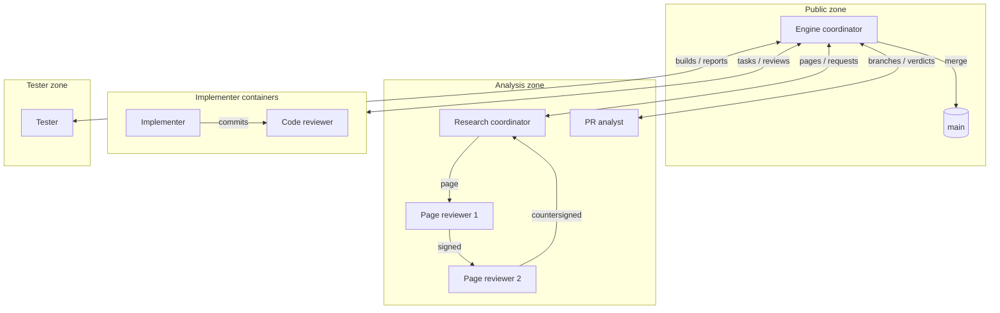

# How the roles run

Coney's work moves through a chain of roles, each running as its own session in its own zone (see
[the clean room](clean-room.md)). This page describes how that chain runs on its own: how each role learns there is
work for it, and what still needs a person.

## No messages between roles

Sessions in different zones never send each other messages. A message is free text, and free text from the analysis
side could carry the original's code across. Instead, every handoff is a file in a known place, with a fixed format
that is checked before anyone acts on it:

- a research page waiting in the gate for a reviewer's signature;
- a signed page bundle waiting in the outbox to be imported;
- a research request or a status file in the queue;
- a build waiting for the tester, a tester report, a PR analyst's signed verdict.

## Inboxes and waking

Each role that runs continuously has an **inbox**: one command, `coney-tools inbox --role <role>`, that reads only
the places that role may see and lists what waits for it. It prints ids, states and counts, never the content of a
page, and exits with status 1 when something needs that role.

Each zone's session runs Coney's zone mod ([mods/coney-zone](../mods/coney-zone/README.md)). It reads the zone's
status locally every few seconds, shows it in a pane (the role, its inbox by state, the walls), and wakes the session
only when the work waiting for its role changes. The session then acts on what it finds by following its written
**brief**, and goes quiet until it is woken again: no session spends anything while nothing happens, and work moves
on within seconds of the role before it finishing. A role whose own work goes on between inbox items, such as the
research coordinator working down its research list, names `idle_wake_minutes` in the role table: the mod also wakes
it once it has been idle that long with none of its subagents at work.

| Role | Zone | Its inbox holds | It acts by |
| --- | --- | --- | --- |
| Research coordinator | analysis | research requests (new and accepted), pages back from the reviewers | dispatching analysts, placing pages in the gate, publishing signed pages |
| Page reviewer 1 and 2 | analysis (read only) | pages waiting for their signature | signing, countersigning or declining |
| Engine coordinator | public | new page bundles, answered and declined research requests, tester reports, verdicts, finished tasks | importing pages, filing implementers' questions as requests, starting containers, staging builds, opening pull requests |
| PR analyst (dispatched by the research coordinator) | analysis | engine branches waiting for a verdict | signing a similarity verdict |
| Tester | tester | builds waiting to be tested | running the acceptance checks and filing a checked report |
| Implementer, code reviewer | container | the one task they were started for | writing and reviewing that task's code |

Implementers and code reviewers do not wait on a timer: the engine coordinator starts one for each task, and it stops
when the task is done.

## What stays with a person

Some steps are reserved for the maintainers on purpose: starting each zone's session (every zone account's password
is typed each time and never stored), changing who may sign (the `allowed_signers` list), the decisions recorded in
the project's plan, and anything a role stops and escalates. Every check that runs on a timer also runs before a push
and again in CI, so the chain never depends on a session doing its job.
